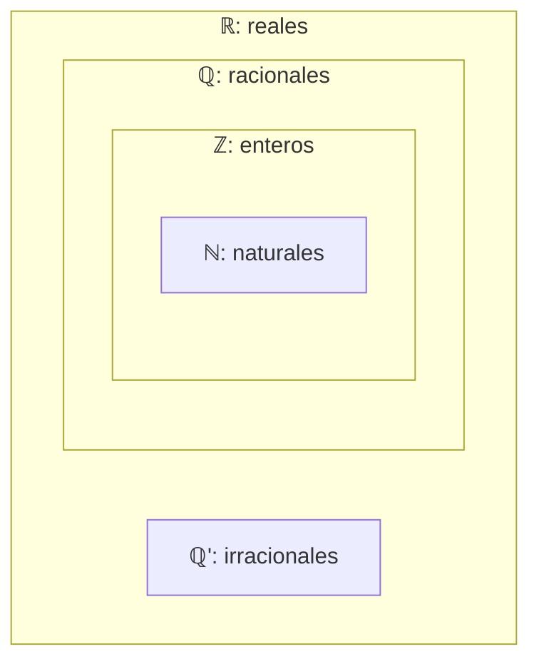

# Clase 12 — Conjuntos

> **Fecha**: 13/10/2026, 15/10/2026 · **Modalidad**: Virtual sincrónica · **Apuntes**: [Diapositivas PDF](./apuntes_clase12.pdf) · [PPT](./apuntes_clase12.pptx) · [Manuscrito anotado](./apuntes_clase12_annotated.pdf)
>
> La sesión del 13/10 cubre las págs. 1–19 del manuscrito; la del 15/10, las págs. 20–47 (marca «Fin: 13/10/2026 · Inicio: 15/10/2026» en la pág. 20).

## Objetivos de la clase

- Iniciar el tema 3 del curso (conjuntos y relaciones) con la noción intuitiva de conjunto, elemento y pertenencia.
- Presentar las dos formas de representar un conjunto (por extensión y por comprensión) y su representación gráfica con diagramas de Venn.
- Definir las relaciones entre conjuntos (igualdad, subconjunto, subconjunto propio y conjuntos disyuntos) con la lógica cuantificacional, y presentar los tipos de conjuntos, la cardinalidad y el conjunto potencia.
- Recoger la retroalimentación del segundo parcial y acordar cómo seguir el curso ante la anormalidad académica y las asambleas estudiantiles.

## Resumen

La sesión del 13/10 empezó con la retroalimentación del segundo parcial y los avisos sobre la situación de la universidad. Después se introdujo la teoría de conjuntos: conjunto, elemento, pertenencia, representación por extensión y por comprensión (con ejemplos de conjuntos numéricos) y diagramas de Venn. En la sesión del 15/10 se vieron las relaciones entre conjuntos, los tipos de conjuntos, la cardinalidad y el conjunto potencia.

## Agenda

**Sesión 1 — 13/10/2026**

1. Avisos: retroalimentación del segundo parcial, presentación pendiente, quizzes, bonus por lectura y parciales 3 y 4. [*(→ Evaluación)*](#evaluación)
2. Anormalidad académica, asamblea del 15/10 y comunicación por el foro. [*(→ Medios de comunicación)*](#medios-de-comunicación)
3. Contextualización: qué es un conjunto. [*(→ sección 1)*](#1-contextualización)
4. Origen y utilidad de los conjuntos: Georg Cantor y la teoría ingenua. [*(→ sección 2)*](#2-origen-y-utilidad-de-los-conjuntos)
5. Conjunto, elemento y pertenencia. [*(→ sección 3)*](#3-conjunto-elemento-y-pertenencia)
6. Representación por extensión y por comprensión. [*(→ sección 4)*](#4-representación-por-extensión-y-por-comprensión)
7. Ejemplos: vocales, enteros y conjuntos numéricos. [*(→ sección 5)*](#5-ejemplos-de-representación)
8. Representación gráfica y diagramas de Venn. [*(→ sección 6)*](#6-representación-gráfica-y-diagramas-de-venn)

**Sesión 2 — 15/10/2026**

1. Aviso: la clase se dicta con normalidad; relatoría de la asamblea. [*(→ Medios de comunicación)*](#medios-de-comunicación)
2. Relaciones entre conjuntos; igualdad y diferencia. [*(→ sección 7)*](#7-igualdad-y-diferencia-entre-conjuntos)
3. Subconjuntos. [*(→ sección 8)*](#8-subconjuntos)
4. Subconjunto propio. [*(→ sección 9)*](#9-subconjunto-propio)
5. Relaciones en términos de subconjuntos: dos demostraciones. [*(→ sección 10)*](#10-relaciones-en-términos-de-subconjuntos)
6. Conjuntos disyuntos. [*(→ sección 11)*](#11-conjuntos-disyuntos)
7. Tipos de conjuntos: vacío, finito, infinito, unitario, universal, homogéneo y heterogéneo. [*(→ sección 12)*](#12-tipos-de-conjuntos)
8. Cardinalidad. [*(→ sección 13)*](#13-cardinalidad)
9. Conjunto potencia. [*(→ sección 14)*](#14-conjunto-potencia)

## Contenido temático

> [!NOTE]
> **Cómo leer este apunte.**
>
> - Las secciones numeradas siguen el orden en que se dictó la clase.
> - **Sesión 1 (13/10), secciones 1 a 6**: manuscrito, págs. 1–19.
> - **Sesión 2 (15/10), secciones 7 a 14**: manuscrito, págs. 20–47.
> - Donde el manuscrito tiene un error, se transcribe tal cual y se explica en una advertencia, con la versión corregida.
> - Los párrafos que empiezan con *Aclaración del apunte* se agregaron al redactar: no se dijeron en clase. Sirven para conectar ideas o evitar confusiones.

**Notación usada en este apunte**

| Símbolo | Se lee | Observación |
|---|---|---|
| `A`, `B`, `C` | conjuntos | Se nombran con letras mayúsculas. |
| `a`, `b`, `x` | elementos | Se nombran con letras minúsculas. |
| `∈` / `∉` | "pertenece a" / "no pertenece a" | Relación entre un **elemento** y un **conjunto**: `h ∈ S`. |
| `{ }` | llaves | Encierran los elementos de un conjunto. |
| `\|` o `:` | "tal que" | Separador en la representación por comprensión: `{x ∈ D \| P(x)}`. |
| `=` / `≠` | "es igual a" / "es diferente de" | Entre conjuntos (sección 7). |
| `⊆` / `⊈` | "es subconjunto de" / "no es subconjunto de" | Relación entre **dos conjuntos** (sección 8). |
| `⊇` | "es superconjunto de" | `B ⊇ A` dice lo mismo que `A ⊆ B`. |
| `⊂` / `⊄` | "es subconjunto propio de" / "no es subconjunto propio de" | Sección 9. En algunos libros, `⊂` se usa para cualquier subconjunto; en este curso, `⊂` es siempre subconjunto **propio** y `⊆` es subconjunto. |
| `∅` | conjunto vacío | El conjunto sin elementos: `∅ = { }`. No es lo mismo que `{∅}` (sección 12). |
| `∩` | intersección | Los elementos comunes a dos conjuntos. Aparece en la definición de conjuntos disyuntos (sección 11); las operaciones entre conjuntos se ven en la próxima clase. |
| `U` | conjunto universal | Contiene todos los elementos del contexto (sección 12). |
| `\|A\|`, `n(A)`, `card(A)` | cardinalidad de A | Número de elementos de A (sección 13). |
| `𝒫(A)` | conjunto potencia de A | Conjunto de todos los subconjuntos de A (sección 14). |
| `ℕ`, `ℤ`, `ℤ⁺`, `ℚ`, `ℝ`, `ℝ⁺` | conjuntos numéricos | Naturales (incluye el 0), enteros, enteros positivos, racionales, reales, reales positivos (sección 5). |
| `⇔` | "si y solo si" | Une dos afirmaciones que dicen lo mismo. En las definiciones formales, el lado izquierdo es una relación entre conjuntos y el derecho, una fórmula de la lógica cuantificacional (secciones 7 a 11). |

### 1. Contextualización

El profesor partió de un ejemplo cotidiano, el **juego de cubiertos** de la casa (pág. 2):

- **Tiene varios elementos**: cucharas, tenedores, cuchillos.
- **Los elementos están agrupados** en un lugar común (soporte, cajón, caja, etc.).
- **Pertenencia**: define si un elemento forma parte o no de ese juego de cubiertos.

Un conjunto no es más que una **agrupación de elementos**, y esta noción puede extenderse más allá de los cubiertos (pág. 3). En clase se anotó que esta idea intuitiva se precisa a continuación con términos formales (matemáticos).

Ejemplos de conjuntos según el contexto (págs. 4–5):

| Contexto | Conjunto | Un elemento |
|---|---|---|
| Los Simpson | `Simpsons = {Homero, Marge, Bart, Lisa, Maggie}` | Maggie |
| Los Transformers | `Autobots = {Optimus, Bumblebee, Ratchet, …}` | Optimus |
| Los Power Rangers | `PowerRangers = {Jason, Trini, Zack, Kimberly, Billy, Tommy}` | Zack (en clase: `Zack ∈ PR`) |
| Los números enteros | `ℤ = {…, −2, −1, 0, 1, 2, …}` | 0 |
| Las onomatopeyas | `Golpes = {bang!, pow!, sock!, …}` (onomatopeyas de Batman) | bang! |

En la pág. 5, el contexto de la diapositiva decía "Los números reales" y se corrigió a mano por "Enteros", que es el conjunto que muestra la fila.

### 2. Origen y utilidad de los conjuntos

**Georg Cantor (1845–1918)** es considerado el padre de la teoría de conjuntos, formulada a finales del siglo XIX (pág. 6). Es importante porque:

- Formalizó la idea de agrupar objetos matemáticos.
- Revolucionó las matemáticas al demostrar que existen "diferentes tamaños" de infinito.
- Su teoría ingenua es la base de la lógica matemática y de las bases de datos modernas.

El profesor recomendó el video [*El Hombre Que Casi Rompe Las Matemáticas (Y a Sí Mismo...)*](https://www.youtube.com/watch?v=8MGbGsihe3k), enlazado en la diapositiva.

**Para qué sirven los conjuntos** (pág. 7):

- Son uno de los componentes básicos de los objetos que se estudian en matemáticas discretas. Son importantes para el **conteo**, y los lenguajes de programación tienen operaciones con conjuntos (en clase se anotó el tipo `set` de Python). El profesor mencionó su relación con materias posteriores del programa, como bases de datos y programación orientada a objetos.
- La teoría de conjuntos es una rama importante de las matemáticas, desarrollada con diversos sistemas de axiomas. En esta clase se trabaja la **teoría de conjuntos ingenua**, que explora la noción de conjunto desde un punto de vista intuitivo, no axiomático.

### 3. Conjunto, elemento y pertenencia

Dos conceptos clave (pág. 8):

- **Conjunto**: una **colección no ordenada de objetos distintos**. Los objetos contenidos en un conjunto son sus **elementos** o miembros.
- **Elemento**: cada uno de los **objetos individuales** que forman parte de un conjunto.

"No ordenada" y "objetos distintos" tienen consecuencias que se precisan en la [sección 4](#4-representación-por-extensión-y-por-comprensión): el orden en que se listan los elementos no importa, y repetir un elemento no cambia el conjunto.

Ejemplos anotados en clase: la familia Simpson es el conjunto y Maggie uno de sus elementos (`Maggie ∈ Simpsons`); en un selector de colores, el verde es un elemento del conjunto de colores; en programación, un arreglo de enteros llamado `altitudes` agrupa valores como 10, −8, 22 y 57.

*Aclaración del apunte:* el arreglo ilustra la idea de **agrupar** elementos, pero no es un conjunto en el sentido de esta clase: un arreglo (o una lista) guarda el orden de sus elementos y admite repetidos, mientras que un conjunto es una colección **no ordenada** de objetos **distintos**. La estructura de programación que se comporta como un conjunto es la que se anotó en la [sección 2](#2-origen-y-utilidad-de-los-conjuntos): el tipo `set` de Python.

> [!NOTE]
> En clase surgió la pregunta de si se entendía la diferencia entre conjunto y elemento. El profesor precisó que el conjunto es la agrupación completa (por ejemplo, la familia Simpson), mientras que un elemento es cada miembro individual que la compone (por ejemplo, Maggie).

**Notación básica** (pág. 9):

- Los conjuntos se representan con **letras mayúsculas** (`A`, `B`, `C`, etc.) y sus elementos con **letras minúsculas** (`a`, `b`, `c`, etc.).
- **Pertenencia** (`∈`): para decir que el elemento `a` **es** un miembro del conjunto `A` se escribe `a ∈ A`.
- **No pertenencia** (`∉`): para decir que el elemento `a` **no está** en el conjunto `A` se escribe `a ∉ A`.

Ejemplo: sea `S` el conjunto asociado a la familia Simpson, `h` el elemento que representa a Homero Simpson y `p` el elemento asociado a Peter Griffin (de *Padre de familia*). Entonces `h ∈ S` y `p ∉ S`.

### 4. Representación por extensión y por comprensión

Existen dos formas de representar un conjunto (págs. 10–11). El profesor las presentó con un mismo ejemplo: sea `G` el conjunto asociado a la familia Griffin y `P` el conjunto de todos los personajes del programa *Padre de familia*.

1. **Notación por extensión**: se lista cada uno de los elementos que pertenecen al conjunto.

   `G = {Peter, Lois, Meg, Chris, Stewie, Brian}`

2. **Notación por comprensión**: se especifica la **característica común** de los elementos que lo conforman (en clase se anotó: un **predicado**). Con el predicado `M(x)`: "x es un miembro de la familia Griffin":

   `G = {x ∈ P | x es un miembro de la familia Griffin} = {x ∈ P | M(x)}`

**Representación por extensión** (*set-roster*) (pág. 12). Los elementos se listan entre llaves `{ }`:

- Cada elemento listado se separa por comas: `S = {a, b, c, d}`.
- **El orden no importa**: `S = {a, b, c, d} = {b, c, a, d}`.
- Los conjuntos se definen por los **elementos que contienen**, no por el orden ni por la cantidad de veces que se repiten: `S = {a, b, c, d} = {a, b, c, b, c, d}`.
- Los **puntos suspensivos** (`…`) pueden usarse para describir un conjunto sin enumerar todos sus miembros cuando el patrón es claro: `S = {a, b, c, d, …, z}`, `ℤ = {…, −1, 0, 1, …}`, `ℕ = {0, 1, 2, …}`.
- Esta representación es útil cuando el conjunto es **finito y pequeño**.

**Representación por comprensión** (*set-builder*) (pág. 13). El conjunto se define indicando una **propiedad o condición que deben cumplir sus elementos**, en lugar de enumerarlos uno por uno. Estructura general:

`A = {x ∈ D | condición que cumple x} = {x ∈ D | P(x)} = {x | P(x)}`

donde:

- `A`: nombre del conjunto.
- `x`: variable que representa los elementos.
- `D`: dominio o universo de discurso.
- Separador (`|` o `:`): "tal que".
- `P(x)`: condición que debe cumplir el elemento para pertenecer al conjunto.

Esta representación es ideal para **conjuntos infinitos o muy grandes** y para expresar condiciones más complejas. Ejemplos anotados en clase: `A = {x ∈ ℝ | x² < 9}` y `B = {x ∈ ℝ | x es primo}`.

El profesor relacionó la condición `P(x)` con los predicados de la lógica cuantificacional ([clase 7](../clase-07/README.md)).

*Aclaración del apunte:* el dominio `D` cumple el papel del universo de discurso, y `P(x)` es una función proposicional que cada elemento del dominio hace verdadera o falsa. El conjunto está formado por los elementos del dominio que la hacen verdadera.

**Comparación** (pág. 14):

| Característica | Por extensión | Por comprensión |
|---|---|---|
| Descripción | Enumera todos los elementos del conjunto | Describe los elementos mediante una propiedad o condición |
| Forma general | `A = {a, b, c, d, …}` | `A = {x ∈ D \| P(x)}` |
| Uso principal | Conjuntos pequeños y finitos | Conjuntos grandes o infinitos, o con reglas definidas |
| Ejemplo: vocales | `V = {a, e, i, o, u}` | `V = {x \| x es una vocal}` |
| Ejemplo: números positivos pares menores que 10 | `P = {2, 4, 6, 8}` | `P = {x \| (x es un número par) y (x < 10)}` |

*Aclaración del apunte:* en el último ejemplo, la representación por comprensión de la diapositiva no dice que `x` sea **positivo** ni cuál es el dominio. Leída al pie de la letra, también la cumplen el 0, el −2, el −4, etc., y entonces no describe el mismo conjunto que `{2, 4, 6, 8}`. Para que ambas representaciones coincidan, la condición debe incluir todo lo que dice el enunciado, por ejemplo `P = {x ∈ ℤ | (x es par) ∧ (x > 0) ∧ (x < 10)}`. Compare con el ejercicio 1b de la [sección 5](#5-ejemplos-de-representación): allí se fijó el dominio `ℕ`, y como el 0 no es impar, la condición `(x es impar) ∧ (x < 10)` sí da exactamente `{1, 3, 5, 7, 9}`.

### 5. Ejemplos de representación

**Ejercicio 1** (pág. 15): escriba los siguientes conjuntos empleando las notaciones por extensión y por comprensión.

| Conjunto | Por extensión | Por comprensión |
|---|---|---|
| a. Todas las vocales | `V = {a, e, i, o, u}` | `V = {x ∈ A \| x es una vocal} = {x ∈ A \| vocal(x)}`, con `A`: abecedario y `vocal(x)`: "x es una vocal" |
| b. Los enteros positivos impares menores que 10 | `P = {9, 7, 5, 3, 1}` | `P = {x ∈ ℕ \| (x es impar) ∧ (x < 10)} = {x ∈ ℕ \| I(x) ∧ (x < 10)}`, con `I(x)`: "x es impar" |
| c. Los enteros positivos menores que 100 | `B = {99, 98, 97, …, 1} = {1, 2, …, 99}` | `B = {x ∈ ℤ \| 1 ≤ x ≤ 99}` |
| d. Los enteros menores que 100 | `C = {…, 98, 99} = {…, −1, 0, 1, …, 98, 99}` | `C = {x ∈ ℤ \| x < 100}` |

> [!NOTE]
> Un estudiante preguntó si, para el ejercicio 1c, la representación por extensión se escribe listando desde 1 hasta 99 con puntos suspensivos. El profesor respondió que sí, y que se puede escribir tanto `{1, 2, …, 99}` como `{99, 98, …, 1}`, porque el orden no importa ([sección 4](#4-representación-por-extensión-y-por-comprensión)).

**Ejercicio 2** (pág. 16): ¿cuál es la notación por extensión y por comprensión de los diferentes conjuntos numéricos dentro del campo de los reales?

| Conjunto | Por extensión | Por comprensión |
|---|---|---|
| a. Números naturales | `ℕ = {0, 1, 2, …}` | `ℕ = {x ∈ ℤ \| x ≥ 0}` |
| b. Números enteros | `ℤ = {…, −2, −1, 0, 1, 2, …}` | `ℤ = {x ∈ ℝ \| no tienen parte decimal}` |
| c. Números enteros positivos | `ℤ⁺ = {1, 2, …}` | `ℤ⁺ = {x ∈ ℤ \| x > 0}` |
| d. Números racionales | Solo se insinuó con algunos valores (−0.5, 0, 2, …): no hay un patrón sencillo para listarlos con puntos suspensivos | `ℚ = {x ∈ ℝ \| x = p/q ∧ p ∈ ℤ ∧ q ∈ ℤ ∧ q ≠ 0}` |
| g. Números reales positivos | — | `ℝ⁺ = {x ∈ ℝ \| x > 0}` |

Para los ítems e y f no se escribió una representación por extensión ni por comprensión:

- e. **Números irracionales**: `ℚ' = ℝ − ℚ`, los reales que no son racionales. El signo `−` entre conjuntos (diferencia) se verá con las operaciones entre conjuntos.
- f. **Números reales**: `ℝ`, que en notación de intervalo es `(−∞, ∞)`.

El ítem h (números complejos) se tachó en clase: no se trabajó.

> [!NOTE]
> En clase surgió la pregunta de si el 0 pertenece a los enteros positivos. El profesor respondió que no: el 0 no es positivo ni negativo. Por eso `ℤ⁺ = {x ∈ ℤ | x > 0}` empieza en 1, mientras que `ℕ` (según la convención del curso) sí incluye el 0.

> [!NOTE]
> Un estudiante preguntó si, para la representación por comprensión de los racionales, no sería mejor definir `p` y `q` por fuera y luego escribir `ℚ = {x ∈ ℝ | x = p/q}`. El profesor respondió que sí, que esa forma es incluso más precisa, y reconoció que la definición de la diapositiva no es la versión rigurosa: lo importante es que la idea quede bien expresada, y para mayor rigor recomendó consultar un libro de álgebra o de análisis matemático.

*Aclaración del apunte:* la idea es que un racional es un número que **se puede escribir** como un cociente de enteros. Tal como está escrita, la condición de la diapositiva usa `p` y `q` sin decir de dónde salen (son variables libres, como en la [clase 7](../clase-07/README.md)), y lo mismo pasa con la propuesta del estudiante. Con la lógica cuantificacional del curso, esa idea se expresa con dos cuantificadores existenciales: `ℚ = {x ∈ ℝ | ∃p ∃q (p ∈ ℤ ∧ q ∈ ℤ ∧ q ≠ 0 ∧ x = p/q)}`, que se lee "los reales `x` para los que existen enteros `p` y `q`, con `q ≠ 0`, tales que `x = p/q`".

En la pág. 16, el profesor dibujó cómo se contienen estos conjuntos (figura de clase):

### 6. Representación gráfica y diagramas de Venn

La **representación gráfica** permite visualizar los elementos, las relaciones entre conjuntos y operaciones como unión, intersección y diferencia. Dependiendo del tipo de conjunto, existen diferentes formas de representarlo gráficamente (pág. 17):

| Tipo de conjunto | Representación |
|---|---|
| Conjuntos finitos | Diagrama de Venn, listado |
| Conjuntos numéricos reales | Recta numérica, intervalos |
| Pares ordenados / relaciones | Plano cartesiano |
| Complejos | Plano complejo (Argand) |
| Conjuntos con pasos/ramas | Árbol de decisiones |

La forma más común y visual de representar los conjuntos y sus relaciones es mediante los diagramas de **Venn-Euler**, comúnmente llamados **diagramas de Venn**, por John Venn (pág. 18). Se caracterizan porque (pág. 19):

1. Permiten ilustrar la relación entre conjuntos.
2. Cada conjunto se representa con una **figura cerrada** (generalmente un círculo).
3. Si se tienen dos o más conjuntos, en las **intersecciones** de los círculos se ubican los elementos que hacen parte de más de un conjunto a la vez.
4. Facilitan el entendimiento de la teoría de conjuntos.

En clase se anotó: **el contexto es importante**. Los ejemplos de la diapositiva dibujan los conjuntos dentro de un rectángulo que representa el universo `U`: con `U` = medios de transporte, los conjuntos de aviones y de trenes; con `U` = *Cats* (felinos), el conjunto de leones, y también los conjuntos de tigres y de leones. El profesor insistió en que, sin saber cuál es el conjunto universal, no se puede interpretar correctamente un diagrama de Venn (el conjunto universal se define en la [sección 12](#12-tipos-de-conjuntos)).

### 7. Igualdad y diferencia entre conjuntos

La sesión del 15/10 empezó con las **relaciones entre conjuntos**, que se dan cuando se comparan las características de dos o más conjuntos y se establece una correspondencia entre ellos (pág. 20): igualdad, subconjuntos, subconjunto propio y conjuntos disyuntos. La diapositiva las ilustra con cuatro diagramas de Venn: un solo círculo `A = B`, dos círculos separados, dos círculos que se cortan, y un círculo `B` dentro de otro `A`. El profesor indicó que, en el curso, la representación gráfica de los conjuntos se limitará a los diagramas de Venn, por ser la forma más sencilla.

**Igualdad** (pág. 21). Dos conjuntos son iguales si tienen **exactamente los mismos elementos**, sin importar el orden ni la repetición.

- Notación: `A = B`
- Definición formal: `A = B ⇔ ∀x (x ∈ A ↔ x ∈ B)`

Ejemplos (pág. 22):

1. Si `A = {1, 2, 3}` y `B = {3, 2, 1}`, como los elementos de ambos conjuntos son los mismos, independientemente del orden, `A = B`.
2. Sea `C = {3, 5, 1}` y `D = {1, 5, 5, 5, 3, 3, 1} = {1, 5, 3}`; por lo tanto es válido afirmar que `C = D`.

**Diferencia** (pág. 23). Dos conjuntos **son diferentes** cuando no tienen exactamente los mismos elementos; en otras palabras, cuando hay **al menos un elemento que está en uno y no está en el otro**:

`A ≠ B ⇔ ∃x (x ∈ A ↔ x ∉ B)`

*Aclaración del apunte:* la fórmula `x ∈ A ↔ x ∉ B` es verdadera exactamente cuando `x` está en uno de los dos conjuntos y no en el otro: si `x ∈ A`, entonces `x ∉ B`, y si `x ∉ A`, entonces `x ∈ B`. Por eso dice lo mismo que la frase de la diapositiva. Es la negación de la definición de igualdad: no todos los elementos cumplen `x ∈ A ↔ x ∈ B`.

**Ejemplo** (pág. 23): dados los siguientes conjuntos, explore las relaciones de igualdad y diferencia.

- `A = {1, 2, 3}`
- `B = {1, 2, 2, 3, 4} = {1, 2, 3, 4}`
- `C = {1, 3}`
- `D = {3, 3, 2, 1} = {3, 2, 1}`

| Iguales | Diferentes |
|---|---|
| `A = D` | `A ≠ C`, `D ≠ C`, `B ≠ A`, `B ≠ D`, `B ≠ C` |

En el manuscrito, los rótulos "Iguales" y "Diferentes" quedaron intercambiados (las desigualdades bajo "Iguales" y `A = D` bajo "Diferentes"); aquí se presentan en su lugar. El diagrama de la pág. 23 dibuja `C` dentro de `A = D`, y este dentro de `B`.

### 8. Subconjuntos

**Subconjunto** (pág. 24). Un subconjunto es un conjunto cuyos elementos están contenidos completamente dentro de otro conjunto. En otras palabras, si todos los elementos de un conjunto `A` también están en un conjunto `B`, entonces `A` es un subconjunto de `B`.

- Notación: `A ⊆ B`
- Definición formal: `A ⊆ B ⇔ ∀x (x ∈ A → x ∈ B)`

Ejemplos (pág. 25):

1. Si `A = {1, 2}` y `B = {1, 2, 3}`, como se cumple que `∀x (x ∈ A → x ∈ B)`, podemos decir que `A ⊆ B`. En clase se anotó además `A ⊆ B ↔ B ⊇ A` y `B ⊈ A`.
2. Sea `F` el conjunto de los fines de semana y `S` el de los días de la semana: `F = {sábado, domingo}` y `S = {lunes, martes, miércoles, jueves, viernes, sábado, domingo}`, de modo que `F ⊆ S`. En clase se anotó `F ⊆ S ↔ S ⊇ F` y `S ⊈ F`.

> [!NOTE]
> En clase surgió la pregunta de si la relación de subconjunto es conmutativa. El profesor respondió que no: si `A ⊆ B`, no se puede afirmar que `B ⊆ A`, porque `B` puede tener elementos que no están en `A`. En el ejemplo 2, `F ⊆ S`, pero `S ⊈ F`: el lunes está en `S` y no en `F`.

**Conclusiones importantes** (pág. 26):

- Un conjunto `A` **no es subconjunto** de `B` si y solo si hay al menos un elemento que se encuentra en `A` pero no está en `B`:

  `A ⊈ B ⇔ ∃x (x ∈ A ∧ x ∉ B)`

  La diapositiva lo ilustra con tres diagramas: dos círculos separados, dos círculos que se cortan, y un círculo `B` dentro de `A`. En los tres, `A ⊈ B`: siempre hay una parte de `A` fuera de `B`.
- Decir que `A` es subconjunto de `B` es lo mismo que decir que `B` es **superconjunto** de `A`, pues decir que todos los elementos de `A` están en `B` es lo mismo que decir que `B` contiene a todos los elementos de `A`: `A ⊆ B ⇔ B ⊇ A`.

*Aclaración del apunte:* la fórmula de `A ⊈ B` es la negación de la definición de `A ⊆ B`, con las leyes de De Morgan para cuantificadores de la [clase 9](../clase-09/README.md): `¬∀x (x ∈ A → x ∈ B) ≡ ∃x ¬(x ∈ A → x ∈ B) ≡ ∃x (x ∈ A ∧ x ∉ B)`.

**Ejemplo** (pág. 27): para cada uno de los siguientes escenarios, determine la relación existente entre los conjuntos. Esta es la transcripción del manuscrito:

| Caso | Conjuntos | Diagrama (manuscrito) | Respuesta (manuscrito) |
|---|---|---|---|
| 1 | `A = {1, 2, 3}`, `B = {4, 5, 6}` | Dos círculos separados | `A ≠ B; A ⊈ B` |
| 2 | `A = {1, 2, 3}`, `B = {2, 3, 4}` | Dos círculos que se cortan: 2 y 3 en la intersección, 1 solo en `A`, 4 solo en `B` | `A ≠ B; A ⊆ B` |
| 3 | `A = {1, 2, 3, 4}`, `B = {2, 3}` | `B` dentro de `A` | `A ≠ B, B ⊆ A` |

> [!WARNING]
> **Error del profesor en clase.** En el Caso 2, la respuesta `A ⊆ B` es incorrecta. Para que `A ⊆ B`, **todos** los elementos de `A` deben estar en `B`, y el 1 está en `A` pero no en `B`. Por la conclusión de la pág. 26, `A ⊈ B ⇔ ∃x (x ∈ A ∧ x ∉ B)`, y ese `x` es el 1. El propio diagrama del manuscrito lo muestra: el 1 queda en la parte de `A` que está fuera de `B`. Tampoco `B ⊆ A`, porque el 4 está en `B` y no en `A`. La respuesta correcta del Caso 2 es: **`A ≠ B; A ⊈ B; B ⊈ A`**.

> [!TIP]
> **Moraleja.** Antes de escribir `A ⊆ B`, busque un elemento de `A` que no esté en `B`. Si lo encuentra, `A ⊈ B`. En un diagrama de Venn, `A ⊆ B` solo cuando el círculo de `A` queda **completo** dentro del de `B`: compartir algunos elementos (círculos que se cortan) no basta.

### 9. Subconjunto propio

**Definición** (pág. 28). El conjunto `A` es subconjunto propio del conjunto `B` si:

1. `A` es subconjunto de `B`, es decir: `A ⊆ B`.
2. `A` es diferente de `B`, o sea: `A ≠ B`.

En otras palabras, `A` es subconjunto propio de `B` si `B` tiene al menos un elemento que no está en `A`. Esto, formalmente, se expresa así (transcripción de la diapositiva):

`A ⊂ B ⇔ ∀x (x ∈ A → x ∈ B) ∧ ∃x (x ∈ A ∧ x ∉ B)`

En clase se anotó, bajo la primera parte, "`A ⊆ B`"; bajo la segunda, "`A ≠ B`"; y al lado, `≡ (A ⊆ B) ∧ (A ≠ B)`.

> [!WARNING]
> **Error del profesor en clase.** La segunda parte de la fórmula está al revés. `∃x (x ∈ A ∧ x ∉ B)` dice que hay un elemento de `A` que **no está en `B`**, y eso contradice la primera parte, que dice que todos los elementos de `A` están en `B`. Por eso, tal como está escrita, la fórmula es **siempre falsa**: ningún conjunto sería subconjunto propio de otro, ni siquiera en el ejemplo de la pág. 29 (`A = {1, 2}`, `B = {1, 2, 3}`), donde no hay ningún elemento de `A` fuera de `B`. Lo que la prosa de la misma diapositiva pide es que **`B` tenga al menos un elemento que no está en `A`**. La definición correcta es:
>
> `A ⊂ B ⇔ ∀x (x ∈ A → x ∈ B) ∧ ∃x (x ∈ B ∧ x ∉ A)`
>
> En el ejemplo de la pág. 29, ese elemento es el 3. La anotación "`A ≠ B`" de la clase sí describe bien lo que esa parte debía expresar: cuando ya se sabe que `A ⊆ B`, que `A` y `B` sean diferentes equivale a que `B` tenga un elemento fuera de `A`.

> [!TIP]
> **Moraleja.** Compruebe cada definición formal con el ejemplo de la clase: si una fórmula que pretende definir algo da falso en el ejemplo que debería cumplirla, la fórmula está mal. Al traducir "B tiene un elemento que no está en A", el elemento debe estar en `B` (`x ∈ B`) y no en `A` (`x ∉ A`).

**Negación** (pág. 28). Si se niega la expresión anterior, un subconjunto no es subconjunto propio de otro cuando:

`A ⊄ B ⇔ ∃x (x ∈ A ∧ x ∉ B) ∨ ∀x (x ∈ B → x ∈ A)`

El profesor mencionó que esta negación se obtiene con las leyes de De Morgan y las equivalencias de cuantificadores de la unidad anterior.

*Aclaración del apunte:* esta negación es correcta, pero como negación de la definición **corregida**: por De Morgan, `¬[∀x (x ∈ A → x ∈ B) ∧ ∃x (x ∈ B ∧ x ∉ A)]` da `∃x (x ∈ A ∧ x ∉ B) ∨ ∀x (x ∈ B → x ∈ A)`. Se lee: o bien `A` no es subconjunto de `B`, o bien `B ⊆ A` (y entonces, si además `A ⊆ B`, son iguales).

**Ejemplo** (pág. 29): si `A = {1, 2}` y `B = {1, 2, 3}`, como `A ⊆ B` y el número de elementos de `A` es menor que el de `B` (o `B` tiene elementos que `A` no tiene), podemos decir que `A ⊂ B`. En clase: (1) `A ⊆ B` y (2) `A ≠ B`, luego `A ⊂ B`.

### 10. Relaciones en términos de subconjuntos

Las relaciones anteriores se pueden expresar en términos de subconjuntos (pág. 30):

| Relación | Expresión en términos de subconjuntos |
|---|---|
| Igualdad | `A = B ⇔ (A ⊆ B) ∧ (B ⊆ A)` |
| Diferencia | `A ≠ B ⇔ (A ⊈ B) ∨ (B ⊈ A)` |
| Subconjunto propio | `A ⊂ B ⇔ (A ⊆ B) ∧ (A ≠ B)` |

> [!IMPORTANT]
> El profesor aclaró que las dos demostraciones de esta sección no entran al parcial, porque corresponden a un nivel más avanzado, propio de los primeros semestres de la carrera de Matemáticas.

**Ejemplo: igualdad** (pág. 31). Aplicando los conceptos de lógica cuantificacional y las definiciones de conjuntos vistas, demuestre la equivalencia para la igualdad de la tabla anterior: `A = B ⇔ (A ⊆ B) ∧ (B ⊆ A)`. Se parte del lado izquierdo de la equivalencia y se llega al derecho:

| # | Afirmación | Razón |
|---|---|---|
| 1 | `A = B` | Premisa (lado izquierdo) |
| 2 | `∀x (x ∈ A ↔ x ∈ B)` | Definición de igualdad entre conjuntos |
| 3 | `∀x ((x ∈ A → x ∈ B) ∧ (x ∈ B → x ∈ A))` | Definición de equivalencia en 2 |
| 4 | `∀x (x ∈ A → x ∈ B) ∧ ∀x (x ∈ B → x ∈ A)` | Distributividad del cuantificador en 3 |
| 5 | `∴ (A ⊆ B) ∧ (B ⊆ A)` | Definición de subconjunto en 4 |

En el paso 3, la "definición de equivalencia" es la equivalencia del bicondicional, `P ↔ Q ≡ (P → Q) ∧ (Q → P)` (anotada en clase). En el paso 4, el `∀` se distribuye sobre la conjunción, con la equivalencia `∀x (P(x) ∧ Q(x)) ≡ ∀x P(x) ∧ ∀x Q(x)` de la [clase 9](../clase-09/README.md).

*Aclaración del apunte:* la tabla parte del lado izquierdo como "premisa", pero lo que se demuestra es una **equivalencia** (`⇔`), no solo una implicación. Eso es válido porque cada paso usa una definición o una equivalencia, y ambas valen en los dos sentidos: la cadena también se puede leer de abajo hacia arriba, del lado derecho al izquierdo. Si algún paso usara una regla de inferencia (que solo vale en un sentido, como el Modus Ponens), la tabla demostraría únicamente una implicación. Lo mismo vale para la demostración siguiente.

**Ejemplo: diferencia** (pág. 32). Demuestre la equivalencia para la diferencia de la tabla anterior: `A ≠ B ⇔ (A ⊈ B) ∨ (B ⊈ A)`.

| # | Afirmación | Razón |
|---|---|---|
| 1 | `A ≠ B` | Premisa (lado izquierdo) |
| 2 | `¬(A = B)` | Premisa 1 en términos de la igualdad |
| 3 | `¬(∀x ((x ∈ A → x ∈ B) ∧ (x ∈ B → x ∈ A)))` | Definición de igualdad en 2 |
| 4 | `¬((A ⊆ B) ∧ (B ⊆ A))` | Definición de subconjunto en 3 |
| 5 | `¬(A ⊆ B) ∨ ¬(B ⊆ A)` | Ley de De Morgan en 4 |
| 6 | `∴ (A ⊈ B) ∨ (B ⊈ A)` | Negación en 5 |

*Aclaración del apunte:* esta tabla condensa algunos pasos de la anterior. El paso 3 aplica a la vez la definición de igualdad y la del bicondicional (pasos 2 y 3 de la demostración de la igualdad), y el paso 4 aplica, además de la definición de subconjunto, la distributividad del `∀` (paso 4 de la demostración de la igualdad).

### 11. Conjuntos disyuntos

Dos conjuntos `A` y `B` son **disyuntos** si no tienen ningún elemento en común. En otras palabras, no existe un elemento que pertenezca a `A` y a `B` al mismo tiempo (pág. 33):

`A ∩ B = ∅ ⇔ ∀x (x ∈ A → x ∉ B)`

En un diagrama de Venn, dos conjuntos disyuntos se dibujan como círculos separados, sin parte en común. `A ∩ B` (la intersección, los elementos comunes a `A` y `B`) se estudiará con las operaciones entre conjuntos; aquí basta leer `A ∩ B = ∅` como "`A` y `B` no tienen elementos comunes".

**Ejemplo** (pág. 33): dados los conjuntos `A = {2, 3, 4}`, `B = {5, 6, 7}` y `C = {6, 7, 8}`, ¿cuáles son disyuntos?

1. `A` y `B` son disyuntos.
2. `A` y `C` son disyuntos.
3. `B` y `C` **no** son disyuntos: comparten el 6 y el 7. En el diagrama de clase, el 6 y el 7 quedan en la intersección de `B` y `C`.

### 12. Tipos de conjuntos

Existen diferentes criterios de clasificación de conjuntos; en el curso se profundiza en los siguientes (pág. 34): vacío, finito, infinito, unitario, universal, homogéneo y heterogéneo.

**Conjunto vacío** (págs. 35–36). El conjunto vacío o nulo es un conjunto especial que se caracteriza por no tener ningún elemento.

- Notación: `∅ = { }`
- Definición formal: `∅ = {x | x ∈ A ∧ x ∉ A}`: ningún `x` puede estar y no estar en `A` a la vez.

Ejemplos:

- Los números naturales menores que cero: `A = {x ∈ ℕ | x < 0} = { } = ∅`. En la recta numérica de la clase, `ℕ = {0, 1, 2, 3, …}` no tiene ningún elemento a la izquierda del 0.
- Los meses del año con 32 días: `E = {x ∈ Meses | x tiene 32 días} = { } = ∅`. En clase se hizo la tabla de meses y días: los meses tienen 28 o 29, 30 o 31 días, y ninguno tiene 32.
- Los colores del arco iris que no son colores: `F = { } = ∅`. En clase se anotó `P ∧ ¬P ≡ F`: la condición "ser color y no ser color" es una contradicción, así que ningún elemento la cumple.

**Conjunto finito** (pág. 37). Un conjunto es finito si tiene un número limitado de elementos: se puede determinar la cantidad total de sus elementos y, teóricamente, se podrían listar todos. Ejemplos (con `n` = número de elementos, [sección 13](#13-cardinalidad)):

- Los estudiantes del curso de Discretas 1: `C = {e₁, e₂, …, eᵢ, …, eₙ₋₁, eₙ}`. En clase: `C = {e₁, e₂, …, e₂₉}`, `n = 29`.
- Los días de la semana: `S = {L, M, W, J, V, S, D}`, `n = 7`.
- Los primeros 10 números naturales: `D = {0, 1, 2, 3, 4, 5, 6, 7, 8, 9}`, `n = 10`.

**Conjunto infinito** (pág. 38). Es aquel que tiene un número ilimitado de elementos; por lo tanto, no es posible contar todos sus elementos. Ejemplos:

- El conjunto de los números naturales: `ℕ = {0, 1, 2, 3, …}`.
- Las estrellas del universo: `E = {Sol, Sirio, Arturo, Vega, Canopus, Alfa Centauri, …}`. En clase: `n(E) → ∞`.
- El conjunto de puntos de una recta.

Sobre el infinito, el profesor recordó que Cantor demostró que hay distintos tamaños de infinito ([sección 2](#2-origen-y-utilidad-de-los-conjuntos)), pero que en el curso basta con decir que la cardinalidad es infinita.

**Conjunto unitario** (pág. 39). Es aquel que contiene **exactamente un solo elemento**. Es un tipo de conjunto no vacío y finito.

- Notación: `A = {a}`
- Ejemplos: el conjunto que solo contiene el 7, `A = {7}`; el conjunto que contiene el último día de la semana, `W = {domingo}`; el conjunto que contiene como único elemento al conjunto vacío, `E = {∅}`; el perro de Superman, `P = {Kripto}`.

> [!NOTE]
> En clase surgió la pregunta de si el conjunto que contiene al conjunto vacío es también un conjunto vacío. El profesor respondió que no: `{∅}` tiene exactamente un elemento (el vacío), así que es un conjunto unitario, con cardinalidad 1. En cambio, `∅ = { }` no tiene ningún elemento ([sección 13](#13-cardinalidad)).

**Conjunto universal** (pág. 40). El conjunto universal, denotado comúnmente por `U`, es el conjunto que contiene todos los elementos posibles dentro de un **contexto** o universo de discurso específico.

- Depende del problema o del conjunto de referencia.
- Todos los demás conjuntos del problema se consideran subconjuntos de `U`.

Ejemplos del conjunto universal según el contexto:

| Contexto | Conjunto universal `U` |
|---|---|
| Letras del abecedario | `U = {a, b, c, …, z}` |
| Números naturales menores que 10 | `U = {0, 1, 2, …, 9}` |
| Estudiantes de Matemáticas Discretas 1 | `U = {e₁, e₂, …, eᵢ, …, eₙ₋₁, eₙ}` |
| Palos de una baraja de póker | `U = {♠, ♥, ♦, ♣}` |
| Valores de las cartas de una baraja de póker | `U = {A, 2, 3, 4, 5, 6, 7, 8, 9, 10, J, Q, K}` |

**Conjunto homogéneo** (pág. 41). Todos sus elementos son de la misma naturaleza o tipo. Ejemplos: los días de la semana, `S = {L, M, W, J, V, S, D}`; algunas frutas, `F = {pera, manzana, uva}`; las edades de los estudiantes de Discretas 1, `E = {17, 19, 20, …, 21}`.

*Aclaración del apunte:* en `E`, los puntos suspensivos no siguen un patrón claro (entre 20 y 21 no hay otro entero). Lo que el ejemplo quiere decir es que las edades del grupo van de 17 a 21; por extensión, sin puntos suspensivos, sería algo como `E = {17, 19, 20, 21}`, según las edades reales del grupo. Recuerde que los puntos suspensivos solo se usan cuando el patrón es claro ([sección 4](#4-representación-por-extensión-y-por-comprensión)).

**Conjunto heterogéneo** (pág. 42). Contiene elementos de diferente tipo o categoría. Ejemplos:

- Los elementos de la mochila de un estudiante: `M = {cuaderno, lápiz, lapicero, calculadora, …}`.
- Los personajes de la *Odisea*: `O = {Ulises, Atenea, Polifemo, Escila, Circe, Penélope}`.

En la diapositiva, los elementos están resaltados con colores según su categoría. Por ejemplo, Ulises y Penélope son humanos y Atenea es una diosa.

En este apunte se corrigió la ortografía de dos nombres que la diapositiva escribe «Cirio» (la estrella Sirio, en el ejemplo de conjunto infinito) y «Cirse» (Circe, en el de la *Odisea*).

### 13. Cardinalidad

La **cardinalidad** es una medida del tamaño de un conjunto: es la cantidad de elementos que tiene (pág. 43). Sea `A` un conjunto; su cardinalidad se escribe:

`|A| = card(A) = n(A)`

**Ejemplo** (pág. 44): determine la cardinalidad de cada uno de los siguientes conjuntos.

| Conjunto | Por extensión | Cardinalidad |
|---|---|---|
| `A`: los enteros positivos impares menores que 10 | `A = {1, 3, 5, 7, 9}` | `\|A\| = n(A) = 5` |
| `S`: las letras del alfabeto español | `S = {a, b, …, ñ, …, z}` | `\|S\| = n(S) = 27` |
| El conjunto nulo | `∅ = { }` | `\|∅\| = n(∅) = 0` |
| `B = {∅}` | `B = {∅}` | `\|B\| = n(B) = 1` |
| `C`: los números enteros | `C = {…, −1, 0, 1, …}` | `\|C\| = n(C) = ℵ₀` (`\|C\|` es ∞) |

El símbolo `ℵ₀` (*alef cero*) es el que usa la diapositiva para la cardinalidad de los enteros; en clase se anotó simplemente `n(C) = |C| → ∞`, en línea con lo dicho sobre el infinito en la [sección 12](#12-tipos-de-conjuntos).

Observe las filas de `∅` y de `{∅}`: el primero no tiene elementos; el segundo tiene uno, que es el vacío.

### 14. Conjunto potencia

El **conjunto potencia** `𝒫(A)` de un conjunto `A` es el conjunto formado por **todos los subconjuntos posibles de `A`**, incluyendo el conjunto vacío (`∅`) y el mismo conjunto (`A`). Su número de elementos (cardinalidad) está dado por (pág. 45):

`|𝒫(A)| = n(𝒫(A)) = 2^|A| = 2^n(A)`

En la pág. 45 el profesor trabajó dos ejemplos a mano:

- `A = {0, 1}`: como `|A| = 2`, `|𝒫(A)| = 2² = 4`, y `𝒫(A) = {∅, {0}, {1}, {0, 1}}`.
- `B = {1, 2, 3}`: como `|B| = 3`, `|𝒫(B)| = 2³ = 8`, y `𝒫(B) = {∅, {1}, {2}, {3}, {1, 2}, {1, 3}, {2, 3}, {1, 2, 3}}`.

El profesor explicó que no hace falta listar los subconjuntos para saber cuántos son: basta con conocer `|A|` y aplicar `2^|A|`.

**Ejemplo 1** (pág. 46): dado el conjunto `A = {1, 2, 3}`, determine el conjunto `𝒫(A)` y su cantidad de elementos.

- Inicialmente se determina la cardinalidad de `𝒫(A)`: como `|A| = n(A) = 3`, `|𝒫(A)| = 2^|A| = 2³ = 8`.
- Finalmente, `𝒫(A)` está formado por: `𝒫(A) = {∅, {1}, {2}, {3}, {1, 2}, {1, 3}, {2, 3}, {1, 2, 3}}`.

En la diapositiva, la última línea dice `|𝒫(A)| = {∅, {1}, …}`; aquí se escribe `𝒫(A) = {…}`, porque `|𝒫(A)|` es un número (8), no un conjunto.

**Ejemplo 2** (pág. 47): dado el conjunto `∅`, determine el conjunto `𝒫(∅)` y su cantidad de elementos.

- Inicialmente se determina la cardinalidad de `𝒫(∅)`: `∅ = { }`, luego `|∅| = 0` y `|𝒫(∅)| = 2^|∅| = 2⁰ = 1`.
- Finalmente, `𝒫(∅)` está formado por: `𝒫(∅) = {∅}`.

> [!NOTE]
> La diapositiva traía `|𝒫(∅)| = 2^|∅| = 2¹ = 2` y `|𝒫(A)| = {∅, {∅}}`. El profesor tachó ambas expresiones en clase y las corrigió a mano: como `|∅| = 0`, `|𝒫(∅)| = 2⁰ = 1`, y el único subconjunto del vacío es el propio vacío, así que `𝒫(∅) = {∅}`. Si repasa con la diapositiva sin anotar, tenga en cuenta esta corrección.

`𝒫(∅) = {∅}` es un conjunto unitario, como `E = {∅}` en la [sección 12](#12-tipos-de-conjuntos): su único elemento es el conjunto vacío.

Para practicar lo visto en esta clase (representación por extensión y por comprensión, igualdad, subconjuntos, cardinalidad y conjunto potencia), puede usar el [Taller 6 – Conjuntos](https://discretas1-udea.github.io/discretas1-udea-20262/resources/talleres/taller6/) del sitio del curso. El taller también incluye temas que todavía no se han visto, como las operaciones entre conjuntos y el producto cartesiano.

### Síntesis de la clase

*Aclaración del apunte:* un resumen de lo esencial, sin contenido nuevo.

**Ideas clave:**

1. **Un conjunto es una colección no ordenada de objetos distintos**: ni el orden ni la repetición cambian el conjunto ([secciones 3](#3-conjunto-elemento-y-pertenencia), [4](#4-representación-por-extensión-y-por-comprensión) y [7](#7-igualdad-y-diferencia-entre-conjuntos)).
2. **Hay dos formas de representar un conjunto**: por extensión, listando sus elementos, y por comprensión, `{x ∈ D | P(x)}`, con un predicado `P(x)` sobre un dominio `D`. La condición debe recoger todo lo que dice el enunciado ([secciones 4](#4-representación-por-extensión-y-por-comprensión) y [5](#5-ejemplos-de-representación)).
3. **Las relaciones entre conjuntos se definen con cuantificadores**: `A = B` con `∀x (x ∈ A ↔ x ∈ B)`, `A ⊆ B` con `∀x (x ∈ A → x ∈ B)`, `A ⊈ B` con `∃x (x ∈ A ∧ x ∉ B)`, y `A ⊂ B` como `(A ⊆ B) ∧ (A ≠ B)` ([secciones 7](#7-igualdad-y-diferencia-entre-conjuntos) a [10](#10-relaciones-en-términos-de-subconjuntos)).
4. **El conjunto universal depende del contexto**, y sin él no se interpreta un diagrama de Venn ([secciones 6](#6-representación-gráfica-y-diagramas-de-venn) y [12](#12-tipos-de-conjuntos)).
5. **`∅` y `{∅}` no son lo mismo**: `|∅| = 0` y `|{∅}| = 1`. Por eso `|𝒫(A)| = 2^|A|` da `|𝒫(∅)| = 2⁰ = 1` y `𝒫(∅) = {∅}` ([secciones 12](#12-tipos-de-conjuntos) a [14](#14-conjunto-potencia)).

> [!IMPORTANT]
> **Errores y dudas de esta clase.** Lo que efectivamente ocurrió o se preguntó en las sesiones:
>
> - **Caso 2 de subconjuntos: `A ⊆ B` con `A = {1, 2, 3}` y `B = {2, 3, 4}`** (error del profesor en clase, 15/10). Lo correcto es `A ⊈ B`, porque el 1 está en `A` y no en `B`. Ver la [sección 8](#8-subconjuntos).
> - **Definición formal de subconjunto propio con `∃x (x ∈ A ∧ x ∉ B)`** (error del profesor en clase, 15/10). Lo correcto es `∃x (x ∈ B ∧ x ∉ A)`. Ver la [sección 9](#9-subconjunto-propio).
> - **`|𝒫(∅)| = 2¹ = 2` y `{∅, {∅}}` en la diapositiva** (error de la diapositiva, corregido en clase el 15/10). Lo correcto es `|𝒫(∅)| = 2⁰ = 1` y `𝒫(∅) = {∅}`. Ver la [sección 14](#14-conjunto-potencia).
> - **Erratas menores del manuscrito**, corregidas en este apunte: los rótulos "Iguales" y "Diferentes" intercambiados ([sección 7](#7-igualdad-y-diferencia-entre-conjuntos)) y `|𝒫(A)| = {…}` en lugar de `𝒫(A) = {…}` ([sección 14](#14-conjunto-potencia)).
> - **¿Cuál es la diferencia entre conjunto y elemento?** (13/10). El conjunto es la agrupación; el elemento, cada miembro ([sección 3](#3-conjunto-elemento-y-pertenencia)).
> - **¿Los enteros del 1 al 99 se escriben con puntos suspensivos?** (pregunta de un estudiante, 13/10). Sí, en cualquier orden ([sección 5](#5-ejemplos-de-representación)).
> - **¿El 0 es un entero positivo?** (13/10). No: no es positivo ni negativo ([sección 5](#5-ejemplos-de-representación)).
> - **¿No es mejor definir `p` y `q` por fuera para escribir `ℚ`?** (pregunta de un estudiante, 13/10). Sí, es más preciso; la definición de la diapositiva no es la rigurosa ([sección 5](#5-ejemplos-de-representación)).
> - **¿La relación de subconjunto es conmutativa?** (15/10). No: `F ⊆ S` pero `S ⊈ F` ([sección 8](#8-subconjuntos)).
> - **¿`{∅}` es un conjunto vacío?** (15/10). No: es unitario, con cardinalidad 1 ([sección 12](#12-tipos-de-conjuntos)).
> - **Las demostraciones de igualdad y diferencia en términos de subconjuntos no entran al parcial** (aviso del profesor, 15/10). Ver la [sección 10](#10-relaciones-en-términos-de-subconjuntos).

## Medios de comunicación

1. **Foro del curso.** El profesor no usa WhatsApp: pidió a los estudiantes que lo mantengan informado por el foro del curso sobre las asambleas y las decisiones estudiantiles (13/10).
2. **Asambleas en horario de clase.** La anormalidad académica se extendió hasta el 14/10/2026, y el 15/10 estaba convocada una asamblea estudiantil para decidir entre declarar paro o continuar con la normalidad académica. El profesor recomendó participar en las asambleas, virtuales y presenciales. Si una asamblea coincide con el horario de clase, el profesor suspenderá la sesión y compartirá el enlace de la asamblea por el foro, para que los estudiantes puedan participar (13/10).
3. **Relatoría de la asamblea.** El 15/10, la clase se dictó con normalidad, porque la asamblea no se transmitía públicamente. Se acordó que los estudiantes enviarán al **correo del profesor** la relatoría de la asamblea, para que él conozca los acuerdos.

## Recursos del curso

| Recurso | Descripción | Enlace |
|---|---|---|
| Video sobre Georg Cantor | *El Hombre Que Casi Rompe Las Matemáticas (Y a Sí Mismo...)*: el origen de la teoría de conjuntos y los distintos tamaños de infinito. Recomendado en clase (opcional). | [YouTube](https://www.youtube.com/watch?v=8MGbGsihe3k) |
| *El arte de pensar* (Rolf Dobelli) | Libro con el subtítulo *52 errores de lógica que es mejor dejar que cometan otros*, propuesto para un posible bonus (ver [Evaluación](#evaluación)). El profesor buscará el PDF para compartirlo. | Por compartir |

## Evaluación

| Ítem | Detalle |
|---|---|
| Segundo parcial: encuesta del 13/10 | En una encuesta de Zoom (portada del manuscrito), «¿Presentó el parcial 2 el día 10 de octubre?»: respondieron 14 estudiantes; 11 (79 %) sí y 3 (21 %) no. |
| Segundo parcial: retroalimentación | Varios estudiantes señalaron que el parcial fue **demasiado largo**; el profesor lo registró como punto por mejorar para el siguiente. Hubo confusión con la hora de presentación (8:00 frente a 11:00) por una falla de comunicación entre la coordinación y los estudiantes, pero todos pudieron presentarlo. El tema más difícil fue el de cuantificadores anidados (el del Quiz 8), que algunos no alcanzaron a repasar. Los apuntes y las tablas de fórmulas entregadas fueron útiles, y en general el parcial se consideró trabajable. |
| Segundo parcial: notas y presentación pendiente | Quienes lo presentaron el 10/10 serán calificados, y las notas se entregarán próximamente. Quienes no lo presentaron lo harán junto con quienes quieran presentarlo de nuevo para mejorar la nota, en una fecha por definir (ver la decisión del 06/10 en la [clase 11](../clase-11/README.md#evaluación)). |
| Quizzes 5–8 | En la misma encuesta, «¿Cuáles quices, relacionados con el parcial 2, ya ha realizado?», respondieron 12 estudiantes: Quiz 5, 12 (100 %); Quiz 6, 9 (75 %); Quiz 7, 6 (50 %); Quiz 8, 4 (33 %). Los quizzes cierran el sábado **17/10/2026 a las 23:59**. |
| Bonus por lectura (por confirmar) | El profesor evalúa dar un **bonus de 0.5** en un parcial por la lectura del libro *El arte de pensar* (Rolf Dobelli). Confirmará por el foro si el bonus se habilita. |
| Parciales 3 y 4 | El tercer parcial cubrirá el tema de conjuntos y relaciones y será presencial. El cuarto parcial será virtual. |
| Alcance del tema de conjuntos | Las demostraciones formales de las relaciones en términos de subconjuntos ([sección 10](#10-relaciones-en-términos-de-subconjuntos)) no entran al parcial (15/10). |

## Pendientes

### Docente

- [ ] Entregar las notas del segundo parcial.
- [ ] Definir la fecha en que presentarán el segundo parcial quienes no lo presentaron el 10/10 y quienes quieran mejorar la nota.
- [ ] Buscar el PDF de *El arte de pensar* y confirmar por el foro si se habilita el bonus de 0.5.
- [ ] Si una asamblea coincide con el horario de clase, suspender la sesión y compartir el enlace por el foro.

### Estudiantes

- [ ] Resolver los Quizzes 5–8 en Ude@ antes del sábado 17/10/2026 a las 23:59.
- [ ] Informar al profesor por el foro sobre las asambleas y las decisiones estudiantiles.
- [ ] Enviar al correo del profesor la relatoría de la asamblea del 15/10.
- [ ] (Opcional) Ver el [video sobre Georg Cantor](https://www.youtube.com/watch?v=8MGbGsihe3k) recomendado en clase.
- [ ] Repasar los temas vistos (representación de conjuntos, relaciones entre conjuntos, tipos, cardinalidad y conjunto potencia) y practicar con el [Taller 6 – Conjuntos](https://discretas1-udea.github.io/discretas1-udea-20262/resources/talleres/taller6/).

## Próxima clase

Martes 20/10/2026: operaciones entre conjuntos e identidades de conjuntos.
