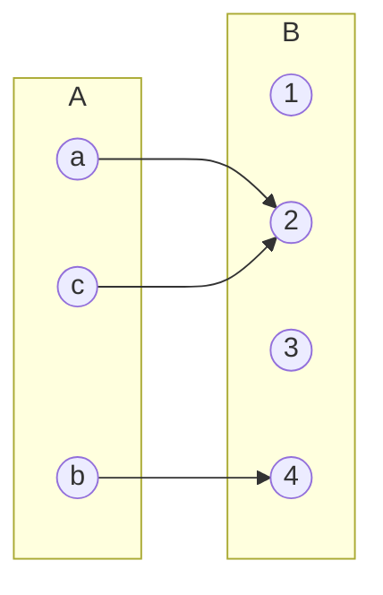

# Clase 14 — Producto cartesiano

> **Fecha**: 27/10/2026 · **Modalidad**: Virtual sincrónica · **Apuntes**: [Diapositivas PDF](./apuntes_clase14.pdf) · [PPT](./apuntes_clase14.pptx) · [Manuscrito anotado](./apuntes_clase14_annotated.pdf)
>
> La sesión cubre las págs. 1–23 del manuscrito. La pág. 24 tiene la marca «Fin: 27/10/2026 · Inicio: 29/10/2026», pero la sesión del 29/10 se dictó con el manuscrito de la [clase 15](../clase-15/). Las págs. 24–45 (representaciones de funciones y "algunas funciones importantes") no se trabajaron en clase.

## Objetivos de la clase

- Definir la n-tupla ordenada, diferenciarla de un conjunto (orden, repeticiones, igualdad) y mostrar su uso en álgebra lineal, imágenes digitales, datos estructurados, juegos y tablas.
- Presentar el producto cartesiano de dos y de n conjuntos como una "fábrica de tuplas", y calcular su cardinalidad.
- Introducir la definición de función como un subconjunto del producto cartesiano, con sus conceptos de dominio, codominio y rango.

## Resumen

La clase abrió el tema de relaciones con sus conceptos preliminares. Primero se definió la n-tupla y se mostraron ejemplos de varias áreas (vectores, transformaciones lineales, píxeles, colores RGB, hora y fecha, ajedrez, registros de una tabla). Luego se presentó el producto cartesiano con cuatro ejemplos resueltos y la fórmula de su cardinalidad. Al final se hizo una introducción rápida a las funciones. La próxima sesión empieza el tema de relaciones.

## Agenda

1. N-tupla ordenada: definición, orden, repeticiones e igualdad; nombres según n. [*(→ sección 1)*](#1-n-tuplas-definición-y-propiedades)
2. N-tuplas en álgebra lineal: vectores en ℝ² y ℝ³, transformaciones y sistemas OCR. [*(→ sección 2)*](#2-n-tuplas-en-álgebra-lineal)
3. N-tuplas en imágenes digitales: posición de un píxel, imagen binaria, escala de grises y color RGB. [*(→ sección 3)*](#3-n-tuplas-en-imágenes-digitales)
4. N-tuplas en datos estructurados, ajedrez y tablas. [*(→ sección 4)*](#4-n-tuplas-en-datos-juegos-y-tablas)
5. Producto cartesiano de dos conjuntos, con un ejemplo en el tablero. [*(→ sección 5)*](#5-producto-cartesiano)
6. Producto cartesiano de n conjuntos. [*(→ sección 6)*](#6-producto-cartesiano-de-n-conjuntos)
7. Ejemplos 1 a 4: combos de desayuno, `A × B` y `B × A`, `A × B × C` y tablero de ajedrez. [*(→ sección 7)*](#7-ejemplos-1-a-4-de-producto-cartesiano)
8. Cardinalidad del producto cartesiano. [*(→ sección 8)*](#8-cardinalidad-del-producto-cartesiano)
9. Funciones: definición, dominio, codominio y rango. [*(→ sección 9)*](#9-funciones-definición-dominio-codominio-y-rango)

## Contenido temático

> [!NOTE]
> **Cómo leer este apunte.**
>
> - Las secciones numeradas siguen el orden en que se dictó la clase (manuscrito, págs. 1–23).
> - Los "Ejemplos 1 a 4" son los de las diapositivas de producto cartesiano (págs. 16–19). Los ejemplos que el profesor agregó a mano en otras páginas se nombran por su contenido (p. ej. *ejemplo de `{0,1,2}` y `{4,5}`*).
> - Los enlaces *código* llevan a Python Tutor, donde puede ejecutar paso a paso el código que acompaña a cada ejemplo en las diapositivas.
> - Los párrafos que empiezan con *Aclaración del apunte* se agregaron al redactar: no se dijeron en clase. Sirven para conectar ideas o evitar confusiones.

**Notación usada en este apunte**

| Símbolo | Se lee | Observación |
|---|---|---|
| `(a₁, a₂, …, aₙ)` | n-tupla | Paréntesis: el orden importa y se permiten repeticiones (sección 1). |
| `{a₁, a₂, …, aₙ}` | conjunto | Llaves: el orden no importa y no hay repeticiones (clase 12). |
| `A × B` | producto cartesiano de `A` y `B` | Conjunto de pares `(a, b)` con `a ∈ A` y `b ∈ B`. No es el producto cruz de vectores (sección 8). |
| `Aⁿ` | potencia cartesiana | `A × A × ⋯ × A` (n veces). |
| `\|A\|` | cardinalidad de `A` | Número de elementos (clase 12). |
| `f: A → B` | `f` es una función de `A` en `B` | `A` es el dominio y `B` el codominio (sección 9). |
| `f(a) = b` | la imagen de `a` es `b` | `b` es el único elemento de `B` que `f` asigna a `a`. |
| `∃!` | existe un único | `∃!b ∈ B` = existe exactamente un `b` en `B`. |
| `D(f)`, `Cod(f)`, `R(f) = Im(f)` | dominio, codominio, rango (imagen) | Sección 9. |

### 1. N-tuplas: definición y propiedades

*(Manuscrito, págs. 2–3.)*

Una **n-tupla** `(a₁, a₂, …, aₙ)` es una **secuencia ordenada y finita de n elementos** en la que:

- **El orden importa.** A diferencia de los conjuntos, la posición de cada elemento es fundamental:

  | Conjuntos | n-tuplas |
  |---|---|
  | `{1, 2, 3} = {3, 2, 1}` | `(1, 2, 3) ≠ (3, 2, 1)` |

- **Se permiten repeticiones.** Un mismo elemento puede aparecer varias veces en una tupla:

  | Conjuntos | n-tuplas |
  |---|---|
  | `{1, 2, 2} = {1, 2}` | `(1, 2, 2)` es una 3-tupla válida |

- **Igualdad.** Dos n-tuplas son iguales si tienen el mismo tamaño y los mismos elementos en el mismo orden:

  `(a₁, a₂, …, aₙ) = (b₁, b₂, …, bₙ) ↔ a₁ = b₁ ∧ a₂ = b₂ ∧ ⋯ ∧ aₙ = bₙ`

  Ejemplo de clase: con `A = (1, 2, 3, 4)`, `B = (1, 2, 3, 4)` y `C = (1, 2, 3, 5)`, se tiene `A = B` y `A ≠ C`, porque el cuarto elemento es distinto.

- **Cada elemento puede provenir de un conjunto diferente (o del mismo conjunto).**
  - Del mismo conjunto: `(x, y, z) = (2.5, −3.1, 7.0)`, con `x, y, z ∈ ℝ`.
  - De conjuntos diferentes: `(nombre, cédula, edad) = ("Ramon", "666", 23)`, con tipos de dato `str`, `str` e `int`.

El término **n-tupla** permite hablar de estas secuencias sin importar su longitud; n puede ser cualquier número:

| n | Nombre | Forma |
|---|---|---|
| 2 | 2-tupla (par ordenado) | `(a₁, a₂)` |
| 3 | 3-tupla (terna) | `(a₁, a₂, a₃)` |
| 4 | 4-tupla | `(a₁, a₂, a₃, a₄)` |
| 10 | 10-tupla | `(a₁, a₂, …, a₁₀)` |

*Aclaración del apunte:* la diapositiva de la pág. 2 ilustra las repeticiones con `(1,2,3)`, que no repite ningún elemento. El ejemplo que se trabajó a mano en clase, `(1, 2, 2)`, es el que se usa arriba.

### 2. N-tuplas en álgebra lineal

*(Manuscrito, págs. 4–7.)*

**Vectores en ℝ² (pares ordenados).** Un vector del plano es una 2-tupla: `(x, y) = [x, y]`, que también se escribe como columna. En la figura de la pág. 4 los vectores son `A = (3, 2)`, `B = (−1, 3)` y `C = (2, −1)`.

**Vectores en ℝ³ (ternas ordenadas).** Un vector del espacio es una 3-tupla: `(x, y, z) = [x, y, z]`. En la figura de la pág. 5, el vector dibujado es `v = (2, 3, 3)`.

*Aclaración del apunte:* en la pág. 4, la lista escrita a la derecha intercambia los nombres de `B` y `C` respecto a la figura; aquí se usan los de la figura. En la pág. 5 el vector se escribe a mano como `(2, 2, 3)`, pero la figura y la columna de al lado dicen `(2, 3, 3)`; aquí se usa `(2, 3, 3)`.

> [!NOTE]
> **En clase surgió la pregunta:** ¿cuál es la diferencia entre una n-tupla y un vector?
> El profesor respondió que, sin ser estrictamente lo mismo, son muy parecidos: la diferencia está en el contexto. En álgebra lineal se habla de vectores en ℝⁿ; en matemáticas discretas, de n-tuplas. El contexto es el que dice qué representa cada posición de la secuencia.

**Transformaciones.** Una transformación lineal `T: V → W` toma una tupla y devuelve otra, posiblemente de distinto tamaño. En la pág. 6 se usa `T: ℝ² → ℝ³`, definida por:

`T(x, y) = (2x + y, x − y, x + y)`

Ejemplos resueltos en clase:

- a. `A = (1, 0)`: `T(A) = (2(1) + 0, 1 − 0, 1 + 0) = (2, 1, 1)`.
- b. `B = (3, −2)`: `T(B) = (2(3) + (−2), 3 − (−2), 3 + (−2)) = (4, 5, 1)`.

Es decir, `T` recibe una 2-tupla y produce una 3-tupla. Para profundizar, la diapositiva recomienda: [DePaul (Sepp)](https://condor.depaul.edu/sepp/) · [Mathematics for Machine Learning](https://mml-book.github.io/) · [Machine Learning Math (J. C. Lin)](https://josephcclin.github.io/courses/machine_learning_math.htm).

**Sistemas OCR.** La pág. 7 muestra el reconocimiento de dígitos escritos a mano: una imagen de 28 × 28 píxeles entra a una red neuronal con 784 entradas y la red responde qué dígito es. *Aclaración del apunte:* 784 = 28 · 28, es decir, la red recibe la imagen como una sola tupla de 784 valores. Para explorar: [Digit Recognition](https://balkarjun.github.io/digit-recognition/) ([modelo](https://github.com/balkarjun/digit-recognition/tree/master/model)) · [TensorFlow Playground](https://playground.tensorflow.org/) · [TensorSpace](https://tensorspace.org/index.html).

### 3. N-tuplas en imágenes digitales

*(Manuscrito, págs. 8–10.)*

**Posición de un píxel (par ordenado).** Cada píxel se ubica con sus coordenadas `(i, j)`. En la cuadrícula de la pág. 8 el eje `x` crece hacia la derecha y el eje `y` hacia abajo, con el origen `(0, 0)` en la esquina superior izquierda; por ejemplo, los píxeles `(18, 6)` y `(6, 13)`. Lo mismo vale para ubicar un objeto en la pantalla de un videojuego (el pato de la figura está en una posición `(i, j)`).

**Imagen binaria.** Cada píxel vale `1` (blanco) o `0` (negro), de modo que la imagen es una matriz de unos y ceros. En clase, un píxel se describió como una 3-tupla `(f, c, t)`: fila, columna y tono. Ver la [imagen binaria interactiva](http://www.cdme.im-uff.mat.br/matrix/matrix-html/matrix_boolean/matrix_boolean_en.html).

*Aclaración del apunte:* en el ejemplo de 2 × 3 de la pág. 8, la matriz es `[[1, 0, 1], [0, 1, 0]]` (filas 0 y 1, columnas 0 a 2) y el píxel encerrado en un círculo es el de la fila 0, columna 0, que vale 1: su tupla es `(0, 0, 1)`. La tupla escrita a mano junto a la matriz es `(0, 1, 1)`, que no coincide con la matriz: el píxel de la fila 0, columna 1 vale 0.

**Escala de grises.** El tono de gris `G` es un número con `0 ≤ G ≤ 255`: `0` es negro y `255` es blanco. La diapositiva lo presenta como una **1-tupla** `(G)`. En la imagen del loro, el profesor marcó el píxel de coordenadas `x = 80`, `y = 82` con tono `100`, y lo escribió como la 3-tupla `(80, 82, 100)` = `(x, y, g)`.

*Aclaración del apunte:* las dos lecturas son compatibles. El tono solo es una 1-tupla; el píxel completo, con su posición, es una 3-tupla.

**Color RGB (terna ordenada).** Cualquier color se representa como `(R, G, B)` = (rojo, verde, azul). En la imagen de [Lenna](https://en.wikipedia.org/wiki/Lenna), el píxel señalado tiene color `(90, 0, 53)`. Puede probar combinaciones con el [selector RGB](https://www.w3schools.com/colors/colors_picker.asp).

### 4. N-tuplas en datos, juegos y tablas

*(Manuscrito, págs. 11–13.)*

**Datos estructurados (POO).** Una hora y una fecha son ternas ordenadas:

| Dato | Terna | Ejemplo de clase |
|---|---|---|
| Hora | `(HH, MM, SS)` | `(12, 48, 22)` |
| Fecha | `(DD, MM, YYYY)` | `(1, 6, 2025)`, es decir, 1 de junio de 2025 |

El profesor comentó que Python tiene un tipo de dato llamado tupla (`tuple`).

**Ajedrez.** Una partida se puede escribir en [notación portátil de partida (PGN)](https://en.wikipedia.org/wiki/Portable_Game_Notation). Para el [mate del pastor](https://en.wikipedia.org/wiki/Scholar%27s_mate) (ver también [ajedrez](https://en.wikipedia.org/wiki/Chess)), la diapositiva representa la partida como una 4-tupla de turnos, cada uno una 2-tupla:

```
MP = ( ("e4", "e5"),
       ("Qh5", "Nc6"),
       ("Bc4", "Nf6"),
       ("Qxf7#", null) )
```

| Elemento | Tipo de tupla | Representación | Descripción |
|---|---|---|---|
| Metadatos | 7-tupla | `("Scholars' Mate", "?", "?", "?", "?", "?", "1-0")` | (evento, sitio, fecha, ronda, blancas, negras, resultado) |
| Turno (par de jugadas) | 2-tupla | `("e4", "e5")` | Blancas: peón a e4; negras: peón a e5 |
| Jugada individual | 5-tupla | `("Q", "x", "f7", "#", null)` | (pieza, captura, casilla destino, jaque/jaque mate, promoción) |

**Tablas.** Cada registro (fila) de una tabla es una n-tupla con tantas posiciones como columnas tenga la tabla. En la tabla `Estudiantes`, con columnas `(ID, Nombre, Apellido, Semestre)`, el registro `(205, "Sofia", "Garcia", 3)` es una 4-tupla. El profesor comentó que las n-tuplas, junto con los conjuntos y las relaciones, son la base matemática de los motores de bases de datos.

### 5. Producto cartesiano

*(Manuscrito, pág. 14.)*

El **producto cartesiano** de dos conjuntos `A` y `B`, denotado `A × B`, es el conjunto de **todas las posibles parejas** `(a, b)` con `a ∈ A` y `b ∈ B`. La diapositiva lo llama una **"fábrica para crear tuplas"**. Formalmente:

- `A × B = {(a, b) | a ∈ A ∧ b ∈ B}`
- `(a, b) ∈ A × B ↔ a ∈ A ∧ b ∈ B`
- `(a, b) ∉ A × B ↔ a ∉ A ∨ b ∉ B`

*Aclaración del apunte:* la tercera línea es la negación de la segunda, por la ley de De Morgan.

**Ejemplo de `{0,1,2}` y `{4,5}`** (escrito a mano en clase). Sean `A = {0, 1, 2}` (`|A| = 3`) y `B = {4, 5}` (`|B| = 2`):

- `A × B = {(0,4), (0,5), (1,4), (1,5), (2,4), (2,5)}`, con `|A × B| = 6`.
- `B × A = {(4,0), (4,1), (4,2), (5,0), (5,1), (5,2)}`, con `|B × A| = 6`.

Los dos productos tienen la misma cardinalidad (`|A| · |B| = (3)(2) = 6` y `|B| · |A| = (2)(3) = 6`), pero **no son el mismo conjunto**: `(0, 4) ∈ A × B` y `(0, 4) ∉ B × A`. En general, `A × B ≠ B × A`.

> [!NOTE]
> **Un estudiante preguntó** cuál era la cardinalidad de `A` y de `B` en este ejemplo. El profesor respondió que `|A| = 3` y `|B| = 2`, así que `|A × B| = 3 × 2 = 6`, lo que coincide con contar uno a uno los pares generados.

### 6. Producto cartesiano de n conjuntos

*(Manuscrito, pág. 15.)*

El producto cartesiano se generaliza a n conjuntos `A₁, A₂, …, Aₙ`: es el conjunto de las n-tuplas ordenadas `(a₁, a₂, …, aₙ)` con `aᵢ ∈ Aᵢ` para `i = 1, 2, …, n`:

`A₁ × A₂ × ⋯ × Aₙ = {(a₁, a₂, …, aₙ) | aᵢ ∈ Aᵢ para i = 1, 2, …, n}`

**Ejemplo de `{1,2}`, `{a,b}` y `{●,■}`** (escrito a mano en clase). Sean `A = {1, 2}`, `B = {a, b}` y `C = {●, ■}`, con `|A| = |B| = |C| = 2`:

- `|A × B × C| = |A| · |B| · |C| = (2)(2)(2) = 2³ = 8`.
- `A × B × C = {(1,a,●), (1,a,■), (1,b,●), (1,b,■), (2,a,●), (2,a,■), (2,b,●), (2,b,■)}`.
- En la misma página se planteó `B × A × C = {(a,1,●), …, (b,2,■)}`, que también tiene `|B × A × C| = 8` elementos, pero son otras ternas: ahora la primera posición viene de `B`.

### 7. Ejemplos 1 a 4 de producto cartesiano

*(Manuscrito, págs. 16–19.)*

**Ejemplo 1 — combos de desayuno.** Un restaurante permite armar un combo con una comida (rosquilla, arepa, pan) y una bebida (café, jugo). ¿Cuántos combos se pueden armar? ([código](https://pythontutor.com/render.html#code=from%20itertools%20import%20product%0A%0AA%20%3D%20%7B'rosquilla',%20'arepa','pan'%7D%0AB%20%3D%20%7B'cafe',%20'jugo'%7D%0A%0A%23%20Producto%20cartesiano%20A%20%C3%97%20B%0AC%20%3D%20list%28product%28A,%20B%29%29%0A%0Afor%20c%20in%20C%3A%0A%20%20%20%20print%28f%22-%3E%20%7Bc%7D%22%29&cumulative=false&curInstr=0&heapPrimitives=nevernest&mode=display&origin=opt-frontend.js&py=311&rawInputLstJSON=%5B%5D&textReferences=false))

- `A = {rosquilla, arepa, pan}`, `|A| = 3`; `B = {café, jugo}`, `|B| = 2`.
- Los combos son `C = A × B = {(a, b) | a ∈ A ∧ b ∈ B}`, con `|C| = |A × B| = (3)(2) = 6`:
- `C = {(rosquilla, café), (rosquilla, jugo), (arepa, café), (arepa, jugo), (pan, café), (pan, jugo)}`.

**Ejemplo 2 — `A × B` y `B × A`.** Dados `A = {1, 2}` (`|A| = 2`) y `B = {a, b, c}` (`|B| = 3`), obtener `A × B` y `B × A`. ([código](https://pythontutor.com/render.html#code=from%20itertools%20import%20product%0A%0AA%20%3D%20%7B1,%202%7D%0AB%20%3D%20%7B'a',%20'b','c'%7D%0A%0A%23%20Producto%20cartesiano%20C%20%3D%20A%20%C3%97%20B%0AC%20%3D%20list%28product%28A,%20B%29%29%0A%0A%23%20Producto%20cartesiano%20C%3D%20B%20%C3%97%20A%0AD%20%3D%20list%28product%28B,%20A%29%29%0A%0Aprint%28f%22AxB%20%3D%20%7BC%7D%22%29%0Aprint%28f%22BxA%20%3D%20%7BD%7D%22%29&cumulative=false&curInstr=7&heapPrimitives=nevernest&mode=display&origin=opt-frontend.js&py=311&rawInputLstJSON=%5B%5D&textReferences=false))

| Producto | Elementos | Cardinalidad |
|---|---|---|
| `A × B` | `{(1,a), (1,b), (1,c), (2,a), (2,b), (2,c)}` | `\|A\| · \|B\| = (2)(3) = 6` |
| `B × A` | `{(a,1), (a,2), (b,1), (b,2), (c,1), (c,2)}` | `\|B\| · \|A\| = (3)(2) = 6` |

**Ejemplo 3 — `A × B × C`.** Con `A = {0, 1}`, `B = {1, 2}` y `C = {0, 1, 2}` (`|A| = 2`, `|B| = 2`, `|C| = 3`). ([código](https://pythontutor.com/render.html#code=from%20itertools%20import%20product%0A%0AA%20%3D%20%7B0,%201%7D%0AB%20%3D%20%7B1,%202%7D%0AC%20%3D%20%7B0,%201,%202%7D%0A%0A%23%20Producto%20cartesiano%20D%20%3D%20A%20%C3%97%20B%20%C3%97%20C%0AD%20%3D%20list%28product%28A,%20B,%20C%29%29%0A%0Aprint%28%22AxBxC%20%3D%20%7B%22%29%0Afor%20d%20in%20D%3A%0A%20%20%20%20print%28%22%20%20%20%20%20%20%20%20%20%20%22,d%29%0Aprint%28%22%20%20%20%20%20%20%20%20%7D%22%29&cumulative=false&curInstr=0&heapPrimitives=nevernest&mode=display&origin=opt-frontend.js&py=311&rawInputLstJSON=%5B%5D&textReferences=false))

`A × B × C = {(a, b, c) | a ∈ A ∧ b ∈ B ∧ c ∈ C}`

`A × B × C = {(0,1,0), (0,1,1), (0,1,2), (0,2,0), (0,2,1), (0,2,2), (1,1,0), (1,1,1), (1,1,2), (1,2,0), (1,2,1), (1,2,2)}`

`|A × B × C| = |A| · |B| · |C| = 2 × 2 × 3 = 12`

**Ejemplo 4 — tablero de ajedrez.** El tablero es una cuadrícula de 8 × 8; en la "notación algebraica", las columnas (*files*) se nombran con las letras `a` a `h` y las filas (*ranks*) con los números 1 a 8. Se definen:

| Conjunto | Por comprensión | Por extensión |
|---|---|---|
| `A` | `{x \| x es una columna del tablero}` | `{a, b, c, d, e, f, g, h}`, `\|A\| = 8` |
| `B` | `{x \| x es una fila del tablero}` | `{1, 2, 3, 4, 5, 6, 7, 8}`, `\|B\| = 8` |
| `C` | `{x \| x es una posición cualquiera del tablero}` | `A × B = {(a,1), …, (h,8)}`, `\|A × B\| = (8)(8) = 64` |
| `D` | `{x \| x es la posición inicial de los caballos}` | `{(b,1), (g,1), (b,8), (g,8)} = {b, g} × {1, 8}` |

El conjunto `D` muestra que el producto cartesiano también sirve para describir solo una parte del tablero: basta con multiplicar las columnas `{b, g}` por las filas `{1, 8}`.

### 8. Cardinalidad del producto cartesiano

*(Manuscrito, pág. 20.)*

La **cardinalidad del producto cartesiano es el producto de las cardinalidades** de los conjuntos individuales:

- Dos conjuntos: `|A × B| = |A| · |B|`.
- n conjuntos: `|A₁ × A₂ × ⋯ × Aₙ| = |A₁| · |A₂| · ⋯ · |Aₙ| = ∏ᵢ₌₁ⁿ |Aᵢ|`.

Así se conoce el tamaño del producto sin tener que listarlo, como se hizo en todos los ejemplos anteriores (6, 8, 12 y 64 elementos).

Casos particulares que trae la diapositiva:

- **Potencia cartesiana:** `Aⁿ = A × A × ⋯ × A` (n veces), con `|Aⁿ| = |A|ⁿ`. Ejemplos: ℝ², ℝ³, `{0, 1}ⁿ`.
- **Conjunto vacío:** `A × ∅ = ∅ × A = ∅`, coherente con `|A| · 0 = 0`.

> [!WARNING]
> No confunda la `×` del producto cartesiano con el **producto cruz** de vectores en ℝ³, que es otra operación (el profesor lo advirtió en clase).

*Aclaración del apunte:* la diapositiva dice "la cardinalidad del producto cruz está dada por `|A × B| = |A| · |B`". Se refiere al producto **cartesiano**, como aclara la nota de la misma diapositiva; aquí se corrigió ese nombre y la barra que faltaba en `|B|`.

### 9. Funciones: definición, dominio, codominio y rango

*(Manuscrito, págs. 21–23.)*

Esta parte fue una introducción rápida. Según el profesor, las funciones se profundizan en otros cursos (Cálculo 1, Cálculo 2, etc.), por eso las diapositivas de representaciones de funciones y de "algunas funciones importantes" (págs. 24–45) no se trabajaron.

**Definición.** Sean `A` y `B` conjuntos no vacíos. Una función `f` de `A` a `B` es una **regla** que asigna a **cada** elemento de `A` **exactamente un** elemento de `B`. Esto se escribe `f: A → B`, y la asignación se denota `f(a) = b`: `b` es el único elemento de `B` que `f` asigna al elemento `a` de `A`. La diapositiva incluye un enlace a [Dirichlet](https://es.wikipedia.org/wiki/Peter_Gustav_Lejeune_Dirichlet), a quien se atribuye esta definición moderna de función, y la imagen de una "máquina de funciones": entra `x` y sale `y = f(x)`.

Una función `f: A → B` también puede definirse como un **subconjunto de `A × B`** (una relación). La diapositiva lo dice así: "este subconjunto está restringido a una relación donde ningún par de elementos de la relación tiene el mismo primer elemento":

`f = {(a, b) ∈ A × B | a cada a ∈ A le corresponde un único b ∈ B}`

**Dominio, codominio y rango.** Para `f: A → B`:

| Concepto | Definición | Notación |
|---|---|---|
| Dominio | Conjunto de todos los elementos de entrada de la función. | `D(f) = A` |
| Codominio | Conjunto de llegada, en el que deben estar los valores asignados por la función. | `Cod(f) = B` |
| Rango (o imagen) | Conjunto formado por los valores que **efectivamente** toma la función al evaluar los elementos de su dominio. | `R(f) = Im(f) = {f(a) \| a ∈ A} ⊆ B` |

**Condición fundamental de una función:** para que `f: A → B` sea función debe cumplirse

`∀a ∈ A, ∃!b ∈ B: f(a) = b`

es decir, cada elemento de `A` tiene exactamente una imagen en `B`.

*Aclaración del apunte:* la frase "ningún par tiene el mismo primer elemento" garantiza solo una parte de la condición: que ningún elemento de `A` tenga **dos** imágenes (el "único" de `∃!`). La otra parte es que **todo** elemento de `A` aparezca como primer elemento de algún par (el "existe" de `∃!`, el "a cada a ∈ A" de la definición). Las dos partes juntas son la condición fundamental. En el ejemplo de abajo, `a`, `b` y `c` aparecen cada uno exactamente una vez como primer elemento. En cambio, que el `2` aparezca dos veces como segundo elemento sí está permitido.

**Ejemplo.** Dados `A = {a, b, c}`, `B = {1, 2, 3, 4}` y la función `f: A → B` definida por `f(a) = 2`, `f(b) = 4`, `f(c) = 2`:

| `a` | `b = f(a)` |
|---|---|
| `a` | `f(a) = 2` |
| `b` | `f(b) = 4` |
| `c` | `f(c) = 2` |

Diagrama de flechas (figura de clase, pág. 23):



- Pares ordenados: `f = {(a, 2), (b, 4), (c, 2)}`.
- Dominio: `D(f) = A = {a, b, c}`.
- Codominio: `Cod(f) = B = {1, 2, 3, 4}`.
- Rango: `R(f) = Im(f) = {2, 4} ⊆ B`.

En clase se anotó además que `|A × B| = |A| · |B| = (3)(4) = 12`: de los 12 pares posibles de `A × B`, la función elige solo 3, uno por cada elemento de `A`. El rango `{2, 4}` es un subconjunto propio del codominio: `1` y `3` están en `B`, pero ningún elemento de `A` llega a ellos.

> [!TIP]
> El profesor señaló que la diferencia entre **codominio** y **rango** no siempre se enfatiza en los cursos de cálculo, pero en matemáticas discretas es importante. El codominio es todo el conjunto de llegada (`B`); el rango es solo la parte de `B` a la que efectivamente llega la función. El rango siempre es un subconjunto del codominio, no necesariamente igual a él.

*Aclaración del apunte:* en la pág. 23, la diapositiva rotulaba la tabla como "Diagrama de flechas"; el profesor la corrigió a mano como "Tabla".

Para practicar el producto cartesiano puede usar el bloque D (ejercicios 9 a 12) del [Taller 6 – Conjuntos](https://discretas1-udea.github.io/discretas1-udea-20262/resources/talleres/taller6/) del sitio del curso. El sitio todavía no tiene una lección publicada sobre producto cartesiano ni funciones.

### Síntesis de la clase

*Aclaración del apunte:* un resumen de lo esencial, sin contenido nuevo.

**Ideas clave:**

1. **Una n-tupla no es un conjunto**: en `(a₁, …, aₙ)` el orden importa y se permiten repeticiones; dos n-tuplas son iguales solo si coinciden posición por posición ([sección 1](#1-n-tuplas-definición-y-propiedades)).
2. **Las n-tuplas están en todas partes**: vectores, píxeles, colores, horas, fechas, jugadas de ajedrez y registros de tablas son tuplas; el contexto dice qué significa cada posición ([secciones 2](#2-n-tuplas-en-álgebra-lineal) a [4](#4-n-tuplas-en-datos-juegos-y-tablas)).
3. **El producto cartesiano es una fábrica de tuplas**: `A × B` reúne todos los pares `(a, b)` con `a ∈ A` y `b ∈ B`, y se generaliza a n conjuntos. En general `A × B ≠ B × A` ([secciones 5](#5-producto-cartesiano) a [7](#7-ejemplos-1-a-4-de-producto-cartesiano)).
4. **Para contar no hace falta listar**: `|A₁ × ⋯ × Aₙ| = |A₁| · ⋯ · |Aₙ|`, por lo que `|A × B| = |B × A|` ([sección 8](#8-cardinalidad-del-producto-cartesiano)).
5. **Una función es un subconjunto de `A × B`** en el que cada elemento de `A` tiene exactamente una imagen. El rango es la parte del codominio a la que efectivamente se llega ([sección 9](#9-funciones-definición-dominio-codominio-y-rango)).

> [!IMPORTANT]
> **Errores y dudas de esta clase.** Lo que efectivamente ocurrió o se preguntó en la sesión:
>
> - **¿Cuál es la diferencia entre una n-tupla y un vector?** (pregunta surgida en clase). Son muy parecidos; el contexto decide el nombre y el significado ([sección 2](#2-n-tuplas-en-álgebra-lineal)).
> - **¿Cuál es la cardinalidad de `A` y de `B` en el ejemplo de `{0,1,2}` y `{4,5}`?** (pregunta de un estudiante). `|A| = 3`, `|B| = 2` y `|A × B| = 6` ([sección 5](#5-producto-cartesiano)).
> - **La `×` del producto cartesiano no es el producto cruz** (advertencia del profesor) ([sección 8](#8-cardinalidad-del-producto-cartesiano)).
> - **Codominio frente a rango** (advertencia del profesor): el rango es un subconjunto del codominio, no necesariamente igual ([sección 9](#9-funciones-definición-dominio-codominio-y-rango)).
> - **Erratas menores**, corregidas en este apunte: el ejemplo de repeticiones `(1,2,3)` ([sección 1](#1-n-tuplas-definición-y-propiedades)); los nombres de `B` y `C` intercambiados en la lista de la pág. 4 y `v = (2,2,3)` por `(2,3,3)` en la pág. 5 ([sección 2](#2-n-tuplas-en-álgebra-lineal)); la tupla `(0,1,1)` del píxel de la imagen binaria ([sección 3](#3-n-tuplas-en-imágenes-digitales)); "producto cruz" por "producto cartesiano" en la fórmula de cardinalidad ([sección 8](#8-cardinalidad-del-producto-cartesiano)).

## Recursos del curso

Gráficas interactivas en Desmos preparadas por el profesor. Corresponden a las diapositivas de funciones (págs. 24–45 del manuscrito), que no se trabajaron en esta sesión; quedan como material de consulta.

| Recurso | Diapositivas relacionadas | Enlace |
|---|---|---|
| Algunas funciones continuas | Representación de funciones en el plano cartesiano y ejemplo 2 de funciones (`y = x²`). | [Desmos](https://www.desmos.com/calculator/t2p4rmw91a) |
| Algunas funciones discretas | Ejemplos 3 y 4 de funciones (Fibonacci y `f(x) = x mod 3`) y funciones piso y techo. | [Desmos](https://www.desmos.com/calculator/fljiojnhto) |
| Ejemplo de relaciones | Definición de función como subconjunto de `A × B`, es decir, como una relación ([sección 9](#9-funciones-definición-dominio-codominio-y-rango)). Sirve de puente al tema de relaciones de la próxima clase. | [Desmos](https://www.desmos.com/calculator/xl1jsg7mg8) |
| Algunas sucesiones | Diapositivas "Sucesiones" y la tabla de ejemplos de sucesiones (constante, aritmética, geométrica, Fibonacci, etc.). | [Desmos](https://www.desmos.com/calculator/dayzhnsoh3) |
| Algunas sumatorias | Diapositivas "Sumatoria" y sus ejemplos. | [Desmos](https://www.desmos.com/calculator/grt2cy4c1x) |

## Pendientes

### Estudiantes

- [ ] Repasar las n-tuplas y el producto cartesiano con los ejemplos resueltos y ejecutar el código de los ejemplos 1 a 3 en Python Tutor.
- [ ] Practicar con el bloque D del [Taller 6 – Conjuntos](https://discretas1-udea.github.io/discretas1-udea-20262/resources/talleres/taller6/).

## Próxima clase

Jueves 29/10/2026: inicio del tema de relaciones (Relaciones – Parte 1), con el manuscrito de la [clase 15](../clase-15/).
