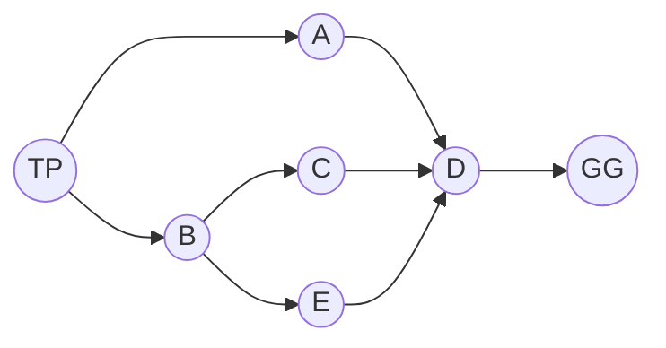

# Clase 15 — Relaciones (Parte 1)

> **Fecha**: 29/10/2026, 03/11/2026 · **Modalidad**: Virtual sincrónica · **Apuntes**: [Diapositivas PDF](./apuntes_clase15.pdf) · [PPT](./apuntes_clase15.pptx) · [Manuscrito anotado](./apuntes_clase15_annotated.pdf)
>
> La sesión del 29/10 cubre las págs. 1–26 del manuscrito; la del 03/11, las págs. 27–39 (marca «Fin: 29/10/2026 · Inicio: 03/11/2026» en la pág. 27). La sesión del 03/11 continuó después con las propiedades de las relaciones, sobre el manuscrito de la [clase 16](../clase-16/) (págs. 1–29), que se documentan en esa clase.

## Objetivos de la clase

- Definir una relación como subconjunto de un producto cartesiano, con su notación y sus cinco formas de representación.
- Determinar el dominio, el rango y la inversa de una relación, y presentar la relación sobre un solo conjunto y la relación identidad.
- Establecer cuándo una relación es una función y cuántas relaciones distintas pueden definirse entre dos conjuntos.
- Acordar con el grupo la nueva fecha del parcial 3 y del supletorio del parcial 2, y su alcance.

## Resumen

El 29/10 la clase abrió con la discusión sobre reprogramar el parcial 3. Luego se mostró que las relaciones aparecen en todas partes (árboles genealógicos, cadenas alimenticias, matrículas, rutas de bus, redes sociales), se repasaron n-tuplas, producto cartesiano y funciones, y se definió la relación con sus ejemplos 1 a 4 y un ejercicio de cuatro relaciones en cinco representaciones. El 03/11 se votó la fecha del parcial y se vieron la relación sobre un solo conjunto, el dominio y el rango, la relación inversa y la relación identidad; la sesión siguió con las propiedades (clase 16).

## Agenda

**Sesión 1 — 29/10/2026**

1. Discusión sobre la reprogramación del parcial 3. [*(→ Evaluación)*](#evaluación)
2. Introducción: las relaciones estructuran nuestro mundo. [*(→ sección 1)*](#1-las-relaciones-estructuran-nuestro-mundo)
3. Cómo representar relaciones en un programa: Python y Prolog. [*(→ sección 2)*](#2-relaciones-en-un-programa-python-y-prolog)
4. Problemas típicos: rutas de bus y redes sociales. [*(→ sección 3)*](#3-problemas-típicos-rutas-de-bus-y-redes-sociales)
5. Repaso: n-tuplas y producto cartesiano. [*(→ sección 4)*](#4-repaso-n-tuplas-y-producto-cartesiano)
6. Ejercicio de repaso: `A × B` y `B × A` en cuatro representaciones. [*(→ sección 5)*](#5-ejercicio-de-repaso-a--b-y-b--a)
7. Repaso: funciones (existencia y unicidad). [*(→ sección 6)*](#6-repaso-funciones)
8. Definición de relación y notación. [*(→ sección 7)*](#7-relación)
9. ¿Cuántas relaciones hay? [*(→ sección 8)*](#8-cuántas-relaciones-hay)
10. Ejemplos 1 a 4 de relaciones. [*(→ sección 9)*](#9-ejemplos-1-a-4-de-relaciones)
11. Ejercicio de repaso: cuatro relaciones en cinco representaciones. [*(→ sección 10)*](#10-ejercicio-de-repaso-cuatro-relaciones-en-cinco-representaciones)

**Sesión 2 — 03/11/2026**

1. Votación de la fecha del parcial 3 y del supletorio del parcial 2. [*(→ Evaluación)*](#evaluación)
2. Relación sobre un solo conjunto. [*(→ sección 11)*](#11-relación-sobre-un-solo-conjunto)
3. Ejemplos 5 y 6: divisibilidad y horas del reloj. [*(→ sección 12)*](#12-ejemplos-5-y-6)
4. Número de relaciones posibles según el contexto. [*(→ sección 13)*](#13-número-de-relaciones-posibles-según-el-contexto)
5. Dominio y rango de una relación. [*(→ sección 14)*](#14-dominio-y-rango-de-una-relación)
6. Relación inversa y ejemplos 7 a 9. [*(→ sección 15)*](#15-relación-inversa)
7. Relación identidad. [*(→ sección 16)*](#16-relación-identidad)
8. Inicio de las propiedades de las relaciones (manuscrito de la [clase 16](../clase-16/)).

## Contenido temático

> [!NOTE]
> **Cómo leer este apunte.**
>
> - Las secciones numeradas siguen el orden en que se dictó la clase.
> - **Sesión 1 (29/10), secciones 1 a 10**: manuscrito, págs. 1–26.
> - **Sesión 2 (03/11), secciones 11 a 16**: manuscrito, págs. 27–39. Las propiedades de las relaciones, que se empezaron ese mismo día, están en el apunte de la [clase 16](../clase-16/).
> - Los "Ejemplos 1 a 9" son los de las diapositivas de relaciones. Los dos ejercicios de repaso se nombran por su contenido (*ejercicio de `A × B` y `B × A`*, *ejercicio de las cuatro relaciones*).
> - Los enlaces *código* llevan a Python Tutor, donde puede ejecutar paso a paso el código de las diapositivas.
> - Los párrafos que empiezan con *Aclaración del apunte* se agregaron al redactar: no se dijeron en clase. Sirven para conectar ideas o evitar confusiones.

**Notación usada en este apunte**

| Símbolo | Se lee | Observación |
|---|---|---|
| `A × B` | producto cartesiano | Todos los pares `(a, b)` con `a ∈ A` y `b ∈ B` ([clase 14](../clase-14/)). |
| `R ⊆ A × B` | `R` es una relación de `A` en `B` | Cualquier subconjunto de `A × B` (sección 7). |
| `xRy` | `x` está relacionado con `y` | Es otra forma de escribir `(x, y) ∈ R`. |
| `¬(xRy)` | `x` no está relacionado con `y` | Es otra forma de escribir `(x, y) ∉ R`; también se tacha la `R`. |
| `𝒫(A × B)` | conjunto potencia de `A × B` | Todos sus subconjuntos, es decir, todas las relaciones de `A` en `B` (sección 8). |
| `n_R` | número de relaciones posibles | `n_R = 2^(\|A\|·\|B\|)`. |
| `a \| b` | `a` divide a `b` | `b` es múltiplo de `a`; en Python, `b % a == 0` (secciones 10 y 12). |
| `x % 12` | residuo de dividir `x` entre 12 | Operador módulo de Python (sección 12). |
| `dom(R)`, `ran(R)` | dominio, rango | Primeros y segundos elementos de los pares de `R` (sección 14). |
| `R⁻¹` | relación inversa | Invierte cada par (sección 15). |
| `I_A` | relación identidad sobre `A` | Los pares `(x, x)` con `x ∈ A` (sección 16). |
| `∃!` | existe un único | Sección 6. |

### 1. Las relaciones estructuran nuestro mundo

*(Manuscrito, págs. 3–4.)*

**¿Qué tienen en común estas imágenes? En todas hay elementos que se conectan de a pares.** La diapositiva muestra cuatro situaciones, y en cada una el profesor marcó quién es `x` y quién es `y`:

| Situación | Relación |
|---|---|
| Cadena alimenticia | *x se come a y* |
| Clasificación de animales (mamíferos, perros, gatos) | *x es un tipo de y* |
| Personajes de Los Simpson y su comida favorita | *x tiene como comida favorita y* (p. ej., Homero Simpson → rosquilla) |
| Estudiantes y cursos | *x está inscrito en y* (p. ej., Ana → Cálculo, Ana → Lógica) |

En el árbol genealógico de Los Simpson, a la pregunta "¿cuántas relaciones distintas se ven en el árbol?" se respondió en clase con dos: (1) *x es esposo(a) de y* y (2) *x es padre (madre) de y*.

**¿Cómo se puede representar una relación?** Con la relación de estudiantes y cursos, la pág. 4 muestra tres formas: una **tabla** (`Estudiante`, `Curso`), un **grafo** que une a cada estudiante con sus cursos, y un **programa**: en Python, un conjunto de pares ordenados.

```python
registró_materias = {
    ("Ana", "Cálculo"), ("Ana", "Lógica"),
    ("Juan", "Lógica"), ("Juan", "Programación"),
    ("Carla", "Cálculo"), ("Carla", "Programación"),
    ("Pedro", "Álgebra"),
    ("Sofía", "Lógica"), ("Sofía", "Álgebra"),
}
```

Como en un conjunto, el orden de las filas no importa y no hay pares repetidos.

### 2. Relaciones en un programa: Python y Prolog

*(Manuscrito, pág. 5.)*

Con los Gemelos Fantásticos (Zan y Jayna) y su mascota Gleek, el conjunto de sujetos es `{Zan, Jayna, Gleek}` y hay dos relaciones: *gemelos* (Zan y Jayna) y *mascota de* (Gleek con cada uno). La diapositiva las escribe de tres maneras:

| Prolog | Python (conjunto de pares) | Python (relación con un rol) |
|---|---|---|
| `gemelo(zan, jayna).`<br>`gemelo(jayna, zan).`<br>`mascota_de(gleek, zan).`<br>`mascota_de(gleek, jayna).` | `gemelo = {("Zan", "Jayna"), ("Jayna", "Zan")}`<br>`mascota_de = {("Gleek", "Zan"), ("Gleek", "Jayna")}` | `rol = {("Zan", "hermano"), ("Jayna", "hermano"), ("Gleek", "mascota")}` |

En Prolog, cada predicado es una relación y cada hecho es un par ordenado.

### 3. Problemas típicos: rutas de bus y redes sociales

*(Manuscrito, págs. 6–8.)*

**Rutas de bus.** El ejemplo, tomado de [Grokking Algorithms](https://www.manning.com/books/grokking-algorithms-second-edition), plantea: usted está en Twin Peaks (San Francisco) y quiere llegar en bus al puente Golden Gate. ¿Qué ruta requiere el menor número de tramos?

Las paradas son `{TP, A, B, C, D, E, GG}` y el mapa es una relación: `x R y` "si hay un tramo directo de `x` a `y`":

`R = {(TP, A), (TP, B), (A, D), (B, C), (B, E), (C, D), (E, D), (D, GG)}`

Figura de clase (pág. 7):



**Respuesta:** `TP → A → D → GG` (3 tramos).

**Redes sociales.** Con el grafo de amigos de Grokking Algorithms (*you* conoce a alice, bob y claire; bob a anuj y peggy; alice a peggy; claire a thom y jonny), la red se guarda en Python como un diccionario de listas y la relación se obtiene así ([código](https://pythontutor.com/visualize.html#code=%23%20Red%20social%20representada%20como%20lista%20de%20adyacencia%20%28diccionario%20de%20listas%29%3A%0A%23%20cada%20llave%20es%20una%20persona%20y%20su%20lista%20contiene%20a%20quienes%20conoce%20directamente.%0Agraph%20%3D%20%7B%7D%0Agraph%5B%22you%22%5D%20%3D%20%5B%22alice%22,%20%22bob%22,%20%22claire%22%5D%0Agraph%5B%22bob%22%5D%20%3D%20%5B%22anuj%22,%20%22peggy%22%5D%0Agraph%5B%22alice%22%5D%20%3D%20%5B%22peggy%22%5D%0Agraph%5B%22claire%22%5D%20%3D%20%5B%22thom%22,%20%22jonny%22%5D%0Agraph%5B%22anuj%22%5D%20%3D%20%5B%5D%0Agraph%5B%22peggy%22%5D%20%3D%20%5B%5D%0Agraph%5B%22thom%22%5D%20%3D%20%5B%5D%0Agraph%5B%22jonny%22%5D%20%3D%20%5B%5D%0A%0A%23%20La%20misma%20relaci%C3%B3n%20como%20conjunto%20de%20pares%20ordenados%3A%20R%20%E2%8A%86%20Personas%20%C3%97%20Personas.%0A%23%20Se%20lee%3A%20%22para%20cada%20persona%20x%20y%20cada%20persona%20y%20de%20la%20lista%20de%20x,%20el%20par%20%28x,%20y%29%20est%C3%A1%20en%20R%22,%0A%23%20es%20decir,%20R%20%3D%20%7B%28x,%20y%29%20%7C%20y%20est%C3%A1%20en%20la%20lista%20de%20contactos%20de%20x%7D.%0AR%20%3D%20%7B%28x,%20y%29%20for%20x%20in%20graph%20for%20y%20in%20graph%5Bx%5D%7D%0A%0A%23%20Un%20set%20no%20garantiza%20orden%20al%20imprimir%3B%20sorted%28%29%20da%20siempre%20la%20misma%20salida.%0Aprint%28sorted%28R%29%29%0Aprint%28len%28R%29%29%20%20%23%20n%C3%BAmero%20de%20pares%20de%20la%20relaci%C3%B3n%20%28aristas%20del%20grafo%29&curInstr=0&mode=display&origin=opt-frontend.js&py=311), [original en GitHub](https://github.com/egonSchiele/grokking_algorithms/blob/master/06_breadth-first_search/python/01_breadth-first_search.py)):

```python
graph = {}
graph["you"] = ["alice", "bob", "claire"]
graph["bob"] = ["anuj", "peggy"]
graph["alice"] = ["peggy"]
graph["claire"] = ["thom", "jonny"]
graph["anuj"] = []
graph["peggy"] = []
graph["thom"] = []
graph["jonny"] = []

R = {(x, y) for x in graph for y in graph[x]}
```

### 4. Repaso: n-tuplas y producto cartesiano

*(Manuscrito, págs. 9–11. Tema visto en la [clase 14](../clase-14/).)*

**n-tupla:** secuencia ordenada y finita en la que el orden importa, se permiten repeticiones y la igualdad es posición por posición. Ejemplos de la diapositiva: `(R, G, B) = (249, 215, 203)` es una 3-tupla, `(i, j) = (18, 6)` es una 2-tupla, `(DD, MM, YYYY) = (13, 8, 2021)` es una 3-tupla y `(G) = (128)` es una 1-tupla.

**Producto cartesiano:** `A × B = {(a, b) | a ∈ A ∧ b ∈ B}`, con `|A × B| = |A| · |B|`. En general, `|A₁ × ⋯ × Aₙ| = |A₁| · |A₂| · ⋯ · |Aₙ|`.

- **Combos de desayuno:** `A = {rosquilla, arepa, pan}`, `B = {café, jugo}`, `|combos| = |A| · |B| = (3)(2) = 6`.
- **Tablero de ajedrez:** con `A` = columnas `{a, …, h}`, `B` = filas `{1, …, 8}` y `C` = piezas `{♔, ♕, ♖, ♗, ♘, ♙}`:
  - N = 2 (casillas): `casillas = A × B`, p. ej. `(e, 1)` es la casilla e1; `|A × B| = (8)(8) = 64`.
  - N = 3 (piezas en casilla): `A × B × C`, p. ej. `(e, 1, ♔)` es el rey en e1 y `(b, 1, ♘)` el caballo en b1; `|A × B × C| = (8)(8)(6) = 384`.

### 5. Ejercicio de repaso: `A × B` y `B × A`

*(Manuscrito, págs. 12–14.)*

Para `A = {1, 2, 3}` (`|A| = 3`) y `B = {0, 1}` (`|B| = 2`), obtener `A × B` y `B × A` como conjunto de pares, tabla, diagrama de flechas y plano cartesiano; verificar las cardinalidades y decidir si `A × B = B × A`.

| | Pares ordenados | Cardinalidad |
|---|---|---|
| `A × B` | `{(1,0), (1,1), (2,0), (2,1), (3,0), (3,1)}` | `\|A\| · \|B\| = 3 × 2 = 6` |
| `B × A` | `{(0,1), (0,2), (0,3), (1,1), (1,2), (1,3)}` | `\|B\| · \|A\| = 2 × 3 = 6` |

En el manuscrito están también las tablas, los diagramas de flechas y los puntos en el plano cartesiano de cada producto. Conclusión de clase: **`A × B ≠ B × A`**. El único par que está en los dos es `(1, 1)` (resaltado en el manuscrito), porque tiene el mismo elemento en las dos posiciones.

*Aclaración del apunte:* la diapositiva pregunta además "¿en qué casos sí lo sería?". `A × B = B × A` cuando `A = B`, o cuando alguno de los dos conjuntos es vacío (los dos productos son `∅`).

### 6. Repaso: funciones

*(Manuscrito, pág. 15. Tema introducido en la [clase 14](../clase-14/).)*

Sean `A` y `B` conjuntos no vacíos. Una función `f` de `A` a `B` es una regla que asigna a **cada** elemento de `A` **exactamente un** elemento de `B`; se escribe `f: A → B`. Debe cumplir dos condiciones:

- **Existencia:** todo elemento de `A` tiene una imagen.
- **Unicidad:** ningún elemento de `A` tiene dos imágenes.

`f ⊆ A × B` tal que `∀a ∈ A ∃!b: (a, b) ∈ f`

### 7. Relación

*(Manuscrito, pág. 16.)*

Una **relación** `R` de `A` en `B` es un subconjunto del producto cartesiano: `R ⊆ A × B`. Cuando los pares se eligen mediante una propiedad (predicado) `P(x, y)`:

`R = {(x, y) | (x ∈ A) ∧ (y ∈ B) ∧ P(x, y)}`

**Notación:** `(x, y) ∈ R` se escribe `xRy`; `(x, y) ∉ R` se escribe `¬(xRy)` (en clase también se escribió tachando la `R`).

- Si `A × B` son todas las flechas posibles, una relación es quedarse con algunas.
- Cualquier subconjunto de `A × B` es una relación, incluso el vacío `∅` o `A × B` completo, aunque no exista una propiedad que lo describa.
- A estas relaciones se les llama **relaciones binarias** (relacionan pares).

### 8. ¿Cuántas relaciones hay?

*(Manuscrito, pág. 17.)*

Cada par de `A × B` tiene dos opciones: **está** o **no está** en `R`. Con `|A| = m` y `|B| = n` hay `m · n` pares, es decir, `2 · 2 · … · 2 = 2^(m·n)` relaciones:

`n_R = |𝒫(A × B)| = 2^|A × B| = 2^(|A|·|B|) = 2^(m·n)`

Sobre un mismo conjunto (`|A| = n`): `n_R = 2^(n²)`.

**Ejemplo.** Sean `A = {0, 1}` y `B = {a}`, con `A × B = {(0, a), (1, a)}`. Entonces `n_R = 2^(2·1) = 4`. En la tabla, `1` significa que el par está en la relación y `0` que no está:

| `(0, a)` | `(1, a)` | Relación |
|---|---|---|
| 0 | 0 | `R₁ = ∅` |
| 1 | 0 | `R₂ = {(0, a)}` |
| 0 | 1 | `R₃ = {(1, a)}` |
| 1 | 1 | `R₄ = {(0, a), (1, a)}` |

En el manuscrito, cada una de las cuatro relaciones se dibuja además como diagrama de flechas, con estos mismos nombres `R₁` a `R₄`.

> [!NOTE]
> **Un estudiante preguntó** por qué se usa el conjunto potencia para contar las relaciones. El profesor respondió que cada par del producto cartesiano tiene exactamente dos posibilidades, pertenecer o no a la relación; contar todas las elecciones es contar todos los subconjuntos de `A × B`, que es lo que cuenta el conjunto potencia.
>
> **El mismo estudiante preguntó** qué diferencia hay entre el producto cartesiano y el número de relaciones. El profesor respondió que el producto cartesiano es el conjunto de todos los pares que se pueden formar; el número de relaciones dice cuántos subconjuntos distintos de ese producto existen.

*Aclaración del apunte:* en la tabla de la diapositiva, las filas `0 1` y `1 0` aparecen con las relaciones intercambiadas (`0 1` junto a `{(0, a)}`). Según las columnas, `{(0, a)}` es la fila `1 0`; aquí se ordenó así.

### 9. Ejemplos 1 a 4 de relaciones

*(Manuscrito, págs. 18–21.)*

**Ejemplo 1 — "es un componente de"** (colores primarios y secundarios, modelo de pigmentos RYB).

- `A = {x | x es un color primario} = {azul, rojo, amarillo}`.
- `B = {y | y es un color secundario} = {verde, morado, naranja}`.
- `|A × B| = 9`. Con la propiedad `P(x, y)`: *x es un componente de y* (en clase: verde = azul + amarillo, naranja = amarillo + rojo, morado = azul + rojo):

`R = {(azul, verde), (azul, morado), (rojo, morado), (rojo, naranja), (amarillo, verde), (amarillo, naranja)}`, con `|R| = 6`.

**Ejemplo 2 — una relación sin propiedad.** Sean `A = {0, 1, 2}` y `B = {a, b}`:

`R = {(0, a), (0, b), (1, a), (2, b)}`

Es una relación de `A` en `B`: por ejemplo, `0 R a`, pero `¬(1 R b)`. `R` no se describe con ninguna propiedad `P`: es una lista de pares y aun así es una relación, porque cualquier subconjunto de `A × B` lo es. En clase se dibujó con diagrama de flechas y tabla matricial.

La diapositiva cierra con: *"Las relaciones son más generales que las funciones. Una función es una relación donde exactamente un elemento de `B` está relacionado con cada elemento de `A`."* También pregunta: ¿es `R` una función de `A` en `B`?

*Aclaración del apunte:* `R` **no** es una función de `A` en `B`, porque `0` tiene dos imágenes, `a` y `b`: falla la condición de unicidad de la [sección 6](#6-repaso-funciones). La existencia sí se cumple (`0`, `1` y `2` tienen imagen).

**Ejemplo 3 — municipios y departamentos.** Sea `A` el conjunto de municipios de Colombia y `B` el de los 32 departamentos:

`R = {(a, b) ∈ A × B | el municipio a pertenece al departamento b}`

Algunos pares: `(Rionegro, Antioquia)`, `(Medellín, Antioquia)`, `(Cali, Valle)`, `(Yumbo, Valle)`, …

**Ejemplo 4 — "ganador del Premio Turing".**

- Personas: `A = {Ron Rivest, Adi Shamir, Len Adleman, Alan Kay, …}`.
- Años: `B = {2002, 2003, 2004, 2005, 2006}`.
- Propiedad `T(x, y)`: "la persona `x` ganó el Premio Turing en el año `y`".

`R = {(x, y) ∈ A × B | T(x, y)}` = `{(Ron Rivest, 2002), (Adi Shamir, 2002), (Len Adleman, 2002), (Alan Kay, 2003), (Vint Cerf, 2004), (Robert Kahn, 2004), (Peter Naur, 2005), (Frances Allen, 2006)}`

Pregunta de la diapositiva: ¿cuántas personas se relacionan con 2002? **3**. ¿Con cuántos años se relaciona cada persona? **1**.

### 10. Ejercicio de repaso: cuatro relaciones en cinco representaciones

*(Manuscrito, págs. 22–26.)*

Sean `A = {0, 1, 2, 3, 4}` (`|A| = 5`) y `B = {0, 1, 2, 3}` (`|B| = 4`), de modo que `A × B` tiene 20 pares. Para cada relación se pide: listar los pares, la tabla, el diagrama de flechas, la **tabla matricial** (filas = elementos de `A`, columnas = elementos de `B`, una `X` donde está el par) y la **matriz binaria** `M_R` (lo mismo, con `1` y `0`). En el manuscrito están las cinco representaciones de cada una; aquí se reproducen los pares y la matriz binaria.

| Relación | Pares ordenados | Matriz binaria `M_R` (filas `a = 0…4`) |
|---|---|---|
| 1. `a = b` | `{(0,0), (1,1), (2,2), (3,3)}` | `1000` · `0100` · `0010` · `0001` · `0000` |
| 2. `a + b = 4` | `{(1,3), (2,2), (3,1), (4,0)}` | `0000` · `0001` · `0010` · `0100` · `1000` |
| 3. `a > b` | `{(1,0), (2,0), (2,1), (3,0), (3,1), (3,2), (4,0), (4,1), (4,2), (4,3)}` | `0000` · `1000` · `1100` · `1110` · `1111` |
| 4. `a \| b`, con `a ≠ 0` | `{(1,0), (1,1), (1,2), (1,3), (2,0), (2,2), (3,0), (3,3), (4,0)}` | `0000` · `1111` · `1010` · `1001` · `1000` |

En la relación 4, el profesor escribió la condición como `b % a = 0`: `a` divide a `b` cuando el residuo de dividir `b` entre `a` es cero. La fila `a = 0` queda vacía por la condición `a ≠ 0`, y `(a, 0)` está para todo `a ≠ 0`, porque `0` es múltiplo de cualquier número.

*Aclaración del apunte:* en el manuscrito, la fila `a = 3` de la matriz binaria de la relación 1 quedó escrita `0 0 1 0`; como el par es `(3, 3)`, debe ser `0 0 0 1`, que es lo que marca la tabla matricial de al lado.

### 11. Relación sobre un solo conjunto

*(Manuscrito, pág. 27. Inicio de la sesión del 03/11.)*

Una relación **sobre** `A` es una relación de `A` en `A`, es decir, un subconjunto de `A × A`:

`R ⊆ A × A`

Es el caso particular `B = A`: los dos elementos del par provienen del mismo conjunto. Cuando los pares se eligen con una propiedad: `R = {(x, y) ∈ A × A | P(x, y)}`.

Ejemplos vistos en la sesión anterior:

- **Red social:** `A` = personas; `xRy` si `x` conoce a `y` (`x` y `y` son personas).
- **Rutas de bus:** `A` = paradas; `xRy` si hay un tramo directo de `x` a `y`.

### 12. Ejemplos 5 y 6

*(Manuscrito, págs. 28–29.)*

**Ejemplo 5 — divisibilidad.** Sea `A = {1, 2, 3, 4}`. Determine `A × A` (`|A × A| = (4)(4) = 16`) y los pares de la relación `R = {(a, b) | a divide a b}` ([código](https://pythontutor.com/visualize.html#code=A%20%3D%20%7B1,%202,%203,%204%7D%0AR%20%3D%20%7B%28a,%20b%29%20for%20a%20in%20A%20for%20b%20in%20A%20if%20b%20%25%20a%20%3D%3D%200%7D%0Aprint%28R%29&curInstr=0&mode=display&origin=opt-frontend.js&py=311)).

En clase se escribió el criterio como `r = b % a`: `a` divide a `b` si el residuo `r` es `0`, es decir, si `b` es múltiplo de `a`. Por ejemplo, `(2, 4) ∈ R` porque `4 % 2 = 0`; `(2, 3) ∉ R` porque `3 % 2 = 1`; `(3, 1) ∉ R` porque `1 % 3 = 1`.

`R = {(1,1), (1,2), (1,3), (1,4), (2,2), (2,4), (3,3), (4,4)}`

```python
A = {1, 2, 3, 4}
R = {(a, b) for a in A for b in A if b % a == 0}
```

> [!NOTE]
> **Un estudiante preguntó** por qué se calcula `b % a` y no `a % b`. El profesor respondió que en "`a` divide a `b`", `a` es el divisor: se calcula `b` módulo `a`, y si da `0`, `b` es múltiplo de `a` y el par `(a, b)` está en la relación.
>
> **Otro estudiante preguntó** si el procedimiento es calcular primero el producto cartesiano, luego verificar la propiedad en cada par y anotar los que la cumplen. El profesor confirmó que ese es exactamente el procedimiento.

**Ejemplo 6 — horas del reloj.** Sea `A = {x | x es una hora del día} = {1, 2, …, 12}` (`|A| = 12`, `|A × A| = 144`). Determine los elementos de `R = {(x, y) | x es una hora antes de y}` ([código](https://pythontutor.com/visualize.html#code=A%20%3D%20set%28range%281,%2013%29%29%0AR%20%3D%20%7B%28x,%20x%20%25%2012%20%2B%201%29%20for%20x%20in%20A%7D%0Aprint%28R%29&curInstr=0&mode=display&origin=opt-frontend.js&py=311)).

`R = {(12,1), (1,2), (2,3), (3,4), (4,5), (5,6), (6,7), (7,8), (8,9), (9,10), (10,11), (11,12)}`

En clase se escribió la propiedad como `P(x, y): x % 12 + 1 == y`, de modo que `R = {(x, y) | x % 12 + 1 == y}`:

- `x = 2`: `2 % 12 + 1 = 2 + 1 = 3`, luego `(2, 3) ∈ R`.
- `x = 12`: `12 % 12 + 1 = 0 + 1 = 1`, luego `(12, 1) ∈ R`. Después de las 12 viene la 1.
- `x = 6`: `6 % 12 + 1 = 7`, luego `(6, 6) ∉ R`.

```python
A = set(range(1, 13))
R = {(x, x % 12 + 1) for x in A}
```

> [!NOTE]
> **Un estudiante preguntó** si no deberían ser 24 horas. El profesor respondió que el ejemplo usa un reloj de 12 horas, así que `A` tiene 12 elementos; la propiedad `y = (x % 12) + 1` cierra el ciclo después de las 12.

### 13. Número de relaciones posibles según el contexto

*(Manuscrito, pág. 30.)*

De `A` en `B`: `n_R = |𝒫(A × B)| = 2^(|A|·|B|) = 2^(m·n)`. Sobre `A` (`|A| = n`): `n_R = |𝒫(A × A)| = 2^(|A|·|A|) = 2^(n²)`.

| Contexto | Conjuntos | Número de relaciones posibles |
|---|---|---|
| Colores primarios y secundarios (Ejemplo 1) | `\|A\| = 3`, `\|B\| = 3` | `2^(3·3) = 2⁹ = 512` |
| Combinación de números y letras (Ejemplo 2) | `\|A\| = 3`, `\|B\| = 2` | `2^(3·2) = 2⁶ = 64` |
| Municipios y departamentos de Colombia (Ejemplo 3) | `\|A\| = m`, `\|B\| = 32` | `2^(32m)` |
| Conjunto de números (Ejemplo 5) | `A = {1, 2, 3, 4}`, `\|A\| = 4` | `2^(4²) = 2¹⁶ = 65536` |
| Horas (Ejemplo 6) | `A = {1, …, 12}`, `\|A\| = 12` | `2^(12²) = 2¹⁴⁴` |

### 14. Dominio y rango de una relación

*(Manuscrito, págs. 31–32.)*

El dominio y el rango describen con precisión qué elementos están realmente involucrados en la relación. Para `R ⊆ A × B`:

- **Dominio:** el conjunto de todos los **primeros** elementos de los pares de `R`. Es un subconjunto de `A`:
  `dom(R) = {x | (x ∈ A) ∧ ∃y (y ∈ B ∧ (x, y) ∈ R)}`
- **Rango:** el conjunto de todos los **segundos** elementos de los pares de `R`. Es un subconjunto de `B`:
  `ran(R) = {y | (y ∈ B) ∧ ∃x (x ∈ A ∧ (x, y) ∈ R)}`

Los elementos de `A` o de `B` que no aparecen en ningún par no están ni en el dominio ni en el rango.

**Ejemplo.** Con `A = {1, 2, 3, 4}` (conjunto de partida), `B = {a, b, c, d}` (conjunto de llegada) y `R = {(1, a), (1, c), (2, b), (4, b)}`:

| `R` | `a` | `b` | `c` | `d` |
|---|---|---|---|---|
| 1 | X | | X | |
| 2 | | X | | |
| 3 | | | | |
| 4 | | X | | |

- `dom(R) = {1, 2, 4}`: las filas con alguna `X`. El `3` no tiene ninguna flecha.
- `ran(R) = {a, b, c}`: las columnas con alguna `X`. La `d` no recibe ninguna flecha.

### 15. Relación inversa

*(Manuscrito, págs. 33–38.)*

La inversa de una relación consiste en **"dar la vuelta"** o **"revertir"** la dirección de todas las conexiones de la relación original. Sea `R ⊆ A × B`; la relación inversa `R⁻¹` invierte el orden de todos los pares de `R`:

`R⁻¹ = {(y, x) | (x, y) ∈ R}`

Propiedades útiles:

1. Doble inversa: `(R⁻¹)⁻¹ = R`.
2. Intercambio del dominio y el rango: `dom(R⁻¹) = ran(R)` y `ran(R⁻¹) = dom(R)`.
3. Si `R` es una relación sobre un mismo conjunto `A`, entonces `R⁻¹ ⊆ A × A` también es una relación sobre `A`.
4. `(A × B)⁻¹ = B × A`.

**Ejemplo 7.** Con los mismos `A`, `B` y `R = {(1, a), (1, c), (2, b), (4, b)}` de la sección anterior, invirtiendo cada par:

`R⁻¹ = {(a, 1), (c, 1), (b, 2), (b, 4)}`

| | Dominio | Rango |
|---|---|---|
| `R` | `{1, 2, 4}` | `{a, b, c}` |
| `R⁻¹` | `{a, b, c}` | `{1, 2, 4}` |

Se cumple la propiedad 2: el dominio y el rango se intercambian.

**Ejemplo 8.** Sean `A = {2, 3, 4}`, `B = {2, 6, 8}` y `R` la relación "divide" de `A` a `B`: `x R y ⟺ x | y`. (a) Establezca qué pares están en `R` y en `R⁻¹` y dibuje sus diagramas de flechas. (b) Describa `R⁻¹` en palabras.

En clase se dejó para analizar, con la explicación en la diapositiva de la solución:

- a. `R = {(x, y) | y mod x = 0} = {(2,2), (2,6), (2,8), (3,6), (4,8)}` y `R⁻¹ = {(2,2), (6,2), (8,2), (6,3), (8,4)}`.
- b. Para todo `(x, y) ∈ A × B`, `y R⁻¹ x ⟺ y es múltiplo de x`. Es decir, `R⁻¹ = {(y, x) | y es múltiplo de x}`: "divide a" al revés es "es múltiplo de".

**Ejemplo 9** (visto rápidamente, sin anotaciones en el manuscrito). Se define `R` de ℝ a ℝ por `x R y ⟺ y = 2|x|`. (a) Dibuje las gráficas de `R` y `R⁻¹` en el plano cartesiano. (b) ¿Es `R⁻¹` una función?

- a. La gráfica de `R` es una "V" que abre hacia arriba (puntos `(0,0)`, `(1,2)`, `(−1,2)`, `(2,4)`, `(−2,4)`). La de `R⁻¹` se obtiene intercambiando las coordenadas, y es una "V" acostada que abre hacia la derecha (puntos `(0,0)`, `(2,1)`, `(2,−1)`, `(4,2)`, `(4,−2)`).
- b. `R⁻¹` **no** es una función, porque `(2, 1)` y `(2, −1)` están en `R⁻¹`: el `2` tendría dos imágenes. Es la misma condición de unicidad de la [sección 6](#6-repaso-funciones).

### 16. Relación identidad

*(Manuscrito, pág. 39.)*

La relación identidad solo relaciona **cada elemento consigo mismo**, y con ningún otro. Dado un conjunto `A`, la relación identidad sobre `A`, `I_A`, es el conjunto de todos los pares en los que cada elemento está relacionado consigo mismo:

`I_A = {(x, y) | x ∈ A ∧ x = y}`, con `I_A ⊆ A × A`.

**Ejemplo.** Para `A = {a, b, c}`, de los 9 pares de `A × A` se eligen los que tienen el mismo elemento en las dos posiciones: `I_A = {(a, a), (b, b), (c, c)}`. Para `B = {1, 2, 3}`: `I_B = {(1, 1), (2, 2), (3, 3)}`.

Para practicar puede usar el [Taller 7 – Relaciones](https://discretas1-udea.github.io/discretas1-udea-20262/resources/talleres/taller7/) del sitio del curso. Ese taller también incluye las propiedades de las relaciones (clase 16), operaciones entre relaciones y representaciones con matrices y grafos dirigidos. El sitio todavía no tiene una lección publicada sobre relaciones.

### Síntesis de la clase

*Aclaración del apunte:* un resumen de lo esencial, sin contenido nuevo.

**Ideas clave:**

1. **Una relación es cualquier subconjunto de `A × B`**: se puede describir con una propiedad o simplemente listando pares, e incluso `∅` y `A × B` son relaciones ([secciones 7](#7-relación) y [9](#9-ejemplos-1-a-4-de-relaciones)).
2. **Una misma relación tiene cinco representaciones equivalentes**: pares ordenados, tabla, diagrama de flechas, tabla matricial y matriz binaria ([sección 10](#10-ejercicio-de-repaso-cuatro-relaciones-en-cinco-representaciones)).
3. **Hay `2^(|A|·|B|)` relaciones de `A` en `B`**, porque cada par está o no está; sobre un solo conjunto, `2^(n²)` ([secciones 8](#8-cuántas-relaciones-hay) y [13](#13-número-de-relaciones-posibles-según-el-contexto)).
4. **Dominio, rango e inversa**: el dominio son los primeros elementos que efectivamente aparecen, el rango los segundos, y la inversa voltea cada par, intercambiando dominio y rango ([secciones 14](#14-dominio-y-rango-de-una-relación) y [15](#15-relación-inversa)).
5. **Las funciones son relaciones especiales**: cada elemento de `A` con exactamente una imagen. Una relación (o la inversa de una función) puede no serlo ([secciones 6](#6-repaso-funciones), [9](#9-ejemplos-1-a-4-de-relaciones) y [15](#15-relación-inversa)).

> [!IMPORTANT]
> **Errores y dudas de esta clase.** Lo que efectivamente ocurrió o se preguntó en las sesiones:
>
> - **¿Por qué el conjunto potencia cuenta las relaciones?** y **¿en qué se diferencia del producto cartesiano?** (preguntas de un estudiante, 29/10) ([sección 8](#8-cuántas-relaciones-hay)).
> - **¿Por qué `b % a` y no `a % b`?** y **¿el procedimiento es producto cartesiano, propiedad y selección?** (preguntas de estudiantes, 03/11) ([sección 12](#12-ejemplos-5-y-6)).
> - **¿No deberían ser 24 horas?** (pregunta de un estudiante, 03/11). El reloj del ejemplo es de 12 horas ([sección 12](#12-ejemplos-5-y-6)).
> - **Fila `a = 3` de la matriz binaria de la relación 1**: en el manuscrito quedó `0 0 1 0`; lo correcto es `0 0 0 1` ([sección 10](#10-ejercicio-de-repaso-cuatro-relaciones-en-cinco-representaciones)).
> - **Erratas menores de las diapositivas**, corregidas en este apunte: las filas `0 1` y `1 0` intercambiadas en la tabla de `A = {0, 1}`, `B = {a}` ([sección 8](#8-cuántas-relaciones-hay)); `naranda` por `naranja` (Ejemplo 1); "Para dos conjuntos" en la fórmula de n conjuntos y barras faltantes en `|A × B|` (repaso); `|A| = {1, 2, 3, 4}` y `|A| = {1, …, 12}` por `A = …` (tabla de la sección 13); un `∧` sobrante en la fórmula de `ran(R)` del ejemplo de dominio y rango; la barra faltante en `y = 2|x|` (Ejemplo 9). En el Ejemplo 3, el profesor cambió a mano "la ciudad" por "el municipio".

## Evaluación

| Ítem | Detalle |
|---|---|
| Reprogramación del parcial 3 | Estaba previsto para el sábado 07/11. El 29/10 se acordó moverlo, porque el tema no había terminado y varios estudiantes tenían supletorios de otras materias; cada estudiante revisaría su calendario para votar el 03/11. |
| Fecha del parcial 3 y del supletorio del parcial 2 | **Sábado 14/11/2026, de 8:00 a 10:00**, definida por votación y discusión en clase (03/11). El supletorio del parcial 2 se presenta el mismo día, para evitar un desplazamiento adicional. |
| Supletorio del parcial 2 | Pueden presentarlo quienes no presentaron el parcial 2 y quienes lo presentaron y quieren mejorar la nota. La inscripción será mediante un formulario que enviará el profesor (03/11). |
| Solución del parcial 2 | Publicada para que cada estudiante revise sus errores y decida si presenta el supletorio: [enunciado](../parciales/parcial2/discretas1_parcial2_2026-2.pdf) · [solución](../parciales/parcial2/discretas1_parcial2_2026-2_sol.pdf). |
| Alcance del parcial 3 | Conjuntos; relaciones y sus representaciones; relaciones de orden y sus representaciones. Por cuestiones de tiempo, este semestre **no** se evalúan los elementos extremos (máximos, mínimos, maximales, minimales) ni las cotas. Tampoco entran las diapositivas de funciones de la [clase 14](../clase-14/) (representaciones de funciones y "algunas funciones importantes"), que se profundizan en Cálculo 1 y Cálculo 2; reconocer cuándo una relación es una función sí entra. |

## Pendientes

### Docente

- [ ] Enviar el formulario de inscripción al supletorio del parcial 2.

### Estudiantes

- [ ] Revisar la [solución del parcial 2](../parciales/parcial2/discretas1_parcial2_2026-2_sol.pdf) y decidir si presenta el supletorio.
- [ ] Si va a presentar el supletorio, diligenciar el formulario cuando el profesor lo envíe.
- [ ] Repasar los ejemplos 1 a 9 y los dos ejercicios de repaso, y practicar con el [Taller 7 – Relaciones](https://discretas1-udea.github.io/discretas1-udea-20262/resources/talleres/taller7/).

## Próxima clase

Jueves 05/11/2026: continuación de las propiedades de las relaciones y sus representaciones con matrices y grafos dirigidos (manuscrito de la [clase 16](../clase-16/)).
