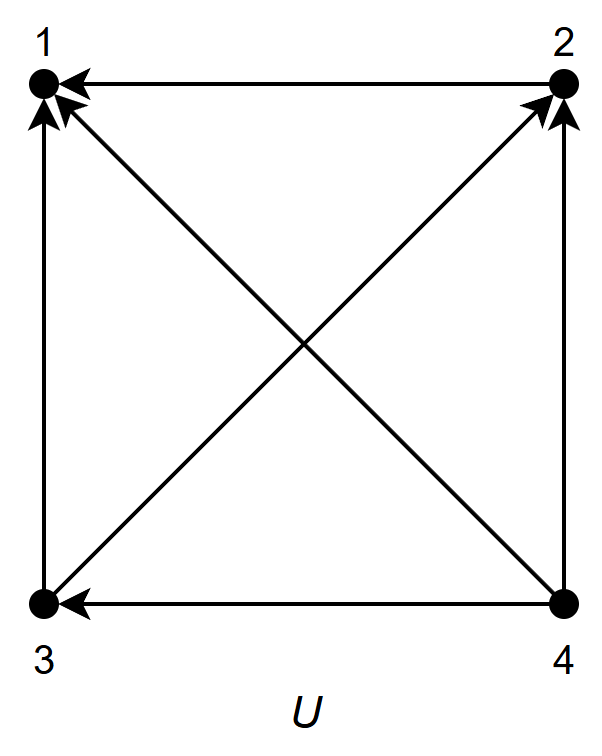
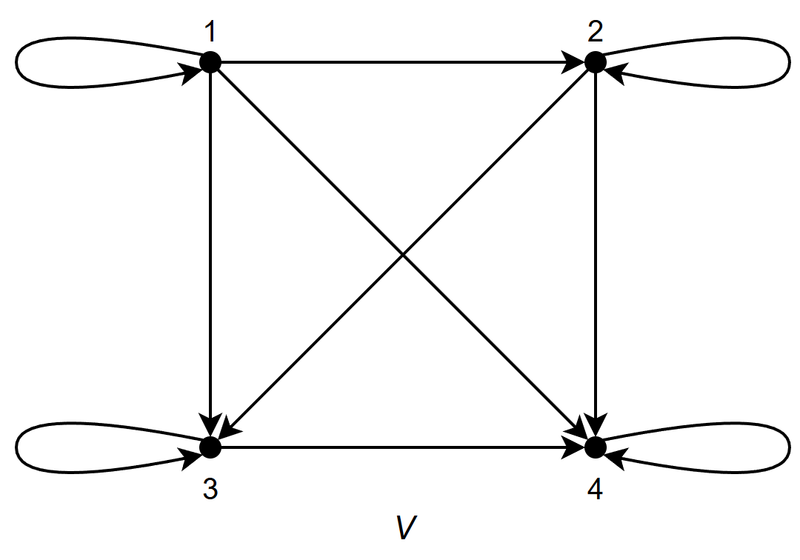
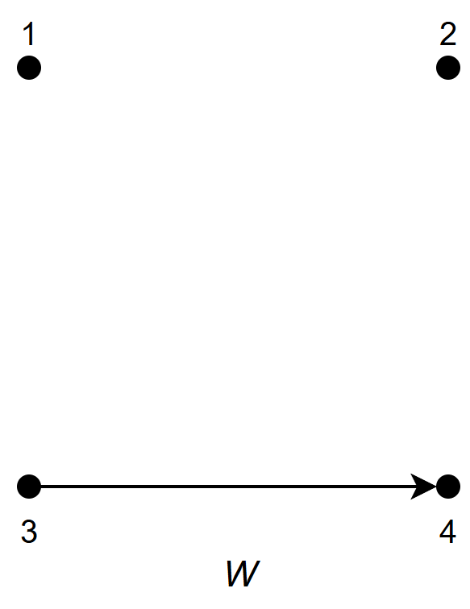

# Clase 16 — Relaciones (Parte 2): propiedades y representaciones

> **Fecha**: 03/11/2026, 05/11/2026 · **Modalidad**: Virtual sincrónica · **Apuntes**: [Diapositivas PDF](./apuntes_clase16.pdf) · [PPT](./apuntes_clase16.pptx) · [Manuscrito anotado](./apuntes_clase16_annotated.pdf)
>
> La sesión del 03/11 empezó terminando la [clase 15](../clase-15/) (págs. 27–39 de su manuscrito, documentadas allí) y siguió con las págs. 1–29 de este manuscrito. La del 05/11 cubre las págs. 30–58 (marca «Fin: 3/11/2026 · Inicio: 5/11/2026» en la pág. 30); las págs. 45–58 (dígrafos y Ejemplo 10) se vieron sin anotaciones. Después, el 05/11 continuó con el manuscrito de la clase 17 (relaciones de orden), que se documenta en esa clase.

## Objetivos de la clase

- Presentar las propiedades de una relación sobre un conjunto, agrupadas en tres familias (reflexividad, simetría y transitividad), con su definición informal y formal y su negación.
- Establecer la diferencia entre negar una propiedad y su versión "anti" (no simétrica frente a antisimétrica, no transitiva frente a antitransitiva), incluidos los casos que se cumplen por vacuidad.
- Mostrar cómo leer esas propiedades en la matriz binaria y en el grafo dirigido (dígrafo) de una relación.

## Resumen

El 03/11 se definieron las propiedades de las relaciones y se aplicaron a seis relaciones de ejemplo (`R, S, T, U, V, W`) sobre `A = {1, 2, 3, 4}`, hasta las tablas resumen de cada familia. El 05/11 se resolvió un ejercicio de repaso con otras seis relaciones (`R₁` a `R₆`) en tabla matricial, matriz binaria y grafo dirigido, y se vio cómo reconocer las propiedades en la matriz y en el dígrafo. La sesión siguió con las relaciones de orden (clase 17).

## Agenda

**Sesión 1 — 03/11/2026** (después de terminar la [clase 15](../clase-15/))

1. Las tres familias de propiedades y sus negaciones. [*(→ sección 1)*](#1-las-tres-familias-de-propiedades)
2. Las relaciones de ejemplo `R, S, T, U, V, W`. [*(→ sección 2)*](#2-relaciones-de-ejemplo)
3. Reflexividad: reflexiva, no reflexiva y antirreflexiva. [*(→ sección 3)*](#3-reflexividad)
4. Simetría: simétrica, no simétrica, antisimétrica y asimétrica. [*(→ sección 4)*](#4-simetría)
5. Transitividad: transitiva, no transitiva y antitransitiva. [*(→ sección 5)*](#5-transitividad)
6. Resúmenes de las tres familias. [*(→ sección 6)*](#6-resúmenes-de-las-tres-familias)

**Sesión 2 — 05/11/2026**

1. Avisos: formulario del supletorio y parciales anteriores. [*(→ Evaluación)*](#evaluación)
2. Ejercicio de repaso: `R₁` a `R₆` en tres representaciones. [*(→ sección 7)*](#7-ejercicio-de-repaso-r₁-a-r₆)
3. Representación con matrices y propiedades en la matriz. [*(→ sección 8)*](#8-representación-con-matrices)
4. Representación con dígrafos y propiedades en el dígrafo. [*(→ sección 9)*](#9-representación-con-dígrafos)
5. Ejemplo 10: las seis representaciones de `R` a `W`. [*(→ sección 10)*](#10-ejemplo-10-representaciones-de-r-a-w)
6. Inicio de las relaciones de orden (manuscrito de la [clase 17](../clase-17/)).

## Contenido temático

> [!NOTE]
> **Cómo leer este apunte.**
>
> - Las secciones numeradas siguen el orden en que se dictó la clase.
> - **Sesión 1 (03/11), secciones 1 a 6**: manuscrito, págs. 1–29.
> - **Sesión 2 (05/11), secciones 7 a 10**: manuscrito, págs. 30–58. Las secciones 9 y 10 (págs. 45–58) se vieron sin anotaciones.
> - Hay dos grupos de relaciones: `R, S, T, U, V, W` (sección 2, usadas en las secciones 3 a 6 y 10) y `R₁` a `R₆` (ejercicio de repaso, sección 7). Los "Ejemplos 1 a 10" son los de las diapositivas de representación (secciones 8 a 10).
> - Los párrafos que empiezan con *Aclaración del apunte* se agregaron al redactar: no se dijeron en clase. Sirven para conectar ideas o evitar confusiones.

**Notación usada en este apunte**

| Símbolo | Se lee | Observación |
|---|---|---|
| `R ⊆ A × A` | `R` es una relación sobre `A` | Las propiedades de esta clase se definen para relaciones sobre un solo conjunto ([clase 15](../clase-15/)). |
| `(x, x)` | lazo o bucle | Un elemento relacionado consigo mismo; en el dígrafo, una flecha que sale y vuelve al mismo nodo. |
| `I_A` | relación identidad sobre `A` | `{(x, x) \| x ∈ A}` ([clase 15](../clase-15/)). |
| `R⁻¹` | relación inversa | Invierte cada par ([clase 15](../clase-15/)). |
| `∀x`, `∃x` | para todo `x`, existe `x` | Cuantificadores vistos en el tema 2. |
| `¬∀x P(x) ≡ ∃x ¬P(x)` | negación de un cuantificador | Se usa para negar cada propiedad. |
| `¬(p → q) ≡ p ∧ ¬q` | negación de la implicación | Ídem. |
| `M_R = [m_ij]` | matriz binaria de `R` | `m_ij = 1` si `(a_i, b_j) ∈ R` y `0` si no (sección 8). |

### 1. Las tres familias de propiedades

*(Manuscrito, pág. 2.)*

Sea `R` una relación sobre un conjunto `A`, es decir, `R ⊆ A × A`. Las propiedades se agrupan en tres familias:

| Reflexividad | Simetría | Transitividad |
|---|---|---|
| Reflexiva | Simétrica | Transitiva |
| Antirreflexiva | Antisimétrica | Antitransitiva |
| | Asimétrica | |

Y la negación de cada propiedad principal: **no reflexiva** = ¬(reflexiva), **no simétrica** = ¬(simétrica), **no transitiva** = ¬(transitiva).

> [!IMPORTANT]
> "No simétrica" y "antisimétrica" **no** son lo mismo (sección 4).

### 2. Relaciones de ejemplo

*(Manuscrito, pág. 3.)*

Sea `A = {1, 2, 3, 4}` (`|A| = 4`). Para analizar cada propiedad se usan seis relaciones sobre `A`, todas subconjuntos de `A × A`, que tiene `|A| · |A| = (4)(4) = 16` pares:

| Relación | Pares |
|---|---|
| `R` | `{(1,1), (1,2), (2,1), (2,2), (3,4), (4,1), (4,4)}` |
| `S` | `{(1,1), (1,2), (2,1)}` |
| `T` | `{(1,1), (1,2), (1,4), (2,1), (2,2), (3,3), (4,1), (4,4)}` |
| `U` | `{(2,1), (3,1), (3,2), (4,1), (4,2), (4,3)}` |
| `V` | `{(1,1), (1,2), (1,3), (1,4), (2,2), (2,3), (2,4), (3,3), (3,4), (4,4)}` |
| `W` | `{(3,4)}` |

**¿Cuántas relaciones distintas se pueden definir sobre `A`?** `n_R = |𝒫(A × A)| = 2^|A × A| = 2¹⁶ = 65536`.

*Aclaración del apunte:* en el manuscrito, la cuenta a mano dice `(4)(4) = 12`; el resultado correcto es 16, que es el que dice la diapositiva y el que se usa en `2¹⁶`.

### 3. Reflexividad

*(Manuscrito, págs. 4–9.)*

**Reflexiva.** Informalmente: todo elemento de `A` se relaciona consigo mismo (y puede relacionarse también con otros).

`R es reflexiva ⟺ ∀x ((x, x) ∈ R)`. Equivalentemente: `R` es reflexiva `⟺ I_A ⊆ R` (contiene a la relación identidad).

Se buscan los pares `(1,1), (2,2), (3,3), (4,4)`:

- `T` y `V` son **reflexivas**: tienen los cuatro.
- `R` **no** es reflexiva: tiene `(1,1)`, `(2,2)` y `(4,4)`, pero no `(3,3)`.
- `S`, `U` y `W` tampoco: les falta al menos un `(x, x)`.

**No reflexiva.** Informalmente: al menos un elemento de `A` no se relaciona consigo mismo. Es la negación de la reflexividad:

`R es no reflexiva ⟺ ¬∀x ((x, x) ∈ R) ⟺ ∃x ((x, x) ∉ R)`

Al negar, `∀` se convierte en `∃` y la condición se niega: `¬∀x P(x) ≡ ∃x ¬P(x)`. Se busca al menos un `(x, x)` que falte:

- `R`: falta `(3,3)`. `S`: faltan `(2,2), (3,3), (4,4)`. `U` y `W`: faltan los cuatro. Las cuatro son **no reflexivas**.
- `T` y `V` **no** son no reflexivas: contienen todos los `(x, x)`. Basta que falte uno solo para que una relación sea no reflexiva.

**Antirreflexiva** (también llamada **irreflexiva**). Informalmente: ningún elemento de `A` se relaciona consigo mismo.

`R es antirreflexiva ⟺ ¬∃x ((x, x) ∈ R) ⟺ ∀x ((x, x) ∉ R)`. Equivalentemente: `R ∩ I_A = ∅` (no comparte pares con la identidad).

- `U` y `W` son **antirreflexivas**: no aparece ningún `(x, x)`.

> [!WARNING]
> **No reflexiva ≠ antirreflexiva.** `S = {(1,1), (1,2), (2,1)}` es no reflexiva (falta `(2,2)`), pero **no** es antirreflexiva (contiene `(1,1)`).
>
> - **Reflexiva**: están todos los `(x, x)`.
> - **Antirreflexiva**: no está ninguno.
> - **No reflexiva**: falta al menos uno.

### 4. Simetría

*(Manuscrito, págs. 10–18.)*

**Simétrica.** Informalmente: es una relación de "ida y vuelta". Si `x` se relaciona con `y`, entonces `y` también se relaciona con `x`.

`R es simétrica ⟺ ∀x∀y ((x, y) ∈ R → (y, x) ∈ R)`. Equivalentemente: `R = R⁻¹` (coincide con su inversa).

Para cada par `(x, y)` se busca su inverso `(y, x)`:

- `S` es **simétrica**: `(1,2) ⟷ (2,1)`.
- `T` es **simétrica**: `(1,2) ⟷ (2,1)` y `(1,4) ⟷ (4,1)`.
- Las demás no lo son. Por ejemplo, en `W = {(3,4)}` falta `(4,3)`.

Los pares `(x, x)` son su propio inverso: nunca rompen la simetría.

> [!NOTE]
> **Un estudiante preguntó** (03/11) si en la relación simétrica los pares como `(1,1)` no se tienen en cuenta porque son su propio inverso. El profesor confirmó que sí: los pares `(x, x)` son su propio inverso y no afectan la verificación; lo mismo vale para `(2,2)`, `(3,3)` y `(4,4)`.

**No simétrica.** Informalmente: existe al menos un par que va en un sentido, pero no regresa. Es la negación de la simetría:

`R es no simétrica ⟺ ¬∀x∀y ((x, y) ∈ R → (y, x) ∈ R) ⟺ ∃x∃y ((x, y) ∈ R ∧ (y, x) ∉ R)`

Al negar, `¬∀` se convierte en `∃` y `¬(p → q) ≡ p ∧ ¬q`. Basta encontrar un par cuyo inverso no esté:

- `R`: `(3,4) ∈ R` pero `(4,3) ∉ R` (también `(4,1)` sin `(1,4)`).
- `U`: `(2,1) ∈ U` pero `(1,2) ∉ U` (ningún par tiene su inverso).
- `V`: `(1,2) ∈ V` pero `(2,1) ∉ V`.
- `W`: `(3,4) ∈ W` pero `(4,3) ∉ W`.

`S` y `T` no son no simétricas: todo par tiene su inverso. Un solo contraejemplo basta para que una relación sea no simétrica.

**Antisimétrica.** Informalmente: entre elementos distintos, ningún par tiene "ida y vuelta"; solo se permite el "doble vínculo" de un elemento consigo mismo.

`R es antisimétrica ⟺ ∀x∀y ((x, y) ∈ R ∧ x ≠ y → (y, x) ∉ R)`

Forma equivalente (si hay ida y vuelta, son el mismo elemento): `R es antisimétrica ⟺ ∀x∀y ((x, y) ∈ R ∧ (y, x) ∈ R → x = y)`.

- `U` es **antisimétrica**: ningún par tiene su inverso.
- `V` es **antisimétrica**: ningún par con `x ≠ y` tiene su inverso; los `(x, x)` están permitidos.
- `W` es **antisimétrica**: `(4,3) ∉ W`.
- `R`, `S` y `T` no lo son: contienen `(1,2)` y `(2,1)`, con `1 ≠ 2`.

**No simétrica ≠ antisimétrica.** Son propiedades independientes: una relación puede tener una, ambas o ninguna.

| | Antisimétrica | No antisimétrica |
|---|---|---|
| **Simétrica** | `I_A = {(1,1), (2,2), (3,3), (4,4)}` | `S`, `T` |
| **No simétrica** | `U`, `V`, `W` | `R` |

- `R` es no simétrica (`(3,4)` sin `(4,3)`) y no antisimétrica (`(1,2)` y `(2,1)`).
- `I_A` es simétrica y antisimétrica a la vez: solo tiene pares `(x, x)`.

**Asimétrica.** Informalmente: todo va en un solo sentido, nunca hay regreso y ningún elemento se relaciona consigo mismo (no hay lazos).

`R es asimétrica ⟺ ∀x∀y ((x, y) ∈ R → (y, x) ∉ R)`

Con `x = y`, la fórmula exige `(x, x) ∉ R`: por eso no admite lazos. Así, **asimétrica ⟺ antisimétrica ∧ antirreflexiva**.

- `U` es **asimétrica**: ningún par tiene su inverso y no hay lazos.
- `W` es **asimétrica**: `(4,3) ∉ W` y no hay lazos.
- `V` es antisimétrica, pero **no** asimétrica: contiene lazos, como `(1,1)`.
- `R`, `S` y `T` no lo son: contienen `(1,2)` y `(2,1)`.

### 5. Transitividad

*(Manuscrito, págs. 19–26.)*

**Transitiva.** Informalmente: si un elemento se relaciona con un segundo, y ese segundo con un tercero, entonces el primero se relaciona con el tercero. Toda "cadena" debe cerrarse.

`R es transitiva ⟺ ∀x∀y∀z ((x, y) ∈ R ∧ (y, z) ∈ R → (x, z) ∈ R)`

Es decir, `x ⟶ y ⟶ z` exige `x ⟶ z`. Si no existe ninguna cadena `(x, y), (y, z)`, la relación es **transitiva por vacuidad**: el antecedente nunca se cumple, así que la implicación siempre es verdadera.

Para cada cadena `(x, y), (y, z)` se verifica que `(x, z)` esté en la relación. Las tres relaciones transitivas del ejemplo, con sus dígrafos (figuras de clase, págs. 20–22):

<table>
<tr>
<td align="center"></td>
<td align="center"></td>
<td align="center"></td>
</tr>
<tr>
<td align="center"><code>U</code>: la relación "&gt;"</td>
<td align="center"><code>V</code>: la relación "≤"</td>
<td align="center"><code>W = {(3,4)}</code></td>
</tr>
</table>

- **`U = {(2,1), (3,1), (3,2), (4,1), (4,2), (4,3)}`** (es la relación "`>`"). Sus cadenas se cierran todas:
  - `(3,2) → (2,1)` exige `(3,1) ∈ U`.
  - `(4,2) → (2,1)` exige `(4,1) ∈ U`.
  - `(4,3) → (3,1)` exige `(4,1) ∈ U`.
  - `(4,3) → (3,2)` exige `(4,2) ∈ U`.

  Por lo tanto, `U` es **transitiva**.
- **`V`** es la relación "`≤`": si `x ≤ y` y `y ≤ z`, entonces `x ≤ z`. Es **transitiva**.
- **`W = {(3,4)}`**: hay una sola flecha y no existe ninguna cadena de dos pasos; por lo tanto `W` es **transitiva por vacuidad**.

**No transitiva.** Informalmente: existe al menos una cadena que no se cierra. Es la negación de la transitividad:

`R es no transitiva ⟺ ¬∀x∀y∀z ((x, y) ∈ R ∧ (y, z) ∈ R → (x, z) ∈ R) ⟺ ∃x∃y∃z ((x, y) ∈ R ∧ (y, z) ∈ R ∧ (x, z) ∉ R)`

Basta encontrar una cadena cuyo cierre no esté:

- `R`: `(3,4), (4,1) ∈ R`, pero `(3,1) ∉ R`.
- `S`: `(2,1), (1,2) ∈ S`, pero `(2,2) ∉ S`.
- `T`: `(2,1), (1,4) ∈ T`, pero `(2,4) ∉ T`.

`U`, `V` y `W` no son no transitivas: son transitivas. Un solo contraejemplo basta.

**Antitransitiva.** Informalmente: es una relación "sin atajos": si un elemento se relaciona con un segundo, y el segundo con un tercero, el primero **nunca** se relaciona con el tercero.

Ejemplo: "`x` es padre de `y`": Abraham → Homero → Bart, pero Abraham **no** es padre de Bart.

`R es antitransitiva ⟺ ∀x∀y∀z ((x, y) ∈ R ∧ (y, z) ∈ R → (x, z) ∉ R)`

Consecuencia: una relación con algún lazo `(x, x)` nunca es antitransitiva, porque la cadena `(x, x), (x, x)` exige `(x, x) ∉ R`.

- `W = {(3,4)}`: no existe ninguna cadena, así que `W` es **antitransitiva por vacuidad**.
- `R`, `S`, `T` y `V` tienen lazos; por ejemplo, `(1,1), (1,1)` y `(1,1) ∈ R`.
- `U`: `(4,3), (3,1) ∈ U` y también `(4,1) ∈ U`.

> [!WARNING]
> - **No transitiva ≠ antitransitiva**: `S` es no transitiva, pero no es antitransitiva.
> - `W` es **transitiva y antitransitiva a la vez**: ambas se cumplen por vacuidad.

### 6. Resúmenes de las tres familias

*(Manuscrito, págs. 27–29.)* Sea `R ⊆ A × A`.

| Familia | Propiedad | Descripción formal | Descripción informal |
|---|---|---|---|
| Reflexividad | Reflexiva | `∀x ((x, x) ∈ R)` | Todo elemento se relaciona consigo mismo. |
| | No reflexiva | `∃x ((x, x) ∉ R)` | Al menos un elemento no se relaciona consigo mismo. |
| | Antirreflexiva | `∀x ((x, x) ∉ R)` | Ningún elemento se relaciona consigo mismo. |
| Simetría | Simétrica | `∀x∀y ((x, y) ∈ R → (y, x) ∈ R)` | Todo par tiene "ida y vuelta". |
| | No simétrica | `∃x∃y ((x, y) ∈ R ∧ (y, x) ∉ R)` | Al menos un par no regresa. |
| | Antisimétrica | `∀x∀y ((x, y) ∈ R ∧ (y, x) ∈ R → x = y)` | Solo hay "ida y vuelta" de un elemento consigo mismo. |
| | Asimétrica | `∀x∀y ((x, y) ∈ R → (y, x) ∉ R)` | Ningún par regresa y no hay lazos. |
| Transitividad | Transitiva | `∀x∀y∀z ((x, y) ∈ R ∧ (y, z) ∈ R → (x, z) ∈ R)` | Toda cadena tiene su atajo. |
| | No transitiva | `∃x∃y∃z ((x, y) ∈ R ∧ (y, z) ∈ R ∧ (x, z) ∉ R)` | Al menos una cadena no tiene atajo. |
| | Antitransitiva | `∀x∀y∀z ((x, y) ∈ R ∧ (y, z) ∈ R → (x, z) ∉ R)` | Ninguna cadena tiene atajo. |

Recordatorios de las diapositivas:

- Para negar: `∀` se convierte en `∃` y `¬(p → q) ≡ p ∧ ¬q`.
- No simétrica ≠ antisimétrica; asimétrica ⟺ antisimétrica ∧ antirreflexiva.
- Sin cadenas: transitiva y antitransitiva por vacuidad.

### 7. Ejercicio de repaso: `R₁` a `R₆`

*(Manuscrito, págs. 30–38. Inicio de la sesión del 05/11.)*

Considere las siguientes relaciones sobre `A = {1, 2, 3, 4}` (cada `Rᵢ ⊆ A × A`). Para cada una, represéntela como tabla matricial, matriz binaria y grafo dirigido, y determine: (a) reflexividad (¿reflexiva, antirreflexiva o ninguna?), (b) simetría (¿simétrica, antisimétrica, asimétrica o ninguna?), (c) transitividad (¿transitiva, antitransitiva o ninguna?). Justifique cada respuesta negativa con un contraejemplo.

En la tabla matricial y en la matriz binaria, **las filas corresponden al primer elemento del par y las columnas al segundo**. En el grafo dirigido, cada nodo es un elemento de `A`, cada flecha un par, y los lazos corresponden a los `1` de la diagonal principal.

> [!NOTE]
> **Un estudiante preguntó** si en la tabla matricial las filas corresponden a un conjunto y las columnas al otro. El profesor respondió que sí: cuando la relación es de `A` en `B`, las filas son el primer conjunto y las columnas el segundo. El dominio se lee en las filas y el rango en las columnas.

| Relación | Pares | Matriz binaria (filas `1…4`) |
|---|---|---|
| `R₁` | `{(2,2), (2,3), (2,4), (3,2), (3,3), (3,4)}` | <code>0 0 0 0</code><br><code>0 1 1 1</code><br><code>0 1 1 1</code><br><code>0 0 0 0</code> |
| `R₂` | `{(1,1), (1,2), (2,1), (2,2), (3,3), (4,4)}` | <code>1 1 0 0</code><br><code>1 1 0 0</code><br><code>0 0 1 0</code><br><code>0 0 0 1</code> |
| `R₃` | `{(2,4), (4,2)}` | <code>0 0 0 0</code><br><code>0 0 0 1</code><br><code>0 0 0 0</code><br><code>0 1 0 0</code> |
| `R₄` | `{(1,2), (2,3), (3,4)}` | <code>0 1 0 0</code><br><code>0 0 1 0</code><br><code>0 0 0 1</code><br><code>0 0 0 0</code> |
| `R₅` | `{(1,1), (2,2), (3,3), (4,4)}` | <code>1 0 0 0</code><br><code>0 1 0 0</code><br><code>0 0 1 0</code><br><code>0 0 0 1</code> |
| `R₆` | `{(1,3), (1,4), (2,3), (2,4), (3,1), (3,4)}` | <code>0 0 1 1</code><br><code>0 0 1 1</code><br><code>1 0 0 1</code><br><code>0 0 0 0</code> |

En el manuscrito están las tres representaciones de cada relación. Por ejemplo, para `R₁` se mostró la cadena `(2,3), (3,4)`, cuyo atajo `(2,4)` está en `R₁`.

> [!NOTE]
> Según el material de Zoom, un estudiante señaló en clase que en la representación de `R₆` faltaba el par `(3,1)`, y se corrigió en el momento. En el manuscrito las tres representaciones ya lo incluyen.

**Resumen de resultados** (pág. 37). En clase se completó y verificó la reflexividad de las seis relaciones, y la simetría y la transitividad de `R₁` y `R₂`; el resto quedó para que el estudiante lo complete.

| Relación | Reflexividad | Simetría | Transitividad |
|---|---|---|---|
| `R₁` | Ninguna (no reflexiva) | No simétrica; no antisimétrica (`(2,3)` y `(3,2)`) | Transitiva |
| `R₂` | Reflexiva | Simétrica | Transitiva |
| `R₃` | Antirreflexiva | Simétrica | Antitransitiva |
| `R₄` | Antirreflexiva | Antisimétrica y asimétrica | Antitransitiva |
| `R₅` | Reflexiva | Simétrica y antisimétrica | Transitiva |
| `R₆` | Antirreflexiva | No simétrica; no antisimétrica (`(1,3)` y `(3,1)`) | No transitiva (`(1,3)`, `(3,1)` sin `(1,1)`) |

*Aclaración del apunte:* `R₆` tampoco es antitransitiva, porque la cadena `(1,3), (3,4)` sí tiene su atajo `(1,4)`; por eso su transitividad es "ninguna".

<details>
<summary>Resumen de resultados de <code>R, S, T, U, V, W</code> (pág. 38)</summary>

| Propiedad | `R` | `S` | `T` | `U` | `V` | `W` |
|---|---|---|---|---|---|---|
| Reflexiva | No | No | Sí | No | Sí | No |
| No reflexiva | Sí | Sí | No | Sí | No | Sí |
| Antirreflexiva | No | No | No | Sí | No | Sí |
| Simétrica | No | Sí | Sí | No | No | No |
| No simétrica | Sí | No | No | Sí | Sí | Sí |
| Antisimétrica | No | No | No | Sí | Sí | Sí |
| Asimétrica | No | No | No | Sí | No | Sí |
| Transitiva | No | No | No | Sí | Sí | Sí |
| No transitiva | Sí | Sí | Sí | No | No | No |
| Antitransitiva | No | No | No | No | No | Sí |

</details>

### 8. Representación con matrices

*(Manuscrito, págs. 39–44.)*

De las formas de representar una relación, se hace énfasis en dos: **matrices** y **dígrafos** (grafos dirigidos). En la pág. 39, el profesor representó la relación `R = {(1,1), (1,2), (2,1), (2,2), (3,4), (4,1), (4,4)}` (la `R` de la sección 2) con su matriz y con su dígrafo:

```
       1 2 3 4
  1  [ 1 1 0 0 ]
  2  [ 1 1 0 0 ]
  3  [ 0 0 0 1 ]
  4  [ 1 0 0 1 ]
```

**Matriz de una relación.** Una relación entre conjuntos finitos se puede representar con una matriz de ceros y unos, llamada **matriz de adyacencia** o **matriz booleana**. Si `R` es una relación de `A = {a₁, a₂, …, aₘ}` a `B = {b₁, b₂, …, bₙ}` (los elementos se pueden ordenar arbitrariamente; cuando `A = B` se usa el mismo orden), `R` se representa con `M_R = [m_ij]`, donde `m_ij = 1` si `(a_i, b_j) ∈ R` y `m_ij = 0` si `(a_i, b_j) ∉ R`.

**Ejemplo 1.** Sean `A = {1, 2, 3}`, `B = {1, 2}` y `R` la relación de `A` a `B` que contiene `(a, b)` si `a > b`. Con el orden numérico creciente:

`R = {(2,1), (3,1), (3,2)}`, con `R ⊆ A × B`, y la matriz `M_R` (abajo) (3 filas por 2 columnas).

```
      1 2
  1 [ 0 0 ]
  2 [ 1 0 ]
  3 [ 1 1 ]
```

En clase se agregó el caso contrario, una relación de `B` en `A`: `S ⊆ B × A`, `S = {(1,1), (2,2), (2,3)}`, con la matriz `M_S` (abajo) (2 filas por 3 columnas). Si la relación es de `A` en `B`, la matriz tiene `|A|` filas y `|B|` columnas.

```
      1 2 3
  1 [ 1 0 0 ]
  2 [ 0 1 1 ]
```

**Ejemplo 2.** Sean `A = {a₁, a₂, a₃}` y `B = {b₁, b₂, b₃, b₄, b₅}`. ¿Qué pares están en la relación representada por la matriz `M_R` (abajo)?

```
       b₁ b₂ b₃ b₄ b₅
  a₁ [ 0  1  0  0  0  ]
  a₂ [ 1  0  1  1  0  ]
  a₃ [ 1  0  1  0  1  ]
```

Como `R` está formada por los pares `(a_i, b_j)` con `m_ij = 1`:

`R = {(a₁, b₂), (a₂, b₁), (a₂, b₃), (a₂, b₄), (a₃, b₁), (a₃, b₃), (a₃, b₅)}`

**Propiedades en la matriz** (relaciones sobre un conjunto):

- `R` es **reflexiva** si todos los elementos de la diagonal principal de `M_R` son `1`.
- `R` es **simétrica** si y solo si `m_ji = 1` siempre que `m_ij = 1`: la matriz es igual a su reflejo respecto a la diagonal.
- `R` es **antisimétrica** si y solo si `m_ij = 0` o `m_ji = 0` cuando `i ≠ j`.

> [!NOTE]
> **Un estudiante preguntó** por qué una relación puede ser simétrica y otra no. El profesor respondió que es no simétrica si existe al menos un par `(x, y)` cuyo inverso `(y, x)` no está; por ejemplo, en `R₁` está `(2,4)` pero no `(4,2)`.
>
> **Otro estudiante preguntó** si para la antisimetría tiene que haber un patrón `1`–`0` en las posiciones simétricas, o si `0`–`0` también sirve. El profesor respondió que `0`–`0` también es compatible con la antisimetría: lo que no puede haber, fuera de la diagonal, es un `1` en `(i, j)` y otro en `(j, i)`.

**Ejemplo 3.** Suponga que la relación `R` en un conjunto está representada por la matriz `M_R` (abajo). ¿Es `R` reflexiva, simétrica y/o antisimétrica?

```
      1 2 3
  1 [ 1 1 0 ]
  2 [ 1 1 1 ]
  3 [ 0 1 1 ]
```

Como todos los elementos de la diagonal son `1`, `R` es **reflexiva**. Como `M_R` es simétrica, `R` es **simétrica** y **no antisimétrica**, ya que tanto `m₁,₂` como `m₂,₁` son `1`.

### 9. Representación con dígrafos

*(Manuscrito, págs. 45–51, vistas sin anotaciones.)*

Un **grafo dirigido**, o **dígrafo**, consiste en un conjunto `V` de vértices (o nodos) junto con un conjunto `E` de pares ordenados de elementos de `V`, llamados aristas (o arcos). En la arista `(a, b)`, `a` es el vértice inicial y `b` el vértice terminal. Una arista de la forma `(a, a)` se denomina **bucle**.

**Ejemplo 4.** El dígrafo de la diapositiva tiene vértices `a, b, c, d` y aristas `(a, b), (a, d), (b, b), (b, d), (c, a), (c, b)` y `(d, b)`.

*Aclaración del apunte:* la diapositiva dice "vértices `a, b, c, d` y `e`", pero el dígrafo no tiene vértice `e`.

**Ejemplo 5.** ¿Cuáles son los pares ordenados de la relación representada por el dígrafo de la diapositiva (vértices `1` a `4`)?

`R = {(1,3), (1,4), (2,1), (2,2), (2,3), (3,1), (3,3), (4,1), (4,3)}`

**Propiedades en el dígrafo:**

- **Reflexividad:** debe haber un bucle en todos los vértices.
- **Simetría:** si `(x, y)` es una arista, `(y, x)` también lo es.
- **Antisimetría:** si `(x, y)` con `x ≠ y` es una arista, `(y, x)` no lo es.
- **Transitividad:** si `(x, y)` y `(y, z)` son aristas, `(x, z)` también lo es: todo camino de dos pasos tiene su "atajo".

En los Ejemplos 6 a 9, el dígrafo representa una relación `R` en `A = {a, b, c, d}`; determine las propiedades que cumple. Las matrices tienen filas y columnas en el orden `a, b, c, d`.

**Ejemplo 6.** `R = {(a, a)}`, con la matriz `M_R` (abajo).

```
      a b c d
  a [ 1 0 0 0 ]
  b [ 0 0 0 0 ]
  c [ 0 0 0 0 ]
  d [ 0 0 0 0 ]
```

- Reflexividad: **No**, no todos los vértices tienen bucle.
- Simetría: **Sí** (trivialmente), no hay arista de un vértice a otro.
- Antisimetría: **Sí** (trivialmente), por la misma razón.
- Transitividad: **Sí** (trivialmente), por la misma razón.

**Ejemplo 7.** `R = {(a, b), (b, d), (d, b)}`, con la matriz `M_R` (abajo). Solución de la diapositiva (transcripción del manuscrito):

```
      a b c d
  a [ 0 1 0 0 ]
  b [ 0 0 0 1 ]
  c [ 0 0 0 0 ]
  d [ 0 1 0 0 ]
```

- Reflexividad: **No**, no hay bucles.
- Simetría: **No**, hay una arista de `a` a `b`, pero no de `b` a `a`.
- Antisimetría: **No**, hay una arista de `d` a `b` y de `b` a `d`.
- Transitividad: **No**, hay aristas de `a` a `c` y de `c` a `b`, pero no hay arista de `a` a `d`.

> [!WARNING]
> **Error del profesor en clase.** La conclusión de la transitividad (**No**) es correcta, pero la justificación no: `(a, c)` y `(c, b)` **no** son aristas de este dígrafo, y además su cierre sería `(a, b)`, no `(a, d)`. Un contraejemplo de transitividad tiene que ser una cadena de aristas que **sí** estén en la relación y cuyo atajo falte. Contraejemplos válidos:
>
> - `(a, b), (b, d) ∈ R`, pero `(a, d) ∉ R`.
> - `(b, d), (d, b) ∈ R`, pero `(b, b) ∉ R`.

> [!TIP]
> Un contraejemplo solo prueba algo si sus pares están en la relación. Antes de citarlo, verifíquelo contra la lista de pares o la matriz: cada `1` de la cadena debe estar en `M_R` y el `1` del atajo debe faltar.

**Ejemplo 8.** `R = {(a, b), (a, c), (c, b)}`, con la matriz `M_R` (abajo).

```
      a b c d
  a [ 0 1 1 0 ]
  b [ 0 0 0 0 ]
  c [ 0 1 0 0 ]
  d [ 0 0 0 0 ]
```

- Reflexividad: **No**, no hay bucles.
- Simetría: **No**; por ejemplo, no hay arista de `c` a `a`.
- Antisimetría: **Sí**, siempre que hay una arista de un vértice a otro, no hay ninguna que regrese.
- Transitividad: **Sí**. La única cadena de dos pasos es `(a, c), (c, b)`, y su atajo `(a, b)` sí está en `R`.

*Aclaración del apunte:* la diapositiva concluye "Transitividad: No, no hay arista de `a` a `b`", pero `(a, b)` sí está (primera fila de `M_R`). Se corrigió en este apunte.

**Ejemplo 9.** `R = {(a, d), (b, c)}`, con la matriz `M_R` (abajo).

```
      a b c d
  a [ 0 0 0 1 ]
  b [ 0 0 1 0 ]
  c [ 0 0 0 0 ]
  d [ 0 0 0 0 ]
```

- Reflexividad: **No**, no hay bucles.
- Simetría: **No**; por ejemplo, no hay arista de `d` a `a`.
- Antisimetría: **Sí**, ninguna arista regresa.
- Transitividad: **Sí** (trivialmente), no hay dos aristas donde la primera termine en el vértice donde empieza la segunda.

### 10. Ejemplo 10: representaciones de `R` a `W`

*(Manuscrito, págs. 52–58, vistas sin anotaciones.)*

Se retoman las relaciones `R, S, T, U, V, W` de la [sección 2](#2-relaciones-de-ejemplo) y se representa cada una con su matriz binaria, su tabla matricial y su dígrafo, junto con la tabla de sus propiedades. Las propiedades coinciden con el resumen de la [sección 7](#7-ejercicio-de-repaso-r₁-a-r₆) (tabla plegable).

| Relación | Matriz binaria (filas `1…4`) |
|---|---|
| `R` | <code>1 1 0 0</code><br><code>1 1 0 0</code><br><code>0 0 0 1</code><br><code>1 0 0 1</code> |
| `S` | <code>1 1 0 0</code><br><code>1 0 0 0</code><br><code>0 0 0 0</code><br><code>0 0 0 0</code> |
| `T` | <code>1 1 0 1</code><br><code>1 1 0 0</code><br><code>0 0 1 0</code><br><code>1 0 0 1</code> |
| `U` | <code>0 0 0 0</code><br><code>1 0 0 0</code><br><code>1 1 0 0</code><br><code>1 1 1 0</code> |
| `V` | <code>1 1 1 1</code><br><code>0 1 1 1</code><br><code>0 0 1 1</code><br><code>0 0 0 1</code> |
| `W` | <code>0 0 0 0</code><br><code>0 0 0 0</code><br><code>0 0 0 1</code><br><code>0 0 0 0</code> |

Observe en las matrices lo visto en la sección 8: `T` y `V` tienen la diagonal llena de `1` (reflexivas); `S` y `T` son iguales a su reflejo respecto a la diagonal (simétricas); en `U`, `V` y `W` nunca hay `1` en dos posiciones simétricas fuera de la diagonal (antisimétricas).

Para practicar puede usar el [Taller 7 – Relaciones](https://discretas1-udea.github.io/discretas1-udea-20262/resources/talleres/taller7/) del sitio del curso: el bloque A trabaja las propiedades, el C la representación matricial y el D los grafos dirigidos. El bloque B (operaciones entre relaciones) es un tema que no se ha visto en clase.

### Síntesis de la clase

*Aclaración del apunte:* un resumen de lo esencial, sin contenido nuevo.

**Ideas clave:**

1. **Cada propiedad tiene su negación y, a veces, su versión "anti"**, y no son lo mismo: no reflexiva ≠ antirreflexiva, no simétrica ≠ antisimétrica, no transitiva ≠ antitransitiva ([secciones 3](#3-reflexividad) a [5](#5-transitividad)).
2. **Para negar una propiedad**, `∀` pasa a `∃` y `¬(p → q) ≡ p ∧ ¬q`: basta **un** contraejemplo, que debe estar en la relación ([secciones 3](#3-reflexividad) a [6](#6-resúmenes-de-las-tres-familias) y [9](#9-representación-con-dígrafos)).
3. **Simetría y antisimetría son independientes**: una relación puede tener una, ambas (como `I_A`) o ninguna; asimétrica ⟺ antisimétrica ∧ antirreflexiva ([sección 4](#4-simetría)).
4. **Sin cadenas, la relación es transitiva y antitransitiva por vacuidad**; con algún lazo, nunca es antitransitiva ([sección 5](#5-transitividad)).
5. **Las propiedades se leen en las representaciones**: diagonal y bucles para la reflexividad, espejo respecto a la diagonal para la simetría, parejas `(i, j)`–`(j, i)` para la antisimetría y "atajos" en el dígrafo para la transitividad ([secciones 8](#8-representación-con-matrices) y [9](#9-representación-con-dígrafos)).

> [!IMPORTANT]
> **Errores y dudas de esta clase.** Lo que efectivamente ocurrió o se preguntó en las sesiones:
>
> - **Ejemplo 7: justificación de la transitividad con aristas que no están en `R`** (error del profesor en clase; la conclusión "no transitiva" es correcta) ([sección 9](#9-representación-con-dígrafos)).
> - **Ejemplo 8: la diapositiva concluye que `R` no es transitiva**; sí lo es, porque `(a, b) ∈ R` (errata corregida en este apunte) ([sección 9](#9-representación-con-dígrafos)).
> - **Faltaba `(3,1)` en la representación de `R₆`** (señalado por un estudiante y corregido en clase, 05/11) ([sección 7](#7-ejercicio-de-repaso-r₁-a-r₆)).
> - **¿Los pares `(x, x)` cuentan en la simetría?** (pregunta de un estudiante, 03/11). No la afectan: son su propio inverso ([sección 4](#4-simetría)).
> - **¿Filas o columnas?** (pregunta de un estudiante, 05/11). Filas = primer elemento (dominio), columnas = segundo (rango) ([sección 7](#7-ejercicio-de-repaso-r₁-a-r₆)).
> - **¿Por qué una relación es simétrica y otra no?** y **¿el patrón `0`–`0` es compatible con la antisimetría?** (preguntas de estudiantes, 05/11). Sí lo es ([sección 8](#8-representación-con-matrices)).
> - **Erratas menores**, corregidas en este apunte: `(4)(4) = 12` por 16 en la pág. 3 ([sección 2](#2-relaciones-de-ejemplo)); el vértice `e` inexistente en el Ejemplo 4 ([sección 9](#9-representación-con-dígrafos)).

## Evaluación

| Ítem | Detalle |
|---|---|
| Formulario del supletorio del parcial 2 | Ya está publicado en el foro del curso. Quienes vayan a presentar el supletorio deben diligenciarlo con sus datos antes del fin de semana, para que el profesor informe a la coordinación (05/11). |
| Parciales anteriores | El profesor subirá al repositorio parciales 3 de semestres anteriores, como material de preparación (05/11). |

## Pendientes

### Docente

- [ ] Subir al repositorio parciales 3 de semestres anteriores.

### Estudiantes

- [ ] Si va a presentar el supletorio del parcial 2, diligenciar el formulario del foro antes del fin de semana.
- [ ] Completar el análisis de simetría y transitividad de `R₃` a `R₆` (sección 7) y comparar con el resumen de resultados.
- [ ] Repasar las representaciones con dígrafos y el Ejemplo 10 (secciones 9 y 10), que se vieron sin anotaciones, y practicar con el [Taller 7 – Relaciones](https://discretas1-udea.github.io/discretas1-udea-20262/resources/talleres/taller7/).

## Próxima clase

Martes 10/11/2026: continuación de las relaciones de orden (manuscrito de la [clase 17](../clase-17/)).
