# Clase 17 — Relaciones de orden

> **Fecha**: 05/11/2026 y 10/11/2026 · **Modalidad**: Virtual sincrónica · **Apuntes**: [Diapositivas PDF](./clase17.pdf) · [PPT](./clase17.pptx) · [Manuscrito anotado](./clase17_annotated.pdf)
>
> La sesión del 05/11 empezó terminando la [clase 16](../clase-16/) y siguió con las págs. 1–17 de este manuscrito. La pág. 18 tiene la marca «Fin: 05/11/2026 · Inicio: 10/11/2026»: la sesión del 10/11 cubrió las págs. 18–46, después de unos avisos y un repaso anotado en las págs. 2, 10, 14 y 15.

## Objetivos de la clase

- Repasar las propiedades reflexiva, simétrica, antisimétrica y transitiva, y mostrar con la relación `3 | (x − y)` que al cambiar una sola propiedad cambia el tipo de relación (equivalencia frente a orden parcial).
- Definir la relación de orden parcial y la de orden total, con la notación `≼`, el concepto de poset y la propiedad de totalidad.
- Presentar el diagrama de Hasse como representación simplificada de un orden parcial y construirlo a partir del dígrafo en cuatro pasos.
- Mostrar el camino inverso: reconstruir el dígrafo de un orden parcial a partir de su diagrama de Hasse.

## Resumen

La sesión del 05/11 repasó las representaciones y las propiedades con la relación `T` de la clase 16. Luego se analizó la relación `3 | (x − y)` sobre `{2, 3, 4, 6, 7, 9}`, que es reflexiva, simétrica y transitiva; con ella se mostró que, si se cambia la simetría por la antisimetría, se obtiene una relación de orden parcial. Se repasó la antisimetría, se definieron el orden parcial y el orden total y se resolvió un primer ejemplo de orden parcial.

La sesión del 10/11 empezó con los avisos del parcial 3 y un repaso de las propiedades. Se estudió el orden total (la comparabilidad y la propiedad de totalidad) con un ejemplo verificado en dos partes. Después se presentaron los grafos y los dígrafos, se explicó por qué el dígrafo de un orden se llena de flechas redundantes y se introdujo el diagrama de Hasse, con su construcción en cuatro pasos: eliminar lazos, eliminar atajos, organizar verticalmente y quitar las flechas. Se aplicó a los Ejemplos 3 a 7 (entre ellos la relación "divide" y `⊆` sobre un conjunto potencia) y, en el Ejemplo 8, se hizo el camino inverso, del Hasse al dígrafo.

## Agenda

**Sesión 1 — 05/11/2026** (después de terminar la [clase 16](../clase-16/))

1. Repaso: representaciones y propiedades con la relación `T`. [*(→ sección 1)*](#1-repaso-de-la-clase-anterior)
2. La relación `3 | (x − y)`: tabla de verificación y representaciones. [*(→ sección 2)*](#2-la-relación-3--x--y)
3. Análisis del dígrafo y de la matriz: reflexiva, simétrica y transitiva. [*(→ sección 3)*](#3-análisis-del-dígrafo-y-de-la-matriz)
4. ¿Y si se cambia la simetría? Equivalencia frente a orden parcial. [*(→ sección 4)*](#4-y-si-se-cambia-la-simetría)
5. Relación antisimétrica: repaso, negación y ejemplo. [*(→ sección 5)*](#5-relación-antisimétrica-repaso-y-negación)
6. Definición de relación de orden parcial y de orden total. [*(→ sección 6)*](#6-relaciones-de-orden-definición)
7. Notación `≼` y conjunto parcialmente ordenado (poset). [*(→ sección 7)*](#7-notación--y-poset)
8. Ejemplo 1 de orden parcial. [*(→ sección 8)*](#8-ejemplo-1-de-orden-parcial)

**Sesión 2 — 10/11/2026**

1. Avisos del parcial 3 y del supletorio del parcial 2. [*(→ Evaluación)*](#evaluación)
2. Repaso de las propiedades y de la diferencia entre orden parcial y total. [*(→ sección 9)*](#9-repaso-al-inicio-de-la-segunda-sesión)
3. Orden total: contextualización con los enteros, comparabilidad y totalidad. [*(→ sección 10)*](#10-orden-total)
4. Ejemplo 2: verificación de un orden total en dos partes. [*(→ sección 11)*](#11-ejemplo-2-de-orden-total)
5. Por qué hace falta el diagrama de Hasse. [*(→ sección 12)*](#12-por-qué-hace-falta-el-diagrama-de-hasse)
6. Grafos no dirigidos y dígrafos. [*(→ sección 13)*](#13-grafos-y-dígrafos)
7. Ejemplo 3: dígrafo de un orden parcial sobre `{a, b, c, d, e}`. [*(→ sección 14)*](#14-ejemplo-3-dígrafo-de-un-orden-parcial)
8. Diagrama de Hasse: definición y los cuatro pasos de construcción. [*(→ sección 15)*](#15-diagrama-de-hasse-definición-y-construcción)
9. Ejemplo 4: del dígrafo del Ejemplo 3 a su diagrama de Hasse. [*(→ sección 16)*](#16-ejemplo-4-del-dígrafo-al-hasse)
10. Ejemplo 5: la relación "divide" sobre `{1, 2, 3, 4, 12}`. [*(→ sección 17)*](#17-ejemplo-5-la-relación-divide)
11. Resumen comparativo: orden parcial frente a orden total. [*(→ sección 18)*](#18-resumen-comparativo-orden-parcial-frente-a-orden-total)
12. Ejemplo 6: diagramas de Hasse de un orden parcial y de un orden total. [*(→ sección 19)*](#19-ejemplo-6-hasse-de-un-orden-parcial-y-de-un-orden-total)
13. Ejemplo 7: `⊆` sobre `𝒫({a, b, c})`. [*(→ sección 20)*](#20-ejemplo-7-subconjunto-sobre-el-conjunto-potencia)
14. Ejemplo 8: del diagrama de Hasse al dígrafo. [*(→ sección 21)*](#21-ejemplo-8-del-hasse-al-dígrafo)
15. Cierre. [*(→ sección 22)*](#22-cierre)

## Contenido temático

> [!NOTE]
> **Cómo leer este apunte.**
>
> - Las secciones numeradas siguen el orden en que se dictó la clase. **Sesión 1 (05/11), secciones 1 a 8**: manuscrito, págs. 1–17. **Sesión 2 (10/11), secciones 9 a 22**: manuscrito, págs. 18–46, más las anotaciones de repaso de ese día en las págs. 2, 10, 14 y 15.
> - Las págs. 28, 30, 34, 35, 42 y 45 son diapositivas con la solución impresa, **sin anotaciones**.
> - Hay dos "Ejemplo 1" en las diapositivas: el de la antisimetría (sección 5) y el de orden parcial (sección 8). Aquí se llaman *ejemplo de antisimetría* y *Ejemplo 1 de orden parcial*. Del mismo modo, el `R₁` y el `R₂` del ejemplo de antisimetría (sobre `{0, 1, 2}`) **no** son el `R₁` y el `R₂` de los Ejemplos 1, 2 y 6 (sobre `{1, 2, 3}`).
> - Los párrafos que empiezan con *Aclaración del apunte* se agregaron al redactar: no se dijeron en clase. Sirven para conectar ideas o evitar confusiones.

**Notación usada en este apunte**

| Símbolo | Se lee | Observación |
|---|---|---|
| `R ⊆ A × A` | relación sobre `A` | [Clase 15](../clase-15/). |
| `M_R = [m_ij]` | matriz binaria de `R` | `m_ij = 1` si `(i, j) ∈ R` ([clase 16](../clase-16/)). |
| `M_R = M_Rᵀ` | la matriz es igual a su transpuesta | Es decir, simétrica respecto a la diagonal. |
| `a \| b` | `a` divide a `b` | `b` es múltiplo de `a`; en Python, `b % a == 0`. `a ∤ b` es su negación. |
| `x ≼ y` | `x` precede a `y` | Notación para `(x, y) ∈ R` cuando `R` es un orden parcial (sección 7). |
| `x ≺ y` | `x` precede estrictamente a `y` | `x ≼ y ∧ x ≠ y`. |
| `(A, ≼)` | conjunto parcialmente ordenado (poset) | Sección 7. |
| `≤` | el orden usual entre números | Se reserva para números; `≼` es cualquier orden parcial. |
| `G = (V, E)` | grafo con vértices `V` y aristas `E` | Sección 13. |
| `{1, 2}` frente a `(1, 2)` | arista sin dirección frente a arista dirigida | Un conjunto no tiene orden; una tupla sí (sección 13). |
| `𝒫(A)` | conjunto potencia de `A` | [Clase 12](../clase-12/). |

### 1. Repaso de la clase anterior

*(Manuscrito, págs. 3–5.)*

Con `A = {1, 2, 3, 4}` y `T = {(1,1), (1,2), (1,4), (2,1), (2,2), (3,3), (4,1), (4,4)}` (la `T` de la [clase 16](../clase-16/)), cada par `(x, y) ∈ T` es una `X` en la fila `x`, columna `y` de la tabla matricial; un `1` en la matriz; y una flecha de `x` a `y` en el dígrafo.

`M_T`:

```
      1 2 3 4
  1 [ 1 1 0 1 ]
  2 [ 1 1 0 0 ]
  3 [ 0 0 1 0 ]
  4 [ 1 0 0 1 ]
```

Propiedades que se usarán en esta clase:

| Propiedad | Descripción formal | En la matriz binaria | En el dígrafo |
|---|---|---|---|
| Reflexiva | `∀x ((x, x) ∈ R)` | Toda la diagonal principal es 1: `m_ii = 1` | Todos los vértices tienen lazo |
| Simétrica | `∀x∀y ((x, y) ∈ R → (y, x) ∈ R)` | Simétrica respecto a la diagonal: `m_ij = m_ji` | Toda flecha tiene su regreso |
| Antisimétrica | `∀x∀y ((x, y) ∈ R ∧ (y, x) ∈ R → x = y)` | Fuera de la diagonal, `m_ij` y `m_ji` nunca son ambos 1 | Entre vértices distintos, nunca hay ida y vuelta |
| Transitiva | `∀x∀y∀z ((x, y) ∈ R ∧ (y, z) ∈ R → (x, z) ∈ R)` | Si `m_ij = 1` y `m_jk = 1`, entonces `m_ik = 1` | Todo camino de dos flechas tiene su atajo |

En clase se clasificó `T`: **reflexiva** (diagonal de unos), **simétrica** (`M_T = M_Tᵀ`), **no antisimétrica** (`m₁₂ = m₂₁ = 1`) y **no transitiva**: `(2,1)` y `(1,4)` están en `T`, pero `(2,4)` no (`m₂₁ = m₁₄ = 1`, pero `m₂₄ = 0`).

### 2. La relación `3 | (x − y)`

*(Manuscrito, págs. 6–8.)*

**Ejemplo.** Sea `A = {2, 3, 4, 6, 7, 9}` y la relación sobre `A`:

`R = {(x, y) ∈ A × A | 3 | (x − y)}`

Obtenga las representaciones de `R`: pares ordenados, matriz binaria y dígrafo.

En clase se recordó que `a | b` se lee "`a` divide a `b`": `b % a = 0`, es decir, `b` es múltiplo de `a`. Aquí la propiedad `P(x, y)` es que **`x − y` es múltiplo de 3**:

- `(2, 7)`: `P(2, 7) = 3 | (2 − 7) = 3 | (−5)`: **no**, luego `(2, 7) ∉ R`.
- `(9, 3)`: `P(9, 3) = 3 | (9 − 3) = 3 | 6`: **sí** (`6 = 3 · 2`), luego `(9, 3) ∈ R`.

> [!NOTE]
> Según el material de Zoom, un estudiante señaló en clase que `9 − 3` debía dar `6` positivo, y el profesor lo confirmó: como `6` es múltiplo de 3, `(9, 3)` pertenece a la relación. En el manuscrito ya aparece `3 | 6`.

**Tabla de verificación** (extracto; en la diapositiva hay una fila por par revisado):

| `(x, y)` | `x − y` | `3 \| (x − y)` | Resultado |
|---|---|---|---|
| `(2,2)` | `0` | `3 \| 0` | Verdadero |
| `(2,3)` | `−1` | `3 \| (−1)` | Falso |
| `(6,3)` | `3` | `3 \| 3` | Verdadero |
| `(3,6)` | `−3` | `3 \| (−3)` | Verdadero |
| `(9,3)` | `6` | `3 \| 6` | Verdadero |
| `(3,9)` | `−6` | `3 \| (−6)` | Verdadero |

La relación está formada por todas las parejas cuya diferencia es divisible por 3:

`R = {(2,2), (3,3), (4,4), (6,6), (7,7), (9,9), (6,3), (3,6), (7,4), (4,7), (9,6), (6,9), (9,3), (3,9)}`

**Matriz binaria** (filas y columnas en el orden `2, 3, 4, 6, 7, 9`):

```
       2 3 4 6 7 9
  2  [ 1 0 0 0 0 0 ]
  3  [ 0 1 0 1 0 1 ]
  4  [ 0 0 1 0 1 0 ]
  6  [ 0 1 0 1 0 1 ]
  7  [ 0 0 1 0 1 0 ]
  9  [ 0 1 0 1 0 1 ]
```

**Dígrafo:** tres grupos separados: `2` solo con su lazo; `4` y `7` unidos en los dos sentidos; y `3`, `6`, `9` unidos todos con todos en los dos sentidos, cada uno con su lazo.

### 3. Análisis del dígrafo y de la matriz

*(Manuscrito, págs. 9–10.)*

El dígrafo cumple tres propiedades:

1. **Reflexiva:** todos los vértices tienen lazo. En la matriz, toda la diagonal principal es 1.
2. **Simétrica:** toda flecha tiene su regreso. En la matriz, `m_ij = m_ji` (por ejemplo, `m₃₆ = m₆₃ = 1`).
3. **Transitiva:** todo camino de dos flechas tiene su atajo; no hay "triángulos dirigidos incompletos". En la matriz, si `m_ij = 1` y `m_jk = 1`, entonces `m_ik = 1` (por ejemplo, `m₃₆ = 1` y `m₆₉ = 1`, y también `m₃₉ = 1`).

En clase se dibujó el esquema del atajo: si hay flechas `a → b` y `b → c`, debe haber también `a → c`; en el dígrafo de `R`, por ejemplo, `(3, 6)` y `(6, 9)` con su atajo `(3, 9)`.

### 4. ¿Y si se cambia la simetría?

*(Manuscrito, pág. 11.)*

`R` es **reflexiva, simétrica y transitiva**: es una **relación de equivalencia**. Su dígrafo se separa en "islas": `{2}`, `{4, 7}`, `{3, 6, 9}`, los números que dejan el mismo residuo al dividirse por 3; en la matriz, las filas de una misma isla son iguales. (Este tema se estudiará más adelante.)

Al cambiar una sola propiedad cambia el tipo de relación:

- Reflexiva + **Simétrica** + Transitiva → **relación de equivalencia**.
- Reflexiva + **Antisimétrica** + Transitiva → **relación de orden parcial** (tema de esta clase).

Recuerde la diferencia: **simetría**, toda flecha tiene su regreso; **antisimetría**, entre vértices distintos nunca hay regreso.

### 5. Relación antisimétrica: repaso y negación

*(Manuscrito, págs. 12–14.)*

En el dígrafo, una relación es antisimétrica si entre dos vértices distintos nunca hay flechas en ambos sentidos; los lazos `(x, x)` sí están permitidos.

`R es antisimétrica ⟺ ∀x∀y ((x, y) ∈ R ∧ (y, x) ∈ R → x = y)`

**Negación:**

`R no es antisimétrica ⟺ ∃x∃y ((x, y) ∈ R ∧ (y, x) ∈ R ∧ x ≠ y)`

Basta encontrar un par de elementos distintos con "ida y vuelta" para que `R` no sea antisimétrica y, por tanto, **no sea un orden parcial**.

**Ejemplo de antisimetría** (Ejemplo 1 de la diapositiva). Sea `A = {0, 1, 2}` y las relaciones `R₁ = {(0,2), (1,2), (2,0)}` y `R₂ = {(0,0), (0,1), (0,2), (1,1), (1,2)}`. Represente el dígrafo de cada una y determine si es antisimétrica.

- **`R₁`**: `(0,2) ∈ R₁` y `(2,0) ∈ R₁`, pero `0 ≠ 2`: hay ida y vuelta, así que `R₁` **no es antisimétrica**. En la matriz `M_R₁` (abajo), las entradas `(0,2)` y `(2,0)` valen 1 a la vez, fuera de la diagonal. En clase se anotó además que `R₁` es **no simétrica** (`(1,2)` sin `(2,1)`) y **no antisimétrica**.

  ```
        0 1 2
    0 [ 0 0 1 ]
    1 [ 0 0 1 ]
    2 [ 1 0 0 ]
  ```

- **`R₂`**: `(0,1)` sin `(1,0)`, `(0,2)` sin `(2,0)`, `(1,2)` sin `(2,1)`: ningún par de elementos distintos tiene ida y vuelta, así que `R₂` **es antisimétrica**. Los lazos `(0,0)` y `(1,1)` no afectan la antisimetría. En la matriz `M_R₂` (abajo), fuera de la diagonal nunca hay dos entradas simétricas que valgan 1 a la vez.

  ```
        0 1 2
    0 [ 1 1 1 ]
    1 [ 0 1 1 ]
    2 [ 0 0 0 ]
  ```

### 6. Relaciones de orden: definición

*(Manuscrito, pág. 15.)*

Una relación `R ⊆ A × A` es de **orden parcial** si es:

**reflexiva + antisimétrica + transitiva**

En clase se recordó cómo se ve cada una: diagonal de unos en la matriz (reflexiva), unos sin su simétrico fuera de la diagonal (antisimétrica) y "atajos" en el dígrafo (transitiva).

Una relación de orden parcial es de **orden total** si, además, **todo par de elementos es comparable**: para cualquier `x, y ∈ A`, se cumple `x R y` o `y R x`.

Figura de clase (pág. 15):


Ejemplos:

- `3 | (x − y)` **no** es de orden: no es antisimétrica (secciones 2 a 4).
- `⊆` (sobre el conjunto potencia `𝒫(A)`) es un **orden parcial**.
- `≤` (sobre `ℤ`) es un **orden total**.

### 7. Notación `≼` y poset

*(Manuscrito, pág. 16.)*

Cuando `R` es una relación de orden parcial sobre `A`, se acostumbra escribir `x ≼ y` en lugar de `(x, y) ∈ R`, y se lee "**`x` precede a `y`**". El par `(A, ≼)` se llama **conjunto parcialmente ordenado** (en inglés, *poset*). Con esta notación, las tres propiedades se escriben:

- **Reflexiva:** `∀x (x ≼ x)`.
- **Antisimétrica:** `∀x∀y (x ≼ y ∧ y ≼ x → x = y)`.
- **Transitiva:** `∀x∀y∀z (x ≼ y ∧ y ≼ z → x ≼ z)`.

**Orden estricto:** `x ≺ y` significa `x ≼ y ∧ x ≠ y`.

El símbolo `≼` representa cualquier orden parcial; `≤` se reserva para el orden usual entre números.

### 8. Ejemplo 1 de orden parcial

*(Manuscrito, pág. 17.)*

Sea `A = {1, 2, 3}`. Determine si `R₁ = {(1,1), (2,2), (3,3), (1,2), (1,3)}` es una relación de orden.

La matriz `M_R₁` se muestra abajo. En el dígrafo, cada vértice tiene su lazo y hay flechas `1 → 2` y `1 → 3`.

```
      1 2 3
  1 [ 1 1 1 ]
  2 [ 0 1 0 ]
  3 [ 0 0 1 ]
```

- **Reflexividad** (`∀x ∈ A, (x, x) ∈ R`): `(1,1)`, `(2,2)` y `(3,3)` están en `R₁`. ✅
- **Antisimetría** (`∀x, y ∈ A, (x, y) ∈ R ∧ (y, x) ∈ R ⟹ x = y`): `(1,2) ∈ R₁` pero `(2,1) ∉ R₁`; `(1,3) ∈ R₁` pero `(3,1) ∉ R₁`. Como no hay pares `(x, y)` y `(y, x)` con `x ≠ y`, la relación es antisimétrica. ✅
- **Transitividad** (`∀x, y, z ∈ A, (x, y) ∈ R ∧ (y, z) ∈ R ⟹ (x, z) ∈ R`): `(1,2), (2,2) ∈ R₁ → (1,2) ∈ R₁`; `(1,3), (3,3) ∈ R₁ → (1,3) ∈ R₁`. ✅

**Conclusión:** como `R₁` es reflexiva, antisimétrica y transitiva, **es una relación de orden parcial** sobre `A`.

*Aclaración del apunte:* la diapositiva solo lista las cadenas que pasan por `(1,2)` y `(1,3)`. Las demás cadenas de `R₁` usan un lazo (por ejemplo, `(1,1), (1,2)`), y su atajo es el mismo par de llegada, que ya está en `R₁`. No hay ninguna cadena `x → y → z` con tres elementos distintos.

### 9. Repaso al inicio de la segunda sesión

*(Manuscrito, págs. 10, 14 y 15, tinta del 10/11.)*

La sesión del 10/11 retomó las propiedades sobre diapositivas ya vistas:

- **Simetría** (pág. 10): en la matriz de `3 | (x − y)` se unió cada `1` fuera de la diagonal con su "espejo" (`m₃₆` con `m₆₃`, `m₄₇` con `m₇₄`, etc.).
- **Antisimetría** (pág. 14): en `M_R₂` del ejemplo de antisimetría, cada `1` fuera de la diagonal tiene un `0` en su espejo.
- **Las tres propiedades del orden parcial** (pág. 15): se dibujó cómo se ve cada una. **Reflexiva**, diagonal de unos. **Antisimétrica**, a cada `1` fuera de la diagonal le corresponde un `0` en el espejo. **Transitiva**, el camino `x → y → z` (pares `(x, y)` y `(y, z)`) con su atajo `(x, z)`.
- **Diagrama de Venn de los órdenes** (pág. 15): los órdenes parciales son las relaciones reflexivas, antisimétricas y transitivas; los órdenes totales, además, cumplen la **totalidad**.

> [!NOTE]
> **Un estudiante preguntó** si "parcial" y "total" se aplican a cada propiedad por separado o a la relación completa. El profesor respondió que **a la relación completa**: si cumple reflexividad, antisimetría y transitividad, es de orden parcial; si además cumple la totalidad, es de orden total. Los órdenes totales son un subconjunto de los órdenes parciales, como muestra el diagrama de Venn.

Otro estudiante pidió repetir la reflexividad. Se resume en tres lecturas equivalentes: todos los pares `(x, x)` están en la relación, toda la diagonal de la matriz es 1, todos los vértices del dígrafo tienen lazo. Si un solo vértice no tiene lazo, la relación deja de ser reflexiva.

### 10. Orden total

*(Manuscrito, págs. 18–19.)*

**Contextualización.** En el Ejemplo 1 de orden parcial ([sección 8](#8-ejemplo-1-de-orden-parcial)), los elementos 2 y 3 no se podían comparar: ni `2 ≼ 3` ni `3 ≼ 2`. En cambio, con los números enteros y la relación `≤`, dos números cualesquiera siempre se pueden comparar:

- `7` y `12`: `7 ≤ 12`.
- `5` y `5`: `5 ≤ 5`.
- `−5` y `0`: `−5 ≤ 0`.

En la recta numérica, dados `x` y `y`, uno de los dos siempre queda a la izquierda del otro (o coinciden). No existe ningún par de enteros que no se pueda comparar: esta propiedad de **comparar siempre todo con todo** es la idea central de un orden total.

**Definición.** Dos elementos `x, y ∈ A` son **comparables** si `x ≼ y` o `y ≼ x`. Una relación de orden parcial `≼` sobre `A` es de **orden total** si todo par de elementos de `A` es comparable. En ese caso, `(A, ≼)` se llama **conjunto totalmente ordenado**.

Un orden total cumple cuatro propiedades:

- **Reflexiva:** `∀x (x ≼ x)`.
- **Antisimétrica:** `∀x∀y (x ≼ y ∧ y ≼ x → x = y)`.
- **Transitiva:** `∀x∀y∀z (x ≼ y ∧ y ≼ z → x ≼ z)`.
- **Totalidad:** `∀x∀y (x ≼ y ∨ y ≼ x)`, **lo que distingue al orden total**.

**Ejemplo:** `(ℤ, ≤)` es un orden total. `(A, R₁)` del Ejemplo 1 de orden parcial no lo es: 2 y 3 no son comparables.

### 11. Ejemplo 2 de orden total

*(Manuscrito, págs. 20–21.)*

**Ejemplo 2.** Sea `A = {1, 2, 3}`. Determine si `R₂ = {(1,1), (1,2), (1,3), (2,2), (2,3), (3,3)}` es una relación de orden total.

La determinación se hace **en dos partes**: primero se verifica que sea un orden parcial y luego la totalidad.

En el dígrafo, cada vértice tiene su lazo y hay flechas `1 → 2`, `1 → 3` y `2 → 3`. La matriz es:

```
      1 2 3
  1 [ 1 1 1 ]
  2 [ 0 1 1 ]
  3 [ 0 0 1 ]
```

**Parte 1: verificación de la relación de orden.**

- **Reflexividad** (`∀x ∈ A, (x, x) ∈ R`): `(1,1)`, `(2,2)` y `(3,3)` están en `R₂`; la diagonal de la matriz es de unos. ✅
- **Antisimetría** (`∀x, y ∈ A, (x, y) ∈ R ∧ (y, x) ∈ R ⟹ x = y`): `(1,2) ∈ R₂` pero `(2,1) ∉ R₂`; `(1,3) ∈ R₂` pero `(3,1) ∉ R₂`; `(2,3) ∈ R₂` pero `(3,2) ∉ R₂`. No hay pares `(x, y)` y `(y, x)` con `x ≠ y`: entre vértices distintos las flechas van en un solo sentido. ✅
- **Transitividad** (`∀x, y, z ∈ A, (x, y) ∈ R ∧ (y, z) ∈ R ⟹ (x, z) ∈ R`): `(1,2), (2,3) ∈ R₂ → (1,3) ∈ R₂`; `(1,2), (2,2) ∈ R₂ → (1,2) ∈ R₂`; `(1,3), (3,3) ∈ R₂ → (1,3) ∈ R₂`. ✅

**Parte 2: verificación de la comparabilidad (totalidad).** `∀x∀y (x ≼ y ∨ y ≼ x)`. Basta revisar los pares de elementos distintos:

- Par `{1, 2}`: comparable, pues `(1,2) ∈ R₂`. ✅
- Par `{1, 3}`: comparable, pues `(1,3) ∈ R₂`. ✅
- Par `{2, 3}`: comparable, pues `(2,3) ∈ R₂`. ✅

**En la matriz:** para cada `i ≠ j`, `m_ij = 1` o `m_ji = 1`. **En el dígrafo:** entre cada par de vértices distintos hay una flecha.

**Conclusión:** `R₂` es un orden parcial (reflexiva, antisimétrica y transitiva) y además cumple la totalidad, así que **es una relación de orden total**. Más exactamente, `R₂` es la relación "menor o igual que" sobre `A = {1, 2, 3}`: `(A, R₂) = (A, ≤)`.

### 12. Por qué hace falta el diagrama de Hasse

*(Manuscrito, pág. 22.)*

Un orden parcial se puede representar como **dígrafo**, pero el dibujo se llena de flechas que no aportan información nueva:

- **Lazos en todos los vértices:** ya se sabe que es reflexiva.
- **Atajos de todos los caminos:** ya se sabe que es transitiva.

El **diagrama de Hasse** es una representación simplificada que elimina esa redundancia. En clase se subrayó que **solo existe para relaciones de orden**: si la relación no es un orden parcial, no tiene diagrama de Hasse.

En la diapositiva se muestra el dígrafo de un orden sobre `{a, b, c, d, e}` junto a su diagrama de Hasse: de los lazos y de las flechas largas no queda nada, y solo quedan cinco líneas. Es el mismo orden de los Ejemplos 3 y 4 (secciones [14](#14-ejemplo-3-dígrafo-de-un-orden-parcial) y [16](#16-ejemplo-4-del-dígrafo-al-hasse)).

### 13. Grafos y dígrafos

*(Manuscrito, pág. 23.)*

Un **grafo** se define formalmente como un par ordenado `G = (V, E)`, donde:

- `V` es el **conjunto de vértices** (o nodos).
- `E` es el **conjunto de aristas** (o enlaces).

Los grafos pueden ser dirigidos o no dirigidos, según la naturaleza de `E`:

- **Grafo no dirigido:** `V = {1, 2, 3}`, `E = {{1,2}, {2,3}}`. En clase se resaltó que aquí las aristas son **conjuntos**: `{1, 2} = {2, 1}`, no hay dirección.
- **Grafo dirigido (dígrafo):** `V = {1, 2, 3}`, `E = {(1,2), (2,3)}`. Aquí las aristas son **tuplas**: `(1, 2) ≠ (2, 1)`, la flecha va de `1` a `2`.

Figura de clase (pág. 23):

<table>
<tr><td align="center">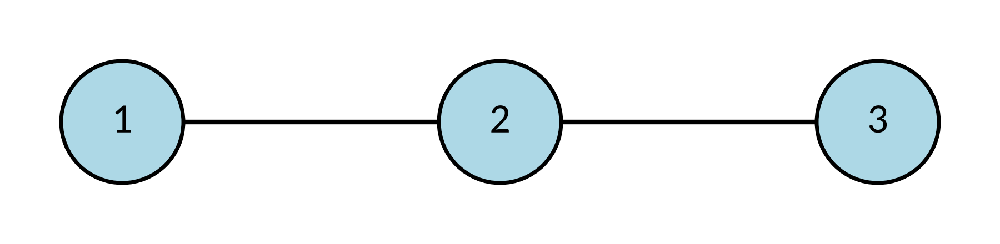<br>Grafo no dirigido</td>
<td align="center">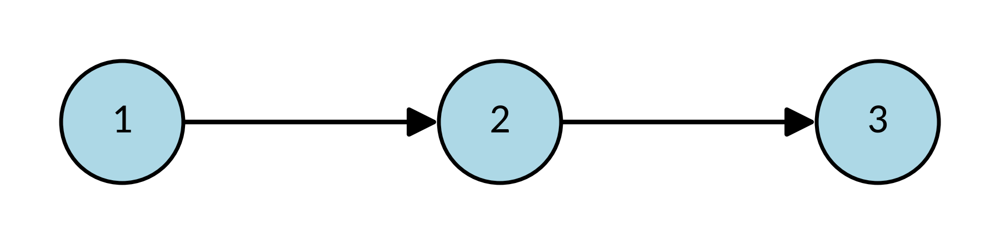<br>Grafo dirigido (dígrafo)</td></tr>
</table>

**Toda relación `R` sobre `A` es un dígrafo:** `G = (A, R)`. Los vértices son los elementos de `A` y las aristas son los pares de `R`.

> [!IMPORTANT]
> **Observación importante:** el diagrama de Hasse se dibuja sin flechas, pero **no** es un grafo no dirigido: la dirección se entiende siempre **hacia arriba**.

### 14. Ejemplo 3: dígrafo de un orden parcial

*(Manuscrito, págs. 24–25.)*

**Ejemplo 3.** Dados los siguientes vértices y aristas, grafique el dígrafo asociado y verifique que representa un orden parcial:

- `V = {a, b, c, d, e}`
- `E = {(a,a), (b,b), (c,c), (d,d), (e,e), (a,c), (c,b), (a,d), (a,e), (e,b), (a,b), (d,b), (d,e)}`

En clase se recordó que las aristas son **tuplas**, por eso el grafo es dirigido. Figura de clase (pág. 25):

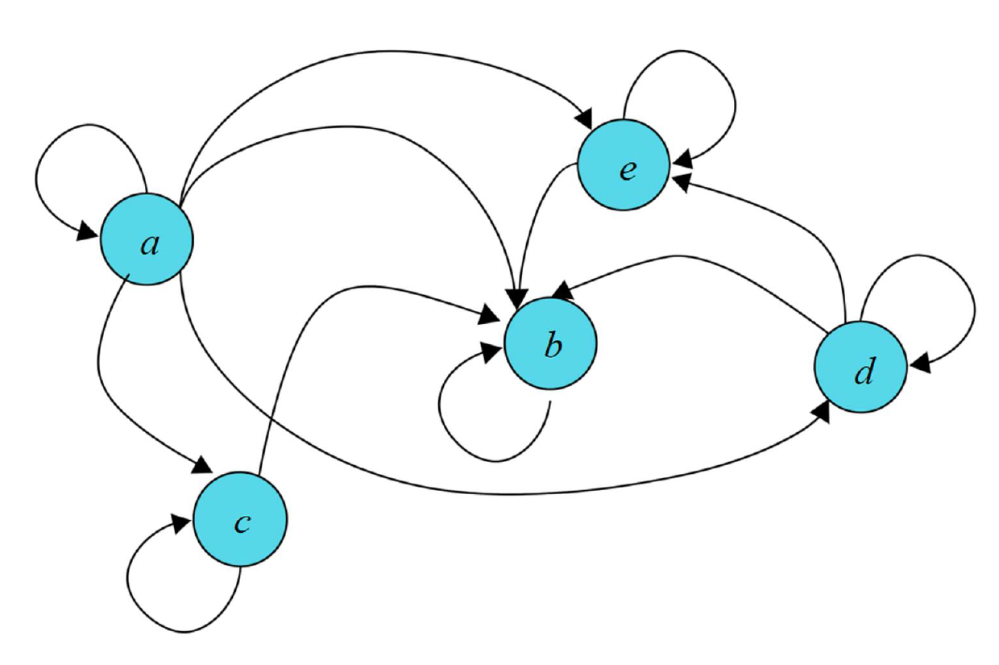

**Matriz binaria** (filas y columnas en el orden `a, b, c, d, e`), tal como se escribió en el manuscrito:

```
      a b c d e
  a [ 1 1 1 1 1 ]
  b [ 0 1 0 0 0 ]
  c [ 0 1 1 0 0 ]
  d [ 0 1 0 1 1 ]
  e [ 0 1 0 0 1 ]
```

- **Reflexiva: sí.** Los 5 vértices tienen lazo; la diagonal es de unos.
- **Antisimétrica: sí.** Ningún par de vértices distintos tiene flechas en ambos sentidos: cada `1` fuera de la diagonal tiene un `0` en su espejo.
- **Transitiva: sí.** Todo camino de dos flechas tiene su atajo. En el manuscrito se verificaron: `(a,c), (c,b) → (a,b)`; `(a,d), (d,b) → (a,b)`; `(a,d), (d,e) → (a,e)`.

**Conclusión:** sí es una relación de orden parcial. Es el mismo orden de la contextualización de la [sección 12](#12-por-qué-hace-falta-el-diagrama-de-hasse); a continuación se obtendrá su diagrama de Hasse.

*Aclaración del apunte:* con tres elementos distintos, los caminos de dos flechas de este orden son cinco: los tres del manuscrito más `(a,e), (e,b) → (a,b)` y `(d,e), (e,b) → (d,b)`. Los dos últimos también tienen su atajo en `E`, y se usan en el Ejemplo 4. Los demás caminos pasan por un lazo y su atajo es el mismo par de llegada.

### 15. Diagrama de Hasse: definición y construcción

*(Manuscrito, págs. 26–27.)*

Un **diagrama de Hasse** es una forma gráfica de representar un conjunto **parcialmente ordenado** `(A, ≼)` de manera simplificada: se **eliminan los lazos** (reflexividad) y los **atajos** (transitividad), y los **elementos mayores se dibujan más arriba**.

**Ejemplo** (Rosen, *Matemática discreta y sus aplicaciones*): la relación `≤` sobre `{1, 2, 3, 4}`. Figura de clase (pág. 26):

<table>
<tr><td align="center">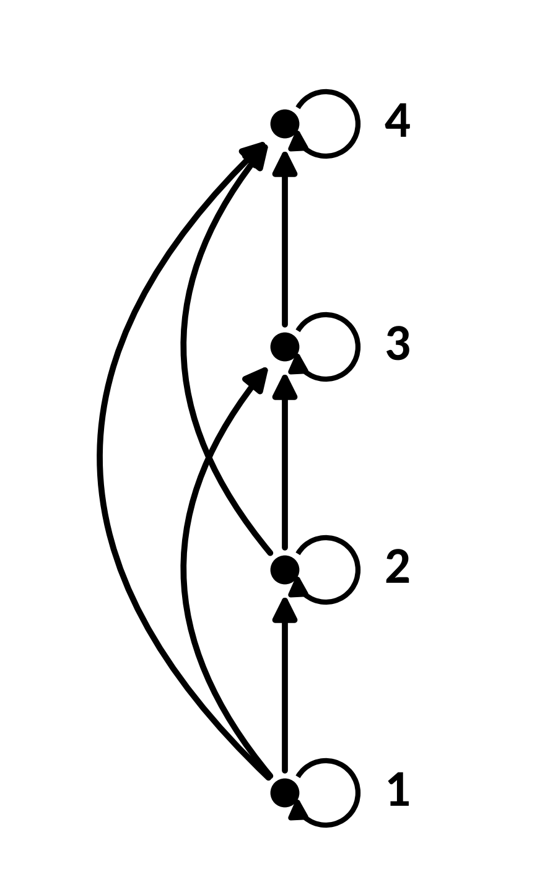<br>Dígrafo de <code>≤</code></td>
<td align="center">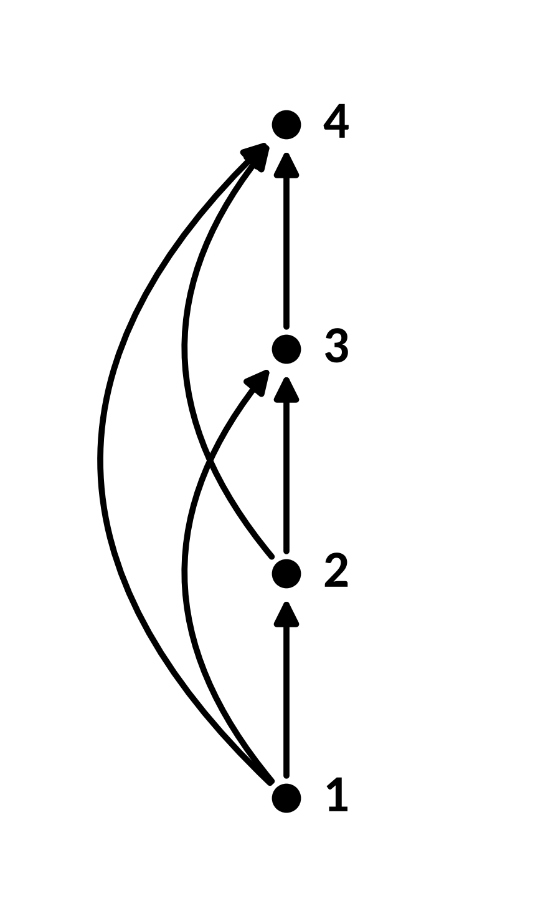<br>Sin lazos</td>
<td align="center">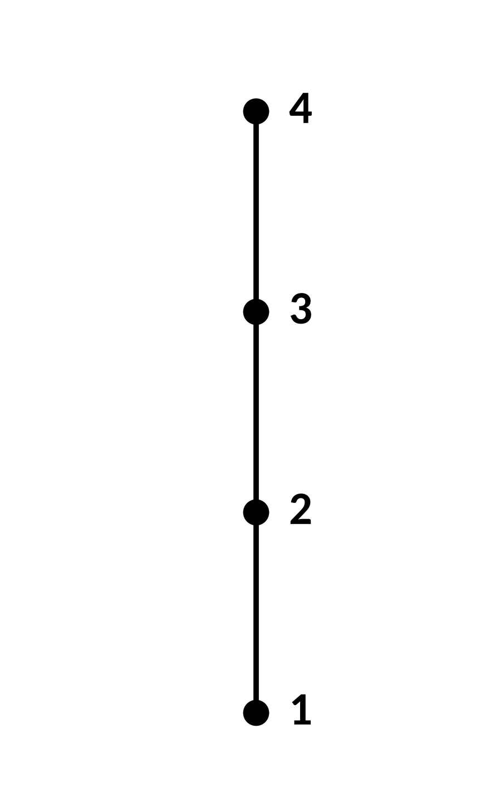<br>Sin atajos ni flechas</td></tr>
</table>

En el manuscrito se marcó la idea de cada paso: el lazo `x → x` se elimina; y si hay `x → y → z`, la flecha directa `x → z` es un atajo y también se elimina. El resultado es la cadena `1 — 2 — 3 — 4`, el diagrama de Hasse.

**Construcción.** Para construir el diagrama de Hasse a partir del dígrafo de un orden parcial `(A, ≼)`:

1. **Eliminar los lazos:** se eliminan los lazos `(x, x)`, porque la reflexividad se da por supuesta.
2. **Eliminar los atajos:** se elimina toda arista `(x, y)` para la que exista `z ∈ A` tal que `x ≺ z ≺ y`. La transitividad permite recuperarla.
3. **Organizar verticalmente:** se redibuja cada arista de modo que su vértice inicial quede debajo del vértice terminal.
4. **Eliminar las flechas:** como todas apuntan hacia arriba, la dirección ya no se necesita.

> [!NOTE]
> **Un estudiante preguntó** qué criterio se usa para organizar los vértices de abajo hacia arriba en los pasos 3 y 4. El profesor respondió que el vértice **inicial** (de donde sale la flecha) va **debajo** del vértice **terminal** (a donde llega). Lo importante es que la posición relativa refleje el orden entre los elementos.

### 16. Ejemplo 4: del dígrafo al Hasse

*(Manuscrito, págs. 28–30; la pág. 30 es la solución impresa, sin anotaciones.)*

**Ejemplo 4.** Aplique los cuatro pasos para obtener el diagrama de Hasse del orden parcial representado por el dígrafo del Ejemplo 3 ([sección 14](#14-ejemplo-3-dígrafo-de-un-orden-parcial)).

En el manuscrito (pág. 29) se resolvió a mano:

- **Paso 1, eliminación de lazos:** se tachan los cinco lazos.
- **Paso 2, eliminación de aristas transitivas:** se tachan tres atajos:
  - `(a,e), (e,b) → (a,b)`: se elimina `(a,b)`.
  - `(d,e), (e,b) → (d,b)`: se elimina `(d,b)`.
  - `(a,d), (d,e) → (a,e)`: se elimina `(a,e)`.

  Quedan cinco aristas: `(a,c)`, `(c,b)`, `(a,d)`, `(d,e)` y `(e,b)`.
- **Pasos 3 y 4, organización vertical y eliminación de flechas:** `a` queda abajo; por una rama suben `d` y luego `e`, y por la otra `c`; las dos ramas llegan a `b`, arriba.

Figura de clase (pág. 30):

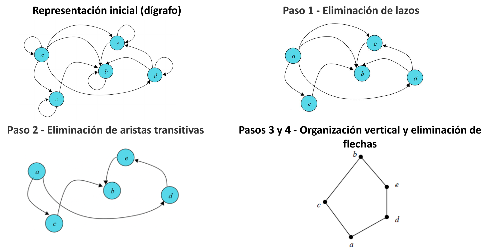

> [!NOTE]
> Según el material de Zoom, un estudiante preguntó por qué la `b` aparecía dos veces en el diagrama: era una `d` mal escrita, y el profesor lo corrigió en el momento. El manuscrito ya está corregido.

### 17. Ejemplo 5: la relación "divide"

*(Manuscrito, págs. 31–35; las págs. 34–35 son la solución impresa, sin anotaciones.)*

**Ejemplo 5.** Sea `A = {1, 2, 3, 4, 12}` y `R` un orden parcial ("divide") sobre `A`, definido como:

`R = {(a, b) ∈ A × A | a | b}`

Es decir, `a ≼ b` si y solo si **`a` divide a `b`** (en Python: `b % a == 0`). Por ejemplo, `2 | 4` es verdadero (`4 % 2 = 0`), pero `3 | 4` es falso (`4 % 3 = 1`).

Obtenga:

1. La representación en pares ordenados de `(A, ≼)`.
2. La representación como dígrafo de `(A, ≼)`.
3. El diagrama de Hasse de `(A, ≼)`.
4. ¿Es `(A, ≼)` un orden total? Justifique.

**1. Pares ordenados.**

`R = {(1,1), (1,2), (1,3), (1,4), (1,12), (2,2), (2,4), (2,12), (3,3), (3,12), (4,4), (4,12), (12,12)}`

**Matriz binaria** (filas y columnas en el orden `1, 2, 3, 4, 12`):

```
       1  2  3  4 12
   1 [ 1  1  1  1  1 ]
   2 [ 0  1  0  1  1 ]
   3 [ 0  0  1  0  1 ]
   4 [ 0  0  0  1  1 ]
  12 [ 0  0  0  0  1 ]
```

- **Reflexiva: sí.** Todo número se divide a sí mismo: la diagonal es de unos.
- **Antisimétrica: sí.** Cada `1` fuera de la diagonal tiene un `0` en su espejo.
- **Transitiva: sí** (se revisa en el dígrafo). En el manuscrito: `(2,4), (4,12) → (2,12)`; `(1,2), (2,12) → (1,12)`.

*Aclaración del apunte:* con tres elementos distintos hay cinco caminos de dos flechas: `1 → 2 → 4`, `1 → 2 → 12`, `1 → 3 → 12`, `1 → 4 → 12` y `2 → 4 → 12`. Sus atajos `(1,4)`, `(1,12)`, `(2,12)` están todos en `R`.

**2. Dígrafo** (figura de clase, pág. 32):

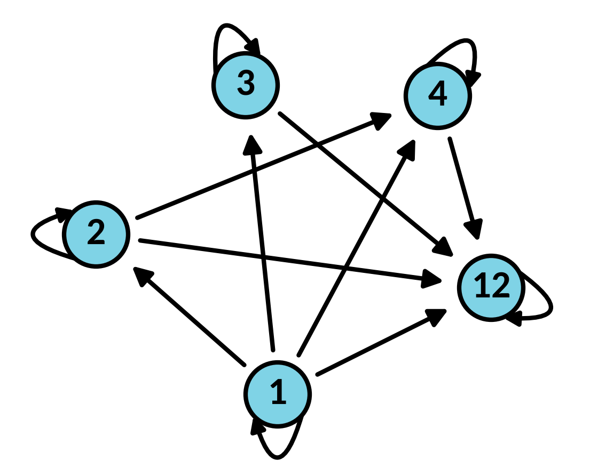

**3. Diagrama de Hasse.** En el manuscrito (pág. 33) se tacharon los lazos y tres atajos: `(1,4)` (por `1 → 2 → 4`), `(2,12)` (por `2 → 4 → 12`) y `(1,12)`.

> [!NOTE]
> **Un estudiante preguntó** si también se tachaba la arista de `1` a `12`, ya que hay un camino `1 → 3 → 12`. El profesor confirmó que **sí**: también es un atajo y debe eliminarse.

Figura de clase (págs. 34–35):

<table>
<tr><td align="center">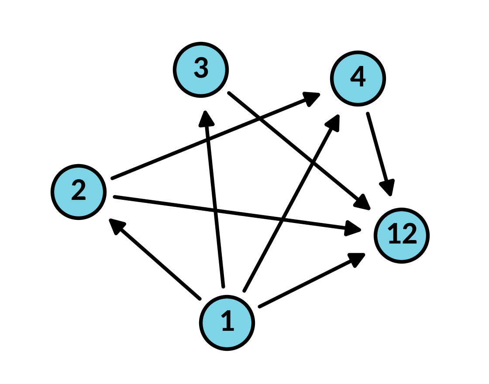<br>Paso 1: eliminación de lazos</td>
<td align="center">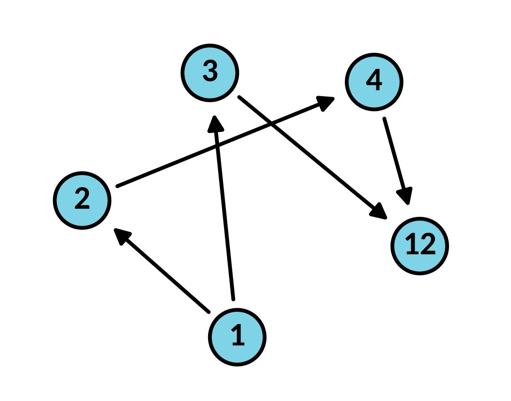<br>Paso 2: eliminación de atajos</td></tr>
<tr><td align="center">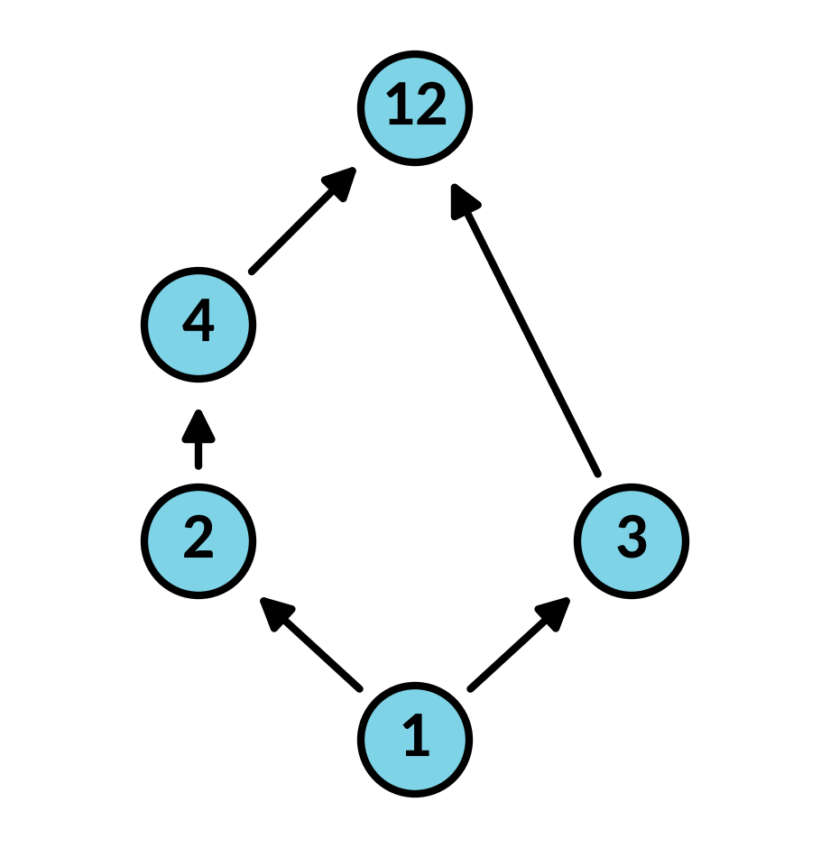<br>Paso 3: organización vertical</td>
<td align="center">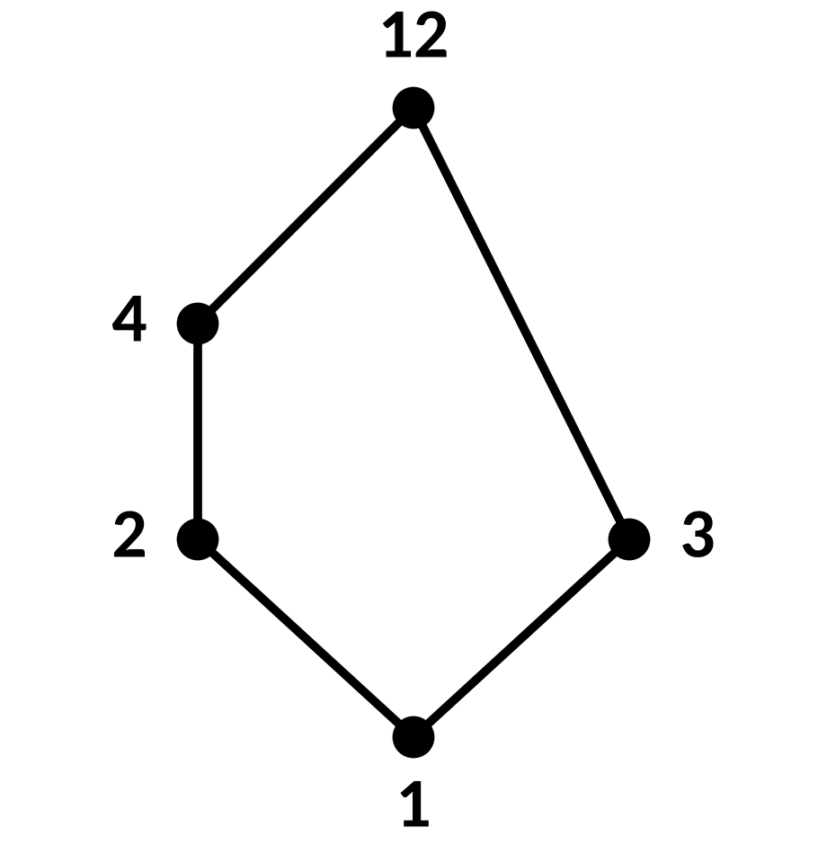<br>Paso 4: diagrama de Hasse</td></tr>
</table>

El diagrama tiene dos ramas: `1 — 2 — 4 — 12` y `1 — 3 — 12`.

**4. ¿Es un orden total?** **No:** 2 y 3 no son comparables (`2 ∤ 3` y `3 ∤ 2`); el diagrama tiene dos ramas.

### 18. Resumen comparativo: orden parcial frente a orden total

*(Manuscrito, págs. 36–37.)*

| Característica | Relación de orden parcial | Relación de orden total |
|---|---|---|
| Definición | Una relación reflexiva, antisimétrica y transitiva. | Un orden parcial que además cumple la totalidad (todo par es comparable). |
| Propiedades | 1. Reflexividad · 2. Antisimetría · 3. Transitividad | 1. Reflexividad · 2. Antisimetría · 3. Transitividad · 4. **Totalidad**: `∀x∀y (x ≼ y ∨ y ≼ x)` |
| Comparabilidad | No se exige. Pueden existir elementos incomparables. | Todo par de elementos es comparable: `x ≼ y ∨ y ≼ x`. |
| Diagrama de Hasse | **Puede tener ramas**: los elementos incomparables quedan en caminos distintos. | **En un conjunto finito**, es una sola cadena vertical, sin ramas. |
| Ejemplos de la clase | Ejemplo 1 (`R₁`); Ejemplo 5 ("divide" sobre `{1, 2, 3, 4, 12}`); Ejemplos 3 y 4. | Ejemplo 2 (`R₂`, `≤` sobre `{1, 2, 3}`); `≤` sobre `{1, 2, 3, 4}`. |
| Ejemplo clásico | La relación "es subconjunto de" (`⊆`) sobre conjuntos. | La relación "menor o igual que" (`≤`) sobre los números reales. |
| Analogía | Las dependencias entre tareas de un proyecto (algunas pueden hacerse en paralelo: son incomparables). | Las palabras de un diccionario (siempre se puede decir cuál va antes). |

### 19. Ejemplo 6: Hasse de un orden parcial y de un orden total

*(Manuscrito, págs. 38–39.)*

**Ejemplo 6.** Sea `A = {1, 2, 3}` y las relaciones de orden analizadas en los Ejemplos 1 y 2:

- Relación de orden parcial: `R₁ = {(1,1), (2,2), (3,3), (1,2), (1,3)}`.
- Relación de orden total: `R₂ = {(1,1), (1,2), (1,3), (2,2), (2,3), (3,3)}`.

Obtenga el diagrama de Hasse de cada una y compare.

**`R₁`** (matriz en la [sección 8](#8-ejemplo-1-de-orden-parcial)). En el dígrafo se tachan los tres lazos; no hay atajos que eliminar. Al organizar verticalmente, `1` queda abajo y `2` y `3` arriba. Figura de clase (pág. 38):

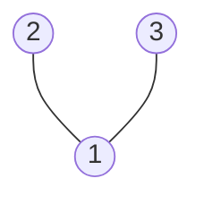

El diagrama tiene **dos ramas**: 2 y 3 no están unidos por ninguna línea, porque son incomparables. Por lo tanto, `R₁` es un orden parcial, pero no total.

**`R₂`** (matriz en la [sección 11](#11-ejemplo-2-de-orden-total)). En el dígrafo se tachan los lazos y el atajo `1 → 3`, que se recupera por `1 → 2 → 3`. Figura de clase (pág. 39):


El diagrama es **una sola cadena vertical**: todos los elementos son comparables. Por lo tanto, `R₂` es un orden total.

### 20. Ejemplo 7: subconjunto sobre el conjunto potencia

*(Manuscrito, págs. 40–42; la pág. 42 es la solución impresa, sin anotaciones.)*

**Ejemplo 7.** Obtenga el diagrama de Hasse de la relación "es subconjunto de" (`⊆`) sobre el conjunto `𝒫({a, b, c})`. Es decir, para todos los subconjuntos `U` y `V` de `{a, b, c}`:

`U ⊆ V ⟺ ∀x (x ∈ U → x ∈ V)`

**Solución.** Como `{a, b, c}` tiene `n = 3` elementos, `𝒫({a, b, c})` tiene `|𝒫({a, b, c})| = 2³ = 8` elementos ([clase 12](../clase-12/)):

`𝒫({a, b, c}) = {∅, {a}, {b}, {c}, {a,b}, {b,c}, {a,c}, {a,b,c}}`

**Matriz de adyacencia** de `⊆` sobre estos 8 elementos (fila `U`, columna `V`: `1` si `U ⊆ V`):

```
             ∅  {a} {b} {c} {a,b} {b,c} {a,c} {a,b,c}
  ∅       [  1   1   1   1    1     1     1      1   ]
  {a}     [  0   1   0   0    1     0     1      1   ]
  {b}     [  0   0   1   0    1     1     0      1   ]
  {c}     [  0   0   0   1    0     1     1      1   ]
  {a,b}   [  0   0   0   0    1     0     0      1   ]
  {b,c}   [  0   0   0   0    0     1     0      1   ]
  {a,c}   [  0   0   0   0    0     0     1      1   ]
  {a,b,c} [  0   0   0   0    0     0     0      1   ]
```

En la diapositiva también está la tabla de adyacencia, con una `X` en cada casilla donde la matriz tiene `1`.

Figura de clase (pág. 42): el dígrafo distingue las **12 líneas del Hasse**, los **7 atajos** y los **8 lazos**; el diagrama de Hasse queda organizado por niveles.

<table>
<tr><td align="center">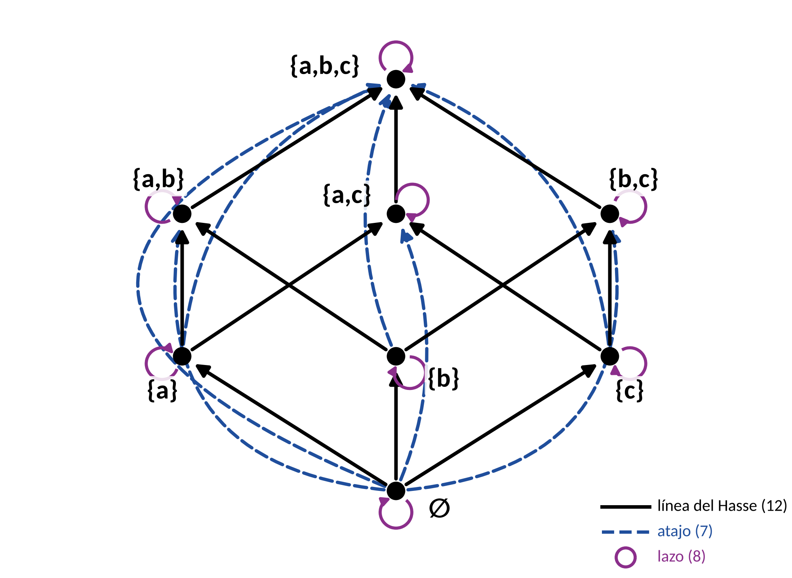<br>Dígrafo</td>
<td align="center">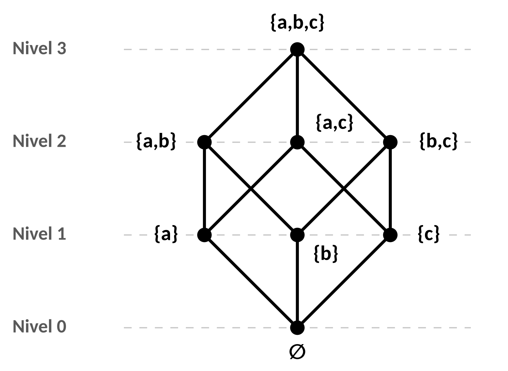<br>Diagrama de Hasse</td></tr>
</table>

*Aclaración del apunte:* en el diagrama de Hasse, el nivel de cada subconjunto es su número de elementos (de `∅` en el nivel 0 a `{a, b, c}` en el nivel 3), y cada línea une un subconjunto con otro que tiene exactamente un elemento más. Como verificación, `8 + 12 + 7 = 27`, que es el número de unos de la matriz.

### 21. Ejemplo 8: del Hasse al dígrafo

*(Manuscrito, págs. 43–45; la pág. 45 es la solución impresa, sin anotaciones.)*

**Ejemplo 8.** Una relación de orden parcial `R` tiene el siguiente diagrama de Hasse. Determine el dígrafo de `R`.

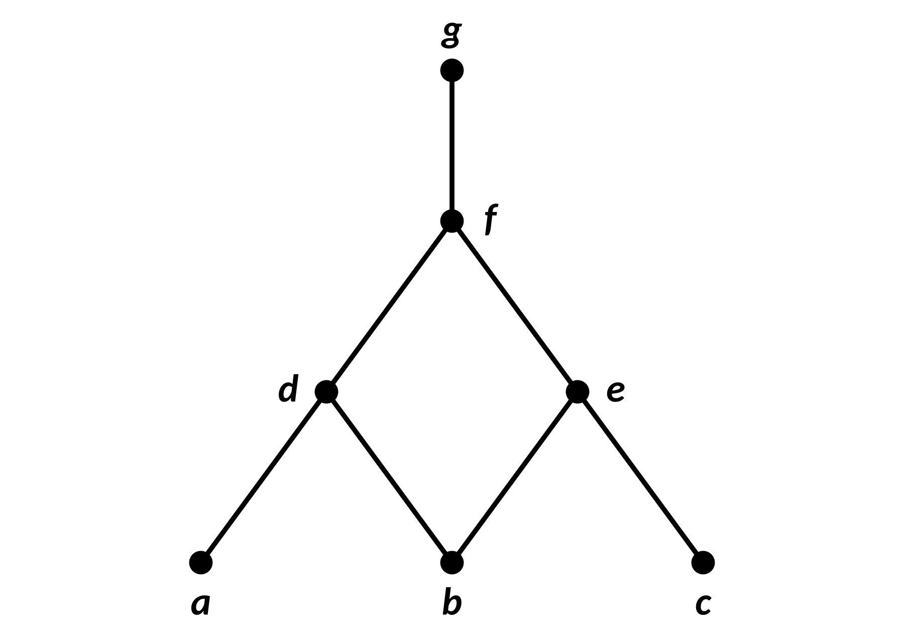

En el diagrama: `d` está por encima de `a` y de `b`; `e`, por encima de `b` y de `c`; `f`, por encima de `d` y de `e`; y `g`, por encima de `f`.

Para reconstruir el dígrafo se **deshacen los pasos de la construcción**:

1. **Orientar:** cada línea se convierte en una flecha hacia arriba.
2. **Agregar los lazos:** un lazo en cada vértice (reflexividad).
3. **Agregar los atajos:** una flecha de `x` a `z` siempre que haya un camino hacia arriba de `x` a `z` (transitividad).

**Solución.** A partir del diagrama de Hasse se construyen la tabla y la matriz de adyacencia. En cada fila `x` se marcan `x` mismo y todos los elementos que están por encima de `x` en el diagrama (a los que se llega subiendo por las líneas).

| `R` | `a` | `b` | `c` | `d` | `e` | `f` | `g` |
|---|---|---|---|---|---|---|---|
| **`a`** | X | | | X | | X | X |
| **`b`** | | X | | X | X | X | X |
| **`c`** | | | X | | X | X | X |
| **`d`** | | | | X | | X | X |
| **`e`** | | | | | X | X | X |
| **`f`** | | | | | | X | X |
| **`g`** | | | | | | | X |

```
      a b c d e f g
  a [ 1 0 0 1 0 1 1 ]
  b [ 0 1 0 1 1 1 1 ]
  c [ 0 0 1 0 1 1 1 ]
  d [ 0 0 0 1 0 1 1 ]
  e [ 0 0 0 0 1 1 1 ]
  f [ 0 0 0 0 0 1 1 ]
  g [ 0 0 0 0 0 0 1 ]
```

En el manuscrito (pág. 44) se resaltaron las líneas del Hasse y se dibujaron en verde los atajos que se agregan. Figura de clase (pág. 45), la representación definitiva del diagrama de Hasse como dígrafo, con **7 líneas del Hasse**, **8 atajos** y **7 lazos**:

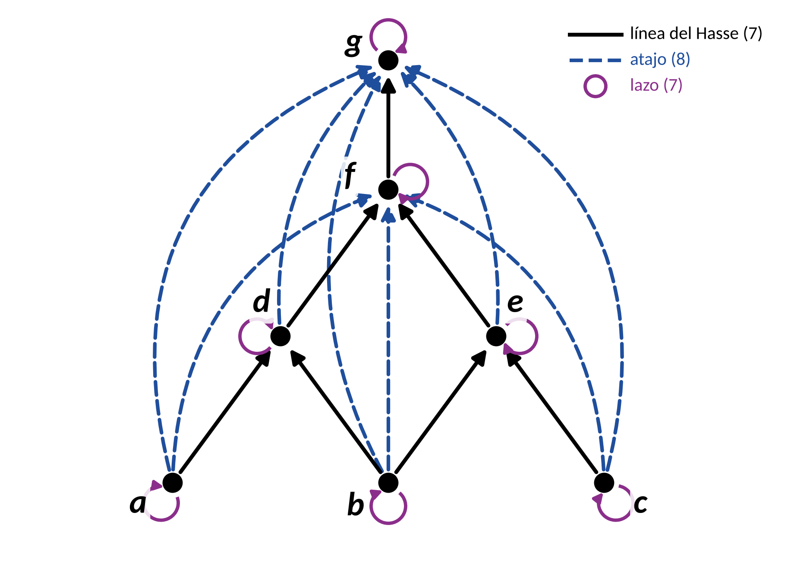

*Aclaración del apunte:* los 8 atajos son `(a,f)`, `(a,g)`, `(b,f)`, `(b,g)`, `(c,f)`, `(c,g)`, `(d,g)` y `(e,g)`. Como verificación, `7 + 8 + 7 = 22`, que es el número de unos de la matriz.

### 22. Cierre

*(Manuscrito, pág. 46.)*

- Un **orden parcial** es una relación reflexiva, antisimétrica y transitiva: `(A, ≼)`.
- Es un **orden total** si, además, todo par de elementos es comparable.
- El **diagrama de Hasse** representa un orden parcial sin lazos, sin atajos y sin flechas (los elementos mayores, arriba).
- **Del dígrafo al Hasse:** eliminar lazos → eliminar atajos → organizar hacia arriba → quitar flechas.
- **Del Hasse al dígrafo:** orientar hacia arriba → agregar lazos → agregar atajos.

En el manuscrito se anotó: «**Hasta aquí va el parcial**» ([→ Evaluación](#evaluación)).

Para practicar puede usar el [Taller 8 – Órdenes Parciales](https://discretas1-udea.github.io/discretas1-udea-20262/resources/talleres/taller8/) del sitio del curso; tenga en cuenta que puede incluir temas que no entran al parcial 3, como los elementos extremos y las cotas.

### Síntesis de la clase

*Aclaración del apunte:* un resumen de lo esencial, sin contenido nuevo.

**Ideas clave:**

1. **Las propiedades se leen en la matriz y en el dígrafo**: diagonal y lazos (reflexiva), espejo y regreso (simétrica), un `1` con un `0` en su espejo (antisimétrica), atajos (transitiva) ([secciones 1](#1-repaso-de-la-clase-anterior) y [9](#9-repaso-al-inicio-de-la-segunda-sesión)).
2. **Una sola propiedad cambia el tipo de relación**: reflexiva + simétrica + transitiva es una equivalencia; reflexiva + antisimétrica + transitiva es un orden parcial. Basta un par de elementos distintos con ida y vuelta para que no sea un orden ([secciones 4](#4-y-si-se-cambia-la-simetría) y [5](#5-relación-antisimétrica-repaso-y-negación)).
3. **Orden total = orden parcial + totalidad** (todo par es comparable). Se verifica en dos partes, y su diagrama de Hasse es una sola cadena; un orden parcial con elementos incomparables tiene ramas ([secciones 10](#10-orden-total), [11](#11-ejemplo-2-de-orden-total) y [19](#19-ejemplo-6-hasse-de-un-orden-parcial-y-de-un-orden-total)).
4. **El diagrama de Hasse solo existe para órdenes** y se obtiene del dígrafo en cuatro pasos: eliminar lazos, eliminar atajos, organizar hacia arriba y quitar flechas ([secciones 15](#15-diagrama-de-hasse-definición-y-construcción) a [17](#17-ejemplo-5-la-relación-divide)).
5. **Del Hasse al dígrafo se deshacen los pasos**: orientar hacia arriba, agregar lazos y agregar atajos; en la tabla, cada fila marca el elemento y todo lo que está por encima de él ([sección 21](#21-ejemplo-8-del-hasse-al-dígrafo)).

> [!IMPORTANT]
> **Errores y dudas de esta clase:**
>
> - **`9 − 3` debía dar `6` positivo** (señalado por un estudiante y corregido en clase): `(9, 3) ∈ R` porque `3 | 6` ([sección 2](#2-la-relación-3--x--y)).
> - **¿"Parcial" y "total" se aplican a cada propiedad o a la relación?** A la relación completa; los órdenes totales son un subconjunto de los parciales ([sección 9](#9-repaso-al-inicio-de-la-segunda-sesión)).
> - **Criterio para organizar verticalmente:** el vértice inicial de cada flecha va debajo del terminal ([sección 15](#15-diagrama-de-hasse-definición-y-construcción)).
> - **Una `b` escrita en lugar de una `d`** en el Ejemplo 4, corregida en clase ([sección 16](#16-ejemplo-4-del-dígrafo-al-hasse)).
> - **La arista `1 → 12` del Ejemplo 5 también es un atajo** (por `1 → 3 → 12`, entre otros) y se elimina ([sección 17](#17-ejemplo-5-la-relación-divide)).
> - Erratas menores de las diapositivas, corregidas en este apunte: `𝒫({a, b, c})` lista `{b}` dos veces y omite `{c}` (pág. 40); la observación «Es el mismo orden de la» quedó cortada (pág. 25); «Hass» por «Hasse» (pág. 38) y «diágrafo» por «dígrafo» (pág. 45).

## Evaluación

| Ítem | Detalle |
|---|---|
| Parcial 3 y supletorio del parcial 2 | Sábado 14/11/2026, 8:00–10:00 (aviso en la pág. 2 del manuscrito). |
| Material permitido en el parcial 3 | Apuntes a mano y libros, solo en papel; nada digital. |
| Alcance del parcial 3 | Todo lo visto hasta el cierre de esta clase (pág. 46: «Hasta aquí va el parcial»): relaciones, sus representaciones y propiedades, relaciones de orden parcial y total, dígrafos, diagramas de Hasse y el paso entre dígrafo y Hasse en los dos sentidos. Como se informó en la [clase 15](../clase-15/#evaluación), **no** se evalúan los elementos extremos (máximos, mínimos, maximales, minimales) ni las cotas. |
| Supletorio del parcial 2 | El profesor enviaría en la noche del 10/11 la lista de quienes lo presentan; los interesados debían confirmarlo ese mismo día. |
| Notas del parcial 2 | Se enviarán en un archivo de Excel; el profesor espera tenerlas listas el fin de semana. |
