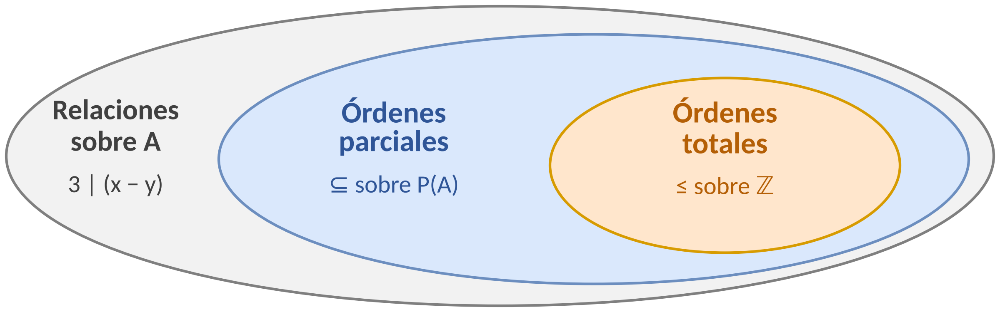

# Clase 17 — Relaciones de orden

> **Fecha**: 05/11/2026 (continúa el 10/11/2026) · **Modalidad**: Virtual sincrónica · **Apuntes**: [Diapositivas PDF](./clase17.pdf) · [PPT](./clase17.pptx) · [Manuscrito anotado](./clase17_annotated.pdf)
>
> La sesión del 05/11 empezó terminando la [clase 16](../clase-16/) y siguió con las págs. 1–17 de este manuscrito. La pág. 18 tiene la marca «Fin: 05/11/2026 · Inicio: 10/11/2026»: las págs. 18–46 se verán el 10/11.

> [!IMPORTANT]
> **Apunte en construcción.** Por ahora documenta solo lo dictado el **05/11** (págs. 1–17), para que pueda estudiarlo antes del parcial 3. Se completará después de la sesión del **10/11** con el orden total, los diagramas de Hasse y el paso del Hasse al dígrafo.

## Objetivos de la clase

- Repasar las propiedades reflexiva, simétrica, antisimétrica y transitiva, y su lectura en la matriz binaria y el dígrafo.
- Mostrar, con la relación `3 | (x − y)`, que al cambiar una sola propiedad cambia el tipo de relación (equivalencia frente a orden parcial).
- Definir la relación de orden parcial y la de orden total, con la notación `≼` y el concepto de conjunto parcialmente ordenado (poset).

## Resumen

La sesión del 05/11 repasó las representaciones y las propiedades con la relación `T` de la clase 16. Luego se analizó la relación `3 | (x − y)` sobre `{2, 3, 4, 6, 7, 9}`, que es reflexiva, simétrica y transitiva; con ella se mostró que, si se cambia la simetría por la antisimetría, se obtiene una relación de orden parcial. Se repasó la antisimetría con dos ejemplos, se definieron el orden parcial y el orden total y se resolvió un primer ejemplo de orden parcial. La clase continúa el 10/11.

## Agenda

**Sesión 1 — 05/11/2026** (después de terminar la [clase 16](../clase-16/))

1. Repaso: representaciones y propiedades con la relación `T`. [*(→ sección 1)*](#1-repaso-de-la-clase-anterior)
2. La relación `3 | (x − y)`: tabla de verificación y representaciones. [*(→ sección 2)*](#2-la-relación-3--x--y)
3. Análisis del dígrafo y de la matriz: reflexiva, simétrica y transitiva. [*(→ sección 3)*](#3-análisis-del-dígrafo-y-de-la-matriz)
4. ¿Y si se cambia la simetría? Equivalencia frente a orden parcial. [*(→ sección 4)*](#4-y-si-se-cambia-la-simetría)
5. Relación antisimétrica: repaso, negación y ejemplo. [*(→ sección 5)*](#5-relación-antisimétrica-repaso-y-negación)
6. Definición de relación de orden parcial y de orden total. [*(→ sección 6)*](#6-relaciones-de-orden-definición)
7. Notación `≼` y conjunto parcialmente ordenado (poset). [*(→ sección 7)*](#7-notación--y-poset)
8. Ejemplo 1 de orden parcial. [*(→ sección 8)*](#8-ejemplo-1-de-orden-parcial)

**Sesión 2 — 10/11/2026**: pendiente (págs. 18–46).

## Contenido temático

> [!NOTE]
> **Cómo leer este apunte.**
>
> - Las secciones numeradas siguen el orden en que se dictó la clase. **Sesión 1 (05/11), secciones 1 a 8**: manuscrito, págs. 1–17.
> - Hay dos "Ejemplo 1" en las diapositivas: el de la antisimetría (sección 5) y el de orden parcial (sección 8). Aquí se llaman *ejemplo de antisimetría* y *Ejemplo 1 de orden parcial*.
> - Los párrafos que empiezan con *Aclaración del apunte* se agregaron al redactar: no se dijeron en clase. Sirven para conectar ideas o evitar confusiones.

**Notación usada en este apunte**

| Símbolo | Se lee | Observación |
|---|---|---|
| `R ⊆ A × A` | relación sobre `A` | [Clase 15](../clase-15/). |
| `M_R = [m_ij]` | matriz binaria de `R` | `m_ij = 1` si `(i, j) ∈ R` ([clase 16](../clase-16/)). |
| `M_R = M_Rᵀ` | la matriz es igual a su transpuesta | Es decir, simétrica respecto a la diagonal. |
| `a \| b` | `a` divide a `b` | `b` es múltiplo de `a`; en Python, `b % a == 0`. |
| `x ≼ y` | `x` precede a `y` | Notación para `(x, y) ∈ R` cuando `R` es un orden parcial (sección 7). |
| `x ≺ y` | `x` precede estrictamente a `y` | `x ≼ y ∧ x ≠ y`. |
| `(A, ≼)` | conjunto parcialmente ordenado (poset) | Sección 7. |
| `≤` | el orden usual entre números | Se reserva para números; `≼` es cualquier orden parcial. |

### 1. Repaso de la clase anterior

*(Manuscrito, págs. 3–5.)*

Con `A = {1, 2, 3, 4}` y `T = {(1,1), (1,2), (1,4), (2,1), (2,2), (3,3), (4,1), (4,4)}` (la `T` de la [clase 16](../clase-16/)), cada par `(x, y) ∈ T` es una `X` en la fila `x`, columna `y` de la tabla matricial; un `1` en la matriz; y una flecha de `x` a `y` en el dígrafo.

`M_T` = `1101` · `1100` · `0010` · `1001`

Propiedades que se usarán en esta clase:

| Propiedad | Descripción formal | En la matriz binaria | En el dígrafo |
|---|---|---|---|
| Reflexiva | `∀x ((x, x) ∈ R)` | Toda la diagonal principal es 1: `m_ii = 1` | Todos los vértices tienen lazo |
| Simétrica | `∀x∀y ((x, y) ∈ R → (y, x) ∈ R)` | Simétrica respecto a la diagonal: `m_ij = m_ji` | Toda flecha tiene su regreso |
| Antisimétrica | `∀x∀y ((x, y) ∈ R ∧ (y, x) ∈ R → x = y)` | Fuera de la diagonal, `m_ij` y `m_ji` nunca son ambos 1 | Entre vértices distintos, nunca hay ida y vuelta |
| Transitiva | `∀x∀y∀z ((x, y) ∈ R ∧ (y, z) ∈ R → (x, z) ∈ R)` | Si `m_ij = 1` y `m_jk = 1`, entonces `m_ik = 1` | Todo camino de dos flechas tiene su atajo |

En clase se clasificó `T`: **reflexiva** (diagonal de unos), **simétrica** (`M_T = M_Tᵀ`), **no antisimétrica** (`m₁₂ = m₂₁ = 1`) y **no transitiva**: `(2,1)` y `(1,4)` están en `T`, pero `(2,4)` no (`m₂₁ = m₁₄ = 1`, pero `m₂₄ = 0`).

### 2. La relación `3 | (x − y)`

*(Manuscrito, págs. 6–8.)*

**Ejemplo.** Sea `A = {2, 3, 4, 6, 7, 9}` y la relación sobre `A`:

`R = {(x, y) ∈ A × A | 3 | (x − y)}`

Obtenga las representaciones de `R`: pares ordenados, matriz binaria y dígrafo.

En clase se recordó que `a | b` se lee "`a` divide a `b`": `b % a = 0`, es decir, `b` es múltiplo de `a`. Aquí la propiedad `P(x, y)` es que **`x − y` es múltiplo de 3**:

- `(2, 7)`: `P(2, 7) = 3 | (2 − 7) = 3 | (−5)`: **no**, luego `(2, 7) ∉ R`.
- `(9, 3)`: `P(9, 3) = 3 | (9 − 3) = 3 | 6`: **sí** (`6 = 3 · 2`), luego `(9, 3) ∈ R`.

> [!NOTE]
> Según el material de Zoom, un estudiante señaló en clase que `9 − 3` debía dar `6` positivo, y el profesor lo confirmó: como `6` es múltiplo de 3, `(9, 3)` pertenece a la relación. En el manuscrito ya aparece `3 | 6`.

**Tabla de verificación** (extracto; en la diapositiva hay una fila por par revisado):

| `(x, y)` | `x − y` | `3 \| (x − y)` | Resultado |
|---|---|---|---|
| `(2,2)` | `0` | `3 \| 0` | Verdadero |
| `(2,3)` | `−1` | `3 \| (−1)` | Falso |
| `(6,3)` | `3` | `3 \| 3` | Verdadero |
| `(3,6)` | `−3` | `3 \| (−3)` | Verdadero |
| `(9,3)` | `6` | `3 \| 6` | Verdadero |
| `(3,9)` | `−6` | `3 \| (−6)` | Verdadero |

La relación está formada por todas las parejas cuya diferencia es divisible por 3:

`R = {(2,2), (3,3), (4,4), (6,6), (7,7), (9,9), (6,3), (3,6), (7,4), (4,7), (9,6), (6,9), (9,3), (3,9)}`

**Matriz binaria** (filas y columnas en el orden `2, 3, 4, 6, 7, 9`):

```
       2 3 4 6 7 9
  2  [ 1 0 0 0 0 0 ]
  3  [ 0 1 0 1 0 1 ]
  4  [ 0 0 1 0 1 0 ]
  6  [ 0 1 0 1 0 1 ]
  7  [ 0 0 1 0 1 0 ]
  9  [ 0 1 0 1 0 1 ]
```

**Dígrafo:** tres grupos separados: `2` solo con su lazo; `4` y `7` unidos en los dos sentidos; y `3`, `6`, `9` unidos todos con todos en los dos sentidos, cada uno con su lazo.

### 3. Análisis del dígrafo y de la matriz

*(Manuscrito, págs. 9–10.)*

El dígrafo cumple tres propiedades:

1. **Reflexiva:** todos los vértices tienen lazo. En la matriz, toda la diagonal principal es 1.
2. **Simétrica:** toda flecha tiene su regreso. En la matriz, `m_ij = m_ji` (por ejemplo, `m₃₆ = m₆₃ = 1`).
3. **Transitiva:** todo camino de dos flechas tiene su atajo; no hay "triángulos dirigidos incompletos". En la matriz, si `m_ij = 1` y `m_jk = 1`, entonces `m_ik = 1` (por ejemplo, `m₃₆ = 1` y `m₆₉ = 1`, y también `m₃₉ = 1`).

En clase se dibujó el esquema del atajo: si hay flechas `a → b` y `b → c`, debe haber también `a → c`; en el dígrafo de `R`, por ejemplo, `(3, 6)` y `(6, 9)` con su atajo `(3, 9)`.

### 4. ¿Y si se cambia la simetría?

*(Manuscrito, pág. 11.)*

`R` es **reflexiva, simétrica y transitiva**: es una **relación de equivalencia**. Su dígrafo se separa en "islas": `{2}`, `{4, 7}`, `{3, 6, 9}`, los números que dejan el mismo residuo al dividirse por 3; en la matriz, las filas de una misma isla son iguales. (Este tema se estudiará más adelante.)

Al cambiar una sola propiedad cambia el tipo de relación:

- Reflexiva + **Simétrica** + Transitiva → **relación de equivalencia**.
- Reflexiva + **Antisimétrica** + Transitiva → **relación de orden parcial** (tema de esta clase).

Recuerde la diferencia: **simetría**, toda flecha tiene su regreso; **antisimetría**, entre vértices distintos nunca hay regreso.

### 5. Relación antisimétrica: repaso y negación

*(Manuscrito, págs. 12–14.)*

En el dígrafo, una relación es antisimétrica si entre dos vértices distintos nunca hay flechas en ambos sentidos; los lazos `(x, x)` sí están permitidos.

`R es antisimétrica ⟺ ∀x∀y ((x, y) ∈ R ∧ (y, x) ∈ R → x = y)`

**Negación:**

`R no es antisimétrica ⟺ ∃x∃y ((x, y) ∈ R ∧ (y, x) ∈ R ∧ x ≠ y)`

Basta encontrar un par de elementos distintos con "ida y vuelta" para que `R` no sea antisimétrica y, por tanto, **no sea un orden parcial**.

**Ejemplo de antisimetría** (Ejemplo 1 de la diapositiva). Sea `A = {0, 1, 2}` y las relaciones `R₁ = {(0,2), (1,2), (2,0)}` y `R₂ = {(0,0), (0,1), (0,2), (1,1), (1,2)}`. Represente el dígrafo de cada una y determine si es antisimétrica.

- **`R₁`**: `(0,2) ∈ R₁` y `(2,0) ∈ R₁`, pero `0 ≠ 2`: hay ida y vuelta, así que `R₁` **no es antisimétrica**. En la matriz `M_R₁` = `001` · `001` · `100`, las entradas `(0,2)` y `(2,0)` valen 1 a la vez, fuera de la diagonal. En clase se anotó además que `R₁` es **no simétrica** (`(1,2)` sin `(2,1)`) y **no antisimétrica**.
- **`R₂`**: `(0,1)` sin `(1,0)`, `(0,2)` sin `(2,0)`, `(1,2)` sin `(2,1)`: ningún par de elementos distintos tiene ida y vuelta, así que `R₂` **es antisimétrica**. Los lazos `(0,0)` y `(1,1)` no afectan la antisimetría. En la matriz `M_R₂` = `111` · `011` · `000`, fuera de la diagonal nunca hay dos entradas simétricas que valgan 1 a la vez.

### 6. Relaciones de orden: definición

*(Manuscrito, pág. 15.)*

Una relación `R ⊆ A × A` es de **orden parcial** si es:

**reflexiva + antisimétrica + transitiva**

En clase se recordó cómo se ve cada una: diagonal de unos en la matriz (reflexiva), unos sin su simétrico fuera de la diagonal (antisimétrica) y "atajos" en el dígrafo (transitiva).

Una relación de orden parcial es de **orden total** si, además, **todo par de elementos es comparable**: para cualquier `x, y ∈ A`, se cumple `x R y` o `y R x`.

Figura de clase (pág. 15):



Ejemplos:

- `3 | (x − y)` **no** es de orden: no es antisimétrica (secciones 2 a 4).
- `⊆` (sobre el conjunto potencia `𝒫(A)`) es un **orden parcial**.
- `≤` (sobre `ℤ`) es un **orden total**.

### 7. Notación `≼` y poset

*(Manuscrito, pág. 16.)*

Cuando `R` es una relación de orden parcial sobre `A`, se acostumbra escribir `x ≼ y` en lugar de `(x, y) ∈ R`, y se lee "**`x` precede a `y`**". El par `(A, ≼)` se llama **conjunto parcialmente ordenado** (en inglés, *poset*). Con esta notación, las tres propiedades se escriben:

- **Reflexiva:** `∀x (x ≼ x)`.
- **Antisimétrica:** `∀x∀y (x ≼ y ∧ y ≼ x → x = y)`.
- **Transitiva:** `∀x∀y∀z (x ≼ y ∧ y ≼ z → x ≼ z)`.

**Orden estricto:** `x ≺ y` significa `x ≼ y ∧ x ≠ y`.

El símbolo `≼` representa cualquier orden parcial; `≤` se reserva para el orden usual entre números.

### 8. Ejemplo 1 de orden parcial

*(Manuscrito, pág. 17.)*

Sea `A = {1, 2, 3}`. Determine si `R₁ = {(1,1), (2,2), (3,3), (1,2), (1,3)}` es una relación de orden.

`M_R₁` = `111` · `010` · `001`. En el dígrafo, cada vértice tiene su lazo y hay flechas `1 → 2` y `1 → 3`.

- **Reflexividad** (`∀x ∈ A, (x, x) ∈ R`): `(1,1)`, `(2,2)` y `(3,3)` están en `R₁`. ✅
- **Antisimetría** (`∀x, y ∈ A, (x, y) ∈ R ∧ (y, x) ∈ R ⟹ x = y`): `(1,2) ∈ R₁` pero `(2,1) ∉ R₁`; `(1,3) ∈ R₁` pero `(3,1) ∉ R₁`. Como no hay pares `(x, y)` y `(y, x)` con `x ≠ y`, la relación es antisimétrica. ✅
- **Transitividad** (`∀x, y, z ∈ A, (x, y) ∈ R ∧ (y, z) ∈ R ⟹ (x, z) ∈ R`): `(1,2), (2,2) ∈ R₁ → (1,2) ∈ R₁`; `(1,3), (3,3) ∈ R₁ → (1,3) ∈ R₁`. ✅

**Conclusión:** como `R₁` es reflexiva, antisimétrica y transitiva, **es una relación de orden parcial** sobre `A`.

*Aclaración del apunte:* la diapositiva solo lista las cadenas que pasan por `(1,2)` y `(1,3)`. Las demás cadenas de `R₁` usan un lazo (por ejemplo, `(1,1), (1,2)`), y su atajo es el mismo par de llegada, que ya está en `R₁`. No hay ninguna cadena `x → y → z` con tres elementos distintos.

Para practicar puede usar el [Taller 8 – Órdenes Parciales](https://discretas1-udea.github.io/discretas1-udea-20262/resources/talleres/taller8/) del sitio del curso; puede incluir temas que se verán el 10/11.

### Síntesis de la clase (sesión del 05/11)

*Aclaración del apunte:* un resumen de lo esencial, sin contenido nuevo. Se completará tras la sesión del 10/11.

**Ideas clave:**

1. **Las cuatro propiedades se leen en la matriz y en el dígrafo**: diagonal y lazos, espejo y regreso, unos simétricos y ida y vuelta, atajos ([sección 1](#1-repaso-de-la-clase-anterior)).
2. **Una sola propiedad cambia el tipo de relación**: reflexiva + simétrica + transitiva es una equivalencia; reflexiva + antisimétrica + transitiva es un orden parcial ([sección 4](#4-y-si-se-cambia-la-simetría)).
3. **Basta un par de elementos distintos con ida y vuelta** para que una relación no sea antisimétrica y, por tanto, no sea un orden parcial ([sección 5](#5-relación-antisimétrica-repaso-y-negación)).
4. **Orden total = orden parcial + todo par es comparable**: `⊆` es un orden parcial y `≤` un orden total ([sección 6](#6-relaciones-de-orden-definición)).
5. **Para verificar un orden parcial se comprueban las tres propiedades**, como en el Ejemplo 1 ([sección 8](#8-ejemplo-1-de-orden-parcial)).

> [!IMPORTANT]
> **Errores y dudas de esta clase** (sesión del 05/11):
>
> - **`9 − 3` debía dar `6` positivo** (señalado por un estudiante y corregido en clase): `(9, 3) ∈ R` porque `3 | 6` ([sección 2](#2-la-relación-3--x--y)).

## Evaluación

| Ítem | Detalle |
|---|---|
| Alcance del parcial 3 (14/11, 8:00–10:00) | Entran las relaciones de orden y sus representaciones, incluido lo que se verá el **10/11** (orden total, diagramas de Hasse y el paso entre dígrafo y Hasse). Como se informó en la [clase 15](../clase-15/#evaluación), **no** se evalúan los elementos extremos (máximos, mínimos, maximales, minimales) ni las cotas. |

## Pendientes

### Estudiantes

- [ ] Repasar las secciones 1 a 8 y el [Taller 8 – Órdenes Parciales](https://discretas1-udea.github.io/discretas1-udea-20262/resources/talleres/taller8/) antes del parcial 3.
- [ ] Asistir a la sesión del 10/11, cuyo contenido también entra al parcial.

## Próxima clase

Martes 10/11/2026: continuación de esta clase (págs. 18–46): orden total (contextualización y Ejemplo 2), representación de órdenes con dígrafos, diagramas de Hasse (construcción y Ejemplos 3 a 8) y paso del Hasse al dígrafo.
