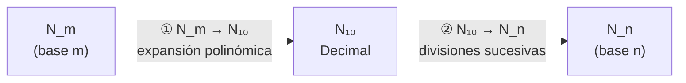
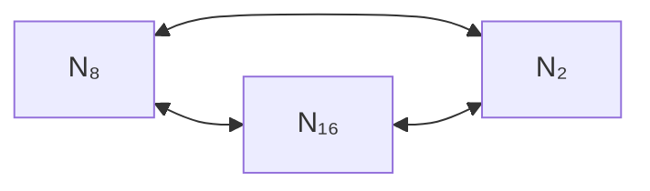

# Clase 18 — Sistemas numéricos

> **Fecha**: 12/11/2026 y 17/11/2026 · **Modalidad**: Virtual sincrónica · **Apuntes**: [Diapositivas PDF](./clase18.pdf) · [PPT](./clase18.pptx) · [Manuscrito anotado](./clase18_annotated.pdf)
>
> La sesión del 12/11 cubrió las págs. 1–21 del manuscrito. La pág. 22 tiene la marca «Fin: 12/11/2026 · Inicio: 17/11/2026»: la sesión del 17/11 cubrió las págs. 22–25 y luego continuó con el manuscrito de la [clase 19](../clase-19/) (circuitos lógicos), que se documenta en esa clase.

## Objetivos de la clase

- Presentar cómo se representa físicamente la información en un computador (niveles de voltaje y señal binaria) y su relación con los valores de verdad de la lógica proposicional.
- Definir la notación posicional y los sistemas numéricos decimal, binario, octal y hexadecimal, con la regla de los dígitos válidos de cada base.
- Establecer los métodos de conversión entre bases: expansión polinómica, divisiones sucesivas y el "puente universal" por la base 10.
- Mostrar el atajo de conversión directa entre binario, octal y hexadecimal por agrupación de bits.

## Resumen

La sesión del 12/11 abrió el último tema del curso con un video sobre el código binario y la representación de la información con niveles de voltaje. Se definió la notación posicional, se estudiaron las bases 10, 2, 8 y 16 y se presentaron la expansión polinómica, las divisiones sucesivas y el puente universal, con ejemplos y un ejercicio con los números del 0 al 15. La sesión del 17/11 presentó el atajo por agrupación de bits entre binario, octal y hexadecimal, y siguió con los circuitos lógicos (clase 19).

## Agenda

**Sesión 1 — 12/11/2026**

1. Video introductorio y representación de la información: datos, niveles de voltaje, señal binaria y ventajas de lo binario. [*(→ sección 1)*](#1-representación-de-la-información)
2. Notación posicional: fórmula, parte entera y parte fraccionaria. [*(→ sección 2)*](#2-notación-posicional)
3. Ejemplos de notación posicional en varias bases, con parte fraccionaria. [*(→ sección 3)*](#3-ejemplos-de-notación-posicional)
4. Los sistemas decimal, binario, octal y hexadecimal; dígitos válidos e inválidos. [*(→ sección 4)*](#4-sistemas-decimal-binario-octal-y-hexadecimal)
5. Tabla resumen de los sistemas numéricos. [*(→ sección 5)*](#5-tabla-resumen-de-los-sistemas-numéricos)
6. Conversión entre bases: el puente universal (ejemplo de `6A₁₆` a base 4). [*(→ sección 6)*](#6-conversión-entre-bases-el-puente-universal)
7. Expansión polinómica: de cualquier base a decimal. [*(→ sección 7)*](#7-expansión-polinómica)
8. Divisiones sucesivas: de decimal a cualquier base. [*(→ sección 8)*](#8-divisiones-sucesivas)
9. Ejemplo: `42₅` a base 9 y a base 2. [*(→ sección 9)*](#9-ejemplo-de-base-5-a-base-9-y-a-base-2)
10. Ejercicio: los números del 0 al 15 en base 2 y base 8. [*(→ sección 10)*](#10-ejercicio-los-números-del-0-al-15)

**Sesión 2 — 17/11/2026** (luego continuó con la [clase 19](../clase-19/))

1. Atajo directo entre binario, octal y hexadecimal: agrupación de bits. [*(→ sección 11)*](#11-atajo-directo-entre-binario-octal-y-hexadecimal)
2. De binario a octal y hexadecimal. [*(→ sección 12)*](#12-de-binario-a-octal-y-hexadecimal)
3. De octal y hexadecimal a binario. [*(→ sección 13)*](#13-de-octal-y-hexadecimal-a-binario)
4. Suma binaria: mencionada, no desarrollada. [*(→ sección 14)*](#14-suma-binaria-mencionada)

## Contenido temático

> [!NOTE]
> **Cómo leer este apunte.**
>
> - Las secciones numeradas siguen el orden en que se dictó la clase. **Sesión 1 (12/11), secciones 1 a 10**: manuscrito, págs. 1–21. **Sesión 2 (17/11), secciones 11 a 14**: manuscrito, págs. 22–25.
> - Las págs. 2 (video) y 5 (conversión análogo/digital) se mostraron **sin anotaciones**.
> - Los párrafos que empiezan con *Aclaración del apunte* se agregaron al redactar: no se dijeron en clase. Sirven para conectar ideas o evitar confusiones (p. ej. el valor decimal de una expansión que en clase quedó sin sumar).

**Notación usada en este apunte**

| Símbolo | Se lee | Observación |
|---|---|---|
| `Nᵦ` o `N_b` | el número `N` en base `b` | El subíndice indica la base: `432₈`, `6A₁₆`, `1101₂`. Si no hay subíndice, se asume base 10 (sección 2). |
| `b` | base | Número entero mayor que 1. |
| `dᵢ` | dígito en la posición `i` | Cumple `0 ≤ dᵢ ≤ b − 1` (sección 4). |
| `n`, `m` | posiciones extremas | `n` es la posición del dígito más significativo de la parte entera; `m` es el número de dígitos de la parte fraccionaria. |
| `bⁱ` | peso de la posición `i` | Posiciones `0, 1, 2, …` a la izquierda del punto; `−1, −2, …` a la derecha. |
| `A, B, C, D, E, F` | dígitos hexadecimales | Valen 10, 11, 12, 13, 14 y 15 (sección 4). |
| bit | dígito binario | Contracción de *binary digit*: 0 o 1. |

### 1. Representación de la información

*(Manuscrito, págs. 2–7.)*

La clase empezó con el video de TED-Ed [How exactly does binary code work?](https://ed.ted.com/lessons/how-exactly-does-binary-code-work-jose-americo-n-l-f-freitas) (José Américo N L F Freitas), que muestra cómo texto, imágenes y sonido se codifican como secuencias de ceros y unos.

**Representación de los datos.** Los datos son una **representación física de la información**, y pueden ser **almacenados, transmitidos y/o procesados**. La diapositiva muestra ejemplos históricos: palo tallado, ficha de arcilla, quipu, jeroglífico, escritura cuneiforme y ábaco.

**Niveles de voltaje.** Aunque la información puede ser muy diversa (imágenes, sonidos, números, códigos), es posible representarla con **niveles de voltaje**, que siguen siendo una representación física. En las computadoras actuales, la forma más simple usa dos valores:

| Valor lógico | Voltaje | Bombillo (dibujo de clase) |
|---|---|---|
| Falso (0) | 0 V | Apagado (OFF) |
| Verdadero (1) | 5 V | Encendido (ON) |

La pág. 5 muestra, sin anotaciones, la conversión análogo/digital (A/D) y digital/análogo (D/A): el sonido entra por un micrófono como voltaje análogo, el computador lo procesa como datos binarios y un parlante lo devuelve como sonido.

**Señal binaria.** Es una señal digital que solo tiene **dos valores posibles**: alto/bajo, ON/OFF, verdadero/falso, sí/no. Los niveles lógicos se representan con los **dígitos binarios 1 y 0** y, desde el punto de vista eléctrico, corresponden a niveles de voltaje.

El profesor conectó esto con el inicio del curso: **binario = dos posibilidades**, igual que las proposiciones, que solo pueden ser falsas (F) o verdaderas (V). En el manuscrito dibujó un interruptor abierto para `0: Falso (F)` y uno cerrado para `1: Verdadero (V)`.

Las figuras de la pág. 6 muestran las dos caras de una señal binaria:

- **"Bits as lamps"**: ocho bombillos encendidos o apagados forman el número `10011011₂`. Cada bombillo encendido aporta su peso (128, 16, 8, 2 y 1), y el total es `155` en decimal.
- **Tren de pulsos**: la secuencia `0101100100` como señal eléctrica, en la que el profesor anotó `0 V` bajo cada 0 y `5 V` bajo cada 1.

**Ventajas de la representación binaria** (pág. 7):

- **Fácil implementación en hardware electrónico**: un transistor opera como un interruptor controlado eléctricamente. Una señal de 0 V lo deja apagado (*switch OFF*) y una de 5 V lo enciende (*switch ON*).
- **Buena tolerancia al ruido eléctrico**, importante en comunicaciones.

### 2. Notación posicional

*(Manuscrito, págs. 8–9.)*

En los **sistemas numéricos posicionales**, un número se representa mediante una cadena de dígitos en la cual **la posición de cada dígito tiene un peso asociado**. Para un número `N` con parte entera y parte fraccionaria, en una base `b`:

```text
       n
N_b =  Σ   dᵢ × bⁱ
     i=−m
```

donde `N` es el valor total del número, `b` es la base (un entero mayor que 1), `dᵢ` es el dígito en la posición `i`, `n` es la posición del dígito más significativo de la parte entera y `m` es el número de dígitos de la parte fraccionaria. El valor de cada dígito debe cumplir `0 ≤ dᵢ ≤ b − 1`.

La fórmula se entiende mejor si se separa en sus dos partes:

```text
N_b = (dₙ dₙ₋₁ … d₁ d₀ . d₋₁ d₋₂ … d₋ₘ₊₁ d₋ₘ)
       └─ parte entera ─┘   └─ parte fraccionaria ─┘
```

- **Parte entera**: `dₙ × bⁿ + dₙ₋₁ × bⁿ⁻¹ + ⋯ + d₁ × b¹ + d₀ × b⁰`
- **Parte fraccionaria**: `d₋₁ × b⁻¹ + d₋₂ × b⁻² + ⋯ + d₋ₘ × b⁻ᵐ`

**Ejemplo: representar `25.4₁₀`.** El profesor rotuló los dígitos por su posición: el 2 es `d₁` (decenas), el 5 es `d₀` (unidades) y el 4 es `d₋₁` (décimas):

| `d₁` | `d₀` | `.` | `d₋₁` |
|---|---|---|---|
| 2 | 5 | `.` | 4 |
| `10¹` | `10⁰` | | `10⁻¹` |

`25.4₁₀ = 2(10¹) + 5(10⁰) + 4(10⁻¹) = 2(10) + 5(1) + 4(0.1)`

**La base cambia el valor.** El profesor escribió `25.4 = 25.4₁₀`: si no se indica la base, se asume base 10. Luego mostró que la misma cadena de dígitos se expande con otra base si cambia el subíndice:

- `25.4₁₆ = 2(16¹) + 5(16⁰) + 4(16⁻¹)`
- `25.4₈ = 2(8¹) + 5(8⁰) + 4(8⁻¹)`

*Aclaración del apunte:* al sumar, `25.4₁₆ = 32 + 5 + 0.25 = 37.25` y `25.4₈ = 16 + 5 + 0.5 = 21.5`. Son tres números distintos escritos con los mismos dígitos; por eso el subíndice de la base no se puede omitir cuando la base no es 10.

### 3. Ejemplos de notación posicional

*(Manuscrito, pág. 10.)*

Exprese en notación posicional los siguientes números. Sobre cada dígito, el profesor anotó el exponente de su posición (`2 1 0`, `1 0 −1`, `3 2 1 0`).

| # | Número | Expansión | Con las potencias calculadas |
|---|---|---|---|
| 1 | `432₁₀` | `4(10²) + 3(10¹) + 2(10⁰)` | `4(100) + 3(10) + 2(1)` |
| 2 | `432₈` | `4(8²) + 3(8¹) + 2(8⁰)` | `4(64) + 3(8) + 2(1)` |
| 3 | `432₁₆` | `4(16²) + 3(16¹) + 2(16⁰)` | `4(256) + 3(16) + 2(1)` |
| 4 | `25.4₁₀` | `2(10¹) + 5(10⁰) + 4(10⁻¹)` | `2(10) + 5(1) + 4(0.1)` |
| 5 | `1101₂` | `1(2³) + 1(2²) + 0(2¹) + 1(2⁰)` | `1(8) + 1(4) + 0(2) + 1(1)` |

*Aclaración del apunte:* al sumar, los ejemplos 2, 3 y 5 valen `282₁₀`, `1074₁₀` y `13₁₀`. Los mismos dígitos `432` dan tres valores distintos según la base.

**Parte fraccionaria en base 2** (escrito a mano en clase). Las potencias negativas de 2 son fracciones: `2⁻¹ = 1/2 = 0.5` y `2⁻² = 1/2² = 1/4 = 0.25`. Con ellas:

`101.11₂ = 1(2²) + 0(2¹) + 1(2⁰) + 1(2⁻¹) + 1(2⁻²) = 1(4) + 0(2) + 1(1) + 1(0.5) + 1(0.25)`

Y la misma cadena leída en base 10:

`101.11 = 1(10²) + 0(10¹) + 1(10⁰) + 1(10⁻¹) + 1(10⁻²) = 1(100) + 0(10) + 1(1) + 1(0.1) + 1(0.01)`

*Aclaración del apunte:* `101.11₂ = 5.75₁₀`, mientras que `101.11₁₀` es ciento uno con once centésimas.

### 4. Sistemas decimal, binario, octal y hexadecimal

*(Manuscrito, págs. 11–14.)*

El profesor resumió las bases del curso en un esquema: `b` puede ser 2, 8, 10 o 16, y anotó que `8 = 2³` y `16 = 2⁴` (esa relación con la base 2 se aprovecha en la [sección 11](#11-atajo-directo-entre-binario-octal-y-hexadecimal)). Para cada base aplicó la misma regla de dígitos válidos, `0 ≤ dᵢ ≤ b − 1`:

| Base | Regla | Dígitos válidos `dᵢ` |
|---|---|---|
| 10 (decimal) | `0 ≤ dᵢ ≤ 9` | `{0, 1, …, 9}` |
| 2 (binario) | `0 ≤ dᵢ ≤ 1` | `{0, 1}` |
| 8 (octal) | `0 ≤ dᵢ ≤ 7` | `{0, 1, 2, 3, 4, 5, 6, 7}` |
| 16 (hexadecimal) | `0 ≤ dᵢ ≤ 15` | `{0, …, 9, A, B, C, D, E, F}` |

**Decimal (base 10).** Es el sistema que usamos a diario; se llama decimal porque usa diez símbolos distintos. Representación: `N = N₁₀ = Σ dᵢ × 10ⁱ`.

Ejemplo, representar `5238`:

`5238 = 5 × 10³ + 2 × 10² + 3 × 10¹ + 8 × 10⁰ = 5 × 1000 + 2 × 100 + 3 × 10 + 8 × 1 = 5238`

| Potencia de 10 | `10³` | `10²` | `10¹` | `10⁰` |
|---|---|---|---|---|
| Forma decimal | 1000 | 100 | 10 | 1 |
| Dígito | 5 | 2 | 3 | 8 |

La potencia de cada posición es el **peso** del dígito. El profesor lo ilustró con dinero: en `$000005` el 5 está en la posición 0 (peso `10⁰`), mientras que en `$500000` está en la posición 5 (peso `10⁵ = 100000`). El mismo dígito vale cinco pesos en un caso y quinientos mil en el otro.

**Binario (base 2).** Solo usa **dos dígitos para representar cualquier número: 0 y 1**. A cada uno se le llama **bit** (contracción del inglés *binary digit*). Representación: `N₂ = Σ dᵢ × 2ⁱ`.

Ejemplo, representar `0110₂`:

`0110₂ = 0 × 2³ + 1 × 2² + 1 × 2¹ + 0 × 2⁰ = 0 × 8 + 1 × 4 + 1 × 2 + 0 × 1 = 0 + 4 + 2 + 0 = 6₁₀`

| Potencia de 2 | `2³` | `2²` | `2¹` | `2⁰` |
|---|---|---|---|---|
| Forma decimal | 8 | 4 | 2 | 1 |
| Dígito | 0 | 1 | 1 | 0 |

**Dígitos inválidos.** Un número no es válido en una base si alguno de sus dígitos es mayor o igual que la base. El profesor marcó con ✗ `23₂` (ni el 2 ni el 3 existen en base 2) y `102₂` (el 2 no es un bit).

**Octal (base 8).** Usa 8 dígitos, del 0 al 7. Representación: `N₈ = Σ dᵢ × 8ⁱ`.

Ejemplo, representar `347₈`:

`347₈ = 3 × 8² + 4 × 8¹ + 7 × 8⁰ = 3 × 64 + 4 × 8 + 7 × 1 = 192 + 32 + 7 = 231₁₀`

| Potencia de 8 | `8²` | `8¹` | `8⁰` |
|---|---|---|---|
| Forma decimal | 64 | 8 | 1 |
| Dígito | 3 | 4 | 7 |

**Hexadecimal (base 16).** Usa 16 símbolos. Como solo hay 10 dígitos numéricos, se completa con las primeras seis letras del alfabeto: `A = 10`, `B = 11`, `C = 12`, `D = 13`, `E = 14` y `F = 15`. Representación: `N₁₆ = Σ dᵢ × 16ⁱ`.

El profesor escribió tres números para practicar la regla de los dígitos:

- ✗ `1A5₁₀`: la `A` no es un dígito decimal.
- ✗ `1G₁₆`: la `G` no es un dígito hexadecimal (solo se llega hasta la `F`).
- ✓ `1AE₁₆`: todos sus dígitos son hexadecimales.

Ejemplo, representar `1AD₁₆`:

`1AD₁₆ = 1 × 16² + A × 16¹ + D × 16⁰ = 1 × 256 + 10 × 16 + 13 × 1 = 256 + 160 + 13 = 429₁₀`

| Potencia de 16 | `16²` | `16¹` | `16⁰` |
|---|---|---|---|
| Forma decimal | 256 | 16 | 1 |
| Dígito | 1 | A | D |

### 5. Tabla resumen de los sistemas numéricos

*(Manuscrito, pág. 15.)*

| Característica | Decimal | Binario | Octal | Hexadecimal |
|---|---|---|---|---|
| Base | 10 | 2 | 8 | 16 |
| Dígitos utilizados | 0, 1, 2, 3, 4, 5, 6, 7, 8, 9 | 0, 1 | 0, 1, 2, 3, 4, 5, 6, 7 | 0–9 y A, B, C, D, E, F |
| Relación con binario | Ninguna directa. Es el sistema de referencia humano. | Es el sistema fundamental de la computación. | 1 dígito octal = 3 bits (`2³ = 8`) | 1 dígito hexadecimal = 4 bits (`2⁴ = 16`) |
| Uso principal | Cálculos cotidianos, finanzas, vida diaria. | Lenguaje nativo del hardware de la computadora (circuitos, lógica). | Permisos de archivos en Unix/Linux, algunos sistemas embebidos. | Direcciones de memoria, colores web (CSS), direcciones MAC, depuración. |

Bajo la tabla, el profesor dibujó a una persona junto al sistema decimal y un computador junto al binario ("0, 1"), con una flecha hacia el octal y el hexadecimal: las personas trabajan en base 10, el computador en base 2, y las bases 8 y 16 son formas compactas de escribir binario.

### 6. Conversión entre bases: el puente universal

*(Manuscrito, pág. 16.)*

El **puente universal** convierte de **cualquier** base a **cualquier** otra usando el sistema decimal como intermediario, en dos partes:

1. **Cualquier base → decimal**: método de **expansión polinómica** ([sección 7](#7-expansión-polinómica)).
2. **Decimal → cualquier base**: método de **divisiones sucesivas** ([sección 8](#8-divisiones-sucesivas)).

Figura de clase (pág. 16), con las anotaciones del profesor:



**Ejemplo de `6A₁₆` a base 4** (escrito a mano en clase): `6A₁₆ = ¿?₄`.

**① `6A₁₆ → N₁₀`** (expansión polinómica):

`6A₁₆ = 6(16¹) + A(16⁰) = 6(16¹) + 10(16⁰) = 6(16) + 10(1) = 106 = 106₁₀`

**② `106₁₀ → N₄`** (divisiones sucesivas entre 4):

| Dividendo | ÷ 4 = cociente | Residuo |
|---|---|---|
| 106 | 26 | 2 |
| 26 | 6 | 2 |
| 6 | 1 | 2 |
| 1 | 0 | 1 |

Los residuos, leídos desde el último hasta el primero, dan `N₄ = 1222₄`. Por lo tanto, `6A₁₆ = 1222₄`.

### 7. Expansión polinómica

*(Manuscrito, pág. 17.)*

**Regla**: se multiplica cada dígito por su base elevada a la posición que ocupa, y se suman todos los resultados. El profesor lo resumió así: *siempre que se pasa a base 10 se usa la expansión en potencias* (`N_b → N₁₀`: expansión).

**Ejemplo: convertir `3B7₁₆` a base 10.** La tabla hexadecimal–decimal de la diapositiva indica que `B = 11`:

`3B7₁₆ = 3 × 16² + B × 16¹ + 7 × 16⁰ = 3 × 16² + 11 × 16¹ + 7 × 16⁰ = 3 × 256 + 11 × 16 + 7 × 1 = 951`

| Potencia de 16 | `16²` | `16¹` | `16⁰` |
|---|---|---|---|
| Forma decimal | 256 | 16 | 1 |
| Dígito hexadecimal | 3 | B | 7 |
| Dígito en decimal | 3 | 11 | 7 |

### 8. Divisiones sucesivas

*(Manuscrito, pág. 18.)*

**Regla**: se divide el número decimal entre la base de destino repetidamente, hasta que el cociente sea 0. El resultado se forma con los **residuos, leídos desde el último hasta el primero**. El profesor anotó: *de base 10 a cualquier base, divisiones sucesivas*.

**Ejemplo: convertir `150₁₀` a base 3.**

| Dividendo | ÷ 3 = cociente | Residuo |
|---|---|---|
| 150 | 50 | 0 |
| 50 | 16 | 2 |
| 16 | 5 | 1 |
| 5 | 1 | 2 |
| 1 | 0 | 1 |

Leyendo los residuos de abajo hacia arriba: `150₁₀ = 12120₃`.

**Ejemplo: convertir `150₁₀` a base 7** (escrito a mano en clase).

| Dividendo | ÷ 7 = cociente | Residuo |
|---|---|---|
| 150 | 21 | 3 |
| 21 | 3 | 0 |
| 3 | 0 | 3 |

Leyendo los residuos de abajo hacia arriba: `150₁₀ = 303₇`.

*Aclaración del apunte:* para comprobar, se puede volver a base 10 con la expansión polinómica: `303₇ = 3(49) + 0(7) + 3(1) = 150` y `12120₃ = 1(81) + 2(27) + 1(9) + 2(3) + 0(1) = 150`.

### 9. Ejemplo: de base 5 a base 9 y a base 2

*(Manuscrito, pág. 19.)*

**Hallar el número `42₅` en base 9** (con el puente universal):

**Paso 1: base 5 → base 10.**

`42₅ = 4 × 5¹ + 2 × 5⁰ = 4 × 5 + 2 × 1 = 20 + 2 = 22₁₀`

| Potencia de 5 | `5¹` | `5⁰` |
|---|---|---|
| Forma decimal | 5 | 1 |
| Dígito | 4 | 2 |

**Paso 2: base 10 → base 9.**

| Dividendo | ÷ 9 = cociente | Residuo |
|---|---|---|
| 22 | 2 | 4 |
| 2 | 0 | 2 |

Resultado: `42₅ = 24₉`.

**El mismo número a base 2** (escrito a mano en clase). El paso ① ya está hecho: `42₅ → N₁₀ = 22₁₀`. Paso ②, `22₁₀ → N₂`:

| Dividendo | ÷ 2 = cociente | Residuo |
|---|---|---|
| 22 | 11 | 0 |
| 11 | 5 | 1 |
| 5 | 2 | 1 |
| 2 | 1 | 0 |
| 1 | 0 | 1 |

Resultado: `N₂ = 10110₂`, es decir, `42₅ = 10110₂`.

> [!NOTE]
> **Un estudiante preguntó** si el puente funciona igual cuando se convierte entre una base par y una impar (como de base 5 a base 2), y qué pasa si el número tiene parte decimal. El profesor respondió que el puente funciona para **cualquier** combinación de bases. Para la parte fraccionaria existe un procedimiento de conversión desde base 10, pero no es parte del curso: se ve en asignaturas posteriores. En los ejercicios del curso, las conversiones con divisiones sucesivas se hacen solo con números enteros.

*Aclaración del apunte:* la parte fraccionaria sí se usó en la **expansión polinómica** (`25.4`, `101.11₂`, secciones [2](#2-notación-posicional) y [3](#3-ejemplos-de-notación-posicional)). Lo que queda fuera del curso es el procedimiento para llevar la parte fraccionaria **desde** base 10 a otra base.

### 10. Ejercicio: los números del 0 al 15

*(Manuscrito, págs. 20–21.)*

**Exprese los números del 0 al 15 en base 2 y en base 8.** En clase se resolvieron dos casos con divisiones sucesivas y se ubicaron en la tabla de la diapositiva.

**`N₁₀ = 5₁₀`**

- A base 8: `5 ÷ 8 = 0`, residuo `5`. Entonces `N₈ = 5₈`.
- A base 2:

  | Dividendo | ÷ 2 = cociente | Residuo |
  |---|---|---|
  | 5 | 2 | 1 |
  | 2 | 1 | 0 |
  | 1 | 0 | 1 |

  Entonces `N₂ = 101₂`.

Resultado: `5₁₀ = 5₈ = 101₂`.

**`N₁₀ = 10₁₀`**

- A base 8: `10 ÷ 8 = 1`, residuo `2`; `1 ÷ 8 = 0`, residuo `1`. Entonces `N₈ = 12₈`.
- A base 2:

  | Dividendo | ÷ 2 = cociente | Residuo |
  |---|---|---|
  | 10 | 5 | 0 |
  | 5 | 2 | 1 |
  | 2 | 1 | 0 |
  | 1 | 0 | 1 |

  Entonces `N₂ = 1010₂`.

Resultado: `10₁₀ = 12₈ = 1010₂`. En la tabla, el profesor encerró la fila del 10, que en hexadecimal es la `A`.

<details>
<summary>Tabla de la diapositiva: los números del 0 al 15 en las cuatro bases</summary>

| Hexadecimal | Decimal | Octal | Binario |
|---|---|---|---|
| 0 | 0 | 0 | 000 |
| 1 | 1 | 1 | 001 |
| 2 | 2 | 2 | 010 |
| 3 | 3 | 3 | 011 |
| 4 | 4 | 4 | 100 |
| 5 | 5 | 5 | 101 |
| 6 | 6 | 6 | 110 |
| 7 | 7 | 7 | 111 |
| 8 | 8 | 10 | 1000 |
| 9 | 9 | 11 | 1001 |
| A | 10 | 12 | 1010 |
| B | 11 | 13 | 1011 |
| C | 12 | 14 | 1100 |
| D | 13 | 15 | 1101 |
| E | 14 | 16 | 1110 |
| F | 15 | 17 | 1111 |

</details>

### 11. Atajo directo entre binario, octal y hexadecimal

*(Manuscrito, pág. 22. Inicio de la sesión del 17/11.)*

El profesor retomó la clase anterior con un esquema de las dos formas de convertir `N_m → N_n`:

1. **Puente**: `N_m → N₁₀` y luego `N₁₀ → N_n` (secciones [6](#6-conversión-entre-bases-el-puente-universal) a [9](#9-ejemplo-de-base-5-a-base-9-y-a-base-2)).
2. **Atajo**: entre las bases 2, 8 y 16 se puede convertir directamente, sin pasar por base 10.

Figura de clase (pág. 22):



El atajo es mucho más rápido porque estas bases son **potencias de 2**, y la clave es la **agrupación de bits**:

- **Octal (base 8)**: `2³ = 8`, así que se trabaja en **grupos de 3 bits**.
- **Hexadecimal (base 16)**: `2⁴ = 16`, así que se trabaja en **grupos de 4 bits**.

Para usar el atajo hay que tener a mano las dos tablas de equivalencia; el profesor recomendó **aprenderlas de memoria**:

| Octal | Binario |
|---|---|
| 0 | 000 |
| 1 | 001 |
| 2 | 010 |
| 3 | 011 |
| 4 | 100 |
| 5 | 101 |
| 6 | 110 |
| 7 | 111 |

| Hexadecimal | Binario | Hexadecimal | Binario |
|---|---|---|---|
| 0 | 0000 | 8 | 1000 |
| 1 | 0001 | 9 | 1001 |
| 2 | 0010 | A | 1010 |
| 3 | 0011 | B | 1011 |
| 4 | 0100 | C | 1100 |
| 5 | 0101 | D | 1101 |
| 6 | 0110 | E | 1110 |
| 7 | 0111 | F | 1111 |

### 12. De binario a octal y hexadecimal

*(Manuscrito, pág. 23.)*

**Regla**: se agrupan los bits **desde la derecha** y se sustituye cada grupo por su dígito correspondiente. Si el último grupo de la izquierda queda incompleto, se rellena con ceros a la izquierda, lo que no cambia el valor del número.

**Ejemplo: convertir `11110101101₂` a octal y a hexadecimal.**

A octal (grupos de 3):

| Grupo | `011` | `110` | `101` | `101` |
|---|---|---|---|---|
| Dígito octal | 3 | 6 | 5 | 5 |

`11110101101₂ = 3655₈`

A hexadecimal (grupos de 4):

| Grupo | `0111` | `1010` | `1101` |
|---|---|---|---|
| Dígito hexadecimal | 7 | A | D |

`11110101101₂ = 7AD₁₆`

**Ejemplo de `1111110₂`** (escrito a mano en clase).

- A octal: `001 | 111 | 110` → `1 7 6`, es decir, `1111110₂ = 176₈`. El primer grupo se completó con dos ceros.
- A hexadecimal: `0111 | 1110` → `7 E`, es decir, `1111110₂ = 7E₁₆`.

*Aclaración del apunte:* los dos resultados representan el mismo número, `126₁₀`: `176₈ = 1(64) + 7(8) + 6 = 126` y `7E₁₆ = 7(16) + 14 = 126`. Del mismo modo, `3655₈` y `7AD₁₆` valen `1965₁₀`.

### 13. De octal y hexadecimal a binario

*(Manuscrito, pág. 24.)*

**Regla**: es el proceso contrario. Se sustituye **cada dígito** por su grupo de bits: 4 bits por cada dígito hexadecimal y 3 por cada dígito octal (con la tabla de la base correspondiente).

**Ejemplo 1: convertir `9F2₁₆` a binario.**

| Dígito hexadecimal | 9 | F | 2 |
|---|---|---|---|
| Grupo de 4 bits | `1001` | `1111` | `0010` |

`9F2₁₆ = 100111110010₂`

**Ejemplo 2: convertir `170₈` a binario.**

| Dígito octal | 1 | 7 | 0 |
|---|---|---|---|
| Grupo de 3 bits | `001` | `111` | `000` |

`170₈ = 001111000₂`

*Aclaración del apunte:* los ceros a la izquierda no cambian el valor: `001111000₂ = 1111000₂`. Se escriben para conservar los grupos completos de 3 bits.

### 14. Suma binaria (mencionada)

*(Manuscrito, pág. 25, sin desarrollar.)*

La última diapositiva presenta la **suma binaria**: los métodos de la aritmética binaria son análogos a los de la decimal, con el 2 (`10₂`) en el papel que tiene el 10 en decimal. Por ejemplo, `1₂ + 1₂ = 10₂` (se escribe 0 y se lleva 1).

El profesor no la desarrolló. Escribió junto al título: *"Luego lo ven en arquitectura"*. Después de esta diapositiva, la sesión siguió con los circuitos lógicos ([clase 19](../clase-19/)).

Para profundizar, puede consultar las [diapositivas originales del curso: Clase 13 – Sistemas numéricos](https://discretas1-udea.github.io/discretas1-udea-20262/assets/slides/clase13.pdf). Incluyen además la suma binaria y circuitos para el cálculo de sumas, que no se trabajaron en esta clase. El sitio del curso todavía no tiene una lección publicada sobre sistemas numéricos.

### Síntesis de la clase

*Aclaración del apunte:* un resumen de lo esencial, sin contenido nuevo.

**Ideas clave:**

1. **El computador representa todo con dos valores**: 0 V (falso, 0) y 5 V (verdadero, 1). Es la misma dualidad de las proposiciones (F/V) ([sección 1](#1-representación-de-la-información)).
2. **En un sistema posicional, la posición da el peso**: `N_b = Σ dᵢ × bⁱ`, con `0 ≤ dᵢ ≤ b − 1`. Los mismos dígitos valen distinto en otra base, por eso se escribe el subíndice ([secciones 2](#2-notación-posicional) a [4](#4-sistemas-decimal-binario-octal-y-hexadecimal)).
3. **Hacia base 10, expansión polinómica; desde base 10, divisiones sucesivas** (residuos leídos del último al primero) ([secciones 7](#7-expansión-polinómica) y [8](#8-divisiones-sucesivas)).
4. **Entre dos bases cualesquiera, el puente**: primero a base 10 y luego a la base de destino ([secciones 6](#6-conversión-entre-bases-el-puente-universal) y [9](#9-ejemplo-de-base-5-a-base-9-y-a-base-2)).
5. **Entre 2, 8 y 16, el atajo**: grupos de 3 bits para octal y de 4 bits para hexadecimal, desde la derecha y rellenando con ceros ([secciones 11](#11-atajo-directo-entre-binario-octal-y-hexadecimal) a [13](#13-de-octal-y-hexadecimal-a-binario)).

> [!IMPORTANT]
> **Errores y dudas de esta clase:**
>
> - **¿El puente funciona entre una base par y una impar? ¿Y con parte decimal?** (pregunta de un estudiante). Funciona con cualquier par de bases; la conversión de la parte fraccionaria desde base 10 no es parte del curso ([sección 9](#9-ejemplo-de-base-5-a-base-9-y-a-base-2)).
> - **Dígitos inválidos** (ejemplos del profesor): `23₂`, `102₂`, `1A5₁₀` y `1G₁₆` no son números válidos en su base ([sección 4](#4-sistemas-decimal-binario-octal-y-hexadecimal)).
> - **Erratas menores de las diapositivas**, corregidas en este apunte: «El valor de cada dígito debe ser `0 ≤ i ≤ b − 1`» por `0 ≤ dᵢ ≤ b − 1` (pág. 8); `2⁰` por `8⁰` en la tabla del octal (pág. 13); `16⁰` por `5⁰` en la tabla de `42₅` (pág. 19).

## Pendientes

### Estudiantes

- [ ] Aprender de memoria las tablas de equivalencia octal–binario (3 bits) y hexadecimal–binario (4 bits), como recomendó el profesor.
- [ ] Repasar los ejemplos resueltos de conversión (puente, expansión polinómica, divisiones sucesivas y atajo por agrupación de bits).

## Próxima clase

Jueves 19/11/2026: compuertas lógicas y ejercicios con circuitos lógicos ([clase 19](../clase-19/)). La sesión del 17/11 ya había empezado ese tema.
