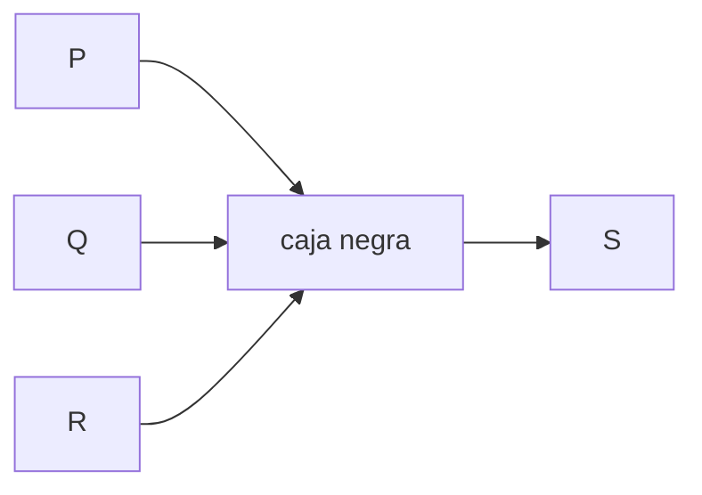

# Clase 19 — Circuitos lógicos

> **Fecha**: 17/11/2026 y 19/11/2026 · **Modalidad**: Virtual sincrónica · **Apuntes**: [Diapositivas PDF](./clase19.pdf) · [PPT](./clase19.pptx) · [Manuscrito anotado](./clase19_annotated.pdf) · [Simulaciones en Logisim](./ejemplos_logisim/) · [Simulaciones del parcial 4 de 2025-2](./simulaciones_parcial4_2025-2/)
>
> La sesión del 17/11 empezó terminando la [clase 18](../clase-18/) (págs. 22–25 de su manuscrito, documentadas allí) y siguió con las págs. 1–15 de este manuscrito (portada: «Inicio: 17/11/2026»). La pág. 16 tiene la marca «Fin: 17/11/2026 · Inicio: 19/11/2026»: la sesión del 19/11 cubrió las págs. 16–39. Las págs. 28–36 (soluciones impresas y diapositivas de simulación) no tienen anotaciones.

## Objetivos de la clase

- Contextualizar los circuitos lógicos: su lugar en la carrera y la idea de Shannon de modelar los circuitos de conmutación con el álgebra de Boole.
- Presentar la analogía entre proposiciones e interruptores (en serie = AND, en paralelo = OR) y el modelo de caja negra, cuyo funcionamiento se describe con una tabla de entrada/salida.
- Definir las compuertas lógicas NOT, AND y OR, y las adicionales NOR, NAND, XOR y XNOR, con su símbolo, su tabla y su expresión booleana.
- Mostrar cómo evaluar un circuito, obtener su tabla y su expresión, construir el circuito de una expresión y diseñar un circuito a partir de una tabla (minitérminos).

## Resumen

La sesión del 17/11, después de terminar los sistemas numéricos (clase 18), ubicó los circuitos digitales entre las materias de la carrera y presentó a Boole y a Shannon. Con interruptores, lámparas y el simulador se mostró la analogía entre las proposiciones y los circuitos (en serie = AND, en paralelo = OR), y se introdujo el modelo de caja negra con el sumador completo. La sesión del 19/11 formalizó las compuertas lógicas, resolvió los Ejemplos 1 a 5 (evaluar, tabular, deducir expresiones, construir circuitos y diseñar con minitérminos) y empezó un ejercicio tipo parcial, que quedó por terminar.

## Agenda

**Sesión 1 — 17/11/2026** (después de terminar la [clase 18](../clase-18/))

1. Relación de los circuitos digitales con las próximas materias. [*(→ sección 1)*](#1-relación-con-las-próximas-materias)
2. Los protagonistas: George Boole y Claude Shannon. [*(→ sección 2)*](#2-boole-y-shannon)
3. La analogía fundamental entre proposiciones e interruptores. [*(→ sección 3)*](#3-la-analogía-fundamental-proposiciones-e-interruptores)
4. Circuito digital: lámpara con uno y con dos interruptores (funciones AND y OR). [*(→ sección 4)*](#4-circuito-digital-funciones-and-y-or)
5. Simuladores de circuitos. [*(→ sección 5)*](#5-simuladores)
6. Circuitos lógicos, caja negra y tabla de entrada/salida; el sumador completo. [*(→ sección 6)*](#6-circuitos-lógicos-y-caja-negra)

**Sesión 2 — 19/11/2026**

1. Compuertas lógicas NOT, AND y OR; variables y expresiones booleanas. [*(→ sección 7)*](#7-compuertas-not-and-y-or)
2. Compuertas NOR, NAND, XOR y XNOR. [*(→ sección 8)*](#8-compuertas-nor-nand-xor-y-xnor)
3. Ejemplo 1: salida de un circuito para unas entradas dadas. [*(→ sección 9)*](#9-ejemplo-1-salida-de-un-circuito)
4. Ejemplo 2: tabla de entrada/salida de un circuito. [*(→ sección 10)*](#10-ejemplo-2-tabla-de-entradasalida)
5. Ejemplo 3: expresión booleana de un circuito. [*(→ sección 11)*](#11-ejemplo-3-expresión-booleana-de-un-circuito)
6. Ejemplo 4: circuito de una expresión booleana. [*(→ sección 12)*](#12-ejemplo-4-circuito-de-una-expresión-booleana)
7. Ejemplo 5: diseño de un circuito a partir de una tabla (minitérminos). [*(→ sección 13)*](#13-ejemplo-5-diseño-a-partir-de-una-tabla)
8. Soluciones impresas y simulaciones. [*(→ sección 14)*](#14-soluciones-y-simulaciones)
9. Ejercicio tipo parcial (sin terminar). [*(→ sección 15)*](#15-ejercicio-tipo-parcial)

## Contenido temático

> [!NOTE]
> **Cómo leer este apunte.**
>
> - Las secciones numeradas siguen el orden en que se dictó la clase. **Sesión 1 (17/11), secciones 1 a 6**: manuscrito, págs. 1–15. **Sesión 2 (19/11), secciones 7 a 15**: manuscrito, págs. 16–39.
> - Las págs. 3 y 28–36 no tienen anotaciones.
> - Los circuitos de los ejemplos se pueden abrir y simular en Logisim-evolution: ver la [guía de simulaciones de esta clase](./ejemplos_logisim/).
> - Los párrafos que empiezan con *Aclaración del apunte* se agregaron al redactar: no se dijeron en clase. Sirven para conectar ideas o evitar confusiones.

**Notación usada en este apunte**

| Compuerta | Lógica proposicional | Álgebra de Boole (circuitos) | Se lee |
|---|---|---|---|
| NOT | `¬P` | `P'` | negación de P, complemento de P |
| AND | `P ∧ Q` | `P · Q` o `PQ` | P y Q (producto booleano) |
| OR | `P ∨ Q` | `P + Q` | P o Q (suma booleana) |
| NOR | `¬(P ∨ Q)` | `(P + Q)' = P ↓ Q` | no (P o Q) |
| NAND | `¬(P ∧ Q)` | `(P · Q)' = P ↑ Q` | no (P y Q) |
| XOR | `P ⊕ Q` | `P ⊕ Q` | disyunción exclusiva, O exclusivo |
| XNOR | `P ↔ Q` | `P ⊙ Q` | bicondicional (sección 8) |
| | F | 0 | falso |
| | V | 1 | verdadero |

**Las dos notaciones.** En este apunte cada expresión se escribe en las dos notaciones: con los signos de la lógica proposicional (`¬`, `∧`, `∨`), como en los temas 1 y 2 del curso, y con los del álgebra de Boole (`'`, `·`, `+`), que son los habituales en circuitos. Son la misma expresión: solo cambian los signos. En el álgebra de Boole, `+` **no** es la suma aritmética sino el OR, y `·` es el AND (sección 7).

*Aclaración del apunte:* en el manuscrito, el profesor unió las dos formas de una misma expresión con `↔`, p. ej. `R = ¬P ∧ Q ↔ R = P'·Q`. Ahí `↔` quiere decir "se escribe también como", no es el conectivo bicondicional de la lógica proposicional. Para evitar esa confusión, aquí las dos formas se presentan lado a lado, en una tabla o separadas por "·".

### 1. Relación con las próximas materias

*(Manuscrito, págs. 2–3.)*

La diapositiva muestra los niveles de un computador, de arriba hacia abajo: aplicación, lenguaje de alto nivel, sistema operativo / compilador, arquitectura del conjunto de instrucciones, organización del hardware del sistema, **circuito digital** y nivel físico. Todo descansa sobre las **matemáticas**.

El profesor ubicó cada nivel en la carrera:

- La arquitectura del conjunto de instrucciones, la organización del hardware y el circuito digital se estudian en **Arquitectura de Computadores**.
- El nivel físico corresponde a la **física de semiconductores**.
- La base matemática es la de **Discretas 1 y 2**.

Esta clase trabaja el nivel del **circuito digital**. La figura de la derecha es un circuito digital real, construido con muchas compuertas lógicas. La pág. 3 repite el esquema sin anotaciones.

### 2. Boole y Shannon

*(Manuscrito, págs. 4–6.)*

| | George Boole | Claude Shannon |
|---|---|---|
| Época | Siglo XIX (1815–1864) | Siglo XX (1916–2001) |
| Disciplina principal | Matemáticas, lógica | Ingeniería eléctrica, matemáticas aplicadas |
| Aporte clave | Creación del **álgebra booleana** | Aplicación del álgebra booleana a **circuitos eléctricos** |
| Obra destacada | [*An Investigation of the Laws of Thought*](https://www.gutenberg.org/files/15114/15114-pdf.pdf) (1854) | [*A Symbolic Analysis of Relay and Switching Circuits*](https://www.cs.virginia.edu/~evans/greatworks/shannon38.pdf) (1938) |
| Enfoque | Formalización de la lógica mediante símbolos algebraicos | Traducción de la lógica simbólica a sistemas físicos |
| Impacto inmediato | Base teórica para la lógica y las matemáticas modernas | Base práctica para la computación digital |
| Legado | Fundador de la lógica matemática moderna | Fundador de la teoría de la información y la computación digital |

El profesor marcó con una flecha que el aporte de Shannon parte del de Boole: el álgebra booleana aplicada a los circuitos. Más sobre ellos: [George Boole](https://es.wikipedia.org/wiki/George_Boole) · [Claude Shannon](https://es.wikipedia.org/wiki/Claude_Shannon) · [BBC Mundo: el matemático que inventó la era digital](https://www.bbc.com/mundo/articles/cn0yxddw9dwo) · [Claude Shannon Explains Information Theory](https://www.youtube.com/watch?v=1afrzErFy_k) · [The Bit Player](https://thebitplayer.com/).

**La idea de Shannon** (pág. 6). Shannon se dio cuenta de que el **comportamiento binario** (abierto/cerrado) de los relés en un circuito eléctrico era análogo al **comportamiento de las proposiciones** (verdadero/falso) en el álgebra de George Boole, desarrollada casi un siglo antes.

*Aclaración del apunte:* la pág. 6 reproduce la tabla original de la tesis de Shannon, que usa la convención contraria a la del curso: allí `0` es el circuito cerrado y la suma `X + Y` es la conexión en serie. En el curso se usa la convención de la pág. 7 (sección 3): cerrado = 1, serie = AND.

### 3. La analogía fundamental: proposiciones e interruptores

*(Manuscrito, págs. 7–8.)*

Shannon demostró que se podía usar el **álgebra de Boole para modelar y analizar cualquier circuito de conmutación**, es decir, cualquier circuito hecho con interruptores (*switches*):

| Álgebra de Boole | Circuitos eléctricos |
|---|---|
| Una proposición **verdadera** (True / 1) | Un interruptor **cerrado** (la corriente pasa) |
| Una proposición **falsa** (False / 0) | Un interruptor **abierto** (la corriente no pasa) |
| El operador lógico **Y** (AND / ∧) | Dos interruptores conectados **en serie** |
| El operador lógico **O** (OR / ∨) | Dos interruptores conectados **en paralelo** |
| El operador lógico **NO** (NOT / ¬) | Un relé "normalmente cerrado" (se abre cuando se activa) |

**Interruptor simple.** Un interruptor `P` abierto vale `P = 0` y uno cerrado vale `P = 1`. En un circuito con una lámpara `L`, la lámpara vale `L = 1` si está encendida (ON) y `L = 0` si está apagada (OFF).

**Interruptores en serie (AND).** La corriente pasa solo si los dos están cerrados:

| `P` | `Q` | Foco |
|---|---|---|
| cerrado | cerrado | encendido |
| cerrado | abierto | apagado |
| abierto | cerrado | apagado |
| abierto | abierto | apagado |

Por eso `L = P ∧ Q` (lógica) · `L = P · Q` (álgebra de Boole).

**Interruptores en paralelo (OR).** La corriente pasa si al menos uno está cerrado:

| `P` | `Q` | Foco |
|---|---|---|
| cerrado | cerrado | encendido |
| cerrado | abierto | encendido |
| abierto | cerrado | encendido |
| abierto | abierto | apagado |

Por eso `L = P ∨ Q` (lógica) · `L = P + Q` (álgebra de Boole).

*Aclaración del apunte:* la diapositiva titula este caso «Interruptores en seria (OR)»; debe decir «en paralelo», como la figura de la misma página.

### 4. Circuito digital: funciones AND y OR

*(Manuscrito, págs. 9–11.)*

**Un interruptor y una lámpara** (pág. 9). El profesor lo dibujó como una caja con entrada `P` y salida `L`:

| Variable lógica | Interruptor | Lámpara |
|---|---|---|
| 1 (V) | Cerrado | Encendido |
| 0 (F) | Abierto | Apagado |

La lámpara repite el estado del interruptor: `L = P`. El profesor anotó que este comportamiento corresponde al **buffer**, una compuerta cuya salida es igual a su entrada (en clase se comentó que sirve para reforzar la señal).

**Función AND** (pág. 10): dos interruptores en serie, `L = f(P, Q) = P ∧ Q` (lógica) · `L = P · Q` (álgebra de Boole). Visto como caja negra, entran `P` y `Q` y sale `L`.

| Interruptor (`P`) | Interruptor (`Q`) | Lámpara (`L`) |
|---|---|---|
| 0 | 0 | 0 |
| 0 | 1 | 0 |
| 1 | 0 | **0** |
| 1 | 1 | 1 |

> [!WARNING]
> **Errata de la diapositiva.** La tabla impresa en la pág. 10 dice que con `P = 1` y `Q = 0` la lámpara vale **1**. Es incorrecto: con los interruptores en serie, si `Q` está abierto la corriente no pasa, y `1 ∧ 0 = 0`. La lámpara solo se enciende en la fila `1 1`, que es la que el profesor resaltó. Aquí se corrigió la tabla.

**Función OR** (pág. 11): dos interruptores en paralelo, `L = f(P, Q) = P ∨ Q` (lógica) · `L = P + Q` (álgebra de Boole).

| Interruptor (`P`) | Interruptor (`Q`) | Lámpara (`L`) |
|---|---|---|
| 0 | 0 | 0 |
| 0 | 1 | 1 |
| 1 | 0 | 1 |
| 1 | 1 | 1 |

El profesor marcó las tres filas en que la lámpara se enciende: con `Q` cerrado, con `P` cerrado o con ambos.

Las diapositivas 9 a 11 enlazan tres circuitos de Tinkercad, y en clase el profesor mostró en el simulador cómo se enciende la lámpara en cada caso. Los enlaces y las instrucciones para simularlos están en la [guía de simulaciones](./ejemplos_logisim/README.md#6-otros-simuladores).

### 5. Simuladores

*(Manuscrito, pág. 12.)*

La diapositiva presenta varios simuladores: Logisim, logic.ly, Falstad, Tinkercad y simulator.io. En clase se recomendó **Logisim-evolution**, la continuación del Logisim original, que se usa también en Arquitectura de Computadores. La [guía de simulaciones de esta clase](./ejemplos_logisim/README.md#2-instalación-de-logisim-evolution) explica cómo instalarlo y la [tabla de simuladores](./ejemplos_logisim/README.md#6-otros-simuladores) describe los demás.

### 6. Circuitos lógicos y caja negra

*(Manuscrito, págs. 13–15.)*

Antes de la definición, el profesor resumió lo visto: el NOT (`¬`) es un relé, el AND (`∧`) son interruptores en serie y el OR (`∨`) en paralelo. Con ellos se arma una **función lógica**, por ejemplo `F = (¬A ∧ B) ∨ ¬C` (lógica) · `F = A'B + C'` (álgebra de Boole).

**Circuito lógico.** Un **circuito lógico** (o **circuito digital**) recibe señales de entrada `p₁, p₂, …, pₙ` y produce señales de salida `s₁, s₂, …, sₙ`. Se puede representar como una **caja negra**:

*Figura de clase (pág. 13). Dentro de la caja, el profesor escribió los conectores `¬`, `∧` y `∨`.*

- El interior de la caja negra contiene la implementación detallada del circuito, que a menudo se ignora mientras la atención se centra en la relación entre las entradas y las salidas.
- En los circuitos lógicos, cada entrada y salida es un **0** (falso) o un **1** (verdadero).
- Una **caja negra** es un modelo que se usa para representar un sistema cuyo funcionamiento interno no se conoce, pero del cual sí se observan sus entradas y salidas.

**Los circuitos complicados se construyen con compuertas lógicas** (pág. 14). El ejemplo es el integrado **CD4008**, un [sumador binario completo de 4 bits](https://www.build-electronic-circuits.com/4000-series-integrated-circuits/ic-4008/). Una de sus etapas suma un bit: tiene tres entradas, `A`, `B` y `Cᵢₙ` (el acarreo que llega), y dos salidas, `S` (la suma) y `Cₒᵤₜ` (el acarreo que sale). El profesor la dibujó como caja negra:

- `S = f₁(A, B, Cᵢₙ)`
- `Cₒᵤₜ = f₂(A, B, Cᵢₙ)`

Por dentro, la etapa usa compuertas XOR, AND y OR (se definen en las secciones [7](#7-compuertas-not-and-y-or) y [8](#8-compuertas-nor-nand-xor-y-xnor)). En clase se simuló y se recorrieron sus 8 combinaciones de entrada; el circuito está en [`ejemplos_logisim/full_adder.circ`](./ejemplos_logisim/full_adder.circ).

**Tabla de entrada/salida** (pág. 15). El funcionamiento de una caja negra se especifica completamente con una **tabla de entrada/salida** (tabla de verdad), que enumera todas las posibles señales de entrada junto con sus salidas. La salida es una función de las entradas: `S = f(P, Q, R)`.

| `P` | `Q` | `R` | `S` |
|---|---|---|---|
| 1 | 1 | 1 | 1 |
| 1 | 1 | 0 | 0 |
| 1 | 0 | 1 | 0 |
| 1 | 0 | 0 | 1 |
| 0 | 1 | 1 | 0 |
| 0 | 1 | 0 | 1 |
| 0 | 0 | 1 | 1 |
| 0 | 0 | 0 | 0 |

- **Tercera fila**: con `P = 1`, `Q = 0` y `R = 1`, ¿cuál es la salida? Respuesta: `S = 0`.
- El profesor agregó otra consulta: con `P = 1`, `Q = 1` y `R = 1`, la salida es `S = 1` (primera fila).

### 7. Compuertas NOT, AND y OR

*(Manuscrito, págs. 16–18. Inicio de la sesión del 19/11.)*

Los circuitos lógicos complicados se construyen a partir de circuitos básicos llamados **compuertas lógicas**. Según el profesor, con las tres básicas (NOT, AND y OR) se puede construir cualquier circuito lógico.

- **Compuerta NOT (inversor)**: una entrada y una salida. Si la entrada es 1, la salida es 0, y si la entrada es 0, la salida es 1.
- **Compuerta AND**: dos entradas y una salida. Si ambas entradas son 1, la salida es 1; de lo contrario, es 0. El profesor la relacionó con los interruptores en serie.
- **Compuerta OR**: dos entradas y una salida. Si ambas entradas son 0, la salida es 0; de lo contrario, es 1. El profesor la relacionó con los interruptores en paralelo.

**Variables y expresiones booleanas** (pág. 17):

- En lógica, variables como `p`, `q` y `r` representan enunciados, y un enunciado tiene uno de solo dos valores de verdad: V (verdadero) o F (falso).
- Un **enunciado** es una expresión, como `p ∧ (¬q ∨ r)`, compuesta de variables y conectores lógicos.
- Cualquier variable que solo pueda tomar uno de dos valores (como una señal de entrada) se llama **variable booleana**.
- Una expresión compuesta por variables booleanas y los conectores `¬`, `∧` y `∨` se llama **expresión booleana**.

Un mismo circuito tiene así tres representaciones. Ejemplo de la pág. 17, una NOT sobre `P` seguida de una AND con `Q`:

| Circuito lógico | Tabla de entrada/salida | Expresión booleana |
|---|---|---|
| `P → NOT → AND ← Q`, salida `R` | `P Q → R`: `00 → 0`, `10 → 0`, `01 → 1`, `11 → 0` | `R = ¬P ∧ Q` (lógica) · `R = P' · Q` (álgebra de Boole) |

*Aclaración del apunte:* la diapositiva escribe `R = ¬P · Q`, que mezcla el `¬` de la lógica con el `·` del álgebra de Boole. Arriba está la misma expresión en cada notación por separado.

**Notación de los circuitos** (pág. 18). El profesor escribió la correspondencia entre la notación de la lógica proposicional y la de los circuitos: `¬ ↔ '`, `∨ ↔ +`, `∧ ↔ ·`, `F ↔ 0` y `V ↔ 1`.

| Compuerta | Lógica proposicional | Álgebra de Boole | Tabla (`A B → X`) |
|---|---|---|---|
| NOT | `X = ¬A` | `X = A'` | `0 → 1`, `1 → 0` |
| OR | `X = A ∨ B` | `X = A + B` | `00 → 0`, `10 → 1`, `01 → 1`, `11 → 1` |
| AND | `X = A ∧ B` | `X = A · B = AB` | `00 → 0`, `10 → 0`, `01 → 0`, `11 → 1` |

Las tablas son las mismas de la negación, la disyunción y la conjunción de la lógica proposicional, con 0 en lugar de F y 1 en lugar de V.

### 8. Compuertas NOR, NAND, XOR y XNOR

*(Manuscrito, pág. 19.)*

Además de las compuertas NOT, AND y OR, existen otras compuertas a partir de las cuales también se pueden construir circuitos lógicos:

| Compuerta | Álgebra de Boole (diapositiva) | Lógica proposicional |
|---|---|---|
| NOR | `X = (A + B)' = A ↓ B` | `X = ¬(A ∨ B)` |
| NAND | `X = (A · B)' = A ↑ B` | `X = ¬(A ∧ B)` |
| XOR | `X = A ⊕ B` | `X = A ⊕ B` |
| XNOR | `X = A ⊙ B` | `X = A ↔ B` |

| `A` | `B` | NOR | NAND | XOR | XNOR |
|---|---|---|---|---|---|
| 0 | 0 | 1 | 1 | 0 | 1 |
| 1 | 0 | 0 | 1 | 1 | 0 |
| 0 | 1 | 0 | 1 | 1 | 0 |
| 1 | 1 | 0 | 0 | 0 | 1 |

- **NOR**: es una OR seguida de una NOT (el profesor la dibujó así); solo vale 1 cuando ambas entradas son 0.
- **NAND**: es una AND seguida de una NOT; solo vale 0 cuando ambas entradas son 1.
- **XOR** ("O exclusivo"): vale 1 cuando las entradas son **distintas**, es decir, cuando una **sola** de ellas es 1. El profesor anotó `≠`.
- **XNOR**: vale 1 cuando las entradas son **iguales**; sirve para comparar si dos señales son lógicamente iguales. El profesor anotó `=`.

Estas compuertas se estudian con más profundidad en Arquitectura de Computadores.

> [!NOTE]
> **Corregido en clase.** En la tabla impresa del XOR, las filas `0 1` y `1 1` decían `0` y `1`. El profesor las tachó y escribió los valores correctos, `1` y `0`, que son los de la tabla de arriba.

*Aclaración del apunte:* la diapositiva dice «Además de las compuertas NOT, AND y XOR…»; se refiere a NOT, AND y **OR**, las de la pág. 18.

*Aclaración del apunte:* la columna de lógica proposicional usa los conectivos de la [clase 3](../clase-03/). El XOR tiene la tabla de la **disyunción exclusiva** `A ⊕ B` (verdadera cuando exactamente una es verdadera). El XNOR tiene la tabla del **bicondicional** `A ↔ B` (verdadero cuando las dos tienen el mismo valor), y por eso sirve para comparar dos señales.

### 9. Ejemplo 1: salida de un circuito

*(Manuscrito, págs. 20–21.)*

**Para cada uno de los siguientes circuitos, indique la salida para las señales de entrada dadas.** Se propaga el valor de cada señal compuerta por compuerta, de izquierda a derecha.

**Ejemplo 1a.** Una NOT sobre `P` y una AND con `Q`. Entradas: `P = 0`, `Q = 1`.

- La NOT convierte `P = 0` en `¬P = 1`.
- La AND recibe `1` y `Q = 1`: la salida es `R = 1`.
- Expresión: `R = ¬P ∧ Q` (lógica) · `R = P' · Q = P'Q` (álgebra de Boole).

**Ejemplo 1b.** Una OR con `P` y `Q`, seguida de una NOT, y una AND con `R`. Entradas: `P = 1`, `Q = 0`, `R = 1`.

- La OR da `P ∨ Q = 1`.
- La NOT da `¬(P ∨ Q) = 0`.
- La AND recibe `0` y `R = 1`: la salida es `S = 0`.

Expresión escrita en clase (transcripción del manuscrito):

`S = R ∧ (¬P ∨ Q)` (lógica) · `S = R(P' + Q)` (álgebra de Boole)

> [!WARNING]
> **Error del profesor en clase.** La expresión final pone la negación solo sobre `P`, pero en el circuito la NOT está **después** de la OR: niega todo el resultado `P ∨ Q`. Así lo indica la etiqueta intermedia que el profesor escribió en el mismo dibujo, `¬(P ∨ Q)`. La expresión correcta es:
>
> `S = R ∧ ¬(P ∨ Q)` (lógica) · `S = R(P + Q)'` (álgebra de Boole)
>
> No son la misma función. Con las entradas del ejemplo las dos dan `0`, y por eso el error no se nota en la evaluación. Pero con `P = 0`, `Q = 1` y `R = 1`, la expresión escrita da `1 ∧ (1 ∨ 1) = 1`, mientras que el circuito da `1 ∧ ¬(0 ∨ 1) = 0`.

> [!TIP]
> Al leer un circuito, la negación cubre **todo lo que entra a la NOT**. Si a la NOT entra una expresión compuesta, se niega entre paréntesis: `¬(P ∨ Q)` o `(P + Q)'`, no `¬P ∨ Q` ni `P' + Q`. Un buen control es evaluar la expresión con varias combinaciones y compararla con el circuito, no solo con las entradas del enunciado.

*Aclaración del apunte:* en la pág. 20, las señales del segundo circuito decían «P = 1, Q = 0 y Q = 1»; el profesor corrigió a mano la última por `R = 1`. La pág. 21 repite el Ejemplo 1 con los valores de las señales anotados sobre los cables.

> [!NOTE]
> Según el registro de la sesión, un estudiante señaló un valor de salida mal escrito en uno de los circuitos y el profesor lo corrigió en ese momento. El manuscrito ya trae los valores corregidos.

### 10. Ejemplo 2: tabla de entrada/salida

*(Manuscrito, pág. 22.)*

**Construya la tabla de entrada/salida para el siguiente circuito:** `P` entra directamente a una OR; `Q` pasa por una NOT y luego entra a la misma OR, cuya salida es `R`.

Para cada combinación se propagan los valores (el profesor los marcó con un color por fila sobre los cables):

| `P` | `Q` | `Q'` | `R` |
|---|---|---|---|
| 0 | 0 | 1 | 1 |
| 0 | 1 | 0 | 0 |
| 1 | 0 | 1 | 1 |
| 1 | 1 | 0 | 1 |

El profesor dibujó la caja negra (entradas `P`, `Q`; salida `R`) y, con un *zoom*, su interior: la NOT sobre `Q` y la OR. La expresión es `R = P ∨ ¬Q` (lógica) · `R = P + Q'` (álgebra de Boole). La tabla lo confirma: `R` solo vale 0 cuando `P = 0` y `Q = 1`.

### 11. Ejemplo 3: expresión booleana de un circuito

*(Manuscrito, págs. 23–24.)*

**Encuentre las expresiones booleanas que corresponden a los circuitos.** Un punto indica una soldadura de dos alambres; cables que se cruzan sin un punto no se tocan.

**Ejemplo 3a.** El profesor nombró la salida de cada compuerta y las combinó:

| Salida | Compuerta | Álgebra de Boole (manuscrito) | Lógica proposicional |
|---|---|---|---|
| `O₁` | la OR | `P + Q` | `P ∨ Q` |
| `O₂` | la AND de abajo (recibe `P` y `Q` por las soldaduras) | `PQ` | `P ∧ Q` |
| `O₃` | la NOT | `O₂' = (PQ)'` | `¬(P ∧ Q)` |
| `R` | la AND final | `O₁ · O₃ = (P + Q)(PQ)'` | `(P ∨ Q) ∧ ¬(P ∧ Q)` |

*Aclaración del apunte:* esta función vale 1 cuando **exactamente una** de las entradas vale 1 (`P ∨ Q` exige al menos una; `¬(P ∧ Q)` descarta que sean las dos). Es la misma tabla del XOR de la [sección 8](#8-compuertas-nor-nand-xor-y-xnor), es decir, de la disyunción exclusiva `P ⊕ Q`.

**Ejemplo 3b.** `P` y `Q` entran a una AND (salida `PQ`); `R` pasa por una NOT (salida `R'`); una segunda AND combina ambas:

`S = P ∧ Q ∧ ¬R` (lógica) · `S = PQR'` (álgebra de Boole)

Vale 1 solo con `P = 1`, `Q = 1` y `R = 0`.

### 12. Ejemplo 4: circuito de una expresión booleana

*(Manuscrito, págs. 25–26.)*

**Construya los circuitos correspondientes a cada una de las siguientes expresiones booleanas.** El profesor siguió tres pasos: pasar la expresión a la notación de circuitos, identificar las entradas y las salidas (caja negra) y construir el interior de la caja con la correspondencia:

| Lógica | Álgebra de Boole | Compuerta | Salida |
|---|---|---|---|
| `¬` | `'` | NOT (inversor) | `x'` |
| `∧` | `·` | AND | `xy` |
| `∨` | `+` | OR | `x + y` |

**Ejemplo 4a.**

`F = (¬P ∧ Q) ∨ ¬Q` (lógica, enunciado) · `F = (P' · Q) + Q' = P'Q + Q'` (álgebra de Boole)

- Entradas: `P`, `Q`. Salida: `F`.
- Circuito: `P` pasa por una NOT (`P'`); una AND combina `P'` con `Q` (`P'Q`); `Q` pasa por otra NOT (`Q'`); una OR final da `P'Q + Q'`.
- *Aclaración del apunte:* `F` vale 0 solo con `P = 1` y `Q = 1`.

**Ejemplo 4b.**

`F = ((P ∧ Q) ∧ (R ∧ S)) ∧ T` (lógica, enunciado) · `F = ((P · Q) · (R · S)) · T = PQRST` (álgebra de Boole)

- Entradas: `P`, `Q`, `R`, `S`, `T`. Salida: `F`.
- Circuito con compuertas de dos entradas, siguiendo los paréntesis: una AND da `PQ`, otra da `RS`, una tercera las une (`PQRS`) y la última agrega `T` (`PQRST`). `F` vale 1 solo si las cinco entradas valen 1.
- El profesor dibujó al lado otra versión: una sola compuerta **AND de cinco entradas**, que hace lo mismo con un circuito más simple.

### 13. Ejemplo 5: diseño a partir de una tabla

*(Manuscrito, pág. 27.)*

**Diseñe un circuito para la siguiente tabla de entrada/salida:**

| `P` | `Q` | `R` | `S` | Minitérmino (álgebra de Boole) | Minitérmino (lógica) |
|---|---|---|---|---|---|
| 1 | 1 | 1 | **1** | `PQR` | `P ∧ Q ∧ R` |
| 1 | 1 | 0 | 0 | | |
| 1 | 0 | 1 | **1** | `PQ'R` | `P ∧ ¬Q ∧ R` |
| 1 | 0 | 0 | **1** | `PQ'R'` | `P ∧ ¬Q ∧ ¬R` |
| 0 | 1 | 1 | 0 | | |
| 0 | 1 | 0 | 0 | | |
| 0 | 0 | 1 | 0 | | |
| 0 | 0 | 0 | 0 | | |

El procedimiento que se mostró:

1. Se toman las filas cuya salida es 1.
2. Por cada una se escribe un producto (AND) de todas las variables: si la variable vale **1** se escribe **normal**; si vale **0** se escribe **negada**. El profesor llamó **minitérminos** a estos productos.
3. Se suman (OR) todos los productos:

`S = PQR + PQ'R + PQ'R'` (álgebra de Boole) · `S = (P ∧ Q ∧ R) ∨ (P ∧ ¬Q ∧ R) ∨ (P ∧ ¬Q ∧ ¬R)` (lógica)

*Aclaración del apunte:* al evaluar esta expresión en las ocho filas se obtiene exactamente la columna `S` de la tabla: vale 1 en `111`, `101` y `100`, y 0 en las demás.

El circuito tiene una NOT para `Q` y otra para `R`, tres compuertas AND de tres entradas (una por minitérmino) y una OR de tres entradas que da `S`.

> [!NOTE]
> **Un estudiante preguntó** por qué, al construir el circuito a partir de una tabla, se usan AND en cada término y luego OR entre ellos. El profesor respondió que esta representación se llama **suma de minitérminos**: cada producto AND vale 1 **solo** para la combinación de su fila, y al unirlos con OR la función vale 1 exactamente en las filas cuya salida es 1. El tema se profundiza en las próximas clases.

### 14. Soluciones y simulaciones

*(Manuscrito, págs. 28–36, sin anotaciones.)*

Las págs. 28–31 traen la solución impresa de los Ejemplos 1 a 5, y las págs. 32–36 muestran cada circuito en el simulador. Los archivos de esas simulaciones están en la carpeta [`ejemplos_logisim/circuitos_logicos/`](./ejemplos_logisim/circuitos_logicos/), descritos en la [sección 5.2 de la guía](./ejemplos_logisim/README.md#52-circuitos_logicos--ejemplos-1-a-5-de-la-clase-diapositivas-págs-2036). Las diapositivas nombran los archivos con extensión `.cir`, pero los archivos reales terminan en `.circ`.

### 15. Ejercicio tipo parcial

*(Manuscrito, págs. 37–39.)*

**Para el circuito mostrado en la figura:**

1. ¿Cómo sería el diagrama de caja negra asociado al circuito?
2. Deduzca la expresión booleana que este implementa.
3. Obtenga la tabla de verdad asociada al circuito.

El circuito tiene entradas `x`, `y`, `z` y salida `f`. Está hecho con NOT y **cuatro compuertas OR**: una OR combina `x` con `y'` y pasa por una NOT; otra OR combina `x` con `z`; una tercera OR une esas dos salidas y pasa por otra NOT; la OR final agrega `y`.

**1. Caja negra.** Entradas `x`, `y`, `z`; salida `f`.

**2. Expresión.** El profesor rotuló la salida de cada compuerta, de izquierda a derecha:

| Compuerta | Álgebra de Boole | Lógica proposicional |
|---|---|---|
| OR de `x` con `y'` | `x + y'` | `x ∨ ¬y` |
| NOT | `(x + y')'` | `¬(x ∨ ¬y)` |
| OR de `x` con `z` | `x + z` | `x ∨ z` |
| OR que une las dos anteriores | `(x + y')' + (x + z)` | `¬(x ∨ ¬y) ∨ (x ∨ z)` |
| NOT | `((x + y')' + (x + z))'` | `¬(¬(x ∨ ¬y) ∨ (x ∨ z))` |
| OR final con `y` | `f = y + ((x + y')' + (x + z))'` | `f = y ∨ ¬(¬(x ∨ ¬y) ∨ (x ∨ z))` |

*Aclaración del apunte:* las filas cuarta a sexta siguen el circuito. En el manuscrito, la cuarta etiqueta se escribió como producto, `(x + y')'(x + z)`, y de ahí viene el error que se explica a continuación.

Expresión escrita en clase (transcripción del manuscrito):

`f = y + ((x + y')'(x + z))'` (álgebra de Boole) · `f = y ∨ ¬(¬(x ∨ ¬y) ∧ (x ∨ z))` (lógica)

> [!WARNING]
> **Error del profesor en clase.** La expresión une `(x + y')'` y `(x + z)` con un **producto** (AND), pero la compuerta que las recibe es una **OR**: se deben unir con una suma. La expresión correcta es:
>
> `f = y + ((x + y')' + (x + z))'` (álgebra de Boole) · `f = y ∨ ¬(¬(x ∨ ¬y) ∨ (x ∨ z))` (lógica)
>
> El propio manuscrito lo confirma. En la pág. 39 el profesor evaluó el circuito con `x = 0`, `y = 0`, `z = 1` y escribió `1` a la salida de esa compuerta, con entradas `0` y `1`. Ese resultado solo es posible con una OR (`0 + 1 = 1`); con un producto daría `0 · 1 = 0`. Las dos expresiones no son equivalentes: con esas mismas entradas, la escrita en clase da `f = 1` y la correcta da `f = 0`, que es el valor anotado en la tabla. De hecho, la expresión escrita en clase vale 1 en las ocho combinaciones (es una tautología), así que no puede describir este circuito.

> [!TIP]
> Antes de escribir la expresión, identifique la **forma** de cada compuerta: la OR tiene la parte de atrás curva y la AND la tiene recta. Al terminar, compare la expresión con al menos una fila evaluada directamente sobre el circuito.

**3. Tabla de verdad.** El profesor listó las ocho combinaciones de `x`, `y`, `z` y alcanzó a calcular las dos primeras:

| `x` | `y` | `z` | `f` |
|---|---|---|---|
| 0 | 0 | 0 | 1 |
| 0 | 0 | 1 | 0 |
| 0 | 1 | 0 | … |
| 0 | 1 | 1 | … |
| 1 | 0 | 0 | … |
| 1 | 0 | 1 | … |
| 1 | 1 | 0 | … |
| 1 | 1 | 1 | … |

La tabla quedó con la nota *"Acabar…"*: se deja para completar.

*Aclaración del apunte:* este circuito es el punto 1 del parcial 4 de 2025-2. Su tabla completa, la simplificación y los archivos para simularlo están en las [simulaciones del parcial 4 de 2025-2](./simulaciones_parcial4_2025-2/). Allí la expresión aparece como `f = y + ((x + y')' + x + z)'`, que es la expresión corregida de arriba sin los paréntesis de `(x + z)`.

El sitio del curso todavía no tiene una lección publicada sobre circuitos lógicos. Para profundizar, puede consultar las [diapositivas originales del curso: Clase 12 – Álgebra de Boole](https://discretas1-udea.github.io/discretas1-udea-20262/assets/slides/clase12.pdf), que también incluyen temas que todavía no se han visto en clase.

### Síntesis de la clase

*Aclaración del apunte:* un resumen de lo esencial, sin contenido nuevo.

**Ideas clave:**

1. **La idea de Shannon**: los interruptores se comportan como proposiciones. Cerrado = 1 (V), abierto = 0 (F); en serie = AND, en paralelo = OR ([secciones 2](#2-boole-y-shannon) a [4](#4-circuito-digital-funciones-and-y-or)).
2. **Un circuito es una caja negra** cuyo comportamiento queda descrito por completo con su tabla de entrada/salida, y su salida es una función de las entradas ([sección 6](#6-circuitos-lógicos-y-caja-negra)).
3. **Tres representaciones de lo mismo**: circuito, tabla y expresión booleana. La expresión se puede escribir con los signos de la lógica (`¬`, `∧`, `∨`) o con los del álgebra de Boole (`'`, `·`, `+`) ([sección 7](#7-compuertas-not-and-y-or)).
4. **Del circuito a la expresión y de vuelta**: se nombra la salida de cada compuerta y se combinan; para construir, se sigue la estructura de la expresión, paréntesis por paréntesis ([secciones 9](#9-ejemplo-1-salida-de-un-circuito) a [12](#12-ejemplo-4-circuito-de-una-expresión-booleana)).
5. **De la tabla al circuito, con minitérminos**: un producto por cada fila con salida 1 (variable en 1 normal, en 0 negada) y la suma de todos ellos ([sección 13](#13-ejemplo-5-diseño-a-partir-de-una-tabla)).

> [!IMPORTANT]
> **Errores y dudas de esta clase:**
>
> - **Ejemplo 1b: la negación de `P ∨ Q` se escribió solo sobre `P`** (error del profesor en clase). La expresión correcta es `S = R ∧ ¬(P ∨ Q)` · `S = R(P + Q)'` ([sección 9](#9-ejemplo-1-salida-de-un-circuito)).
> - **Ejercicio tipo parcial: un producto donde el circuito tiene una OR** (error del profesor en clase). La expresión correcta es `f = y ∨ ¬(¬(x ∨ ¬y) ∨ (x ∨ z))` · `f = y + ((x + y')' + (x + z))'` ([sección 15](#15-ejercicio-tipo-parcial)).
> - **Tabla de la función AND con la fila `1 0` en 1** (errata de la diapositiva, pág. 10) ([sección 4](#4-circuito-digital-funciones-and-y-or)).
> - **Tabla del XOR con las filas `0 1` y `1 1` invertidas** (corregido en clase, pág. 19) ([sección 8](#8-compuertas-nor-nand-xor-y-xnor)).
> - **¿Por qué AND por fila y OR entre filas al diseñar desde una tabla?** (pregunta de un estudiante). Es la suma de minitérminos ([sección 13](#13-ejemplo-5-diseño-a-partir-de-una-tabla)).
> - **La tabla original de Shannon usa la convención contraria** a la del curso (0 = cerrado) ([sección 2](#2-boole-y-shannon)).
> - Erratas menores de las diapositivas, corregidas en este apunte: «en seria (OR)» por «en paralelo (OR)» (pág. 8); «NOT, AND y XOR» por «NOT, AND y OR» (pág. 19); «Q = 1» por «R = 1» en el Ejemplo 1b, corregido a mano en clase (pág. 20).

## Pendientes

### Estudiantes

- [ ] Instalar Logisim-evolution con la [guía de simulaciones](./ejemplos_logisim/README.md#2-instalación-de-logisim-evolution) y simular los Ejemplos 1 a 5.
- [ ] Completar la tabla de verdad del ejercicio tipo parcial ([sección 15](#15-ejercicio-tipo-parcial)) y compararla con la de las [simulaciones del parcial 4 de 2025-2](./simulaciones_parcial4_2025-2/).

## Próxima clase

Introducción al álgebra booleana (clase 20), donde se profundiza la representación por minitérminos.
