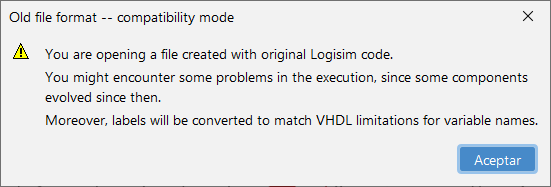
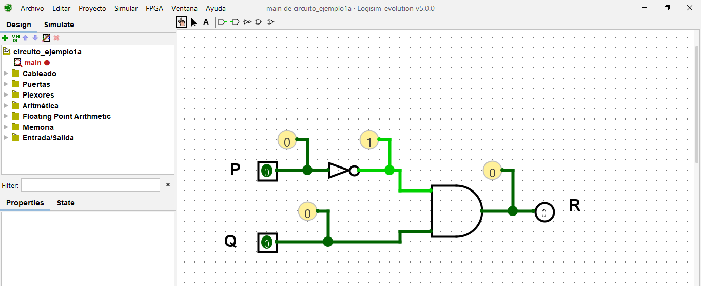
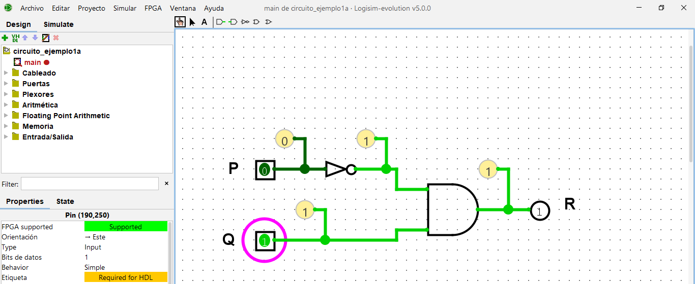
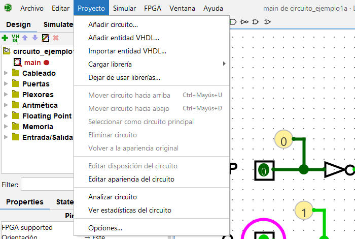
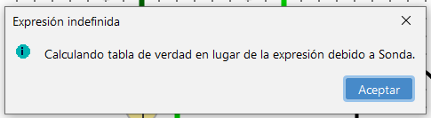
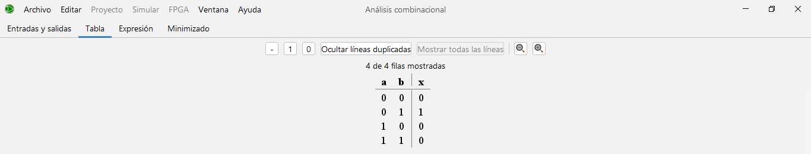

# Simulaciones en Logisim — Clase 19 (Circuitos lógicos)

> **Material relacionado**: [Diapositivas de la clase 19](../clase19.pdf) · [Simulaciones del parcial 4 de 2025-2](../simulaciones_parcial4_2025-2/)
>
> Esta carpeta contiene los circuitos de la clase 19 listos para abrir en un simulador. Con ellos puede cambiar las entradas de cada circuito y comprobar por sí mismo las salidas y las tablas de verdad que se calcularon a mano en las diapositivas.

## Contenido

1. [¿Qué es Logisim-evolution?](#1-qué-es-logisim-evolution)
2. [Instalación de Logisim-evolution](#2-instalación-de-logisim-evolution)
3. [Descargar los archivos de ejemplo](#3-descargar-los-archivos-de-ejemplo)
4. [Ejemplo guiado: el Ejemplo 1 de la clase](#4-ejemplo-guiado-el-ejemplo-1-de-la-clase)
5. [Qué hay en cada carpeta](#5-qué-hay-en-cada-carpeta)
6. [Otros simuladores](#6-otros-simuladores)

## 1. ¿Qué es Logisim-evolution?

Logisim es un simulador de circuitos lógicos: usted dibuja compuertas (NOT, AND, OR, …) y cables, cambia las entradas con un clic y ve de inmediato el valor de cada salida. Los archivos de un circuito tienen extensión `.circ`.

Los ejemplos de esta carpeta se hicieron con **Logisim 2.7.1**, la versión original de Carl Burch ([cburch.com/logisim](https://www.cburch.com/logisim/)). Esa versión ya no se mantiene, así que se recomienda instalar **Logisim-evolution**, su continuación. Es gratuita, de código abierto y abre sin problema los archivos de la versión original. Esta guía se probó con **Logisim-evolution 5.0.0** en Windows 10.

## 2. Instalación de Logisim-evolution

Todos los instaladores están en la página de versiones del proyecto:
**<https://github.com/logisim-evolution/logisim-evolution/releases/latest>**.
En la sección **Assets** de esa página, descargue el archivo que corresponde a su sistema operativo:

| Sistema operativo | Archivo a descargar | ¿Requiere Java? |
|---|---|---|
| Windows (procesador Intel o AMD, el caso más común) | `logisim-evolution-<versión>-amd64.msi` | No, lo trae incluido |
| Windows (procesador ARM) | `logisim-evolution-<versión>-aarch64.msi` | No |
| macOS con procesador Intel | `logisim-evolution-<versión>-x86_64.dmg` | No |
| macOS con procesador Apple (M1, M2, …) | `logisim-evolution-<versión>-aarch64.dmg` | No |
| Linux (Debian, Ubuntu) | `logisim-evolution_<versión>_amd64.deb` | No |
| Linux (Fedora, openSUSE) | `logisim-evolution-<versión>-1.x86_64.rpm` | No |
| Cualquier sistema (versión portable) | `logisim-evolution-<versión>-all.jar` | Sí, Java 21 o superior |

### Windows (paso a paso)

1. Descargue `logisim-evolution-<versión>-amd64.msi` desde la página de versiones (en la 5.0.0 pesa unos 79 MB).
2. Haga doble clic en el archivo descargado. Si Windows muestra el aviso *Windows protegió su PC*, haga clic en **Más información** y luego en **Ejecutar de todas formas**.
3. Acepte el aviso de *Control de cuentas de usuario* para permitir la instalación y espere a que termine.
4. Abra el programa desde el menú Inicio, buscando **Logisim-evolution**. Queda instalado en `C:\Program Files\Logisim-evolution`.

Si usa el administrador de paquetes de Windows, también puede instalarlo desde una terminal:

```
winget install -e --id logisim-evolution.logisim-evolution
```

### macOS y Linux

- **macOS**: abra el `.dmg` y arrastre Logisim-evolution a la carpeta *Aplicaciones*. Si macOS impide abrirlo porque es de un "desarrollador no identificado", haga clic derecho sobre la aplicación y elija **Abrir**.
- **Linux**: instale el `.deb` (`sudo apt install ./logisim-evolution_<versión>_amd64.deb`) o el `.rpm`. También está disponible en Flathub y Snap.

### Versión portable (`.jar`)

Si no puede instalar programas (por ejemplo, en un computador de una sala), descargue `logisim-evolution-<versión>-all.jar` y ejecútelo con `java -jar logisim-evolution-<versión>-all.jar`. Esta opción necesita **Java 21 o superior** instalado ([adoptium.net](https://adoptium.net/temurin/releases/)); con versiones anteriores de Java no abre.

## 3. Descargar los archivos de ejemplo

GitHub no permite descargar una carpeta completa con un clic. Tiene tres opciones:

- **Un grupo de ejemplos**: use los `.zip` de esta carpeta (`compuertas.zip`, `circuitos_logicos.zip`, `representacion_funciones.zip`). Haga clic en el `.zip`, luego en el botón de descarga (*Download raw file*) y descomprímalo.
- **Un solo circuito**: haga clic en el `.circ` y use el mismo botón de descarga.
- **Todo el repositorio**: en la página principal del repositorio, use **Code → Download ZIP**.

> [!IMPORTANT]
> Un `.circ` abierto directamente en el navegador solo muestra texto (XML). Para simularlo debe descargarlo y abrirlo con Logisim-evolution.

## 4. Ejemplo guiado: el Ejemplo 1 de la clase

Este recorrido usa [`circuitos_logicos/circuito_ejemplo1a.circ`](./circuitos_logicos/circuito_ejemplo1a.circ), el primer circuito del Ejemplo 1 (diapositivas, págs. 20, 28 y 32): una compuerta NOT sobre `P` y una AND con `Q`, es decir, `R = ¬P ∧ Q`. La pregunta de la diapositiva es cuál es la salida para `P = 0` y `Q = 1`.

**Paso 1 — Abrir el archivo.** En Logisim-evolution use **Archivo → Abrir…** (`Ctrl+O`) y elija el `.circ`. También puede arrastrar el archivo sobre la ventana del programa.

Como el archivo es de la versión original, Logisim-evolution lo abre en *modo de compatibilidad* y puede mostrar este aviso. El aviso dice, en inglés, que el archivo se creó con el Logisim original y que algunos nombres podrían ajustarse. Es normal: haga clic en **Aceptar** y continúe.



Al abrirlo verá el circuito con todas las entradas en 0. Para verlo más grande, use los botones de zoom de la esquina inferior izquierda (en las capturas está en **×2**).



Cómo leer la pantalla:

| Elemento | Qué es |
|---|---|
| Cuadrado con un número (`P`, `Q`) | **Entrada**. Su valor se cambia con un clic. |
| Círculo con un número (`R`) | **Salida** del circuito. |
| Círculos amarillos | **Sondas**: muestran el valor que pasa por ese cable. Sirven para seguir el circuito paso a paso, como en las soluciones de las diapositivas. |
| Cable verde claro / verde oscuro | El cable lleva un `1` / un `0`. |

**Paso 2 — Cambiar una entrada.** Verifique que esté activa la herramienta de la **mano** (*Poke*), el primer ícono de la barra superior, y haga clic sobre la entrada `Q`. Su valor pasa a `1` y el circuito se recalcula de inmediato. Con `P = 0` y `Q = 1` la salida es `R = 1`, igual que en la solución de la pág. 28. Las sondas muestran el valor intermedio: la NOT entrega `¬P = 1`.



Haga clic sobre `P` y `Q` hasta recorrer las cuatro combinaciones; así obtiene a mano la tabla de entrada/salida del circuito.

> [!TIP]
> Si en vez de la mano está activa la flecha (*Edit*), un clic selecciona o mueve componentes en lugar de cambiar su valor. Si movió algo por error, use **Editar → Deshacer** (`Ctrl+Z`).

**Paso 3 — Obtener la tabla de verdad completa.** Logisim puede construir la tabla automáticamente. Abra el menú **Proyecto → Analizar circuito**.



Como este circuito tiene sondas, Logisim no puede deducir la expresión booleana y muestra este aviso. Haga clic en **Aceptar**: la tabla de verdad sí se calcula.



En la ventana *Análisis combinacional*, la pestaña **Tabla** muestra todas las combinaciones de entrada con su salida:



> [!NOTE]
> El analizador llama a las variables `a`, `b` y `x` en lugar de `P`, `Q` y `R`. En estos archivos las letras `P`, `Q`, `R` son textos escritos junto a las entradas, no el nombre interno de cada entrada. Las entradas se nombran en orden de arriba hacia abajo: `a = P`, `b = Q`, y la salida `x = R`. La tabla dice que `R = 1` solo cuando `P = 0` y `Q = 1`, que es justamente `R = ¬P ∧ Q`.

Cuando un circuito **no** tiene sondas, las pestañas **Expresión** y **Minimizado** de esa misma ventana muestran la expresión booleana del circuito y una versión simplificada. Esto sirve para comprobar una simplificación hecha a mano. En la tabla de la [sección 5](#5-qué-hay-en-cada-carpeta), la columna "Sondas" indica qué archivos las tienen.

**Paso 4 — Cerrar.** Si al cerrar Logisim le pregunta si desea guardar los cambios, elija **No**. Si guarda, el archivo queda convertido al formato de Logisim-evolution y ya no se puede abrir con el Logisim original.

## 5. Qué hay en cada carpeta

*Las tablas de verdad descritas en esta sección se verificaron ejecutando cada archivo en Logisim-evolution 5.0.0.* Las expresiones usan la notación de las diapositivas: `P'` (o `¬P`) para NOT, `P·Q` (o `P ∧ Q`) para AND y `P + Q` (o `P ∨ Q`) para OR.

### 5.1 `compuertas/` — Las compuertas básicas (diapositivas, págs. 18–19)

Un archivo por compuerta, con entradas `P` y `Q` y salida `X`. Sirven para comprobar la tabla de entrada/salida de cada compuerta.

| Archivo | Compuerta | Expresión | `X = 1` cuando… |
|---|---|---|---|
| [`gate_not.circ`](./compuertas/gate_not.circ) | NOT | `X = P'` | `P = 0` |
| [`gate_and.circ`](./compuertas/gate_and.circ) | AND | `X = P·Q` | ambas entradas valen 1 |
| [`gate_or.circ`](./compuertas/gate_or.circ) | OR | `X = P + Q` | al menos una entrada vale 1 |
| [`gate_nand.circ`](./compuertas/gate_nand.circ) | NAND | `X = (P·Q)'` | al menos una entrada vale 0 |
| [`gate_nor.circ`](./compuertas/gate_nor.circ) | NOR | `X = (P + Q)'` | ambas entradas valen 0 |
| [`gate_xor.circ`](./compuertas/gate_xor.circ) | XOR | `X = P ⊕ Q` | las entradas son distintas |
| [`gate_xnor.circ`](./compuertas/gate_xnor.circ) | XNOR | `X = (P ⊕ Q)'` | las entradas son iguales |

### 5.2 `circuitos_logicos/` — Ejemplos 1 a 5 de la clase (diapositivas, págs. 20–36)

Las diapositivas de las págs. 32–36 (*Ejemplos – Simulaciones*) muestran cada uno de estos circuitos en Logisim. Allí los archivos aparecen con extensión `.cir`, pero los archivos reales terminan en `.circ`.

| Archivo | Ejemplo | Circuito / expresión | Qué comprobar | Sondas |
|---|---|---|---|---|
| [`circuito_ejemplo1a.circ`](./circuitos_logicos/circuito_ejemplo1a.circ) | 1 (págs. 20, 28, 32) | `R = ¬P ∧ Q` | Con `P = 0`, `Q = 1` se obtiene `R = 1` (ver la [sección 4](#4-ejemplo-guiado-el-ejemplo-1-de-la-clase)). | Sí |
| [`circuito_ejemplo1b.circ`](./circuitos_logicos/circuito_ejemplo1b.circ) | 1 (págs. 20, 28, 32) | `S = ¬(P ∨ Q) ∧ R` | Con `P = 1`, `Q = 0`, `R = 1` se obtiene `S = 0`. La única combinación con `S = 1` es `P = 0`, `Q = 0`, `R = 1`. | Sí |
| [`circuito_ejemplo2.circ`](./circuitos_logicos/circuito_ejemplo2.circ) | 2 (págs. 22, 28, 33) | `R = P ∨ ¬Q` | La tabla de la pág. 28: `R = 0` solo cuando `P = 0` y `Q = 1`. | Sí |
| [`circuito_ejemplo3a.circ`](./circuitos_logicos/circuito_ejemplo3a.circ) | 3 (págs. 23, 29, 34) | `(P + Q)·(P·Q)'` (en el archivo la salida se llama `R`) | Vale 1 cuando exactamente una de las dos entradas vale 1. | Sí |
| [`circuito_ejemplo3b.circ`](./circuitos_logicos/circuito_ejemplo3b.circ) | 3 (págs. 24, 29, 34) | `S = P·Q·R'` | Vale 1 solo con `P = 1`, `Q = 1`, `R = 0`. | Sí |
| [`circuito_ejemplo4a.circ`](./circuitos_logicos/circuito_ejemplo4a.circ) | 4 (págs. 25, 30, 35) | `(¬P ∧ Q) ∨ ¬Q` | Vale 0 solo con `P = 1`, `Q = 1`. | No |
| [`circuito_ejemplo4b.circ`](./circuitos_logicos/circuito_ejemplo4b.circ) | 4 (págs. 26, 30, 35) | `U = ((P ∧ Q) ∧ (R ∧ S)) ∧ T` | Vale 1 solo si las cinco entradas valen 1. | No |
| [`circuito_ejemplo5.circ`](./circuitos_logicos/circuito_ejemplo5.circ) | 5 (págs. 27, 31, 36) | `S = PQR + PQ'R + PQ'R'` | La tabla de la pág. 27: `S = 1` en las filas `111`, `101` y `100`. | No |

*Aclaración del apunte:* en la pág. 20, el segundo circuito del Ejemplo 1 dice "P = 1, Q = 0 y Q = 1". La tercera entrada es `R`: la solución de la pág. 28 usa `R = 1`.

### 5.3 `representacion_funciones/` — Una misma función en varias formas

Cada ejemplo trae la **misma función booleana** construida de varias maneras: sin simplificar, simplificada y, en el segundo, en forma canónica. Al analizar cada archivo (**Proyecto → Analizar circuito**) se comprueba que todas las versiones tienen **la misma tabla de verdad**: simplificar cambia el circuito, no la función. Ninguno de estos archivos tiene sondas, así que las pestañas *Expresión* y *Minimizado* funcionan.

| Archivo | Entradas → salida | Expresión que implementa |
|---|---|---|
| [`ejemplo1_f_no_simplificada.circ`](./representacion_funciones/ejemplo1_f_no_simplificada.circ) | `a, b → f` | `f = a'b + ab' + ab` |
| [`ejemplo1_f_simplificada.circ`](./representacion_funciones/ejemplo1_f_simplificada.circ) | `a, b → f` | `f = a + b` |
| [`ejemplo2_f1_canonica.circ`](./representacion_funciones/ejemplo2_f1_canonica.circ) | `M, P, N, L → A` | `A = MPNL + MPNL' + MPN'L + MPN'L' + MP'NL'` |
| [`ejemplo2_f1_no_simplificada.circ`](./representacion_funciones/ejemplo2_f1_no_simplificada.circ) | `M, P, N, L → A` | `A = MP + MNL'` |
| [`ejemplo2_f1_simplificada.circ`](./representacion_funciones/ejemplo2_f1_simplificada.circ) | `M, P, N, L → A` | `A = M(P + NL')` |

En el ejemplo 2, `A = 1` exactamente en las combinaciones `MPNL` = `1010`, `1100`, `1101`, `1110` y `1111`.

Los tres archivos del ejemplo 2 usan un **subcircuito**. El circuito `main` solo muestra una "caja" con las entradas y la salida; la lógica está dentro de esa caja. Para verla, haga doble clic en el nombre del subcircuito (`alama` o `alarma1`) en el panel izquierdo, debajo de `main`.

*Aclaración del apunte:* en `ejemplo2_f1_canonica.circ` se fijó explícitamente en 5 el número de entradas de la compuerta OR final. En el Logisim original ese era el valor por defecto, pero Logisim-evolution usa 2 por defecto y, sin este ajuste, ignoraba tres de los cinco términos. El circuito es el mismo.

### 5.4 `ejemplo1/`, `ejemplo2/`, `ejemplo1_clase.circ` y `ejemplo2_clase.circ`

| Archivo | Entradas → salida | Qué hace (según su tabla de verdad) | Sondas |
|---|---|---|---|
| [`ejemplo1/circuito1a.circ`](./ejemplo1/circuito1a.circ) | `A, B, C, D → X` | Circuito con compuertas NOT, AND y OR; `X = 0` solo cuando las cuatro entradas valen 0. | Sí |
| [`ejemplo1/circuito1b.circ`](./ejemplo1/circuito1b.circ) | `A, B, C, D → X` | Una sola OR de cuatro entradas, `X = A + B + C + D`: la misma tabla que `circuito1a`, con un circuito mucho más simple. | No |
| [`ejemplo2/alarmaTanques.circ`](./ejemplo2/alarmaTanques.circ) | `A, B, C → S` | `S = 1` cuando **al menos dos** de las tres entradas valen 1 (`S = AB + AC + BC`). Está construido como subcircuito (`alarma`). | No |
| [`ejemplo1_clase.circ`](./ejemplo1_clase.circ) | `A, B, C → F` | `F = 1` en las filas `ABC` = `010`, `011`, `101`, `110`, `111`, que equivale a `F = B + AC`. Usa el subcircuito `circuito1`. | No |
| [`ejemplo2_clase.circ`](./ejemplo2_clase.circ) | `R, S, T → Q` | `Q = 1` solo cuando las tres entradas valen 0, es decir, `Q = R'S'T'`. Usa el subcircuito `circuito2`. | No |

### 5.5 Los archivos `.zip`

`compuertas.zip`, `circuitos_logicos.zip` y `representacion_funciones.zip` contienen exactamente los mismos archivos que las carpetas del mismo nombre. Existen solo para facilitar la descarga (ver la [sección 3](#3-descargar-los-archivos-de-ejemplo)).

## 6. Otros simuladores

La diapositiva de la pág. 12 menciona varios simuladores. Logisim-evolution es el único con el que se pueden abrir los `.circ` de esta carpeta; los demás sirven para explorar las mismas ideas de otra manera.

| Simulador | Para qué sirve | Requisitos |
|---|---|---|
| [Logisim-evolution](https://github.com/logisim-evolution/logisim-evolution) | Circuitos con compuertas lógicas; abre todos los ejemplos de esta carpeta. | Instalación ([sección 2](#2-instalación-de-logisim-evolution)) |
| [Logisim original](https://www.cburch.com/logisim/) | Versión 2.7.1 con la que se crearon los ejemplos. Ya no se mantiene. | Java |
| [Tinkercad Circuits](https://www.tinkercad.com/) | Circuitos con componentes "reales": batería, interruptores, bombillos y protoboard. | Navegador y cuenta gratuita |
| [Falstad Circuit Simulator](https://www.falstad.com/circuit/) | Circuitos eléctricos animados, con la corriente en movimiento; incluye circuitos lógicos. | Navegador |
| [simulator.io](https://simulator.io/) | Simulador de compuertas lógicas en línea. | Navegador |
| [logic.ly](https://logic.ly/) | Simulador de compuertas lógicas orientado a la enseñanza. | Navegador |

Las diapositivas 9 a 11 enlazan tres circuitos de Tinkercad que ilustran la analogía de Shannon entre interruptores y lógica: un interruptor que enciende una lámpara, y dos interruptores en **serie** (AND) o en **paralelo** (OR):

- [Circuito digital: interruptor y lámpara](https://www.tinkercad.com/things/fiv7VEz3qa1-circuitodigital) (pág. 9)
- [Función AND: interruptores en serie](https://www.tinkercad.com/things/4TMdYwk7HdB-circuito2and) (pág. 10)
- [Función OR: interruptores en paralelo](https://www.tinkercad.com/things/8UzGdwyjeiQ-circuito2or) (pág. 11)

Para simularlos, abra el enlace, inicie sesión en Tinkercad y use **Copiar y modificar** (*Copy and Tinker*). Luego pulse **Iniciar simulación** y haga clic sobre los interruptores para abrirlos o cerrarlos.
