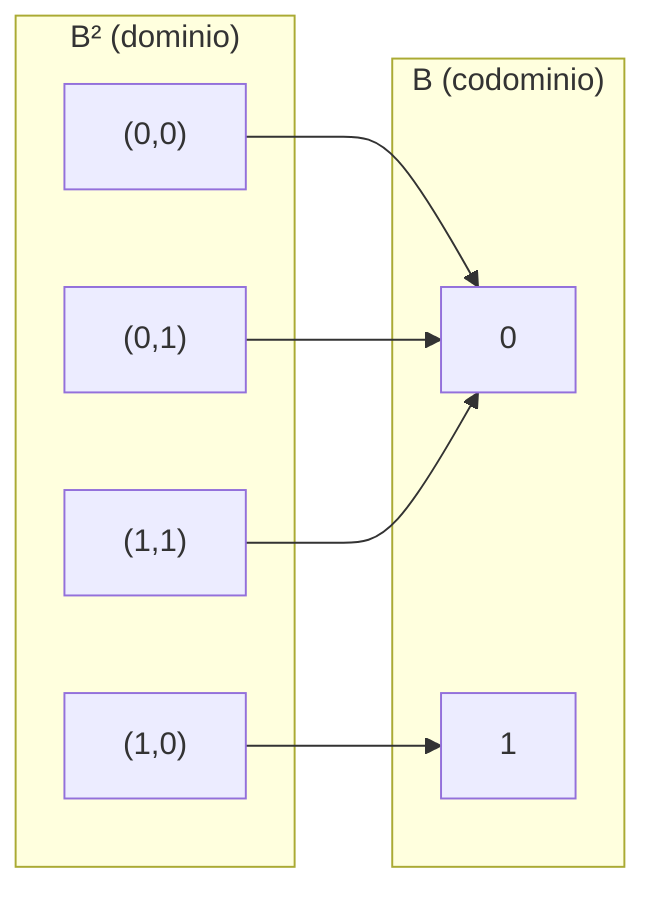
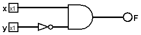
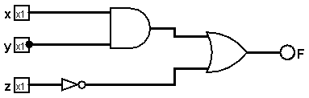

# Clase 20 — Álgebra booleana

> **Fecha**: 24/11/2026 y 26/11/2026 · **Modalidad**: Virtual sincrónica · **Apuntes**: [Diapositivas PDF](./clase20.pdf) · [PPT](./clase20.pptx) · [Manuscrito anotado](./clase20_annotated.pdf) · [Circuitos de los Ejemplos 1 y 2 en Logisim](./ejemplos_logisim/)
>
> La sesión del 24/11 cubrió las págs. 1–26 del manuscrito (portada: «24/11/2026»). La pág. 27 tiene la marca «Fin: 24/11/2026 · Inicio: 26/11/2026»: la sesión del 26/11 cubrió las págs. 27–40 y luego continuó con el manuscrito de la [clase 21](../clase-21/) (formas canónicas y diseño de circuitos), que se documenta en esa clase.

## Objetivos de la clase

- Presentar el álgebra booleana como una nueva representación de la lógica proposicional: el conjunto `B = {0, 1}` con la suma (OR), el producto (AND) y el complemento (NOT).
- Definir las funciones booleanas de grado `n` y sus representaciones: tabla de verdad, diagrama de flechas, expresión, circuito y cubo.
- Establecer cuándo dos funciones son iguales y cuándo dos expresiones son equivalentes, y contar cuántas funciones booleanas de grado `n` existen.
- Introducir las identidades del álgebra booleana y el principio de dualidad, y usarlas para demostrar identidades y simplificar expresiones.

## Resumen

La sesión del 24/11 tradujo la lógica proposicional al álgebra booleana, definió las funciones booleanas y las representó con tablas, diagramas de flechas, circuitos y cubos (Ejemplos 1 y 2), y cerró con la igualdad de funciones y las operaciones entre funciones. La sesión del 26/11 contó las funciones de grado `n`, presentó las 16 funciones de grado 2, la tabla de identidades y el principio de dualidad, y las aplicó a demostrar y simplificar expresiones (Ejemplos 5, 7 y 8; el Ejemplo 6 solo se mencionó). Terminó viendo muy rápido la definición formal de álgebra booleana y su correspondencia con la lógica y los conjuntos, y siguió con la clase 21.

## Agenda

**Sesión 1 — 24/11/2026**

1. Contextualización: video sobre AND, OR y NOT. [*(→ sección 1)*](#1-contextualización)
2. Conceptos clave: el conjunto `B`, los tres operadores y la correspondencia con la lógica proposicional. [*(→ sección 2)*](#2-conceptos-clave)
3. Ejemplos 1 a 4 de la introducción: evaluar y traducir. [*(→ sección 3)*](#3-ejemplos-de-la-introducción)
4. Definiciones fundamentales: conjunto booleano, variable, n-tuplas y función booleana de grado `n`. [*(→ sección 4)*](#4-definiciones-fundamentales)
5. Ejemplo 1: dominio, tabla, diagrama de flechas y circuito de `F = xy'`; la resta no es booleana. [*(→ sección 5)*](#5-ejemplo-1-dominio-tabla-flechas-y-circuito)
6. Expresiones booleanas: definición recursiva. [*(→ sección 6)*](#6-expresiones-booleanas-definición-recursiva)
7. Ejemplo 2: tabla con índice, expresión, circuito y cubo de `F = xy + z'`. [*(→ sección 7)*](#7-ejemplo-2-tabla-expresión-circuito-y-cubo)
8. Igualdad de funciones y expresiones equivalentes. [*(→ sección 8)*](#8-igualdad-de-funciones-y-expresiones-equivalentes)
9. Operaciones con funciones booleanas. [*(→ sección 9)*](#9-operaciones-con-funciones-booleanas)

**Sesión 2 — 26/11/2026**

1. Ejemplo 3: cuántas funciones booleanas de grado `n` hay. [*(→ sección 10)*](#10-ejemplo-3-cuántas-funciones-de-grado-n-hay)
2. Ejemplo 4: las 16 funciones de grado 2. [*(→ sección 11)*](#11-ejemplo-4-las-16-funciones-de-grado-2)
3. Identidades del álgebra booleana. [*(→ sección 12)*](#12-identidades-del-álgebra-booleana)
4. Principio de dualidad. [*(→ sección 13)*](#13-principio-de-dualidad)
5. Ejemplo 5: demostrar la idempotencia; mención del Ejemplo 6 (absorción). [*(→ sección 14)*](#14-ejemplos-5-y-6-demostrar-idempotencia-y-absorción)
6. Ejemplo 7: demostrar una identidad con identidades y con tabla de verdad. [*(→ sección 15)*](#15-ejemplo-7-identidades-y-tabla-de-verdad)
7. Ejemplo 8: simplificar una expresión y verificar el resultado. [*(→ sección 16)*](#16-ejemplo-8-simplificar-y-verificar)
8. Definición formal de álgebra booleana; lógica, conjuntos y álgebra de Boole como tres ejemplos de la misma estructura (vistas muy rápido). [*(→ sección 17)*](#17-definición-formal-y-tres-ejemplos-de-álgebra-booleana)

## Contenido temático

> [!NOTE]
> **Cómo leer este apunte.**
>
> - Las secciones numeradas siguen el orden en que se dictó la clase. **Sesión 1 (24/11), secciones 1 a 9**: manuscrito, págs. 1–26. **Sesión 2 (26/11), secciones 10 a 17**: manuscrito, págs. 27–40.
> - La clase tiene dos numeraciones de ejemplos: los **Ejemplos 1 a 4 de la introducción** (sección 3), que aquí se rotulan «(introducción)», y los **Ejemplos 1 a 8** de funciones booleanas (secciones 5 a 16).
> - Las soluciones impresas de las págs. 6–9, 14–15 y 20–21 y la simplificación del Ejemplo 8 (pág. 34) no tienen anotaciones a mano.
> - El **Ejemplo 6** (pág. 32) solo se mencionó en clase: su solución impresa queda para estudiarla por su cuenta. Las **págs. 36–40** (definición formal y correspondencias) se vieron muy rápido, al final de la sesión, y solo tienen resaltado.
> - Los párrafos que empiezan con *Aclaración del apunte* se agregaron al redactar: no se dijeron en clase. Sirven para conectar ideas o evitar confusiones.

**Notación usada en este apunte**

| Símbolo | Se lee | Observación |
|---|---|---|
| `B = {0, 1}` | conjunto booleano | `0` = falso, `1` = verdadero (sección 2). En la definición formal de la sección 17, `B` es el conjunto de un álgebra booleana cualquiera. |
| `x + y` | suma booleana (OR) | `1 + 1 = 1`: **no** es la suma aritmética. |
| `x · y` o `xy` | producto booleano (AND) | El punto se puede omitir: `xy'` es `x · y'`. |
| `x'` o `x̄` | complemento de `x` (NOT) | La diapositiva también usa una barra sobre la expresión: `(0 + 1)'` se escribe con una barra sobre `0 + 1`. |
| `Bⁿ` | conjunto de las n-tuplas booleanas | `\|Bⁿ\| = 2ⁿ` (sección 4). |
| `F: Bⁿ → B` | función booleana de grado `n` | Asigna a cada n-tupla una única salida, 0 o 1. |
| `i` | índice de la fila | Las filas de una tabla se numeran de `0` a `2ⁿ − 1` (sección 7). |
| `=` | igualdad (álgebra de Boole) | Corresponde a la equivalencia `≡` de la lógica proposicional (sección 17). |
| `≡` | equivalencia lógica | Como en las clases de lógica proposicional. |

**Orden de las operaciones.** Como en la lógica proposicional, primero se aplica el complemento (NOT), luego el producto (AND) y por último la suma (OR). Así lo recordó el profesor al evaluar `x + yz'` en el Ejemplo 4 de la introducción. Es la misma tabla de prioridad de la [clase 4](../clase-04/README.md#1-repaso-operadores-lógicos-y-reglas-de-prioridad): `¬` antes que `∧`, y `∧` antes que `∨`.

### 1. Contextualización

*(Manuscrito, pág. 2, sin anotaciones.)*

La clase empezó con el video [The three words that power every device you own](https://www.youtube.com/watch?v=dkocGur84i8) (TED-Ed), como repaso. El video presenta las tres operaciones del álgebra de Boole (AND, OR y NOT) con el ejemplo de una máquina de pinball, y menciona que la compuerta NOR (una OR seguida de una NOT) puede reemplazar por sí sola a las demás.

### 2. Conceptos clave

*(Manuscrito, pág. 3.)*

El álgebra booleana trabaja con el conjunto `B = {0, 1}` y tres operadores:

- **Suma booleana**: OR (`+`).
- **Producto booleano**: AND (`·`).
- **Complemento**: NOT (`'`).

| `x` | `y` | `x + y` | `x · y` |
|---|---|---|---|
| 0 | 0 | 0 | 0 |
| 0 | 1 | 1 | 0 |
| 1 | 0 | 1 | 0 |
| 1 | 1 | **1** | 1 |

| `x` | `x'` |
|---|---|
| 0 | 1 |
| 1 | 0 |

> [!WARNING]
> `1 + 1 = 1`. No es la suma aritmética: «`+`» significa OR.

**Correspondencia con la lógica proposicional.** El profesor anotó sobre cada operador su conectivo: OR (`∨`), AND (`∧`), NOT (`¬`).

| Lógica proposicional | Álgebra de Boole |
|---|---|
| Falso `F` | `0` |
| Verdadero `V` | `1` |
| `∨` | `+` |
| `∧` | `·` |
| `¬` | `'` |

**Ejemplo.** La expresión en lógica proposicional `x ∨ y ∧ ¬z ≡ x ∨ (y ∧ ¬z)` se puede reescribir en álgebra booleana como `x + y · z' = x + yz' = x + yz̄`.

*Aclaración del apunte:* el paréntesis de `x ∨ (y ∧ ¬z)` no cambia nada, porque `∧` (el producto) se aplica antes que `∨` (la suma).

### 3. Ejemplos de la introducción

*(Manuscrito, págs. 4–9. Los ejemplos se resolvieron a mano en las págs. 4–5; las págs. 6–9 traen la solución impresa, sin anotaciones.)*

**Ejemplo 1 (introducción).** Encuentre el valor de `1 · 0 + (0 + 1)'`.

`1 · 0 + (0 + 1)' = 0 + (1)' = 0 + 0 = 0`

**Ejemplo 2 (introducción).** Traduzca la igualdad del ejemplo anterior a su representación en lógica proposicional.

Con la correspondencia `1 ↔ V`, `0 ↔ F`, `· ↔ ∧`, `+ ↔ ∨`, `' ↔ ¬`, la expresión `1 · 0 + (0 + 1)'` se traduce como:

`(V ∧ F) ∨ ¬(F ∨ V) ≡ F ∨ ¬V ≡ F ∨ F ≡ F`

El resultado coincide con el del Ejemplo 1 (introducción): `0` en álgebra de Boole, `F` en lógica.

**Ejemplo 3 (introducción).** Traduzca la equivalencia lógica `(V ∧ V) ∨ ¬F ≡ V` a una identidad en álgebra booleana.

| Lógica proposicional | Álgebra de Boole |
|---|---|
| `(V ∧ V) ∨ ¬F ≡ V` | `(1 · 1) + 0' = 1` |
| `V ∨ V ≡ V` | `1 + 1 = 1` |
| `V ≡ V` | `1 = 1` |

*Aclaración del apunte:* en el manuscrito, la columna del álgebra de Boole también se escribió con `≡`. En álgebra de Boole la relación se escribe `=`, que es la que corresponde a `≡` (sección 17). La solución impresa (pág. 8) dice por error «la expresión `1 · 0 + (0 + 1)'` se traduce como», copiado del Ejemplo 2; la expresión que se traduce es `(V ∧ V) ∨ ¬F ≡ V`.

**Ejemplo 4 (introducción).** Evalúe `x + yz'` para `x = 0`, `y = 1`, `z = 0`.

`x + yz' = 0 + 1 · 0' = 0 + 1 · 1 = 0 + 1 = 1`

Primero se complementa `z`, luego se hace el producto con `y` y al final la suma con `x`.

### 4. Definiciones fundamentales

*(Manuscrito, pág. 10.)*

1. **Conjunto booleano (`B`)**: el conjunto formado únicamente por los elementos 0 y 1: `B = {0, 1}`.
2. **Variable booleana**: una variable `x` que toma valores en `B`, es decir, `x = 0` o `x = 1`.
3. **Conjunto de n-tuplas (`Bⁿ`)**: todas las secuencias (o «tuplas») de `n` valores booleanos:

   `Bⁿ = {(x₁, x₂, …, xₙ) | xᵢ ∈ B para 1 ≤ i ≤ n}`

   - Ejemplo: `B² = {(0,0), (0,1), (1,0), (1,1)}`. El profesor anotó `|B²| = 2² = 4`.
   - **Importante**: `|Bⁿ| = 2ⁿ`. Cada n-tupla es una fila de la tabla de verdad.
4. **Función booleana de grado `n`**: una función `F: Bⁿ → B` que asigna a cada n-tupla una única salida, 0 o 1.

*Aclaración del apunte:* las n-tuplas son las mismas del producto cartesiano de la [clase 14](../clase-14/): `Bⁿ = B × B × ⋯ × B` (`n` veces).

### 5. Ejemplo 1: dominio, tabla, flechas y circuito

*(Manuscrito, págs. 11–15.)*

**Considere la función `F(x, y) = xy'`.**

- a. Identifique el dominio y el codominio de `F`.
- b. Construya la tabla de verdad de `F`, incluyendo las columnas intermedias necesarias.
- c. Represente `F` mediante un diagrama de flechas.
- d. Dibuje el circuito lógico que implementa `F`.
- e. ¿Es `F` una función booleana? Justifique su respuesta.
- f. ¿Es `G(x, y) = x − y` (resta aritmética) una función booleana? Justifique su respuesta.

**a. Dominio y codominio.** Las entradas son `x`, `y`: `n = 2`, y cada entrada es una pareja `(x, y)`.

- Dominio: `B² = {(0,0), (0,1), (1,0), (1,1)}`.
- Codominio (las salidas posibles): `B = {0, 1}`.

Es decir, `F: B² → B`.

**b. Tabla de verdad**, con la columna intermedia `y'`:

| `i` | `x` | `y` | `y'` | `F = xy'` |
|---|---|---|---|---|
| 0 | 0 | 0 | 1 | 0 |
| 1 | 0 | 1 | 0 | 0 |
| 2 | 1 | 0 | 1 | **1** |
| 3 | 1 | 1 | 0 | 0 |

`F(x, y) = 1` si y solo si `x = 1` y `y = 0`.

**c. Diagrama de flechas** *(figura de clase, págs. 12 y 14)*. Cada pareja de `B²` apunta a su salida en `B`:

**d. Circuito.** `F(x, y) = xy' = x · y'`: la entrada `y` pasa por una NOT, que da `y'`, y una AND combina `x` con `y'`. Al lado, el profesor dibujó las tres compuertas de la [clase 19](../clase-19/README.md#7-compuertas-not-and-y-or): AND (`z = xy`), OR (`z = x + y`) y NOT (`z = x'`).

*(Circuito de la solución impresa, pág. 14. El archivo de Logisim está en [`ejemplos_logisim/`](./ejemplos_logisim/).)*

**e.** Sí. A cada elemento de `B²` le asigna exactamente un valor de `B`. Por lo tanto, `F` es una función booleana de grado 2: `F: B² → B`.

**f. Resta aritmética.** `G(x, y) = x − y`:

| `x` | `y` | `x − y` | ¿Está en `B`? |
|---|---|---|---|
| 0 | 0 | 0 | ∈ `B` |
| 0 | 1 | **−1** | **∉ `B`** |
| 1 | 0 | 1 | ∈ `B` |
| 1 | 1 | 0 | ∈ `B` |

Como `G(0, 1) = 0 − 1 = −1 ∉ B`, `G` no cumple `G: B² → B`. Luego `G` **no** es una función booleana.

> [!NOTE]
> **Preguntas de clase.** Un estudiante pidió repetir cómo se construye el circuito. El profesor explicó que primero se identifican las entradas (`x` e `y`), luego se aplica la NOT a `y` para obtener `y'` y por último se conectan `x` e `y'` a una AND, cuya salida es `F`. También surgió la pregunta de cómo se justifica que una función es booleana: lo es si **todas** sus salidas, para todas las combinaciones de entrada, pertenecen a `{0, 1}`. Basta una salida fuera de `B`, como el `−1` de la resta, para que no lo sea.

*Aclaración del apunte:* que las salidas estén en `{0, 1}` es la condición que se discutió en clase, pero la definición de la sección 4 pide también que las entradas sean las n-tuplas de `Bⁿ` y que a cada una le corresponda **una única** salida. Por eso la respuesta impresa del literal e dice: «A cada elemento de `B²` le asigna exactamente un valor de `B`».

### 6. Expresiones booleanas: definición recursiva

*(Manuscrito, pág. 16, solo resaltado.)*

Las expresiones booleanas en las variables `x₁, x₂, …, xₙ` se definen recursivamente:

1. **Caso base (los bloques fundamentales)**: son expresiones booleanas las constantes `0` y `1` y las variables `x₁, x₂, …, xₙ`.
2. **Paso recursivo (las reglas de construcción)**: si `E₁` y `E₂` son expresiones booleanas, también lo son el complemento `E₁'`, el producto `E₁ · E₂` y la suma `E₁ + E₂`.
3. **Cierre**: solo son expresiones booleanas las que se obtienen aplicando 1 y 2.

Ejemplo: construcción de `x + y · z'`.

| Paso | Expresión | Regla |
|---|---|---|
| 1 | `x`, `y`, `z` | Caso base (variables) |
| 2 | `z'` | Complemento de `z` |
| 3 | `y · z'` | Producto de `y` y `z'` |
| 4 | `x + y · z'` | Suma de `x` con `y · z'` |

> [!TIP]
> **En palabras simples** (diapositiva): se empieza con piezas básicas (0, 1 y las variables) y se combinan con tres reglas (`'`, `·` y `+`). Cada regla es una compuerta (NOT, AND u OR), así que construir la expresión es lo mismo que construir el circuito.

### 7. Ejemplo 2: tabla, expresión, circuito y cubo

*(Manuscrito, págs. 17–22.)*

**Considere la función `F(x, y, z) = xy + z'`.**

- a. Identifique el dominio y el codominio de `F`. ¿Cuántas filas tiene su tabla de verdad?
- b. Construya la tabla de verdad de `F`, incluyendo el índice de cada fila y las columnas intermedias necesarias.
- c. Traduzca `F` a una expresión en lógica proposicional.
- d. Dibuje el circuito lógico que implementa `F`.
- e. Represente `F` en un cubo, resaltando los vértices donde `F = 1`.

**a.** Las entradas son `x`, `y`, `z`: `n = 3`, así que la tabla tiene `|B³| = 2³ = 8` filas.

- Dominio: `B³ = {(0,0,0), (0,0,1), (0,1,0), (0,1,1), (1,0,0), (1,0,1), (1,1,0), (1,1,1)}`.
- Codominio: `B = {0, 1}`.

Es decir, `F: B³ → B`.

**b. Tabla de verdad.** El profesor recomendó agregar siempre el **índice** `i` de cada fila (de `0` a `2ⁿ − 1`): ayuda a identificar las combinaciones y, después, a construir expresiones a partir de la tabla. Las columnas intermedias son `z'` y `xy`:

| `i` | `x` | `y` | `z` | `z'` | `xy` | `F = xy + z'` | Producto de la fila |
|---|---|---|---|---|---|---|---|
| 0 | 0 | 0 | 0 | 1 | 0 | **1** | `x'y'z'` |
| 1 | 0 | 0 | 1 | 0 | 0 | 0 | |
| 2 | 0 | 1 | 0 | 1 | 0 | **1** | `x'yz'` |
| 3 | 0 | 1 | 1 | 0 | 0 | 0 | |
| 4 | 1 | 0 | 0 | 1 | 0 | **1** | `xy'z'` |
| 5 | 1 | 0 | 1 | 0 | 0 | 0 | |
| 6 | 1 | 1 | 0 | 1 | 1 | **1** | `xyz'` |
| 7 | 1 | 1 | 1 | 0 | 1 | **1** | `xyz` |

`F = 1` en las filas `i = 0, 2, 4, 6, 7`.

> [!NOTE]
> Durante la clase, un estudiante señaló que en la fila 5 (`x = 1`, `y = 0`, `z = 1`) el valor de `xy + z'` debía ser 0, y el profesor lo corrigió. El manuscrito ya muestra el valor correcto.

**La expresión que sale de la tabla.** En el manuscrito, el profesor escribió junto a cada fila con salida 1 un producto de las tres variables: la variable que vale 1 se escribe normal y la que vale 0 se escribe complementada (última columna). Sumando esos productos obtuvo:

`H(x, y, z) = x'y'z' + x'yz' + xy'z' + xyz' + xyz`

*Aclaración del apunte:* es el mismo procedimiento de los **minitérminos** del [Ejemplo 5 de la clase 19](../clase-19/README.md#13-ejemplo-5-diseño-a-partir-de-una-tabla). El manuscrito llama `H` a esta expresión para distinguirla de `xy + z'`. Las dos valen 1 exactamente en las filas 0, 2, 4, 6 y 7, así que representan la **misma función**: `H = F`. Son dos expresiones equivalentes (sección 8).

**c. Expresión en lógica proposicional** (solución impresa, pág. 21). Con la correspondencia `· ↔ ∧`, `+ ↔ ∨`, `' ↔ ¬`:

`F = xy + z' ⟺ (x ∧ y) ∨ ¬z`

*Aclaración del apunte:* aquí `⟺` quiere decir «se escribe en lógica proposicional como»: es la misma expresión con otros signos, no una fórmula nueva que haya que demostrar.

**d. Circuito.** El profesor dibujó a mano el circuito de `H` (pág. 19): tres NOT (una por variable), **cinco AND de tres entradas** (una por producto, cada una con su color) y una **OR de cinco entradas** que da `H`. La solución impresa (pág. 21) trae el circuito de `F = xy + z'`, mucho más corto: una AND para `xy`, una NOT para `z'` y una OR.

*(Circuito de la solución impresa, pág. 21. El archivo de Logisim está en [`ejemplos_logisim/`](./ejemplos_logisim/).)*

Los dos circuitos calculan la misma función. El profesor comentó que el circuito largo se puede simplificar con el álgebra booleana, sin construirlo con todos los productos, y lo dejó para la sesión siguiente (secciones 12 a 16).

**e. Representación como cubo** (pág. 22). Cada vértice del cubo es una fila de la tabla (una terna `xyz`), y dos vértices unidos por una arista difieren en un solo bit. Se resaltan los vértices donde `F = 1`:

| Vértice | `000` | `001` | `010` | `011` | `100` | `101` | `110` | `111` |
|---|---|---|---|---|---|---|---|---|
| Fila `i` | 0 | 1 | 2 | 3 | 4 | 5 | 6 | 7 |
| `F` | **1** | 0 | **1** | 0 | **1** | 0 | **1** | **1** |

Vértices resaltados: `000`, `010`, `100`, `110` y `111`.

### 8. Igualdad de funciones y expresiones equivalentes

*(Manuscrito, págs. 23–24.)*

- **Igualdad de funciones**: dos funciones `F` y `G` son iguales (`F = G`) si y solo si `F(x₁, x₂, …, xₙ) = G(x₁, x₂, …, xₙ)` para **toda** combinación de valores `xᵢ ∈ B`.
- **Expresiones equivalentes**: expresiones distintas que representan la **misma función**. Se verifica comparando sus tablas de verdad fila por fila.

**Ejemplo.** Para cada uno de los siguientes pares, determine si las expresiones son equivalentes.

**Par 1: `F = x'y + xy' + xy` y `G = x + y`.**

| `i` | `x` | `y` | `x'` | `y'` | `x'y` | `xy'` | `xy` | `F` | `G = x + y` |
|---|---|---|---|---|---|---|---|---|---|
| 0 | 0 | 0 | 1 | 1 | 0 | 0 | 0 | 0 | 0 |
| 1 | 0 | 1 | 1 | 0 | 1 | 0 | 0 | 1 | 1 |
| 2 | 1 | 0 | 0 | 1 | 0 | 1 | 0 | 1 | 1 |
| 3 | 1 | 1 | 0 | 0 | 0 | 0 | 1 | 1 | 1 |

Las columnas coinciden en las cuatro filas: **`F = G`**, así que las expresiones son equivalentes.

**Par 2: `F = x + y'` y `G = (x + y)'`.**

| `i` | `x` | `y` | `y'` | `x + y` | `F = x + y'` | `G = (x + y)'` |
|---|---|---|---|---|---|---|
| 0 | 0 | 0 | 1 | 0 | 1 | 1 |
| 1 | 0 | 1 | 0 | 1 | 0 | 0 |
| 2 | 1 | 0 | 1 | 1 | **1** | **0** |
| 3 | 1 | 1 | 0 | 1 | **1** | **0** |

Las filas 2 y 3 son distintas: **`F ≠ G`**, así que las expresiones no son equivalentes. Para que dos funciones sean distintas basta una fila en la que difieran.

### 9. Operaciones con funciones booleanas

*(Manuscrito, págs. 25–26.)*

Sean `F` y `G` funciones booleanas de `n` variables:

| Operación | Definición | En el circuito |
|---|---|---|
| Complemento | `F'(x₁, …, xₙ) = (F(x₁, …, xₙ))'` | NOT a la salida de `F` |
| Suma | `(F + G)(x₁, …, xₙ) = F(x₁, …, xₙ) + G(x₁, …, xₙ)` | OR entre las salidas de `F` y `G` |
| Producto | `(F · G)(x₁, …, xₙ) = F(x₁, …, xₙ) · G(x₁, …, xₙ)` | AND entre las salidas de `F` y `G` |

**Ejemplo.** Sean `F(x, y) = xy'` y `G(x, y) = x'y`. Obtenga la tabla de verdad para las operaciones `F'`, `F + G` y `F · G`.

El profesor nombró cada operación:

- `O₁ = F' = (xy')'`
- `O₂ = F + G = xy' + x'y`
- `O₃ = F · G = (xy') · (x'y)`

| `i` | `x` | `y` | `x'` | `y'` | `xy'` | `O₁ = (xy')'` | `x'y` | `O₂ = xy' + x'y` | `O₃ = (xy')(x'y)` |
|---|---|---|---|---|---|---|---|---|---|
| 0 | 0 | 0 | 1 | 1 | 0 | 1 | 0 | 0 | 0 |
| 1 | 0 | 1 | 1 | 0 | 0 | 1 | 1 | 1 | 0 |
| 2 | 1 | 0 | 0 | 1 | 1 | 0 | 0 | 1 | 0 |
| 3 | 1 | 1 | 0 | 0 | 0 | 1 | 0 | 0 | 0 |

Las columnas que ya estaban calculadas (`xy'` y `x'y`) se reutilizan para obtener las tres operaciones.

> [!NOTE]
> Durante la clase, un estudiante señaló que el último valor de la columna `xy'` debía ser 0, y el profesor lo corrigió. El manuscrito ya muestra el valor correcto.

*Aclaración del apunte:* `O₂ = xy' + x'y` es el XOR (vale 1 cuando `x` e `y` son distintos), y `O₃` vale 0 en todas las filas porque `F` y `G` nunca valen 1 en la misma fila. Las dos aparecen entre las 16 funciones de grado 2 de la sección 11.

### 10. Ejemplo 3: cuántas funciones de grado n hay

*(Manuscrito, pág. 27. Aquí empieza la sesión del 26/11: marca «Fin: 24/11/2026 · Inicio: 26/11/2026».)*

**¿Qué tantas funciones booleanas de grado `n` se pueden formar?**

- **Número de filas**: cada variable toma 2 valores, así que la tabla tiene `2 × 2 × ⋯ × 2` (`n` factores) `= 2ⁿ` filas. El profesor lo ilustró con `F = xy + z`: es de grado 3 (variables `x`, `y`, `z`), así que `n = 3` y tiene `2ⁿ = 2³ = 8` filas.
- **Número de funciones**: una función queda determinada por su **columna de salida**. Cada una de las `2ⁿ` casillas puede ser 0 o 1, así que hay `2 × 2 × ⋯ × 2` (`2ⁿ` factores) `= 2^(2ⁿ)` funciones.

| Grado `n` | Filas (`2ⁿ`) | Funciones (`2^(2ⁿ)`) |
|---|---|---|
| 1 | 2 | 4 |
| **2** | **4** | **16** |
| **3** | **8** | **256** |
| 4 | 16 | 65 536 |
| 5 | 32 | 4 294 967 296 |
| 6 | 64 | ≈ 1,8 × 10¹⁹ |

El profesor resaltó las filas `n = 2` y `n = 3` y calculó el total de funciones con 3 variables: `2^(2ⁿ) = 2^(2³) = 2⁸ = 256`.

### 11. Ejemplo 4: las 16 funciones de grado 2

*(Manuscrito, pág. 28.)*

Una función de grado 2 es de la forma `F: B² → B`. Como `|B²| = 4` (la tabla tiene `2² = 4` filas), hay `2⁴ = 16` funciones de grado 2. El profesor agregó el índice `i` de las filas y encerró las dos funciones constantes, `F₁ = 1` y `F₁₆ = 0`.

Aquí la tabla de la diapositiva se presenta transpuesta: cada fila es una función, y las cuatro columnas de salida corresponden a las entradas `(x, y)` de las filas `i = 0, 1, 2, 3`.

| Función | `(0,0)` | `(0,1)` | `(1,0)` | `(1,1)` | Expresión | Nombre |
|---|---|---|---|---|---|---|
| `F₁` | 1 | 1 | 1 | 1 | `1` | Cte. 1 |
| `F₂` | 0 | 1 | 1 | 1 | `x + y` | OR |
| `F₃` | 1 | 0 | 1 | 1 | `x + y'` | |
| `F₄` | 0 | 0 | 1 | 1 | `x` | |
| `F₅` | 1 | 1 | 0 | 1 | `x' + y` | |
| `F₆` | 0 | 1 | 0 | 1 | `y` | |
| `F₇` | 1 | 0 | 0 | 1 | `xy + x'y'` | XNOR |
| `F₈` | 0 | 0 | 0 | 1 | `xy` | AND |
| `F₉` | 1 | 1 | 1 | 0 | `(xy)'` | NAND |
| `F₁₀` | 0 | 1 | 1 | 0 | `xy' + x'y` | XOR |
| `F₁₁` | 1 | 0 | 1 | 0 | `y'` | NOT y |
| `F₁₂` | 0 | 0 | 1 | 0 | `xy'` | |
| `F₁₃` | 1 | 1 | 0 | 0 | `x'` | NOT x |
| `F₁₄` | 0 | 1 | 0 | 0 | `x'y` | |
| `F₁₅` | 1 | 0 | 0 | 0 | `x'y'` | NOR |
| `F₁₆` | 0 | 0 | 0 | 0 | `0` | Cte. 0 |

*Aclaración del apunte:* las compuertas de la [clase 19](../clase-19/README.md#8-compuertas-nor-nand-xor-y-xnor) son algunas de estas 16 funciones. También aparecen funciones de los ejemplos anteriores: `F₁₂ = xy'` es la `F` del Ejemplo 1, `F₁₄ = x'y` es la `G` de la sección 9, y la `F = x + y'` de la sección 8 es `F₃`.

### 12. Identidades del álgebra booleana

*(Manuscrito, pág. 29.)*

El profesor anotó sobre las columnas la correspondencia con la lógica (Producto `·` ↔ `∧`, Suma `+` ↔ `∨`), y al lado `F ↔ 0`, `V ↔ 1`, `¬ ↔ '`. Con flechas marcadas «Dual» señaló que cada identidad de la columna del producto tiene su pareja en la columna de la suma (sección 13).

| Nombre | Producto (`·`) | Suma (`+`) |
|---|---|---|
| 1. Ley de la doble negación | `x'' = x` (una sola ley para las dos columnas) | |
| 2. Ley de idempotencia | `x · x = x` | `x + x = x` |
| 3. Ley de identidad | `x · 1 = x` | `x + 0 = x` |
| 4. Ley de dominación | `x · 0 = 0` | `x + 1 = 1` |
| 5. Leyes conmutativas | `x · y = y · x` | `x + y = y + x` |
| 6. Ley asociativa | `x · (y · z) = (x · y) · z` | `x + (y + z) = (x + y) + z` |
| 7. Ley distributiva | `x · (y + z) = x · y + x · z` | `x + y · z = (x + y) · (x + z)` ⚠️ |
| 8. Leyes de De Morgan | `(x · y)' = x' + y'` | `(x + y)' = x' · y'` |
| 9. Ley de absorción | `x · (x + y) = x` | `x + x · y = x` |
| 10. Ley del complemento | `x · x' = 0` | `x + x' = 1` |

> [!WARNING]
> ⚠️ `x + y · z = (x + y) · (x + z)` no se cumple en la aritmética usual, pero sí en álgebra booleana.

*Aclaración del apunte:* en las demostraciones de las secciones 14 a 16, cada ley se cita con la operación a la que se aplica: «Identidad para la suma (+)» es `x + 0 = x`, «Complemento para el producto (·)» es `x · x' = 0`, y así con las demás.

**¿Para qué sirven?** El profesor insistió en que simplificar una expresión con estas identidades permite construir su circuito con **menos compuertas**, es decir, un circuito más barato. Es lo que se hace en el Ejemplo 8 (sección 16).

### 13. Principio de dualidad

*(Manuscrito, pág. 30.)*

- El **principio de dualidad** sostiene que si una identidad booleana es verdadera, su dual también lo es. Por eso las identidades de la tabla anterior vienen en pares.
- Para obtener el **dual** de una expresión booleana se hacen estos intercambios, dejando quietas las variables `x, y, z, …` y sus versiones complementadas `x', y', z', …`:
  - la suma (`+`) por el producto (`·`), y viceversa;
  - el elemento neutro `0` por el `1`, y viceversa.

**Ejemplos.**

| Expresión original | Intercambios | Expresión dual |
|---|---|---|
| `x + 0 = x` | `+ → ·`, `0 → 1` | `x · 1 = x` |
| `x · (y + z) = x · y + x · z` | `· → +`, `+ → ·` | `x + (y · z) = (x + y) · (x + z)` |
| `xyz' + w` | `· → +`, `+ → ·` | `(x + y + z') · w` |

El tercer ejemplo lo agregó el profesor a mano. *Aclaración del apunte:* al hacer el dual hay que conservar el orden en que se agrupan las operaciones: `xyz'` era un producto que se sumaba con `w`, así que su dual `x + y + z'` va entre paréntesis y se multiplica por `w`. La `z'` sigue complementada.

*Aclaración del apunte:* la doble negación (`x'' = x`) ocupa una sola casilla en la tabla de la sección 12 porque no tiene `+`, `·`, `0` ni `1`: su dual es ella misma.

### 14. Ejemplos 5 y 6: demostrar idempotencia y absorción

*(Manuscrito, págs. 31–32.)*

Las demostraciones usan el formato afirmación-razón de la [clase 5](../clase-05/README.md#5-demostración-por-afirmación-razón): cada línea es una expresión igual a la anterior, y la razón dice qué identidad se aplicó y sobre qué línea («en 2»).

**Ejemplo 5.** Demuestre la ley de idempotencia para el producto, `x · x = x`, y para la suma, `x + x = x`.

El profesor marcó con una flecha que las dos demostraciones **parten del lado derecho** (`x`) y llegan al lado izquierdo.

*Aclaración del apunte:* se puede empezar por cualquiera de los dos lados. Cada línea es igual a la anterior por una ley, así que la primera línea es igual a la última: si se parte de `x` y se llega a `x + x`, queda demostrado `x + x = x`.

`x + x = x`:

| # | Afirmación | Razón |
|---|---|---|
| 1 | `x` | Lado derecho de la equivalencia |
| 2 | `x + 0` | Identidad para la suma (+) en 1 |
| 3 | `x + x · x'` | Complemento para el producto (·) en 2 |
| 4 | `(x + x) · (x + x')` | Distributividad para la suma (+) en 3 |
| 5 | `(x + x) · 1` | Complemento para la suma (+) en 4 |
| 6 | `x + x` | Identidad para el producto (·) en 5 |

`x · x = x`:

| # | Afirmación | Razón |
|---|---|---|
| 1 | `x` | Lado derecho de la equivalencia |
| 2 | `x · 1` | Identidad para el producto (·) en 1 |
| 3 | `x · (x + x')` | Complemento para la suma (+) en 2 |
| 4 | `x · x + x · x'` | Distributividad para el producto (·) en 3 |
| 5 | `x · x + 0` | Complemento para el producto (·) en 4 |
| 6 | `x · x` | Identidad para la suma (+) en 5 |

*Aclaración del apunte:* las dos demostraciones son duales una de la otra: cada paso de la segunda es el dual del mismo paso de la primera (sección 13).

**Ejemplo 6.** Demuestre la ley de absorción `x · (x + y) = x` empleando las identidades del álgebra booleana. *(Pág. 32. En clase solo se mencionó; esta es la solución impresa de la diapositiva, para estudiarla por su cuenta.)*

| # | Afirmación | Razón |
|---|---|---|
| 1 | `x · (x + y)` | Lado izquierdo de la equivalencia |
| 2 | `(x + 0) · (x + y)` | Identidad para la suma (+) en 1 |
| 3 | `(x + 0) · x + (x + 0) · y` | Distributividad para el producto (·) en 2 |
| 4 | `x · x + (x + 0) · y` | Identidad para la suma (+) en 3 |
| 5 | `x + (x + 0) · y` | Idempotencia para el producto (·) en 5 |
| 6 | `x + x · y` | Identidad para la suma (+) en 6 |
| 7 | `x · (1 + y)` | Distributividad para el producto (·) en 6 (Factor común) |
| 8 | `x · 1` | Dominación para la suma (+) en 7 |
| 9 | `x` | Identidad para el producto (·) en 8 |

*Aclaración del apunte:* en la diapositiva, los pasos 5 y 6 citan su propia línea («en 5», «en 6»). Deben citar la línea anterior: el paso 5 aplica la idempotencia **en 4** y el paso 6 aplica la identidad **en 5**. En el paso 7, para sacar `x` como factor común se usa a la vez `x = x · 1` (identidad para el producto): `x + x · y = x · 1 + x · y = x · (1 + y)`. Cada línea de la tabla es igual a la anterior; se comprobó con su tabla de verdad.

### 15. Ejemplo 7: identidades y tabla de verdad

*(Manuscrito, pág. 33.)*

**Demuestre la identidad `x + x'y = x + y` empleando las identidades del álgebra booleana y la tabla de verificación (tabla de verdad).**

**a. Usando las identidades:**

| # | Afirmación | Razón |
|---|---|---|
| 1 | `x + x' · y` | Lado izquierdo de la identidad |
| 2 | `(x + x') · (x + y)` | Distributiva para la suma (+) en 1 |
| 3 | `1 · (x + y)` | Complemento para la suma (+) en 2 |
| 4 | `x + y` | Identidad para el producto (·) en 3 |

**b. Usando la tabla de verdad:**

| `x` | `y` | `x'` | `x'y` | `x + x'y` | `x + y` |
|---|---|---|---|---|---|
| 0 | 0 | 1 | 0 | 0 | 0 |
| 0 | 1 | 1 | 1 | 1 | 1 |
| 1 | 0 | 0 | 0 | 1 | 1 |
| 1 | 1 | 0 | 0 | 1 | 1 |

Las dos últimas columnas son iguales. El profesor unió con flechas la línea 1 de la demostración con la columna `x + x'y` y la línea 4 con la columna `x + y`: los dos métodos prueban lo mismo.

### 16. Ejemplo 8: simplificar y verificar

*(Manuscrito, págs. 34–35. La simplificación de la pág. 34 no tiene anotaciones.)*

**Simplifique la expresión `G(x, y, z) = x'yz + xy'z' + xy'z + xyz' + xyz` empleando las identidades.**

| # | Afirmación | Razón |
|---|---|---|
| 1 | `x'yz + xy'z' + xy'z + xyz' + xyz` | Expresión original |
| 2 | `x'yz + (xy'z' + xy'z) + (xyz' + xyz)` | Asociatividad para la suma (+) en 1 |
| 3 | `x'yz + xy'(z' + z) + xy(z' + z)` | Distributividad para el producto (·) en 2 (Factor común) |
| 4 | `x'yz + xy'1 + xy1` | Complemento para la suma (+) en 3 |
| 5 | `x'yz + xy' + xy` | Identidad para el producto (·) en 1 |
| 6 | `x'yz + x(y' + y)` | Distributividad para el producto (·) en 5 (Factor común) |
| 7 | `x'yz + x1` | Complemento para la suma (+) en 6 |
| 8 | `x'yz + x` | Identidad para el producto (·) en 7 |
| 9 | `(x' + x)(yz + x)` | Distributividad para la suma (+) en 8 |
| 10 | `1(yz + x)` | Complemento para la suma (+) en 9 |
| 11 | `yz + x` | Identidad para el producto (·) en 10 |
| 12 | `x + yz` | Conmutatividad para la suma (+) en 11 |

*Aclaración del apunte:* el paso 5 cita «en 1», pero la identidad se aplica sobre la línea anterior: debe decir **en 4**. En el paso 9 se usa la distributiva de la suma, `x + y · z = (x + y) · (x + z)`, con `x` como término común: `x'(yz) + x = (x' + x)(yz + x)`.

**Verificación con tabla.** Empleando tabla de verificación, demuestre que `G(x, y, z) = x'yz + xy'z' + xy'z + xyz' + xyz` es igual a `F(x, y, z) = x + yz`.

| `x` | `y` | `z` | `x'` | `y'` | `z'` | `yz` | `x'yz` | `xy'z'` | `xy'z` | `xyz'` | `xyz` | `G` | `F` |
|---|---|---|---|---|---|---|---|---|---|---|---|---|---|
| 0 | 0 | 0 | 1 | 1 | 1 | 0 | 0 | 0 | 0 | 0 | 0 | 0 | 0 |
| 0 | 0 | 1 | 1 | 1 | 0 | 0 | 0 | 0 | 0 | 0 | 0 | 0 | 0 |
| 0 | 1 | 0 | 1 | 0 | 1 | 0 | 0 | 0 | 0 | 0 | 0 | 0 | 0 |
| 0 | 1 | 1 | 1 | 0 | 0 | 1 | 1 | 0 | 0 | 0 | 0 | 1 | 1 |
| 1 | 0 | 0 | 0 | 1 | 1 | 0 | 0 | 1 | 0 | 0 | 0 | 1 | 1 |
| 1 | 0 | 1 | 0 | 1 | 0 | 0 | 0 | 0 | 1 | 0 | 0 | 1 | 1 |
| 1 | 1 | 0 | 0 | 0 | 1 | 0 | 0 | 0 | 0 | 1 | 0 | 1 | 1 |
| 1 | 1 | 1 | 0 | 0 | 0 | 1 | 0 | 0 | 0 | 0 | 1 | 1 | 1 |

Las columnas `G` y `F` son iguales en las ocho filas: `G = F`. El profesor señaló con flechas que la columna `G` corresponde a la expresión original y la columna `F` a la simplificada.

*Aclaración del apunte:* así se ve el ahorro del que habló el profesor (sección 12). `G` tiene cinco productos de tres variables, como la `H` del Ejemplo 2: construido término por término, su circuito necesita cinco AND de tres entradas, una OR de cinco entradas y tres NOT. En cambio, `F = x + yz` se construye con una AND y una OR.

### 17. Definición formal y tres ejemplos de álgebra booleana

*(Manuscrito, págs. 36–40, vistas muy rápido al final de la sesión; solo tienen resaltado.)*

**Definición formal.** Un álgebra booleana es una 6-tupla `(B, +, ·, ', 0, 1)` formada por:

- un conjunto `B` (no necesariamente `{0, 1}`);
- dos operadores binarios (`+` y `·`) y un operador unario (`'`);
- dos elementos distinguidos de `B`, `0` y `1`;

donde se cumplen los siguientes axiomas para todo `x, y, z ∈ B`:

| Axioma | Forma producto (`·`) | Forma suma (`+`) |
|---|---|---|
| Conmutativa | `x · y = y · x` | `x + y = y + x` |
| Asociativa | `x · (y · z) = (x · y) · z` | `x + (y + z) = (x + y) + z` |
| Distributiva | `x · (y + z) = x · y + x · z` | `x + y · z = (x + y) · (x + z)` |
| Identidad | `x · 1 = x` | `x + 0 = x` |
| Complemento | `x · x' = 0` | `x + x' = 1` |

> [!TIP]
> Las demás leyes de la tabla (idempotencia, absorción, De Morgan…) **no son axiomas, son teoremas**: se demuestran a partir de estos cinco pares.

*Aclaración del apunte:* en esta definición, `B` es un conjunto cualquiera, no necesariamente el `B = {0, 1}` del resto de la clase. Por ejemplo, en la teoría de conjuntos los elementos de `B` son los subconjuntos de un universo `U` (ver abajo). El Ejemplo 5 (sección 14) muestra por qué la idempotencia es un teorema: su demostración usa solo identidad, complemento y distributividad, que son axiomas.

**Tres ejemplos de álgebra booleana.** La lógica proposicional, la teoría de conjuntos y el álgebra de Boole cumplen los mismos axiomas: son tres ejemplos de la misma estructura en contextos distintos.

- **Lógica proposicional**: operaciones sobre proposiciones (V/F).
- **Teoría de conjuntos**: operaciones sobre subconjuntos de un universo `U` ([clase 13](../clase-13/README.md#7-identidades-básicas-para-conjuntos)).
- **Álgebra de Boole**: operaciones con 0 y 1.

Por eso, toda ley que se cumple en uno se puede traducir a los otros dos.

**Correspondencia entre símbolos y conceptos** (pág. 38):

| Concepto | Lógica proposicional | Teoría de conjuntos | Álgebra de Boole |
|---|---|---|---|
| Elementos | Proposiciones `p`, `q` | Conjuntos `A`, `B` | Variables `x`, `y` |
| Verdadero / Todo | Verdadero `V` | Conjunto universal `U` | `1` |
| Falso / Nada | Falso `F` | Conjunto vacío `∅` | `0` |
| Operación AND | Conjunción `∧` | Intersección `∩` | Producto `·` |
| Operación OR | Disyunción `∨` | Unión `∪` | Suma `+` |
| Operación NOT | Negación `¬` | Complemento `Aᶜ` | Complemento `x'` |
| Relación de igualdad | Equivalencia `≡` | Igualdad `=` | Igualdad `=` |

*Aclaración del apunte:* en la columna de la teoría de conjuntos, `B` es el nombre de un conjunto cualquiera (como en la [clase 13](../clase-13/)), no el conjunto booleano `{0, 1}`.

<strong>Correspondencia entre identidades</strong> (págs. 39–40)

| # | Identidad | Lógica proposicional | Teoría de conjuntos | Álgebra de Boole |
|---|---|---|---|---|
| 1 | Elemento neutro | `p ∨ F ≡ p` · `p ∧ V ≡ p` | `A ∪ ∅ = A` · `A ∩ U = A` | `x + 0 = x` · `x · 1 = x` |
| 2 | Dominación | `p ∧ F ≡ F` · `p ∨ V ≡ V` | `A ∩ ∅ = ∅` · `A ∪ U = U` | `x · 0 = 0` · `x + 1 = 1` |
| 3 | Idempotencia | `p ∨ p ≡ p` · `p ∧ p ≡ p` | `A ∪ A = A` · `A ∩ A = A` | `x + x = x` · `x · x = x` |
| 4 | Complemento | `p ∨ ¬p ≡ V` · `p ∧ ¬p ≡ F` | `A ∪ Aᶜ = U` · `A ∩ Aᶜ = ∅` | `x + x' = 1` · `x · x' = 0` |
| 5 | Conmutativa | `p ∨ q ≡ q ∨ p` · `p ∧ q ≡ q ∧ p` | `A ∪ B = B ∪ A` · `A ∩ B = B ∩ A` | `x + y = y + x` · `x · y = y · x` |
| 6 | Asociativa | `p ∨ (q ∨ r) ≡ (p ∨ q) ∨ r` · `p ∧ (q ∧ r) ≡ (p ∧ q) ∧ r` | `A ∪ (B ∪ C) = (A ∪ B) ∪ C` · `A ∩ (B ∩ C) = (A ∩ B) ∩ C` | `x + (y + z) = (x + y) + z` · `x · (y · z) = (x · y) · z` |
| 7 | Distributiva | `p ∨ (q ∧ r) ≡ (p ∨ q) ∧ (p ∨ r)` · `p ∧ (q ∨ r) ≡ (p ∧ q) ∨ (p ∧ r)` | `A ∪ (B ∩ C) = (A ∪ B) ∩ (A ∪ C)` · `A ∩ (B ∪ C) = (A ∩ B) ∪ (A ∩ C)` | `x + y · z = (x + y) · (x + z)` · `x · (y + z) = x · y + x · z` |
| 8 | De Morgan | `¬(p ∨ q) ≡ ¬p ∧ ¬q` · `¬(p ∧ q) ≡ ¬p ∨ ¬q` | `(A ∪ B)ᶜ = Aᶜ ∩ Bᶜ` · `(A ∩ B)ᶜ = Aᶜ ∪ Bᶜ` | `(x + y)' = x' · y'` · `(x · y)' = x' + y'` |
| 9 | Doble negación | `¬(¬p) ≡ p` | `(Aᶜ)ᶜ = A` | `x'' = x` |
| 10 | Absorción | `p ∨ (p ∧ r) ≡ p` · `p ∧ (p ∨ r) ≡ p` | `A ∪ (A ∩ B) = A` · `A ∩ (A ∪ B) = A` | `x + x · y = x` · `x · (x + y) = x` |

Esta tabla numera y nombra las identidades de otra forma que la de la sección 12: allí la ley de identidad (`x + 0 = x`) es la 3, y aquí aparece como «Elemento neutro», con el número 1. Son las mismas leyes.

El sitio del curso todavía no tiene una lección publicada sobre álgebra booleana. Para profundizar, puede consultar las [diapositivas originales del curso: Clase 12 – Álgebra de Boole](https://discretas1-udea.github.io/discretas1-udea-20262/assets/slides/clase12.pdf), que también incluyen temas que no se vieron en esta clase.

### Síntesis de la clase

*Aclaración del apunte:* un resumen de lo esencial, sin contenido nuevo.

**Ideas clave:**

1. **El álgebra booleana sobre `B = {0, 1}` es otra forma de escribir la lógica proposicional**: `0`/`1` por `F`/`V`, `+` por `∨`, `·` por `∧` y `'` por `¬`. Ojo: `1 + 1 = 1` ([secciones 2](#2-conceptos-clave) y [3](#3-ejemplos-de-la-introducción)).
2. **Una función booleana de grado `n` es `F: Bⁿ → B`**: su tabla tiene `2ⁿ` filas, y se puede representar con tabla, diagrama de flechas, expresión, circuito o cubo. Si alguna salida no está en `{0, 1}`, no es booleana ([secciones 4](#4-definiciones-fundamentales) a [7](#7-ejemplo-2-tabla-expresión-circuito-y-cubo)).
3. **Dos funciones son iguales si coinciden en todas las filas**; expresiones distintas que dan la misma función son equivalentes. Hay `2^(2ⁿ)` funciones de grado `n`: 16 de grado 2 ([secciones 8](#8-igualdad-de-funciones-y-expresiones-equivalentes), [10](#10-ejemplo-3-cuántas-funciones-de-grado-n-hay) y [11](#11-ejemplo-4-las-16-funciones-de-grado-2)).
4. **Las identidades vienen en pares duales**: el dual se obtiene intercambiando `+` con `·` y `0` con `1`, sin tocar las variables ([secciones 12](#12-identidades-del-álgebra-booleana) y [13](#13-principio-de-dualidad)).
5. **Con las identidades se demuestra y se simplifica**: cada paso se justifica con una ley, el resultado se puede verificar con la tabla de verdad, y una expresión más simple da un circuito con menos compuertas ([secciones 14](#14-ejemplos-5-y-6-demostrar-idempotencia-y-absorción) a [16](#16-ejemplo-8-simplificar-y-verificar)).

> [!IMPORTANT]
> **Errores y dudas de esta clase:**
>
> - **Fila 5 de la tabla del Ejemplo 2 y último valor de la columna `xy'` en las operaciones con funciones** (señalados por estudiantes y corregidos en clase; el manuscrito ya está bien) ([secciones 7](#7-ejemplo-2-tabla-expresión-circuito-y-cubo) y [9](#9-operaciones-con-funciones-booleanas)).
> - **¿Cómo se construye el circuito de `xy'`? ¿Cómo se justifica que una función es booleana?** (preguntas de clase) ([sección 5](#5-ejemplo-1-dominio-tabla-flechas-y-circuito)).
> - **Pasos que citan una línea equivocada** (inconsistencias menores de las diapositivas): los pasos 5 y 6 del Ejemplo 6 deben citar «en 4» y «en 5», y el paso 5 del Ejemplo 8 debe citar «en 4» ([secciones 14](#14-ejemplos-5-y-6-demostrar-idempotencia-y-absorción) y [16](#16-ejemplo-8-simplificar-y-verificar)).
> - **El `B` de la definición formal no es necesariamente `{0, 1}`** ([sección 17](#17-definición-formal-y-tres-ejemplos-de-álgebra-booleana)).
> - Erratas menores de las diapositivas, corregidas en este apunte: «Algebra Boolena» por «Álgebra booleana» (portada); «toma valores de puede `B`» por «toma valores en `B`» y «la tabla de la tabla de verdad» (pág. 10); la solución del Ejemplo 3 (introducción) que cita la expresión del Ejemplo 2 (pág. 8); «Identidad el producto» por «Identidad para el producto» (pág. 31); «la ley la absorción» por «la ley de absorción» (pág. 32).

## Pendientes

### Estudiantes

- [ ] Abrir y simular en Logisim-evolution los circuitos de los Ejemplos 1 y 2 ([`ejemplos_logisim/`](./ejemplos_logisim/)); la instalación está en la [guía de la clase 19](../clase-19/ejemplos_logisim/README.md#2-instalación-de-logisim-evolution).
- [ ] Estudiar la demostración del Ejemplo 6 ([sección 14](#14-ejemplos-5-y-6-demostrar-idempotencia-y-absorción)), que en clase solo se mencionó, y la definición formal y las tablas de correspondencia ([sección 17](#17-definición-formal-y-tres-ejemplos-de-álgebra-booleana)), que se vieron muy rápido.
- [ ] Repasar las demostraciones de los Ejemplos 5 a 8 con las tablas de identidades ([sección 12](#12-identidades-del-álgebra-booleana)) y de correspondencia ([sección 17](#17-definición-formal-y-tres-ejemplos-de-álgebra-booleana)).

## Próxima clase

La misma sesión del 26/11 continuó con las formas canónicas y el diseño de circuitos ([clase 21](../clase-21/)).
