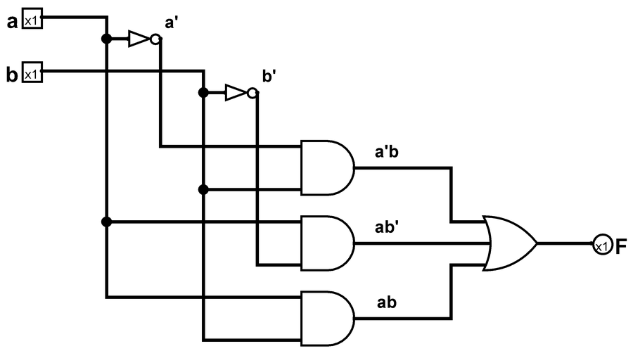
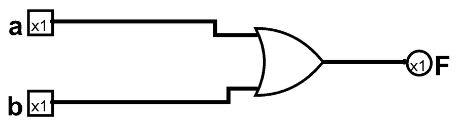
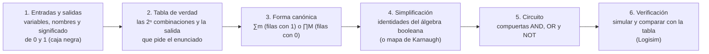
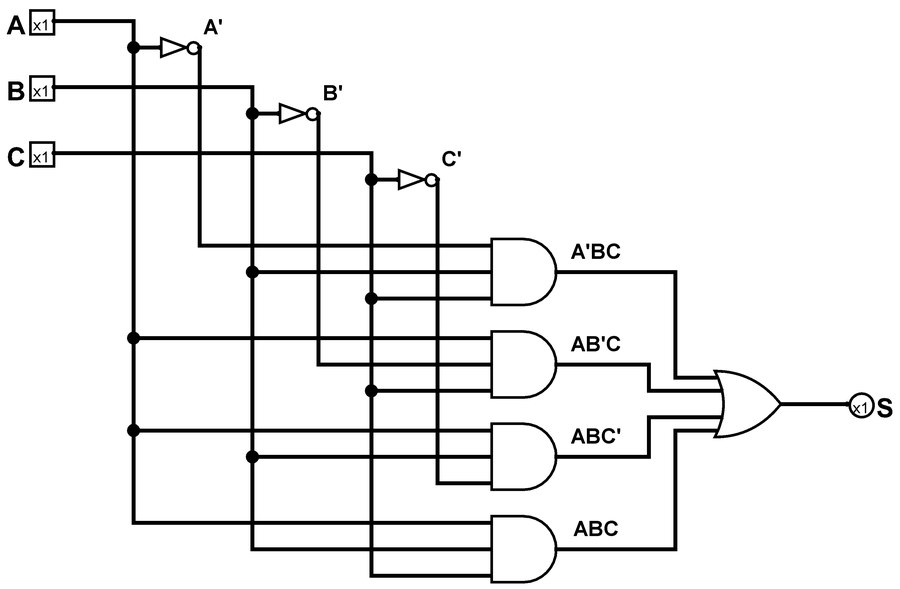
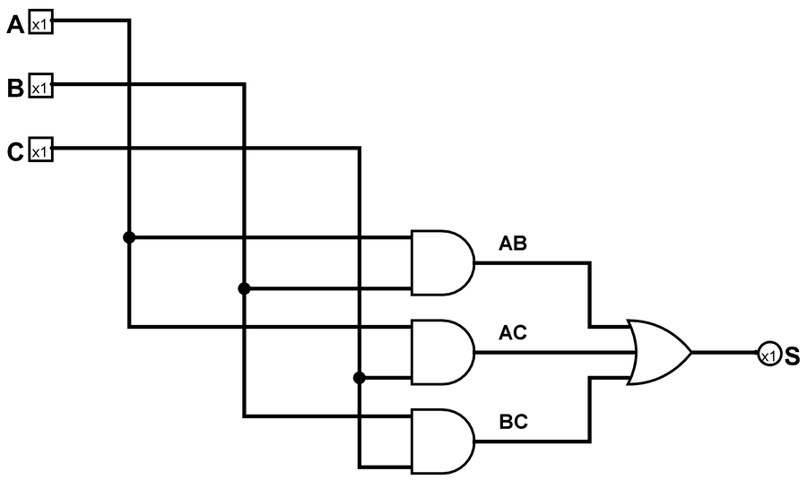

# Clase 21 — Formas canónicas y diseño de circuitos

> **Fecha**: 26/11/2026 · **Modalidad**: Virtual sincrónica · **Apuntes**: [Diapositivas PDF](./clase21.pdf) · [PPT](./clase21.pptx) · [Manuscrito anotado](./clase21_annotated.pdf) · [Taller 2 de 2025-1](./taller-02_algebra_booleana.pdf) · [Guía de diseño de circuitos (para la casa)](./guia_diseno_circuitos/)
>
> La sesión del 26/11 empezó terminando la [clase 20](../clase-20/) (págs. 27–40 de su manuscrito, documentadas allí) y siguió con este manuscrito (portada: «26/11/2026»). Las págs. con escritura a mano llegan hasta la 30 (Ejemplo 4, literales a–c); el resto del Ejemplo 4, la síntesis y la guía para la casa son diapositivas impresas, sin anotaciones.

## Objetivos de la clase

- Presentar las formas canónicas como la forma estándar y única de escribir una función booleana, para saber si dos expresiones representan la misma función.
- Definir los mintérminos y los maxtérminos, y construir con ellos la suma de productos canónica (`∑m`) y el producto de sumas canónico (`∏M`).
- Mostrar cómo pasar de una forma canónica a la otra, cómo obtenerlas desde la tabla o con identidades y cómo simplificarlas.
- Establecer el proceso de diseño de un circuito a partir de un enunciado en palabras y aplicarlo al problema de los tres tanques.

## Resumen

Después de terminar la clase 20, la sesión del 26/11 mostró que una misma función tiene muchas expresiones y presentó las formas canónicas como su representación estándar. Se definieron los mintérminos y los maxtérminos, la SOP canónica (`∑m`, filas con 1) y la POS canónica (`∏M`, filas con 0) y la conversión entre ellas, y se resolvieron los Ejemplos 1 y 2 a mano; del Ejemplo 3 se remitió a la solución impresa. La clase cerró con el proceso de diseño de circuitos y el Ejemplo 4 de los tres tanques, y dejó una guía de diseño para trabajar en casa.

## Agenda

1. Motivación: una función, muchas expresiones. [*(→ sección 1)*](#1-motivación-una-función-muchas-expresiones)
2. Definición de forma canónica: términos producto y suma, SOP y POS. [*(→ sección 2)*](#2-definición-de-forma-canónica)
3. Mintérminos. [*(→ sección 3)*](#3-mintérminos)
4. Maxtérminos. [*(→ sección 4)*](#4-maxtérminos)
5. Suma de productos canónica: `∑m`. [*(→ sección 5)*](#5-suma-de-productos-canónica)
6. Producto de sumas canónico: `∏M`. [*(→ sección 6)*](#6-producto-de-sumas-canónico)
7. Conversión entre `∑m` y `∏M`. [*(→ sección 7)*](#7-conversión-entre-formas-canónicas)
8. Ejemplo 1: formas canónicas desde una tabla, simplificación y circuitos. [*(→ sección 8)*](#8-ejemplo-1-de-la-tabla-al-circuito)
9. Estrategia de simplificación: términos adyacentes. [*(→ sección 9)*](#9-estrategia-de-simplificación-términos-adyacentes)
10. Ejemplo 2: la SOP canónica desde la tabla y con identidades; la POS canónica. [*(→ sección 10)*](#10-ejemplo-2-la-sop-canónica-con-identidades)
11. Ejemplo 3: simplificar, formas canónicas y comparación con el Ejemplo 8 de la clase 20 (solución impresa). [*(→ sección 11)*](#11-ejemplo-3-simplificar-y-comparar)
12. Proceso de diseño de circuitos. [*(→ sección 12)*](#12-proceso-de-diseño)
13. Ejemplo 4: alarma de los tres tanques. [*(→ sección 13)*](#13-ejemplo-4-los-tres-tanques)
14. Síntesis de la diapositiva y guía para la casa. [*(→ sección 14)*](#14-síntesis-de-la-diapositiva-y-guía-para-la-casa)

## Contenido temático

> [!NOTE]
> **Cómo leer este apunte.**
>
> - Las secciones numeradas siguen el orden en que se dictó la clase (manuscrito, págs. 1–36). Las «partes 1 y 2» que citan las diapositivas son las clases 19 y 20; aquí se enlazan como [clase 19](../clase-19/) y [clase 20](../clase-20/).
> - Tienen escritura a mano las págs. 1–12, 17–19, 22–24 y 29–30. Las respuestas impresas de las págs. 13–16, 20–21, 25–28 y 31–36 no tienen anotaciones; en los Ejemplos 3 y 4 el profesor remitió a ellas («Ver la solución»).
> - Los párrafos que empiezan con *Aclaración del apunte* se agregaron al redactar: no se dijeron en clase. Sirven para conectar ideas o evitar confusiones.

**Notación usada en este apunte**

| Símbolo | Se lee | Observación |
|---|---|---|
| `x'` | complemento de `x` | Como en la [clase 20](../clase-20/). |
| `i` | índice de la fila | Las filas se numeran de `0` a `2ⁿ − 1`; el índice es el valor en binario de la fila (`101` es la fila 5). |
| `mᵢ` | mintérmino de la fila `i` | Producto que vale 1 **solo** en la fila `i` (sección 3). En la [clase 19](../clase-19/README.md#13-ejemplo-5-diseño-a-partir-de-una-tabla) se llamó «minitérmino»: es lo mismo. |
| `Mᵢ` | maxtérmino de la fila `i` | Suma que vale 0 **solo** en la fila `i` (sección 4). |
| `∑m(i₁, i₂, …)` | suma de los mintérminos de esas filas | SOP canónica: las filas donde `F = 1` (sección 5). |
| `∏M(i₁, i₂, …)` | producto de los maxtérminos de esas filas | POS canónica: las filas donde `F = 0` (sección 6). |
| SOP | suma de productos | *Sum of products*. |
| POS | producto de sumas | *Product of sums*. |

### 1. Motivación: una función, muchas expresiones

*(Manuscrito, pág. 2.)*

En la clase 20 se vio que dos expresiones son **equivalentes** cuando representan la misma función, es decir, cuando tienen la misma tabla de verdad. Considere:

| Expresión | Paso que la produce (anotado a mano) |
|---|---|
| `F₁(x, y) = xy' + xy` | Expresión inicial |
| `F₂(x, y) = x(y' + y)` | Factorización (distributiva leída de derecha a izquierda) |
| `F₃(x, y) = x · 1` | Complemento para la suma |
| `F₄(x, y) = x` | Identidad para el producto |

El profesor escribió arriba la distributiva `x · (y + z) = x · y + x · z` con una flecha de derecha a izquierda marcada «Fact.»: **factorizar** es usar la distributiva al revés.

| `i` | `x` | `y` | `y'` | `xy'` | `xy` | `y' + y` | `F₁` | `F₂` | `F₃` | `F₄` |
|---|---|---|---|---|---|---|---|---|---|---|
| 0 | 0 | 0 | 1 | 0 | 0 | 1 | 0 | 0 | 0 | 0 |
| 1 | 0 | 1 | 0 | 0 | 0 | 1 | 0 | 0 | 0 | 0 |
| 2 | 1 | 0 | 1 | 1 | 0 | 1 | 1 | 1 | 1 | 1 |
| 3 | 1 | 1 | 0 | 0 | 1 | 1 | 1 | 1 | 1 | 1 |

Las cuatro expresiones son equivalentes: representan la misma función, `F(x, y) = x`. Pero no es evidente a simple vista, y comparar tablas fila por fila no es práctico cuando hay muchas variables. El profesor recordó el conteo de la clase 20: con `n = 2` hay `2² = 4` filas y `2^(2²) = 2⁴ = 16` funciones.

> [!TIP]
> **Pregunta de la clase** (diapositiva): ¿existe una forma estándar, única para cada función, que permita saber si dos expresiones representan la misma función? → las **formas canónicas**.

### 2. Definición de forma canónica

*(Manuscrito, pág. 3.)*

- **Término producto**: producto de variables o de sus complementos. Ejemplos: `xy`, `x'yz'`.
- **Término suma**: suma de variables o de sus complementos. Ejemplos: `x + y'`, `x' + y + z`.
- **Suma de productos (SOP)**: suma de términos producto. Ejemplo: `xy + z'`.
- **Producto de sumas (POS)**: producto de términos suma. Ejemplo: `(x + y)(x' + z)`.
- **Forma canónica**: una SOP o una POS en la que **cada término contiene todas las variables** de la función, cada una una sola vez (sin complemento o complementada).

Para que se viera la estructura, el profesor escribió al margen ejemplos con números: un producto `(2)(3)(5)`, una suma `2 + 3 + 5`, una suma de productos `(2)(3) + 5` y un producto de sumas `(2 + 3) · 5`.

| | Canónica (`n = 3`: `x, y, z`) | No canónica |
|---|---|---|
| SOP | `x'yz' + xy'z' + xyz` | `xy + z'` (a `xy` le falta `z`) |
| POS | `(x + y + z)(x' + y + z')` | `(x + y)z'` (a cada término le faltan variables) |

El profesor lo resumió así en clase: una expresión es canónica cuando cada término contiene todas las variables de la función; si a algún término le falta una variable, no es canónica.

> [!TIP]
> **Unicidad** (diapositiva): cada función tiene una sola SOP canónica y una sola POS canónica (sin contar el orden de los términos). Por eso, dos expresiones son equivalentes si y solo si tienen la misma forma canónica.

### 3. Mintérminos

*(Manuscrito, págs. 4–5.)*

**De una fila a un término.** En el [Ejemplo 8 de la clase 20](../clase-20/README.md#16-ejemplo-8-simplificar-y-verificar) se trabajó con `G(x, y, z) = x'yz + xy'z' + xy'z + xyz' + xyz`. En su tabla de verificación, **cada término vale 1 en exactamente una fila**:

| `i` | `x` | `y` | `z` | `x'yz` | `xy'z'` | `xy'z` | `xyz'` | `xyz` | `G` |
|---|---|---|---|---|---|---|---|---|---|
| 0 | 0 | 0 | 0 | 0 | 0 | 0 | 0 | 0 | 0 |
| 1 | 0 | 0 | 1 | 0 | 0 | 0 | 0 | 0 | 0 |
| 2 | 0 | 1 | 0 | 0 | 0 | 0 | 0 | 0 | 0 |
| 3 | 0 | 1 | 1 | **1** | 0 | 0 | 0 | 0 | 1 |
| 4 | 1 | 0 | 0 | 0 | **1** | 0 | 0 | 0 | 1 |
| 5 | 1 | 0 | 1 | 0 | 0 | **1** | 0 | 0 | 1 |
| 6 | 1 | 1 | 0 | 0 | 0 | 0 | **1** | 0 | 1 |
| 7 | 1 | 1 | 1 | 0 | 0 | 0 | 0 | **1** | 1 |

`x'yz` vale 1 solo en la fila 3 (`011`): `x' = 1` exige `x = 0`, y además `y = 1`, `z = 1`. `G` vale 1 exactamente en las filas 3, 4, 5, 6 y 7: una fila por término. El profesor escribió junto a cada fila con 1 el término que la «enciende».

**Definición.**

- Un **mintérmino** de `n` variables es un término producto que contiene las `n` variables, cada una una sola vez.
- **Notación**: `mᵢ`, donde `i` es el índice de la fila (su valor en binario).
- **Regla**: en la fila `i`, la variable va **sin complemento si vale 1** y **complementada si vale 0**.
- **Ejemplo**: fila 5 = `101` → `x = 1`, `y = 0`, `z = 1` → `m₅ = xy'z`. El profesor lo marcó en la tabla, escribiendo los bits `1 0 1` sobre `x y' z`.

| `i` | `x` | `y` | `z` | `mᵢ` | Expresión |
|---|---|---|---|---|---|
| 0 | 0 | 0 | 0 | `m₀` | `x'y'z'` |
| 1 | 0 | 0 | 1 | `m₁` | `x'y'z` |
| 2 | 0 | 1 | 0 | `m₂` | `x'yz'` |
| 3 | 0 | 1 | 1 | `m₃` | `x'yz` |
| 4 | 1 | 0 | 0 | `m₄` | `xy'z'` |
| 5 | 1 | 0 | 1 | `m₅` | `xy'z` |
| 6 | 1 | 1 | 0 | `m₆` | `xyz'` |
| 7 | 1 | 1 | 1 | `m₇` | `xyz` |

> [!TIP]
> `mᵢ` vale 1 **solamente** en la fila `i`.

### 4. Maxtérminos

*(Manuscrito, pág. 6.)*

- Un **maxtérmino** de `n` variables es un término suma que contiene las `n` variables, cada una una sola vez.
- **Notación**: `Mᵢ`, con el mismo índice de fila.
- **Regla**: en la fila `i`, la variable va **sin complemento si vale 0** y **complementada si vale 1**.
- **Relación**: `Mᵢ = mᵢ'`. Por ejemplo, `m₅' = (xy'z)' = x' + y'' + z' = x' + y + z' = M₅` (De Morgan para el producto y doble complemento).

El profesor marcó la fila 5: `i = 5` → `M₅ = x' + y + z'`, con los bits `1 0 1` sobre `x' y z'`.

| `i` | `x` | `y` | `z` | `Mᵢ` | Expresión |
|---|---|---|---|---|---|
| 0 | 0 | 0 | 0 | `M₀` | `x + y + z` |
| 1 | 0 | 0 | 1 | `M₁` | `x + y + z'` |
| 2 | 0 | 1 | 0 | `M₂` | `x + y' + z` |
| 3 | 0 | 1 | 1 | `M₃` | `x + y' + z'` |
| 4 | 1 | 0 | 0 | `M₄` | `x' + y + z` |
| 5 | 1 | 0 | 1 | `M₅` | `x' + y + z'` |
| 6 | 1 | 1 | 0 | `M₆` | `x' + y' + z` |
| 7 | 1 | 1 | 1 | `M₇` | `x' + y' + z'` |

> [!TIP]
> `Mᵢ` vale 0 **solamente** en la fila `i`.

> [!WARNING]
> La regla es la **contraria** a la de los mintérminos. En la fila 5 (`101`): `m₅ = xy'z`, pero `M₅ = x' + y + z'`.

### 5. Suma de productos canónica

*(Manuscrito, pág. 7.)*

**SOP = `∑m`.** Se **suman** (OR) los mintérminos de las filas donde `F = 1`. Notación abreviada: `F = ∑m(i₁, i₂, …)`, la lista de filas donde `F = 1`.

| `i` | `x` | `y` | `z` | `F` | `mᵢ` |
|---|---|---|---|---|---|
| 0 | 0 | 0 | 0 | 0 | |
| 1 | 0 | 0 | 1 | 0 | |
| 2 | 0 | 1 | 0 | **1** | `x'yz' = m₂` |
| 3 | 0 | 1 | 1 | 0 | |
| 4 | 1 | 0 | 0 | **1** | `xy'z' = m₄` |
| 5 | 1 | 0 | 1 | 0 | |
| 6 | 1 | 1 | 0 | **1** | `xyz' = m₆` |
| 7 | 1 | 1 | 1 | **1** | `xyz = m₇` |

Número de filas: `n = 3 → 2³ = 8`. `F` vale 1 en las filas 2, 4, 6 y 7:

`F(x, y, z) = m₂ + m₄ + m₆ + m₇ = x'yz' + xy'z' + xyz' + xyz = ∑m(2, 4, 6, 7)`

> [!TIP]
> Cada `mᵢ` enciende solo su fila; la suma enciende exactamente las filas donde `F = 1`. La `G` del Ejemplo 8 de la clase 20 es `G = ∑m(3, 4, 5, 6, 7)`.

### 6. Producto de sumas canónico

*(Manuscrito, pág. 8.)*

**POS = `∏M`.** Se **multiplican** (AND) los maxtérminos de las filas donde `F = 0`. Notación abreviada: `F = ∏M(i₁, i₂, …)`, la lista de filas donde `F = 0`.

La misma función `F` de la sección anterior vale 0 en las filas 0, 1, 3 y 5:

| `i` | `x` | `y` | `z` | `F` | `Mᵢ` |
|---|---|---|---|---|---|
| 0 | 0 | 0 | 0 | **0** | `x + y + z = M₀` |
| 1 | 0 | 0 | 1 | **0** | `x + y + z' = M₁` |
| 2 | 0 | 1 | 0 | 1 | |
| 3 | 0 | 1 | 1 | **0** | `x + y' + z' = M₃` |
| 4 | 1 | 0 | 0 | 1 | |
| 5 | 1 | 0 | 1 | **0** | `x' + y + z' = M₅` |
| 6 | 1 | 1 | 0 | 1 | |
| 7 | 1 | 1 | 1 | 1 | |

`F(x, y, z) = M₀ · M₁ · M₃ · M₅ = (x + y + z)(x + y + z')(x + y' + z')(x' + y + z') = ∏M(0, 1, 3, 5)`

> [!TIP]
> Cada `Mᵢ` apaga solo su fila; el producto vale 0 exactamente en las filas donde `F = 0`.

### 7. Conversión entre formas canónicas

*(Manuscrito, pág. 9.)*

| `i` | `F` | Aparece en |
|---|---|---|
| 0 | 0 | `M₀` (`∏M`) |
| 1 | 0 | `M₁` (`∏M`) |
| 2 | 1 | `m₂` (`∑m`) |
| 3 | 0 | `M₃` (`∏M`) |
| 4 | 1 | `m₄` (`∑m`) |
| 5 | 0 | `M₅` (`∏M`) |
| 6 | 1 | `m₆` (`∑m`) |
| 7 | 1 | `m₇` (`∑m`) |

- Cada fila aparece en **una sola** de las dos listas: si `F = 1`, en la `∑m`; si `F = 0`, en la `∏M`.
- Para convertir, se cambia `∑` por `∏` (o al revés) y se listan **los índices que faltan**:

  `F = ∑m(2, 4, 6, 7) = ∏M(0, 1, 3, 5)`

- El complemento `F'` vale 1 donde `F` vale 0:

  `F' = ∑m(0, 1, 3, 5) = ∏M(2, 4, 6, 7)`

> [!WARNING]
> **SOP** = suma de productos = `∑m` → filas donde `F = 1`. **POS** = producto de sumas = `∏M` → filas donde `F = 0`. Las dos listas juntas cubren exactamente `{0, 1, …, 2ⁿ − 1}`: con 2 variables los índices van de 0 a 3, nunca hasta 4.

### 8. Ejemplo 1: de la tabla al circuito

*(Manuscrito, págs. 10–15. Las págs. 13–15 son las respuestas impresas, sin anotaciones.)*

**La siguiente tabla de verdad describe la función `F(a, b)`:**

| `i` | `a` | `b` | `F` |
|---|---|---|---|
| 0 | 0 | 0 | 0 |
| 1 | 0 | 1 | 1 |
| 2 | 1 | 0 | 1 |
| 3 | 1 | 1 | 1 |

- a. Indique el número de filas y el índice de cada fila.
- b. Obtenga la forma canónica SOP (`∑m`).
- c. Obtenga la forma canónica POS (`∏M`).
- d. Simplifique la SOP con las identidades del álgebra booleana.
- e. Dibuje el circuito de la SOP canónica y el de la expresión simplificada.

El profesor escribió junto a la tabla el término de cada fila: `a + b` en la fila 0 (la única con `F = 0`), y `a'b = m₁`, `ab' = m₂`, `ab = m₃` en las filas con `F = 1`.

**a.** Variables `a`, `b` → `n = 2` → filas `= 2ⁿ = 2² = 4`, con índices de 0 a 3.

**b.** `F = a'b + ab' + ab = m₁ + m₂ + m₃ = ∑m(1, 2, 3)`.

**c.** Transcripción del manuscrito:

`F = a + b = M₀ = ∑M(0)`

> [!WARNING]
> **Error del profesor en clase.** La POS canónica se escribe con **`∏`**, no con `∑`: es un **producto** de maxtérminos. Lo correcto es
>
> `F = a + b = M₀ = ∏M(0)`
>
> Escribir `∑` cambia el sentido: `∑m(…)` lista las filas donde la función vale **1** y suma sus mintérminos, mientras que `∏M(…)` lista las filas donde vale **0** y multiplica sus maxtérminos. Leído como `∑m(0)`, el resultado sería `a'b'`, una función que vale 1 solo en la fila 0: justo la contraria de la que se buscaba. La respuesta impresa (pág. 13) trae la notación correcta: `F(a, b) = ∏M(0)`.

> [!TIP]
> Antes de escribir la notación abreviada, pregúntese qué filas está listando: con `∑m` van las filas con 1; con `∏M`, las filas con 0. Es el primer «error común» de la síntesis de la clase (sección 14).

**d. Simplificación de la SOP** (manuscrito, pág. 11):

| # | Afirmación | Razón |
|---|---|---|
| 1 | `a'b + ab' + ab` | Expresión original |
| 2 | `a'b + a(b' + b)` | Factorización para el AND (·) |
| 3 | `a'b + a(1)` | Complemento para el OR (+) |
| 4 | `a'b + a` | Identidad para el AND (·) |
| 5 | `a + a'b` | Conmutatividad para el OR (+) |
| 6 | `(a + a') · (a + b)` | Distributividad para el OR (+) |
| 7 | `1 · (a + b)` | Complemento para el OR (+) |
| 8 | `a + b` | Identidad para el AND (·) |

La respuesta impresa (pág. 14) hace la misma simplificación en 9 pasos, con la razón citada «en k»: primero conmuta `ab'` y `ab` y después saca `a` como factor común.

> [!TIP]
> **Atajo** (diapositiva, pág. 14): los pasos 5 a 8 demuestran `a + a'b = a + b`, que es el resultado del [Ejemplo 7 de la clase 20](../clase-20/README.md#15-ejemplo-7-identidades-y-tabla-de-verdad) (`x + x'y = x + y`). Ya demostrado, se puede citar en un solo paso.

**e. Circuitos** (manuscrito, pág. 12). El profesor dibujó primero cada circuito como caja negra (entradas `a`, `b`; salida `F`) y después su interior.

| SOP canónica: `F = a'b + ab' + ab` | Simplificada: `F = a + b` |
|---|---|
|  |  |

*(Circuitos de la respuesta impresa, pág. 15. Archivos: [`ejemplo1_canonica.circ`](./ejemplo1_canonica.circ) y [`ejemplo1_simplificada.circ`](./ejemplo1_simplificada.circ).)*

El circuito canónico usa 2 NOT, 3 AND y 1 OR; el simplificado, 1 OR. El profesor lo puso en pesos: si cada compuerta costara 1.000 pesos, pasar de 6 compuertas a 1 ahorra 5.000 pesos. Cada compuerta es una operación booleana, así que simplificar la expresión es usar menos compuertas.

> [!TIP]
> Simplificar cambia el circuito, no la función: los dos circuitos tienen la misma tabla de verdad (diapositiva, pág. 15).

*Aclaración del apunte:* la POS canónica, `F = a + b`, ya era la expresión simplificada; la diapositiva lo anota así: «La POS canónica ya es muy simple».

### 9. Estrategia de simplificación: términos adyacentes

*(Manuscrito, pág. 16, sin anotaciones.)*

- En la clase 20 se representó una función en un [cubo](../clase-20/README.md#7-ejemplo-2-tabla-expresión-circuito-y-cubo): cada vértice es una fila y dos vértices unidos por una arista difieren en un solo bit.
- Dos mintérminos **adyacentes** se combinan y la variable que cambia desaparece: `ab' + ab = a(b' + b) = a · 1 = a`.
- Con la idempotencia (`ab = ab + ab`) un mintérmino se puede usar dos veces:

  `a'b + ab' + ab = (a'b + ab) + (ab' + ab) = b + a`

La figura de la diapositiva es el cuadrado de `a` y `b`: los vértices `01`, `10` y `11` (las filas con `F = 1` del Ejemplo 1) están en negro; la arista `10`–`11` es `ab' + ab = a` y la arista `01`–`11` es `a'b + ab = b`.

> [!TIP]
> En Logisim, la pestaña **Minimizado** agrupa casillas adyacentes en un **mapa de Karnaugh**: es la misma idea, organizada en una cuadrícula (diapositiva). Los mapas de Karnaugh no se trabajaron en clase; aparecen en la [guía para la casa](./guia_diseno_circuitos/).

### 10. Ejemplo 2: la SOP canónica con identidades

*(Manuscrito, págs. 17–21. Las págs. 20–21 son las respuestas impresas, sin anotaciones.)*

**Considere la función `F(x, y, z) = (x + y)z'`.**

- a. Construya la tabla de verdad con el índice de cada fila y las columnas intermedias.
- b. Obtenga la forma canónica SOP (`∑m`) a partir de la tabla.
- c. Obtenga la misma SOP canónica usando las identidades del álgebra booleana.
- d. Obtenga la forma canónica POS (`∏M`).

**a.** Variables `x, y, z` → `n = 3` → filas `= 2³ = 8`. Junto a cada fila, el profesor escribió su mintérmino (filas con 1) o su maxtérmino (filas con 0):

| `i` | `x` | `y` | `z` | `z'` | `x + y` | `F = (x + y)z'` | Término de la fila |
|---|---|---|---|---|---|---|---|
| 0 | 0 | 0 | 0 | 1 | 0 | 0 | `M₀ = x + y + z` |
| 1 | 0 | 0 | 1 | 0 | 0 | 0 | `M₁ = x + y + z'` |
| 2 | 0 | 1 | 0 | 1 | 1 | **1** | `m₂ = x'yz'` |
| 3 | 0 | 1 | 1 | 0 | 1 | 0 | `M₃ = x + y' + z'` |
| 4 | 1 | 0 | 0 | 1 | 1 | **1** | `m₄ = xy'z'` |
| 5 | 1 | 0 | 1 | 0 | 1 | 0 | `M₅ = x' + y + z'` |
| 6 | 1 | 1 | 0 | 1 | 1 | **1** | `m₆ = xyz'` |
| 7 | 1 | 1 | 1 | 0 | 1 | 0 | `M₇ = x' + y' + z'` |

**b.** `F = ∑m(2, 4, 6) = m₂ + m₄ + m₆ = x'yz' + xy'z' + xyz'`.

**c. La SOP canónica con identidades** (manuscrito, pág. 18). La idea es que a cada término de `xz' + yz'` le falta una variable; para introducirla se multiplica por 1 escrito como `(y + y')` o `(x + x')`:

| # | Afirmación | Razón |
|---|---|---|
| 1 | `(x + y)z'` | Expresión original |
| 2 | `xz' + yz'` | Distributividad para el AND (·) |
| 3 | `xz' · 1 + yz' · 1` | Identidad para el AND (·) |
| 4 | `xz'(y + y') + yz'(x + x')` | Complemento para el OR (+) |
| 5 | `xz'y + xz'y' + yz'x + yz'x'` | Distributividad para el AND (·) |
| 6 | `xyz' + xy'z' + xyz' + x'yz'` | Conmutatividad para el AND (·) |
| 7 | `xyz' + xy'z' + x'yz'` | Idempotencia para el OR (+) |
| 8 | `x'yz' + xy'z' + xyz'` | Conmutatividad para el OR (+) |

El resultado es la misma SOP del literal b. El profesor resaltó en el paso 6 los dos `xyz'` repetidos, que la idempotencia (`xyz' + xyz' = xyz'`) convierte en uno.

*Aclaración del apunte:* en el paso 7 los dos `xyz'` no están juntos, así que la idempotencia se aplica después de reordenar los términos (conmutativa para la suma). La respuesta impresa (pág. 21) lo hace en dos pasos separados y termina con «`= ∑m(2, 4, 6)`, Definición de mintérmino».

**d. POS canónica** (manuscrito, pág. 19). `F = 0` en las filas 0, 1, 3, 5 y 7; el profesor escribió sobre cada maxtérmino los bits de su fila y debajo su índice:

`F = ∏M(0, 1, 3, 5, 7) = (x + y + z)(x + y + z')(x + y' + z')(x' + y + z')(x' + y' + z')`

*Comprobación* (diapositiva, pág. 20): `{2, 4, 6} ∪ {0, 1, 3, 5, 7} = {0, …, 7}`.

### 11. Ejemplo 3: simplificar y comparar

*(Manuscrito, págs. 22–27. En las págs. 23–24 el profesor escribió «Solución abajo» y en la 22 «Ver la solución resuelta en las diapositivas de abajo»: el ejemplo se trabajó con las respuestas impresas de las págs. 25–27, sin anotaciones.)*

**Considere la función `F(x, y, z) = xyz + (x + y)(x + z)`.**

- a. Simplifique `F` con las identidades del álgebra booleana.
- b. Construya la tabla de verdad de la expresión simplificada.
- c. Obtenga las formas canónicas `∑m` y `∏M`.
- d. Obtenga la POS canónica a partir de `F'`, usando las identidades.
- e. Compare `F` con la función `G` del Ejemplo 8 de la clase 20. ¿Qué concluye?

**a. Simplificación:**

| # | Afirmación | Razón |
|---|---|---|
| 1 | `F = xyz + (x + y)(x + z)` | Expresión original |
| 2 | `= xyz + (x + yz)` | Distributiva para la suma (+) en 1 |
| 3 | `= xyz + x + yz` | Asociativa para la suma (+) en 2 |
| 4 | `= x + xyz + yz` | Conmutativa para la suma (+) en 3 |
| 5 | `= x + x(yz) + yz` | Asociativa para el producto (·) en 4 |
| 6 | `= x + yz` | Absorción para la suma (+) en 5 |

> [!TIP]
> En el paso 2 la distributiva para la suma se usa «al revés»: `(x + y)(x + z) = x + yz`. Así se evita expandir el producto con dos distributivas (diapositiva).

**b. Tabla de verdad de `F = x + yz`:**

| `i` | `x` | `y` | `z` | `yz` | `F = x + yz` |
|---|---|---|---|---|---|
| 0 | 0 | 0 | 0 | 0 | 0 |
| 1 | 0 | 0 | 1 | 0 | 0 |
| 2 | 0 | 1 | 0 | 0 | 0 |
| 3 | 0 | 1 | 1 | 1 | 1 |
| 4 | 1 | 0 | 0 | 0 | 1 |
| 5 | 1 | 0 | 1 | 0 | 1 |
| 6 | 1 | 1 | 0 | 0 | 1 |
| 7 | 1 | 1 | 1 | 1 | 1 |

**c. Formas canónicas:**

- `F = ∑m(3, 4, 5, 6, 7) = x'yz + xy'z' + xy'z + xyz' + xyz`
- `F = ∏M(0, 1, 2) = (x + y + z)(x + y + z')(x + y' + z)`

**d. POS a partir de `F'`.** Como `F'` vale 1 exactamente en las filas donde `F` vale 0 (filas 0, 1 y 2), su SOP canónica es `F' = ∑m(0, 1, 2) = x'y'z' + x'y'z + x'yz'`.

| # | Afirmación | Razón |
|---|---|---|
| 1 | `F = (F')'` | Doble complemento |
| 2 | `= (x'y'z' + x'y'z + x'yz')'` | Sustitución de `F'` en 1 |
| 3 | `= (x'y'z')'(x'y'z)'(x'yz')'` | De Morgan para la suma (+) en 2 |
| 4 | `= (x'' + y'' + z'')(x'' + y'' + z')(x'' + y' + z'')` | De Morgan para el producto (·) en 3 |
| 5 | `= (x + y + z)(x + y + z')(x + y' + z)` | Doble complemento en 4 |
| 6 | `= M₀ · M₁ · M₂ = ∏M(0, 1, 2)` | Definición de maxtérmino en 5 |

> [!TIP]
> En la práctica, `∏M` se lee directamente de la tabla (filas donde `F = 0`). Este procedimiento muestra **por qué** esa lectura es correcta: complementar dos veces y aplicar De Morgan convierte la SOP de `F'` en la POS de `F` (diapositiva).

**e. Comparación.** La `G` del Ejemplo 8 de la clase 20 es `G = ∑m(3, 4, 5, 6, 7)`. Misma forma canónica → `F = G`.

> [!TIP]
> `xyz + (x + y)(x + z)` y `x'yz + xy'z' + xy'z + xyz' + xyz` son expresiones **equivalentes**: las dos se simplifican a `x + yz`. La forma canónica las identifica (diapositiva). Es la respuesta a la pregunta de la sección 1.

### 12. Proceso de diseño

*(Manuscrito, pág. 28, sin anotaciones.)*

*(Figura de clase, pág. 28.)*

> [!TIP]
> Es el **punto 2 del parcial**: diseñar un circuito a partir de un enunciado en palabras (diapositiva).

### 13. Ejemplo 4: los tres tanques

*(Manuscrito, págs. 29–34. Los literales a–c se resolvieron a mano en las págs. 29–30; para d y e el profesor escribió «Ver solución» y remitió a las respuestas impresas de las págs. 32–34, sin anotaciones.)*

**En una planta de procesamiento químico se usa un elemento químico líquido que se almacena en tres tanques. Cada tanque tiene un sensor de nivel que entrega un nivel ALTO (1) cuando el nivel del líquido cae por debajo de un punto especificado. Diseñe un circuito que indique cuándo el nivel de dos o más tanques cae por debajo de ese punto.**

- a. Identifique las entradas y la salida, con el significado de 0 y 1, y dibuje la caja negra.
- b. Construya la tabla de verdad.
- c. Obtenga las formas canónicas `∑m` y `∏M`.
- d. Simplifique la SOP con las identidades.
- e. Dibuje el circuito simplificado.
- f. Verifique el diseño en Logisim.

*(Adaptado del problema 3 del [taller 2 de 2025-1](./taller-02_algebra_booleana.pdf).)*

El profesor dibujó los tres tanques, cada uno con su sensor (`A`, `B`, `C`), conectados a la caja que activa la alarma.

> [!NOTE]
> **El profesor se equivocó aquí con los nombres de las variables.** En la pág. 30 las entradas se llaman `A`, `B`, `C`, pero los mintérminos y maxtérminos y las formas canónicas quedaron escritos con `x`, `y`, `z` (por ejemplo, `m₃ = x'yz` en lugar de `A'BC`). Además, la salida se llama `F` en el manuscrito y `S` en las respuestas impresas. En este apunte todo se escribe con `A`, `B`, `C` y la salida `S`, como en las respuestas impresas: `x ↔ A`, `y ↔ B`, `z ↔ C`.

**a. Entradas y salida.**

- Entradas (una por tanque): `A`, `B`, `C` = sensores de los tanques 1, 2 y 3. El profesor lo anotó así: nivel **bajo** = 1, nivel **alto** = 0.
- Salida: `S` (la alarma) = 1 si **dos o más** tanques tienen el nivel bajo; 0 en otro caso.
- Caja negra: entradas `A`, `B`, `C` y salida `S`.

**b. Tabla de verdad.** `n = 3` → filas `= 2³ = 8`. La columna «Tanques bajos» cuenta cuántas entradas valen 1:

| `i` | `A` | `B` | `C` | Tanques bajos | `S` | Término de la fila |
|---|---|---|---|---|---|---|
| 0 | 0 | 0 | 0 | 0 | 0 | `M₀ = A + B + C` |
| 1 | 0 | 0 | 1 | 1 | 0 | `M₁ = A + B + C'` |
| 2 | 0 | 1 | 0 | 1 | 0 | `M₂ = A + B' + C` |
| 3 | 0 | 1 | 1 | 2 | **1** | `m₃ = A'BC` |
| 4 | 1 | 0 | 0 | 1 | 0 | `M₄ = A' + B + C` |
| 5 | 1 | 0 | 1 | 2 | **1** | `m₅ = AB'C` |
| 6 | 1 | 1 | 0 | 2 | **1** | `m₆ = ABC'` |
| 7 | 1 | 1 | 1 | 3 | **1** | `m₇ = ABC` |

**c. Formas canónicas:**

- SOP: `S = ∑m(3, 5, 6, 7) = A'BC + AB'C + ABC' + ABC`
- POS: `S = ∏M(0, 1, 2, 4) = (A + B + C)(A + B + C')(A + B' + C)(A' + B + C)`

**d. Simplificación de la SOP** (respuesta impresa, pág. 33):

| # | Afirmación | Razón |
|---|---|---|
| 1 | `S = A'BC + AB'C + ABC' + ABC` | Expresión original (SOP canónica) |
| 2 | `= A'BC + AB'C + ABC' + ABC + ABC + ABC` | Idempotencia para la suma (+) en 1 |
| 3 | `= ABC + A'BC + ABC + AB'C + ABC + ABC'` | Conmutativa para la suma (+) en 2 |
| 4 | `= (ABC + A'BC) + (ABC + AB'C) + (ABC + ABC')` | Asociativa para la suma (+) en 3 |
| 5 | `= (A + A')BC + A(B + B')C + AB(C + C')` | Distributiva para el producto (·) en 4 (factor común) |
| 6 | `= 1·BC + A·1·C + AB·1` | Complemento para la suma (+) en 5 |
| 7 | `= BC + AC + AB` | Identidad para el producto (·) en 6 |
| 8 | `= AB + AC + BC` | Conmutativa para la suma (+) en 7 |

> [!TIP]
> `ABC` (fila 7) es vecino en el cubo de las filas 3, 5 y 6: difiere en un solo bit de cada una. Por eso se usa tres veces (idempotencia) y cada par pierde una variable (diapositiva). Es la estrategia de la sección 9.

**e. Circuito simplificado:** `S = AB + AC + BC`.

| SOP canónica | Simplificada: `S = AB + AC + BC` |
|---|---|
|  |  |

*(Archivos: [`tanques_canonica.circ`](./tanques_canonica.circ), con 4 AND, 1 OR y 3 NOT, y [`tanques_simplificada.circ`](./tanques_simplificada.circ), con 3 AND y 1 OR.)*

**f. Verificación en Logisim:** *Proyecto → Analizar circuito*. La pestaña **Tabla** muestra `S = 1` en las filas 3, 5, 6 y 7, y **Minimizado** propone `B·C + A·C + A·B`: la misma expresión obtenida a mano (diapositiva, pág. 34).

*Aclaración del apunte:* la salida vale 1 justo cuando la **mayoría** de los sensores vale 1. Una lectura directa de la expresión lo confirma: `AB + AC + BC` vale 1 cuando algún par de tanques está bajo a la vez.

### 14. Síntesis de la diapositiva y guía para la casa

*(Manuscrito, págs. 35–36, sin anotaciones.)*

| Punto del parcial | Dónde se practicó |
|---|---|
| 1d. SOP y POS desde una tabla | Ejemplos 1, 2 y 3; diapositivas de `∑m` y `∏M` |
| 1e. Simplificar o convertir | Ejemplos 1 y 3; conversión `∑m ↔ ∏M` |
| 2. Diseño desde un enunciado | Ejemplo 4 y la guía de diseño (primos y vehículo) |

Proceso completo: enunciado → tabla → `∑m` / `∏M` → simplificación → circuito → verificación en el simulador.

> [!WARNING]
> **Errores comunes** (diapositiva):
>
> - Invertir SOP y POS: SOP = `∑m` (filas con `F = 1`); POS = `∏M` (filas con `F = 0`).
> - Complementar al revés: en `mᵢ` se complementa la variable que vale 0; en `Mᵢ`, la que vale 1.
> - Índices fuera de rango: con `n` variables van de 0 a `2ⁿ − 1` (con 2 variables, de 0 a 3).
> - Olvidar filas: `∑m` y `∏M` juntas deben cubrir todas las filas, sin repetir ninguna.

**Guía para la casa.** La [guía de diseño de circuitos](./guia_diseno_circuitos/) desarrolla dos diseños completos, con el procedimiento a mano y la simulación en Logisim-evolution, siguiendo los pasos del taller 2:

- **Detector de números primos de 3 bits**: `P = ∑m(2, 3, 5, 7) = A'B + AC`.
- **Luz de advertencia del tablero de un vehículo** (4 variables): `A = ∑m(10, 12, 13, 14, 15) = M(P + NL')`.
- Construcción automática de un circuito a partir de su tabla (*Análisis combinacional*).
- Ejercicios propuestos con respuesta.

El profesor remitió a esta guía para practicar el diseño y para ver los mapas de Karnaugh que muestra Logisim.

El sitio del curso todavía no tiene una lección publicada sobre formas canónicas. Para profundizar, puede consultar las [diapositivas originales del curso: Clase 12 – Álgebra de Boole](https://discretas1-udea.github.io/discretas1-udea-20262/assets/slides/clase12.pdf), que también incluyen temas que no se vieron en esta clase.

### Síntesis de la clase

*Aclaración del apunte:* un resumen de lo esencial, sin contenido nuevo.

**Ideas clave:**

1. **Una función tiene muchas expresiones, pero una sola forma canónica de cada tipo**: por eso dos expresiones son equivalentes si y solo si tienen la misma forma canónica ([secciones 1](#1-motivación-una-función-muchas-expresiones), [2](#2-definición-de-forma-canónica) y [11](#11-ejemplo-3-simplificar-y-comparar)).
2. **Mintérmino `mᵢ`**: producto con todas las variables que vale 1 solo en la fila `i` (variable en 1 sin complemento, en 0 complementada). **Maxtérmino `Mᵢ`**: suma con todas las variables que vale 0 solo en la fila `i`, con la regla contraria ([secciones 3](#3-mintérminos) y [4](#4-maxtérminos)).
3. **SOP = `∑m`, filas con `F = 1`; POS = `∏M`, filas con `F = 0`**. Las dos listas se complementan: para convertir se cambia `∑` por `∏` y se listan los índices que faltan ([secciones 5](#5-suma-de-productos-canónica) a [7](#7-conversión-entre-formas-canónicas)).
4. **La forma canónica se puede obtener desde la tabla o con identidades** (a cada término se le introduce la variable que le falta multiplicándolo por `1 = x + x'`), y se simplifica combinando términos adyacentes ([secciones 9](#9-estrategia-de-simplificación-términos-adyacentes) y [10](#10-ejemplo-2-la-sop-canónica-con-identidades)).
5. **Diseñar un circuito**: entradas y salida → tabla → forma canónica → simplificación → circuito → verificación. Simplificar cambia el circuito, no la función ([secciones 8](#8-ejemplo-1-de-la-tabla-al-circuito), [12](#12-proceso-de-diseño) y [13](#13-ejemplo-4-los-tres-tanques)).

> [!IMPORTANT]
> **Errores y dudas de esta clase:**
>
> - **Ejemplo 1c: la POS canónica se escribió `∑M(0)`** (error del profesor en clase). Lo correcto es `F = ∏M(0)`: la POS es un producto de maxtérminos ([sección 8](#8-ejemplo-1-de-la-tabla-al-circuito)).
> - **Ejemplo 4: nombres de las variables** (error del profesor en clase). Las entradas son `A`, `B`, `C`, pero los términos y las formas canónicas se escribieron con `x`, `y`, `z`, y la salida se llamó `F` en lugar de `S` ([sección 13](#13-ejemplo-4-los-tres-tanques)).
> - **Ejemplo 2c: idempotencia con términos que no están juntos** (aclaración del apunte): se reordena y luego se aplica ([sección 10](#10-ejemplo-2-la-sop-canónica-con-identidades)).
> - **¿Cuándo una expresión no es canónica?** (aclarado en clase): cuando a algún término le falta una variable ([sección 2](#2-definición-de-forma-canónica)).
> - **¿Cómo se conecta la matemática con el circuito real?** (aclarado en clase): cada compuerta es una operación booleana; simplificar la expresión es usar menos compuertas ([sección 8](#8-ejemplo-1-de-la-tabla-al-circuito)).

## Pendientes

### Estudiantes

- [ ] Trabajar la [guía de diseño de circuitos](./guia_diseno_circuitos/): el detector de primos, la luz del vehículo y los ejercicios propuestos.
- [ ] Repasar las respuestas impresas de los Ejemplos 3 y 4 (secciones [11](#11-ejemplo-3-simplificar-y-comparar) y [13](#13-ejemplo-4-los-tres-tanques)), a las que remitió el profesor.
- [ ] Abrir en Logisim-evolution los circuitos del Ejemplo 1 y de los tanques y verificarlos con *Proyecto → Analizar circuito*.
