# Guía de diseño de circuitos lógicos

> **Material de la parte 3 de circuitos lógicos y álgebra booleana** (clase 21, formas canónicas y diseño). Esta guía es para trabajar en casa, después de la clase.
>
> Desarrolla dos diseños completos, con todo lo que se hace a mano y la simulación en Logisim-evolution, siguiendo los pasos del ejemplo resuelto del taller 2: un **detector de números primos de 3 bits** y la **luz de advertencia del tablero de un vehículo**. Al final hay ejercicios propuestos con su respuesta.

## Contenido

- [El proceso de diseño](#el-proceso-de-diseño)
- [Diseño 1: detector de números primos de 3 bits](#diseño-1-detector-de-números-primos-de-3-bits)
- [Diseño 2: luz de advertencia del tablero de un vehículo](#diseño-2-luz-de-advertencia-del-tablero-de-un-vehículo)
- [Construir un circuito a partir de su tabla](#construir-un-circuito-a-partir-de-su-tabla)
- [Ejercicios propuestos](#ejercicios-propuestos)
- [Archivos de esta carpeta](#archivos-de-esta-carpeta)

Si todavía no tiene el simulador, siga la [guía de instalación de Logisim-evolution](../../clase-19/ejemplos_logisim/README.md#2-instalación-de-logisim-evolution). Las capturas de esta guía son de Logisim-evolution 5.0 en español.

## El proceso de diseño

| Paso | Qué se hace |
|:-:|---|
| 1. Análisis | Identificar las entradas y las salidas, darles nombre y decidir qué significa 0 y qué significa 1. Se resume en un diagrama de caja negra. |
| 2. Tabla de verdad | Listar las `2ⁿ` combinaciones de las `n` entradas, en orden ascendente con su índice `i`, y escribir la salida que pide el enunciado. |
| 3. Función y simplificación | Obtener la forma canónica (`∑m`: filas con salida 1; `∏M`: filas con salida 0) y simplificarla con las identidades del álgebra booleana. |
| 4. Circuito | Dibujar el circuito de la expresión simplificada con compuertas AND, OR y NOT. |
| 5. Verificación | Simular el circuito y comprobar que, para todas las combinaciones, la salida coincide con la tabla de verdad. |

En las demostraciones se usan los nombres de las leyes de la tabla de identidades de la parte 2 (clase 20) y la referencia «en k» indica el paso del que viene cada afirmación.

---

## Diseño 1: detector de números primos de 3 bits

**Enunciado.** Diseñe un circuito que reciba un número de 3 bits y encienda una salida si el número es primo.

### Paso 1: análisis

- **Entradas:** tres bits `A`, `B` y `C`, donde `A` es el bit más significativo y `C` el menos significativo. El número es `4A + 2B + C`.
- **Salida:** `P` (de «primo»). `P = 1` si el número es primo y `P = 0` si no lo es.

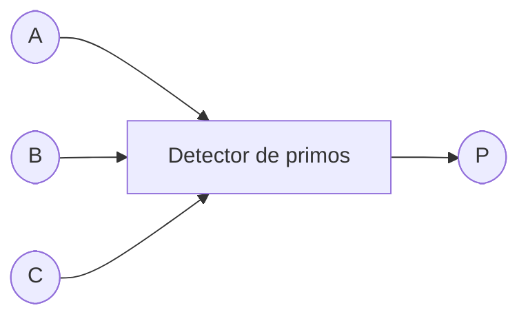

### Paso 2: tabla de verdad

Primero se decide, para cada número de 0 a 7, si es primo. Recuerde que 0 y 1 **no** son primos; los primos menores que 8 son 2, 3, 5 y 7.

| Decimal | Binario `ABC` | ¿Primo? |
|:-:|:-:|:-:|
| 0 | `000` | No |
| 1 | `001` | No |
| 2 | `010` | Sí |
| 3 | `011` | Sí |
| 4 | `100` | No |
| 5 | `101` | Sí |
| 6 | `110` | No |
| 7 | `111` | Sí |

Número de filas: `n = 3 → 2³ = 8`. Como `ABC` es el número en binario, el índice `i` de cada fila es el mismo número:

| `i` | `A` | `B` | `C` | `P` |
|:-:|:-:|:-:|:-:|:-:|
| 0 | 0 | 0 | 0 | 0 |
| 1 | 0 | 0 | 1 | 0 |
| 2 | 0 | 1 | 0 | **1** |
| 3 | 0 | 1 | 1 | **1** |
| 4 | 1 | 0 | 0 | 0 |
| 5 | 1 | 0 | 1 | **1** |
| 6 | 1 | 1 | 0 | 0 |
| 7 | 1 | 1 | 1 | **1** |

### Paso 3: función booleana y simplificación

`P` vale 1 en las filas 2, 3, 5 y 7. La forma canónica SOP es la suma de esos mintérminos (variable sin complemento si vale 1, complementada si vale 0):

`P = m₂ + m₃ + m₅ + m₇ = A′BC′ + A′BC + AB′C + ABC = ∑m(2, 3, 5, 7)`

La forma canónica POS usa las filas donde `P = 0` (0, 1, 4 y 6), con la regla contraria (variable sin complemento si vale 0):

`P = (A + B + C) · (A + B + C′) · (A′ + B + C) · (A′ + B′ + C) = ∏M(0, 1, 4, 6)`

Simplificación de la SOP. La estrategia es agrupar mintérminos que difieren en una sola variable: `A′BC′` y `A′BC` (filas 2 y 3), y `AB′C` y `ABC` (filas 5 y 7).

| # | Afirmación | Razón |
|:-:|---|---|
| 1 | `P = A′BC′ + A′BC + AB′C + ABC` | Expresión original (SOP canónica) |
| 2 | `= A′B(C′ + C) + AB′C + ABC` | Distributiva para el producto (·) en 1 (factor común) |
| 3 | `= A′B(C + C′) + AB′C + ABC` | Conmutativa para la suma (+) en 2 |
| 4 | `= A′B·1 + AB′C + ABC` | Complemento para la suma (+) en 3 |
| 5 | `= A′B + AB′C + ABC` | Identidad para el producto (·) en 4 |
| 6 | `= A′B + ACB′ + ACB` | Conmutativa para el producto (·) en 5 |
| 7 | `= A′B + AC(B′ + B)` | Distributiva para el producto (·) en 6 (factor común) |
| 8 | `= A′B + AC(B + B′)` | Conmutativa para la suma (+) en 7 |
| 9 | `= A′B + AC·1` | Complemento para la suma (+) en 8 |
| 10 | `= A′B + AC` | Identidad para el producto (·) en 9 |

**Resultado:** `P = A′B + AC`.

> [!NOTE]
> En el ejemplo resuelto del taller 2 esta simplificación aparece en cuatro pasos, con la razón «Factor común». Aquí se escriben los pasos completos: la ley es la **distributiva para el producto** usada para sacar factor común, y antes de aplicar el complemento (`x + x′ = 1`) se reordena `C′ + C` como `C + C′`.

Lectura del resultado: el número es primo si `A = 0` y `B = 1` (los números 2 y 3) o si `A = 1` y `C = 1` (los números 5 y 7).

### Paso 4: circuito

Circuito de la SOP canónica (archivo [`primos_canonica.circ`](./primos_canonica.circ)): 3 NOT, 4 AND de tres entradas y 1 OR de cuatro entradas.

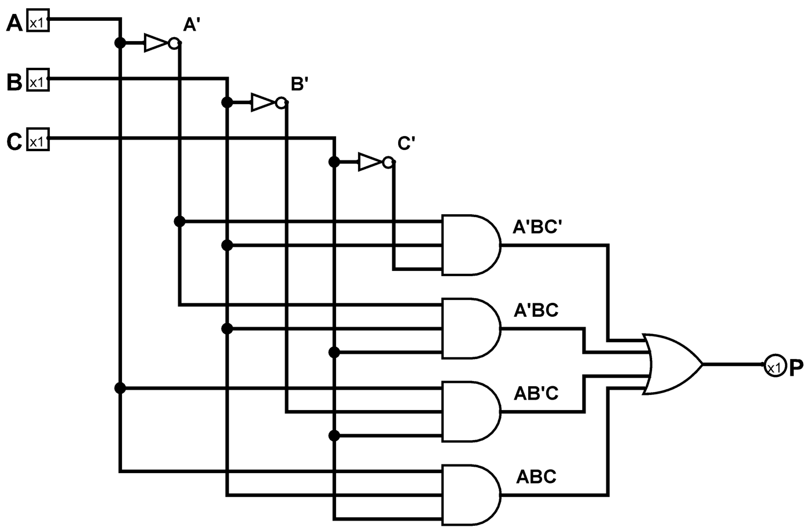

Circuito simplificado, `P = A′B + AC` (archivo [`primos_simplificada.circ`](./primos_simplificada.circ)): 1 NOT, 2 AND de dos entradas y 1 OR.

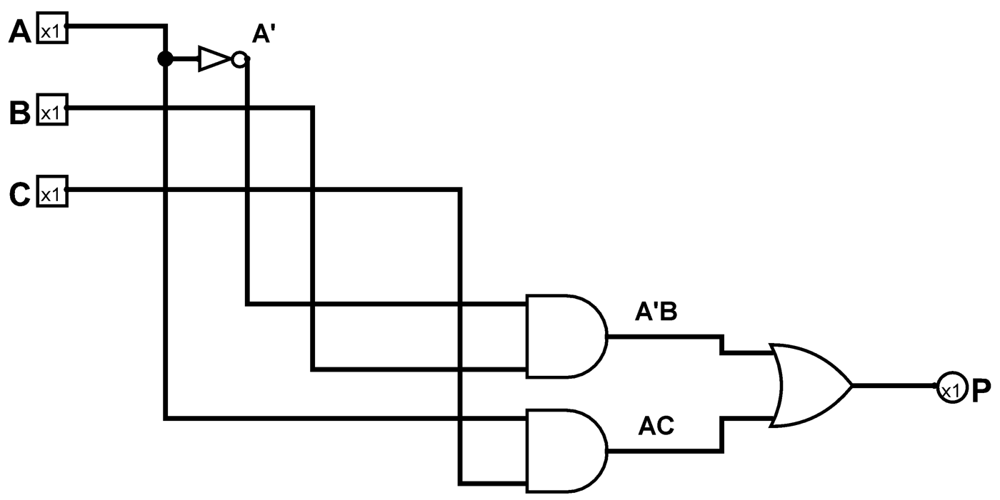

### Paso 5: simulación en Logisim-evolution

**5.1 Abrir el circuito.** Use **Archivo → Abrir…** (`Ctrl+O`) y elija [`primos_simplificada.circ`](./primos_simplificada.circ). Al abrirlo, todas las entradas valen 0:

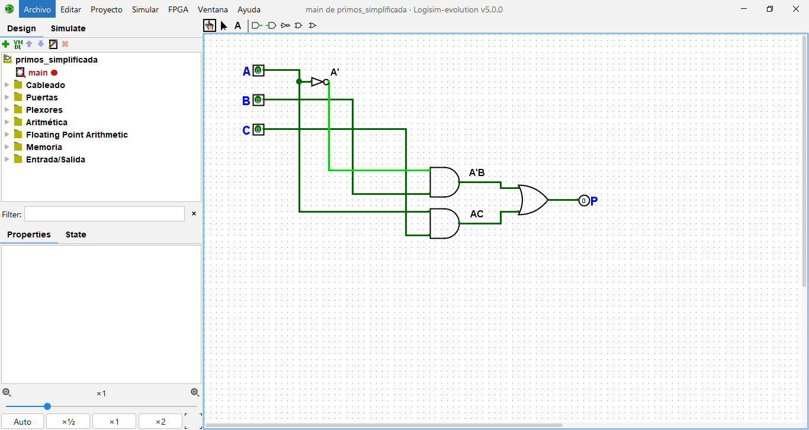

**5.2 Probar combinaciones.** Con la herramienta de la mano (el primer ícono de la barra de herramientas), haga clic sobre una entrada para cambiar su valor entre 0 y 1. Los cables verde claro llevan un 1 y los verde oscuro un 0. Logisim marca con un círculo la última entrada que se cambió.

Con `A = 1`, `B = 0`, `C = 1` (el número 5, fila 5) la compuerta AND de `AC` se activa y `P = 1`:

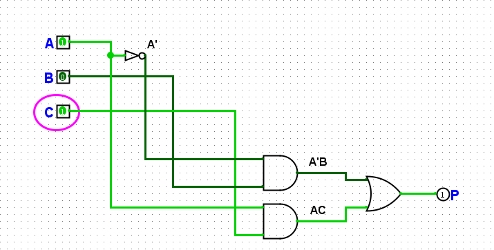

Con `A = 1`, `B = 0`, `C = 0` (el número 4, fila 4) ninguna AND se activa y `P = 0`:

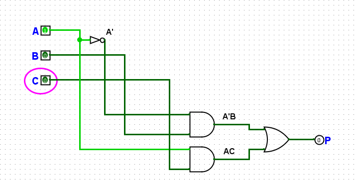

Recorra así las ocho combinaciones y compare cada salida con la tabla del paso 2.

**5.3 Comparar con la tabla automáticamente.** En lugar de probar fila por fila, use **Proyecto → Analizar circuito**:

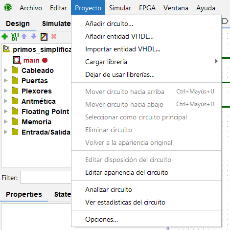

Se abre la ventana **Análisis combinacional**. La pestaña **Tabla** muestra la tabla de verdad del circuito. Debe coincidir con la del paso 2 (`P = 1` en las filas 2, 3, 5 y 7). Los botones de lupa cambian el tamaño de la tabla.

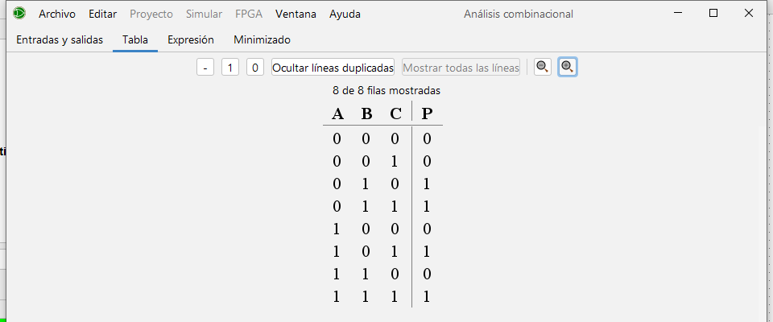

La pestaña **Expresión** muestra la expresión que implementa el circuito. Logisim escribe el complemento con una barra encima: `A̅` es lo mismo que `A′`.

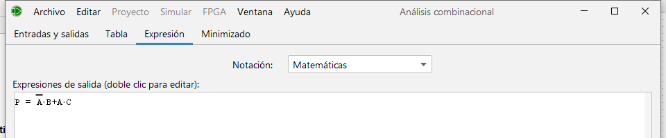

La pestaña **Minimizado** muestra el **mapa de Karnaugh** y la expresión mínima. Las columnas del mapa están en el orden `00, 01, 11, 10`, de modo que dos casillas vecinas difieren en un solo bit (como los vértices vecinos del cubo de la parte 2). Logisim propone `A̅·B + A·C`, la misma expresión obtenida a mano:

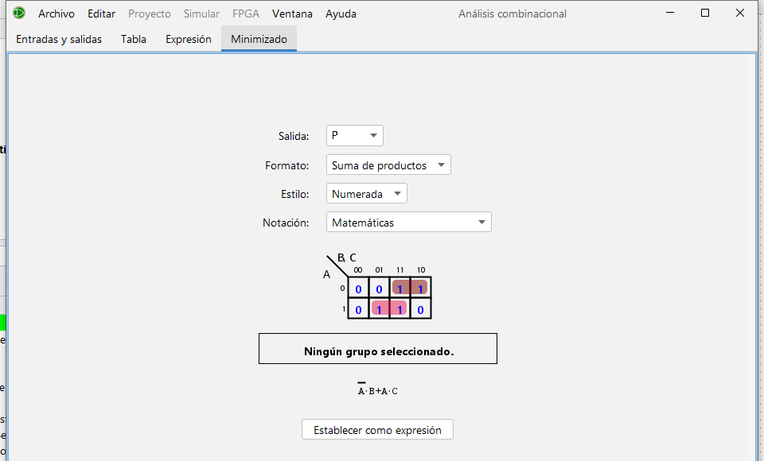

En **Formato** se puede elegir **Producto de sumas**. Logisim propone entonces `P = (A + B)·(A′ + C)`, una POS simplificada (no canónica) de la misma función:

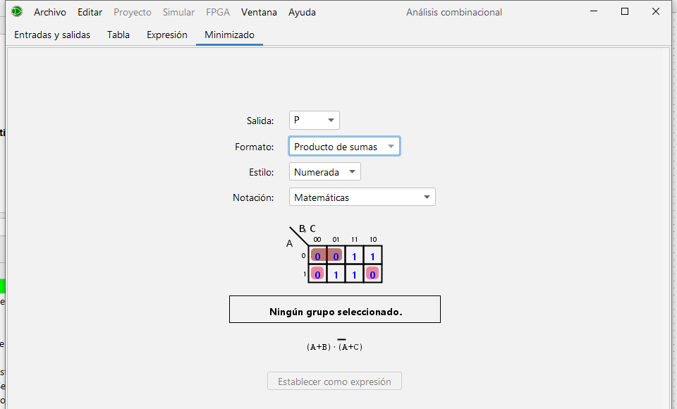

> [!TIP]
> Para comprobar que la versión canónica y la simplificada son la misma función, abra [`primos_canonica.circ`](./primos_canonica.circ) y repita **Proyecto → Analizar circuito**: la tabla debe ser idéntica. Simplificar cambia el circuito, no la función.

---

## Diseño 2: luz de advertencia del tablero de un vehículo

**Enunciado.** Se requiere diseñar un circuito lógico que controle una luz de advertencia en el tablero de un vehículo. La luz debe encenderse si ocurre alguna de estas situaciones de peligro:

- El motor está encendido y la puerta del conductor está abierta.
- El motor está encendido, es de noche y las luces están apagadas.

### Paso 1: análisis

| Variable | Significado de 1 | Significado de 0 |
|:-:|---|---|
| `M` (motor) | El motor está encendido | El motor está apagado |
| `P` (puerta) | La puerta del conductor está abierta | La puerta está cerrada |
| `N` (noche) | Es de noche | Es de día |
| `L` (luces) | Las luces están encendidas | Las luces están apagadas |
| `A` (salida) | La luz de advertencia se enciende | La luz de advertencia está apagada |

Hay 4 entradas y 1 salida.

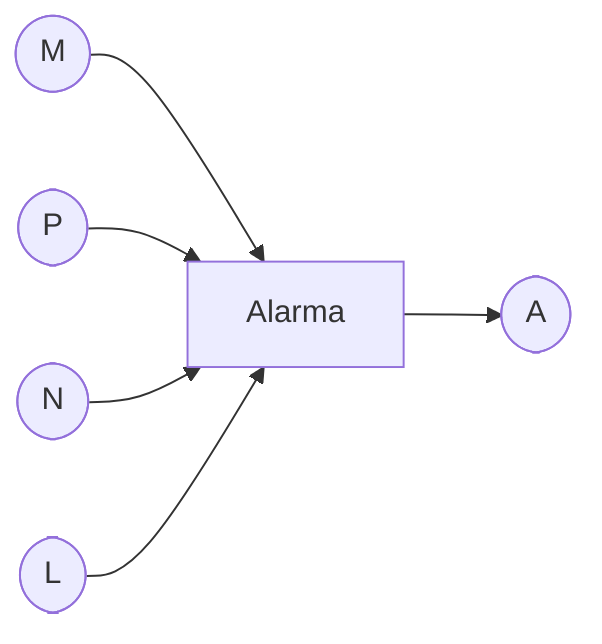

### Paso 2: expresión del enunciado y tabla de verdad

Cada situación de peligro es un producto:

- Motor encendido **y** puerta abierta: `M = 1` y `P = 1` → `MP`.
- Motor encendido **y** de noche **y** luces apagadas: `M = 1`, `N = 1` y `L = 0` → `MNL′`.

La luz se enciende si ocurre una situación **o** la otra:

`A = MP + MNL′`

Número de filas: `n = 4 → 2⁴ = 16`. La tabla incluye las columnas intermedias:

| `i` | `M` | `P` | `N` | `L` | `L′` | `MP` | `MNL′` | `A` |
|:-:|:-:|:-:|:-:|:-:|:-:|:-:|:-:|:-:|
| 0 | 0 | 0 | 0 | 0 | 1 | 0 | 0 | 0 |
| 1 | 0 | 0 | 0 | 1 | 0 | 0 | 0 | 0 |
| 2 | 0 | 0 | 1 | 0 | 1 | 0 | 0 | 0 |
| 3 | 0 | 0 | 1 | 1 | 0 | 0 | 0 | 0 |
| 4 | 0 | 1 | 0 | 0 | 1 | 0 | 0 | 0 |
| 5 | 0 | 1 | 0 | 1 | 0 | 0 | 0 | 0 |
| 6 | 0 | 1 | 1 | 0 | 1 | 0 | 0 | 0 |
| 7 | 0 | 1 | 1 | 1 | 0 | 0 | 0 | 0 |
| 8 | 1 | 0 | 0 | 0 | 1 | 0 | 0 | 0 |
| 9 | 1 | 0 | 0 | 1 | 0 | 0 | 0 | 0 |
| 10 | 1 | 0 | 1 | 0 | 1 | 0 | 1 | **1** |
| 11 | 1 | 0 | 1 | 1 | 0 | 0 | 0 | 0 |
| 12 | 1 | 1 | 0 | 0 | 1 | 1 | 0 | **1** |
| 13 | 1 | 1 | 0 | 1 | 0 | 1 | 0 | **1** |
| 14 | 1 | 1 | 1 | 0 | 1 | 1 | 1 | **1** |
| 15 | 1 | 1 | 1 | 1 | 0 | 1 | 0 | **1** |

`A = 1` en las filas 10, 12, 13, 14 y 15. Por ejemplo, la fila 10 (`MPNL = 1010`) es: motor encendido, puerta cerrada, de noche y luces apagadas.

### Paso 3: función booleana y simplificación

Forma canónica SOP (filas donde `A = 1`):

`A = m₁₀ + m₁₂ + m₁₃ + m₁₄ + m₁₅ = MP′NL′ + MPN′L′ + MPN′L + MPNL′ + MPNL = ∑m(10, 12, 13, 14, 15)`

Forma canónica POS (las otras once filas, donde `A = 0`):

`A = ∏M(0, 1, 2, 3, 4, 5, 6, 7, 8, 9, 11)`

Las dos listas juntas cubren las 16 filas, de 0 a 15.

**Simplificación a partir de la expresión del enunciado.** Es corta, porque `M` es un factor común:

| # | Afirmación | Razón |
|:-:|---|---|
| 1 | `A = MP + MNL′` | Expresión obtenida del enunciado |
| 2 | `= M(P + NL′)` | Distributiva para el producto (·) en 1 (factor común) |

**Simplificación a partir de la SOP canónica.** Es más larga, pero llega al mismo resultado:

| # | Afirmación | Razón |
|:-:|---|---|
| 1 | `A = MP′NL′ + MPN′L′ + MPN′L + MPNL′ + MPNL` | Expresión original (SOP canónica) |
| 2 | `= MP′NL′ + M(PN′L′ + PN′L + PNL′ + PNL)` | Distributiva para el producto (·) en 1 (factor común) |
| 3 | `= MP′NL′ + M(P(N′L′ + N′L + NL′ + NL))` | Distributiva para el producto (·) en 2 (factor común) |
| 4 | `= MP′NL′ + M(P(N′(L′ + L) + N(L′ + L)))` | Distributiva para el producto (·) en 3 (factor común) |
| 5 | `= MP′NL′ + M(P(N′(L + L′) + N(L + L′)))` | Conmutativa para la suma (+) en 4 |
| 6 | `= MP′NL′ + M(P(N′·1 + N·1))` | Complemento para la suma (+) en 5 |
| 7 | `= MP′NL′ + M(P(N′ + N))` | Identidad para el producto (·) en 6 |
| 8 | `= MP′NL′ + M(P(N + N′))` | Conmutativa para la suma (+) en 7 |
| 9 | `= MP′NL′ + M(P·1)` | Complemento para la suma (+) en 8 |
| 10 | `= MP′NL′ + MP` | Identidad para el producto (·) en 9 |
| 11 | `= M(P′NL′) + MP` | Asociativa para el producto (·) en 10 |
| 12 | `= M(P′NL′ + P)` | Distributiva para el producto (·) en 11 (factor común) |
| 13 | `= M(P + P′NL′)` | Conmutativa para la suma (+) en 12 |
| 14 | `= M(P + NL′)` | Teorema x + x′y = x + y (ejemplo 7 de la parte 2) en 13 |

En el paso 14 se cita el teorema `x + x′y = x + y`, demostrado en el ejemplo 7 de la parte 2, con `x = P` e `y = NL′`.

**Resultado:** `A = M(P + NL′)`. Se lee: la luz se enciende si el motor está encendido **y** (la puerta está abierta **o** es de noche con las luces apagadas).

### Paso 4: circuito

Circuito de la expresión del enunciado, `A = MP + MNL′` ([`vehiculo_enunciado.circ`](./vehiculo_enunciado.circ)): 1 NOT, 2 AND y 1 OR.

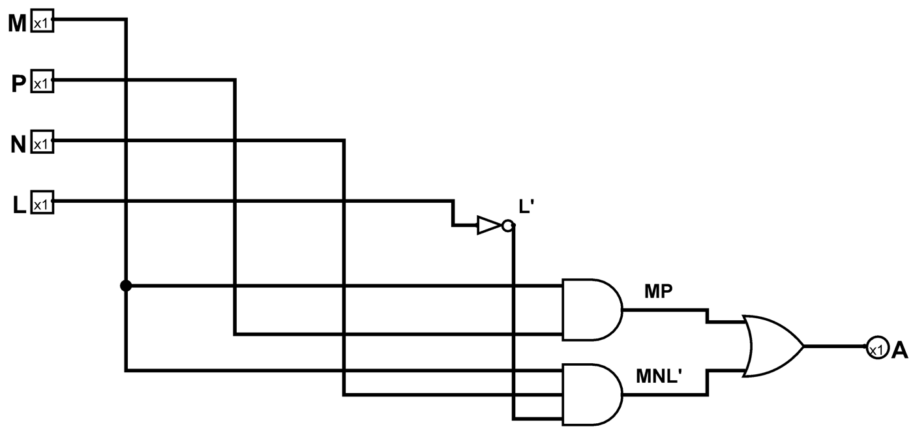

Circuito de la SOP canónica ([`vehiculo_canonica.circ`](./vehiculo_canonica.circ)): 3 NOT, 5 AND de cuatro entradas y 1 OR de cinco entradas.

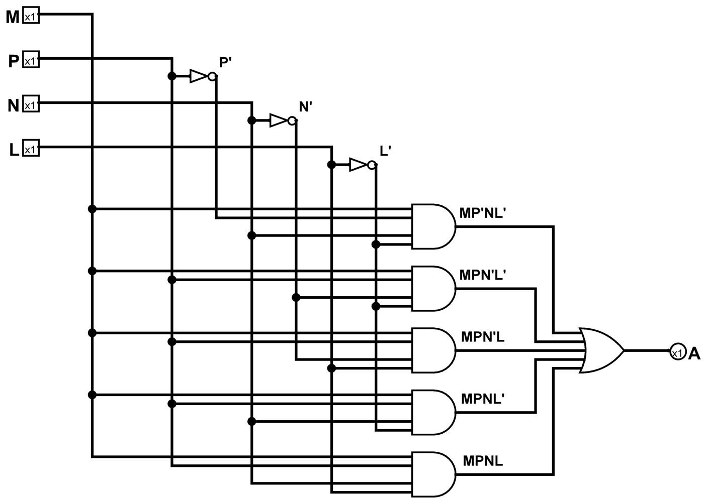

Circuito simplificado, `A = M(P + NL′)` ([`vehiculo_simplificada.circ`](./vehiculo_simplificada.circ)): 1 NOT, 2 AND de dos entradas y 1 OR de dos entradas.

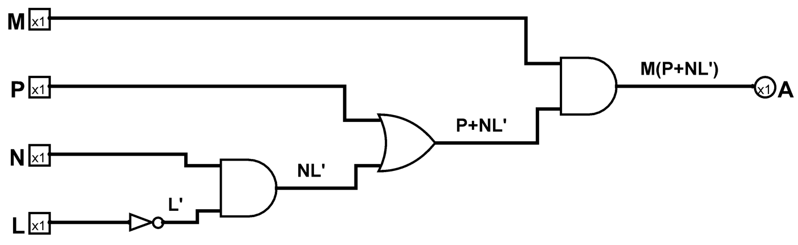

### Paso 5: simulación en Logisim-evolution

Abra [`vehiculo_simplificada.circ`](./vehiculo_simplificada.circ) y, con la herramienta de la mano, ponga `M = 1` y `N = 1`, dejando `P = 0` y `L = 0` (fila 10). La luz se enciende (`A = 1`) por la segunda situación de peligro: la señal pasa por `L′`, `NL′` y `P + NL′`.

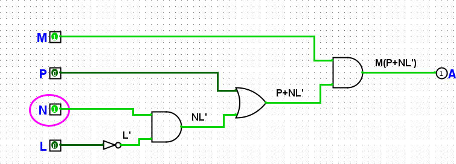

Luego use **Proyecto → Analizar circuito**. La pestaña **Tabla** muestra las 16 filas; `A = 1` solo en las filas 10, 12, 13, 14 y 15:

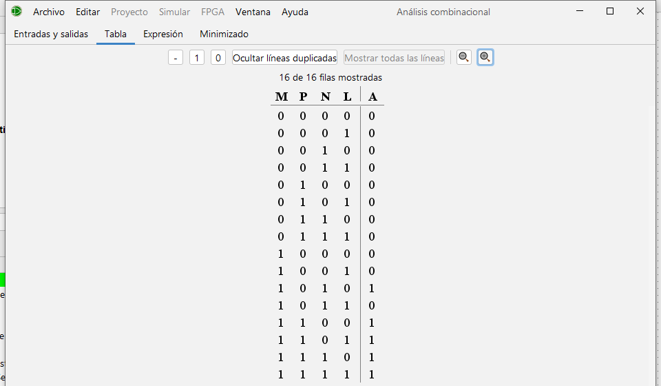

La pestaña **Expresión** muestra `A = M·(P + N·L̅)`, la expresión que se construyó:

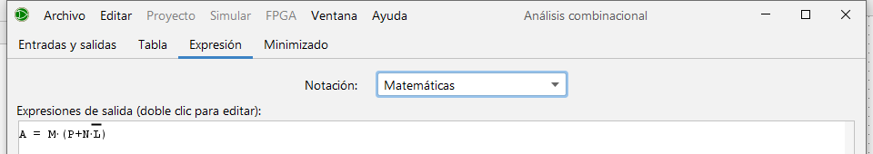

La pestaña **Minimizado** propone `M·N·L̅ + M·P`:

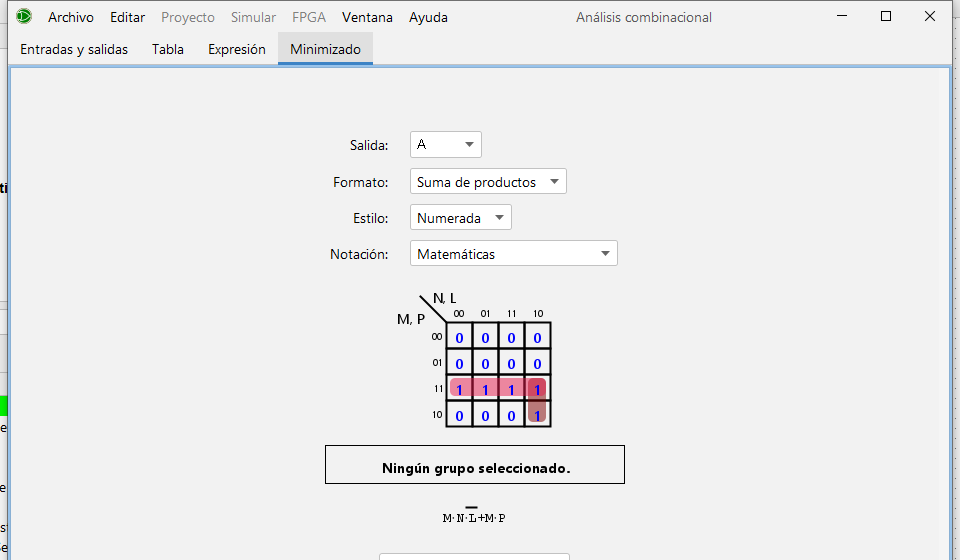

> [!NOTE]
> `MNL′ + MP` y `M(P + NL′)` son expresiones equivalentes: una se obtiene de la otra con la distributiva y la conmutativa. Logisim entrega la **suma de productos mínima**. La forma factorizada `M(P + NL′)` no es una suma de productos. Los dos circuitos usan 1 NOT, 2 AND y 1 OR, pero en la forma factorizada las dos AND son de dos entradas, mientras que en `MNL′ + MP` una de ellas es de tres.

La presentación original incluye además un montaje del mismo circuito con componentes físicos (protoboard, compuertas y LED) en Tinkercad: [Alarma](https://www.tinkercad.com/things/03V7LC4vWsa-alarma).

---

## Construir un circuito a partir de su tabla

Logisim también puede hacer el camino inverso: a partir de una tabla de verdad, construye el circuito. Este recorrido usa la tabla del detector de primos y empieza con un proyecto vacío (**Archivo → Nuevo**).

**1. Abrir el análisis combinacional.** Use **Ventana → Análisis combinacional**:

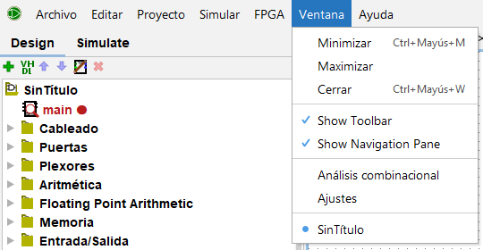

**2. Definir las entradas y las salidas.** En la pestaña **Entradas y salidas**, haga clic en «Haga clic para añadir una nueva variable», escriba el nombre y pulse `Enter`. Agregue `A`, `B` y `C` como entradas y `P` como salida:

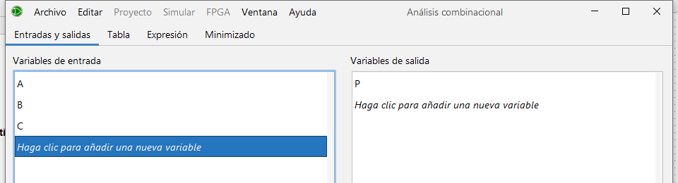

**3. Llenar la tabla.** En la pestaña **Tabla**, la columna de la salida empieza con guiones (`-`, valor no definido). Haga clic en cada casilla de `P` y escriba `0` o `1`:

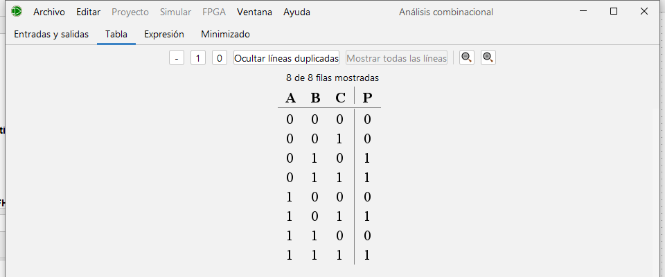

**4. Revisar la expresión.** Las pestañas **Expresión** y **Minimizado** muestran `P = A̅·B + A·C`, como en el diseño 1.

**5. Crear el circuito.** Pulse **Crear circuito**, escriba un nombre (por ejemplo, `detector_primos`) y pulse **Aceptar**. Las casillas «Sólo puertas con dos entradas» y «Sólo puertas NAND» cambian el tipo de compuertas que se usan; déjelas sin marcar.

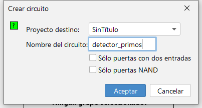

Logisim agrega al proyecto un circuito nuevo con la expresión minimizada:

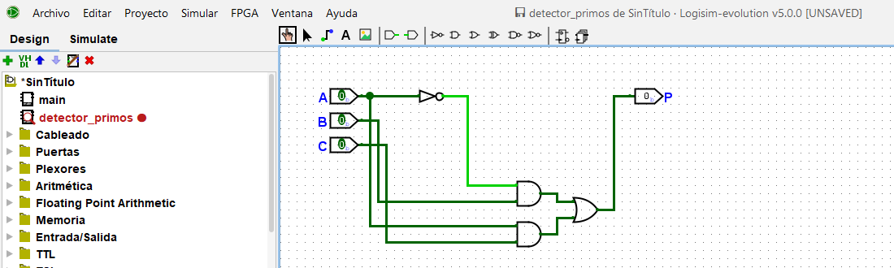

> [!IMPORTANT]
> Esta herramienta sirve para **comprobar** un diseño. En el parcial, la tabla, la forma canónica y la simplificación se hacen a mano.

---

## Ejercicios propuestos

**Ejercicio 1.** En el ejemplo 2 de la parte 2 se trabajó con `F(x, y, z) = xy + z′`.

1. Construya su tabla de verdad con el índice de cada fila.
2. Obtenga sus formas canónicas `∑m` y `∏M`.
3. Compruebe que las dos listas juntas cubren las filas de 0 a 7.

Respuesta

Número de filas: `n = 3 → 2³ = 8`.

| `i` | `x` | `y` | `z` | `z′` | `xy` | `F` |
|:-:|:-:|:-:|:-:|:-:|:-:|:-:|
| 0 | 0 | 0 | 0 | 1 | 0 | **1** |
| 1 | 0 | 0 | 1 | 0 | 0 | 0 |
| 2 | 0 | 1 | 0 | 1 | 0 | **1** |
| 3 | 0 | 1 | 1 | 0 | 0 | 0 |
| 4 | 1 | 0 | 0 | 1 | 0 | **1** |
| 5 | 1 | 0 | 1 | 0 | 0 | 0 |
| 6 | 1 | 1 | 0 | 1 | 1 | **1** |
| 7 | 1 | 1 | 1 | 0 | 1 | **1** |

- `F = ∑m(0, 2, 4, 6, 7) = x′y′z′ + x′yz′ + xy′z′ + xyz′ + xyz`
- `F = ∏M(1, 3, 5) = (x + y + z′)(x + y′ + z′)(x′ + y + z′)`
- `{0, 2, 4, 6, 7} ∪ {1, 3, 5} = {0, 1, …, 7}`, sin repetir ningún índice.

**Ejercicio 2.** Obtenga la SOP canónica de `F(x, y, z) = x + yz` usando solo identidades del álgebra booleana. Compare su resultado con el de la tabla de verdad (ejemplo 3 de la presentación).

Respuesta

La idea es multiplicar cada término por `1` escrito como `(v + v′)` para cada variable que le falta, y después distribuir.

| # | Afirmación | Razón |
|:-:|---|---|
| 1 | `F = x + yz` | Expresión original |
| 2 | `= x·1·1 + 1·yz` | Identidad para el producto (·) en 1 |
| 3 | `= x(y + y′)(z + z′) + (x + x′)yz` | Complemento para la suma (+) en 2 |
| 4 | `= x((y + y′)z + (y + y′)z′) + (x + x′)yz` | Distributiva para el producto (·) en 3 |
| 5 | `= x(yz + y′z + yz′ + y′z′) + (x + x′)yz` | Distributiva para el producto (·) en 4 |
| 6 | `= xyz + xy′z + xyz′ + xy′z′ + xyz + x′yz` | Distributiva para el producto (·) en 5 |
| 7 | `= xyz + xyz + xy′z + xyz′ + xy′z′ + x′yz` | Conmutativa para la suma (+) en 6 |
| 8 | `= xyz + xy′z + xyz′ + xy′z′ + x′yz` | Idempotencia para la suma (+) en 7 |
| 9 | `= x′yz + xy′z′ + xy′z + xyz′ + xyz` | Conmutativa para la suma (+) en 8 |
| 10 | `= ∑m(3, 4, 5, 6, 7)` | Definición de mintérmino en 9 |

Coincide con la tabla de verdad: `F = 1` en las filas 3, 4, 5, 6 y 7. Es la misma función `G` del ejemplo 8 de la parte 2.

**Ejercicio 3.** Repita el diseño del detector de primos para que la salida `P` valga 1 cuando el número de 3 bits **no** es primo. ¿Qué relación tiene la nueva función con la original?

Respuesta

La nueva función es el complemento `P′`. Vale 1 en las filas donde `P = 0`:

- `P′ = ∑m(0, 1, 4, 6)` y `P′ = ∏M(2, 3, 5, 7)`: se intercambian las listas de `P`.
- Su circuito puede ser el del diseño 1 con una compuerta NOT a la salida, o el de una SOP propia: `P′ = A′B′ + AC′` (verifíquelo con su tabla o con Logisim).

**Ejercicio 4 (de un parcial anterior).** El punto 2 del parcial 4 de 2025-2 es un diseño con dos sensores y una alarma activa en BAJO. Su enunciado, la solución y las simulaciones están en [simulaciones del parcial 4 de 2025-2](../../clase-19/simulaciones_parcial4_2025-2/README.md#punto-2--alarma-activa-en-bajo).

---

## Archivos de esta carpeta

| Archivo | Entradas → salida | Expresión |
|---|---|---|
| [`primos_canonica.circ`](./primos_canonica.circ) | `A, B, C → P` | `P = A′BC′ + A′BC + AB′C + ABC` |
| [`primos_simplificada.circ`](./primos_simplificada.circ) | `A, B, C → P` | `P = A′B + AC` |
| [`vehiculo_enunciado.circ`](./vehiculo_enunciado.circ) | `M, P, N, L → A` | `A = MP + MNL′` |
| [`vehiculo_canonica.circ`](./vehiculo_canonica.circ) | `M, P, N, L → A` | `A = MP′NL′ + MPN′L′ + MPN′L + MPNL′ + MPNL` |
| [`vehiculo_simplificada.circ`](./vehiculo_simplificada.circ) | `M, P, N, L → A` | `A = M(P + NL′)` |

Todos los archivos están en el formato de Logisim-evolution, sin sondas y con las entradas y salidas nombradas, así que **Proyecto → Analizar circuito** muestra las letras del enunciado. Las tablas de verdad de los cinco circuitos se verificaron con Logisim-evolution 5.0 contra las de esta guía.

Para descargar un archivo, ábralo en GitHub y use el botón de descarga (*Download raw file*). Un `.circ` abierto en el navegador solo muestra texto (XML).
